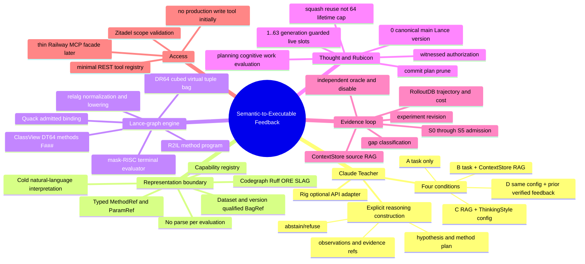

# LG-COG-001 — Scratchpad / mindmap: Claude Teacher ↔ Lance-graph executable cognitive substrate

**Status:** PROPOSED · DOCS ONLY · 2026-11-14. **Owner:** unassigned. **No new runtime, MCP server, IR opcode, production integration or benchmark is claimed.**

**Core epiphany:** Claude API calls are *teacher probes*, not the runtime. They articulate externally visible, explicitly constructed operations over a context. The goal is to see which operations can be represented, bound and independently verified as `MethodRef × ParamRef × version-qualified virtual DR bag` using existing Lance-graph algebra, without repeated string/AST/JSON parsing on the execution path. $200/month is an experimental ceiling **if credits actually exist and apply to the target Anthropic organization**; verify balance, expiry, API terms and rates, never presume subscription credits are API balance.

## Mindmap



## North star in one sentence

**Claude says WHAT and WHY as a candidate; Codegraph tells WHERE; method binding tells WHICH EXACT typed operation and operands; relalg/Quack/R2IL/mask-RISC execute IF ADMITTED; ThoughtGit explores counterfactual branches; Rubicon controls admissible transitions; independent oracles judge; RolloutDB remembers; ContextStore makes the resulting evidence discoverable again.**

## The essential conceptual correction

We are NOT building SQL↔SQL parity as the main objective, and NOT creating a LangGraph interpreter or agent-JSON graph at runtime. SQL/DataFusion is an optional cold analytical lens. The experiment studies whether natural-language cognitive work can become an executable, independently verified **method over a virtual DR bag**. Strings/JSON remain allowed at network / model / documentation boundaries; they must not be the hot-path dispatch ABI.

Proposed human-facing notation (NOT a shipped Rust grammar):

```text
crate::{op}::{param}::{DR<bag_ref>}
    |
    V1 resolved invocation = MethodRef + ParamRef + BagRef
    BagRef = (dataset_id, world_version, basis_digest, owner_or_lease_generation,
              class_or_lens_id, selection/mask_witness)
    |
    method signature checks, authorization, replay witness
    |
    relalg / Quack / R2IL → admitted mask-RISC terminal program
    |
    typed OutcomeRef / RefusalRef + causal evidence
```

`DR64³` is the intended virtual/dynamic spatial and tuple-bag representation family, **not a claim** that every dynamic³/DR64³ bag can already bind to every relalg or Quack route. Bag is a borrowed, owner-pinned virtual view with shape, version and population witnesses; it is not a materialized per-row Rust object. No physical pointers persist across runs. `crate::{op}::{param}` is conceptual notation, not a reason to create a Rust module for every generated operation. The canonical representation should be compact positional IDs / typed enums / versioned method registry and a codebook, with labels as cold aliases only.

## Crate seams, status, responsibilities

| Seam | Current source / evidence | Proposed responsibility | NOT allowed |
| --- | --- | --- | --- |
| `lance-graph-flow` | D-LFA plan; crate **absent** from crates/ listing 2026-11-14 | thin graph / pause / branch / method-dispatch facade over `OrchestrationBridge`; adopt bounded `rs-graph-llm` semantics | competing executor, second transaction owner, materialized session store |
| `lance-context` / `ContextStore` | upstream independent store; existing Claude Code MCP example | RAG over source, plans, capability descriptions and prior evidence with source version | truth authority over production methods or direct storage of live rows |
| `lance-context` / `RolloutDB` | upstream `RolloutStore` uses `RolloutRecord` → Arrow batch → sharded MemWAL; `add` durability precedes visibility | persistent experiment trajectories, feedback, token budgets and oracle results | Rubicon decision authority, assuming append returns a new dataset version |
| `thought-git-probe` | slots.rs, oracle.rs, receipt.rs, squash.rs; production land/rebase/persistence not claimed | in-memory speculation and counterfactual alternatives; slot 0 givens / 1..63 live recycled | treating recyclable slot index as global durable thought identity |
| `lance-graph-relalg` | `src/{ir,normalize,lower,join_body,program}.rs` | formal relational expression and admitted lowering for method-body fragments | alternate executor or unsupported join/gather assumptions |
| `lance-graph-quack` | `src/{lib,bind,set}.rs` | typed plan/bag/mask binding and existing evaluator route | automatic reuse of computed foreign masks without an admitted witness |
| `lance-graph-r2il` | `src/{lib,polyfill,binding,binding_native,procs}.rs`; positional polyfill words | typed method mapping and frozen semantics witness | string routing or regenerated method ordinal without proof |
| `lance-graph-mask-risc` | `src/{ir,exec,sel,value,reference,fuse}.rs` | single terminal mask/selection kernel where expressible | unsupported Gather, across-lane indexing, second row interpreter |
| `lance-graph-dt64` / DR views | `src/{dr,lane,lib}.rs`; other dynamic bag research plans | tuple bag / resident selection / version and basis binding | pretending all DR64³/DR256/dynamic³ combinations are admitted |
| `lance-graph-contract` | `kanban.rs`, `thinking.rs`, `style_family.rs`, `orchestration.rs` | authoritative style enums, Rubicon DAG, transition microcopy, routing contract | inferred method authority from LLM reward or text |

See existing plans: `d-lfa-lance-graph-flow-rubicon-assimilation-v1.md`, `d-rft-relalg-thought-git-frontier-v1.md`, `thought-git-basics-v1.md`, `thought-git-api-v1.md`, `d-dynbag-holographic-bags-v1.md`, `d-dynbag-4-dr-versioned-mapping-v1.md`, `r2il-machine-semantic-contract-v1.md`, `virtual-address-superpowers-roadmap-v1.md`. Respect their existing ownership and stop rules. D-LFA already insists no second engine, guarded GKAT tests for structured flows, and `RequestCommit` as intent, NOT direct Lance write.

## Control vs representation vs execution: three distinct objects

1. **TeacherCandidate** (cold/protocol side): structured explicit observations, source evidence IDs, hypotheses, proposed semantic operation names and declared uncertainty. Never trust emitted `MethodRef` without verification.
2. **BoundMethodInvocation** (native side, proposed): compact `MethodRef`, semantically witnessed positional opcode / lens, `ParamRef` and version-qualified `BagRef`, explicit read/write effect class, required laws, flow owner and generation; NO payload JSON. Admission happens before execution.
3. **ExecutionWitness** (cold/durable evidence side): run/fixture IDs, complete provenance, source/policy/ontology versions, accepted or refused method binding, logical ordered predecessors, oracle digest, outcome, resource/cost data, phase verdict, only a durable ID of the thought (slot/generation is transient).

Do not make IR a text parser. The single cold step compiles/resolves external tool arguments into typed, versioned references; subsequent calls use them until invalidation. If invalidated, rebind/refuse, not silent retarget.

## DR64³ / virtual tuple bag semantics that must be proved

- **Ownership / lifetime:** a view borrows from an actual Lance-backed owner; all mask/lane leases are generation checked; a prior pointer may never become a valid new-owner address.
- **Identity:** dataset ID + logical class/method ID + version + row ordering/population and basis witness; `NodeGuid` or positional key resolution must be qualified rather than equated with a physical offset.
- **Bag shape:** declare lane widths, cardinality/selection, null/unknown policy, ordering, relations and witnesses; no hidden AST/JSON materialization.
- **Mask RISC admission:** only legal opcodes; retain deny path for Gather, unadmitted cross-table reads or derived-mask reuse. Reusing a computed mask is NOT automatically an admitted join population.
- **3D vs relational:** DR64³ may be used to address spatial/virtual lanes, but ordinary relalg projection/fold does not magically inherit spatial conservation, CFD claims, O(3) invariance or XLOG compositional joins. Distinguish these laws.
- **Replay:** exactly pinned world, policy, method and evidence identity with total/causal step ordering and external-effect digests, rather than merely `sequence_order`.

## Rubicon / styles / ThoughtGit invariants

- `StyleFamily`: 12 stable orchestration families; `ThinkingStyle`: 36 runbook variants; mapping from `style_family.rs` is canonical, no free 12×36 product.
- `FieldModulation`: seven parameters, cold versioned configuration and reproducible fingerprint; a `ThinkingStyle` is NOT evidence nor permission.
- Rubicon phases: Planning → CognitiveWork → Evaluation → Commit/Plan/Prune; Plan → Planning; pre-action veto can Prune. A verdict that merely increases eligibility without a successful counterfactual returns Plan, not Commit; Hold may stay put.
- Thought 0 is givens/main (Lance version). Live slots 1..63 are **capacity**, not lifetime. FIFO/LeastUsed pressure, dependency-preserving squash and generation-stale refusal. Squash != land; reward != authorization.
- No workflow or LLM path issues a real commit; only existing supervisor/sealed-cycle/BatchWriter ownership may publish after explicit independent admission. Some historical comments explicitly mark final calcification action as unwired; verify fresh before implementing.

## Minimal end-to-end demonstrator

A source-backed question such as "What happens on `Evaluation + IncreaseEligible + Counterfactual::NotRun`?" is given to Claude in four arms. Model emits typed external operation suggestion; registry resolves canonical `KanbanColumn::advance_on_revision`; deterministic oracle returns Plan, independent negative test rejects Commit; the lab recorder writes one `RolloutRecord` and retrieves after flush; ThoughtGit can represent a counterfactual branch with generation-stale guard. **This first demonstration MUST NOT claim full R2IL/DR64³ execution.** Separately qualify a genuine F### × bag executable slice through S0–S5 before claiming native substrate integration.

## Phased work / no implicit promotion

- **P0** docs + mindmap + source inventory + witness schema draft (this PR only).
- **P1** exact crate/API census with links and compiler-proven IR binding: classify `SHIPPED / LAB / PROPOSED / ABSENT / BLOCKED / UNKNOWN`. Check whether Rubicon DAG and F### bind into a real resident bag under current pins; no guessing.
- **P2** cold Claude/Rig → structured candidate → RAG/Codegraph → typed method registry/refusal. One verified lab case.
- **P3** ThoughtGit branch/merge counterfactual + independent oracle; no canonical land.
- **P4** RolloutDB provenance, flush/read-back, no leakage, multi-run policy feedback; measure API cost.
- **P5** actual relalg/Quack/R2IL/mask-RISC route on a pinned real/fixture population, with independent differential and negative tests.
- **P6** optional REST+Railway MCP thin facade with Zitadel scopes and deny-by-default; production effects disabled.
- **P7** run preregistered A/B/C/D study, report stage-specific accuracy, cost and architectural gap yield.

## Hard stopping falsifiers

1. Claude output or untrusted `MethodRef` bypasses registry/authorization.
2. Parsing, model calls or JSON/serde occur in the hot path after binding.
3. A flow introduces its own evaluator, scheduler, truth store or canonical write owner.
4. A recycled slot or stale lease is accepted.
5. Rubicon advances to Commit from a non-acceptable verdict or under wrong guard projection.
6. Replay reproduces a result with wrong basis, method or ordering witness.
7. Oracle and candidate share the same execution kernel or results are labeled verified without negative tests.
8. MemWAL durable `add` is called a new visible canonical Lance version.
9. Lab fixture findings are promoted to production capability.
10. An externally visible source claim lacks commit/source provenance or uses inaccessible private data in model prompts.

## Decision asks, intentionally open

- Should the native binding layer live adjacent to R2IL binding, or in a new tiny `lance-graph-flow` consumer? Favor reuse of the existing binding registry, no parallel ABI.
- How to represent logical `BagRef`/basis and `ParamRef` exactly? Inventory existing ClassView/DT64/MailboxSoA contracts before minting bits/structs.
- Which real F### × bag operation has an independent oracle and can run without Gather/derived masks?
- Upstream RolloutDB adapter versus separate typed witness dataset over its generic `StorageBase` (private implementation)? Try unmodified `RolloutRecord` first; propose upstream API only after measured overhead.
- How to encode evidence roots, policy digests, source confidence, refusal and cost in durable columnar provenance without conflating epistemic authority with score?

**No implementation/test/benchmark/Claude API usage is claimed in this docs-only capture.**
