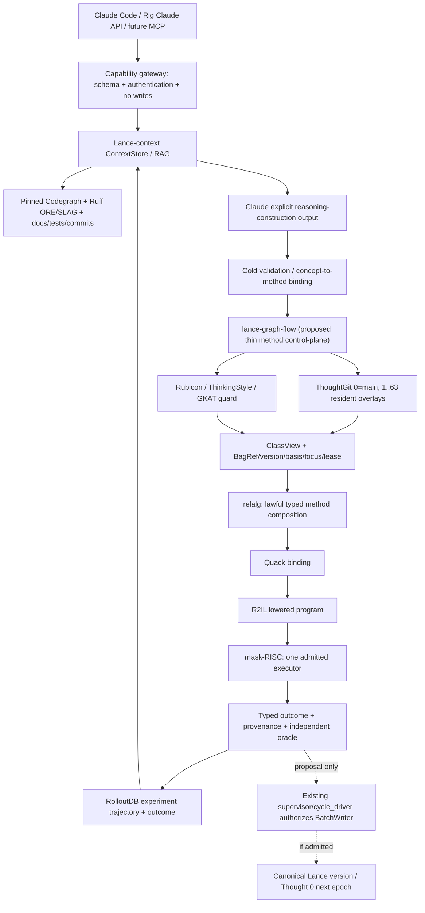

# Cognitive Teacher → Executable Method Feedback, v1

**Status:** PROPOSED / DOCS ONLY. **Date:** 2026-11-14. **Owner:** TBD. **No runtime changes, no API calls, no measured performance, no new admitted contracts.**
**Entry mindmap:** [cognitive-teacher-mindmap-scratchpad.md](cognitive-teacher-mindmap-scratchpad.md)
**Aim:** Turn otherwise unused Claude API experiment budget into an evidence-driven, reproducible teacher loop that exposes Lance-graph capability as typed methods, detects binding and semantic gaps, and makes it discoverable to Claude Code via an eventual authorized REST/MCP read-only membrane.

## 0. Capture the actual request, not the SQL detour

The problem is **NOT** "get Quack SQL to equal DataFusion SQL" and not "make RolloutDB an LLM planner." Claude Code has no pre-integrated, durable, source-version-qualified semantic RAG for the extraordinary Lance-graph substrate. Claude must repeatedly rediscover an "alien reactor" by reading code. The proposal is to feed Claude API a controlled context and ask WHAT it believes, WHICH explicit steps / hypotheses it would construct, HOW these map to admitted method laws, and WHAT source, execution and independent-oracle evidence agree or disagree. Feedback becomes more useful than a prose memory.

RolloutDB is experiment memory/evidence history, not epistemic authority and not the execution core. Lance-context ContextStore supplies retrieval. Rig is an optional Claude transport adapter; rs-graph-llm gives orchestration ergonomics for assimilation. All canonical execution remains under existing Lance-graph owner and contracts.

## 1. Architecture: one engine, multiple surfaces



**Do not conflate** graph-flow interrupt/resume, speculative thought squash, Rubicon `Commit` state, MemWAL durable append, and Lance canonical-version publication. Distinct gates and receipts.

## 2. Method ABI: syntax at cold boundary, NOT parsing in operation hot path

User's mnemonic: `crate::{op}::{param}::{DR{bag reference} + virtual tuple bag over DR64³}`.

Interpret as `crate::{op}::{param}::{BoundVirtualBagRef}`, a conceptual dispatch address, not existing Rust syntax, codegen claim, or a new hierarchy of crates. Existing `lance-graph-r2il/src/polyfill.rs` is positional: `POLYFILL_LENS=0xFFFF_F000`; names such as SQL/R2IL/Quack are aliases to law-bearing ordinals, not per-row symbols.

**Proposed COLD compiler protocol**:
1. Claude emits validated `Observation[] / Hypothesis[] / MethodPlan[] / Abstain`, not inaccessible hidden chain of thought.
2. Schema/policy validate IDs, permitted operation vocabulary, token and byte budgets, source evidence refs, acyclic declared dependencies, desired effects.
3. `Codegraph` maps source symbols to ClassId / MethodOrdinal and proven signature where available. If missing, return `UNKNOWN` or `DISCOVERY_GAP`; do not mint authoritative identifiers from Claude strings.
4. Registry binds a stable `MethodRef` to versioned law/implementation/codebook identity; domain semantics incl. Bag/Set, K3/null, ordering, aggregation, and mask permissions.
5. Resolve `BagRef` to owner generation, source Lance version, basis digest, class schema/shape, focus, row-order/cardinality witness, tenant and lease/epoch. No raw pointer survives hotplug or replay. A `DR64³` spatial bag is one **optional** route if shape and algebra are admitted; DR64, DR256, dynamic bags and sparse runs are distinct admitted physical routes under the same law.
6. Bind with `ClassView` (where implemented), `relalg` law composition, `Quack` and R2IL/mask-RISC lowerer. One result contract. Rebind on changed source, never deserialize a whole node graph.
7. Hot execution consumes only numeric/fixed-width handles, borrowed resident selection/planes, explicit typed operands, and compiled instructions. No JSON/serde/ORM/string dispatch inside the hot path. Any materialization is an explicit boundary.
8. Produce typed `ExecutionWitness` with methods/bags, scope, order, result, refusal, elapsed costs, oracle ref and provenance digest.

**Illustrative logical ABI, not a published layout:**

```rust
// PROPOSED only. Rust paths and fixed widths require a separate ABI RFC.
struct BoundMethodCall {
    class_id: ClassId,
    method: MethodOrdinal,
    law: LawRef,
    method_semantics: SemanticsDigest,
    args: ParamLaneRef,
    bag: VersionQualifiedBagRef,    // data owner + world + basis + focus
    thought: ThoughtRef,             // independent of reusable slot index
    effect: EffectPolicy,            // read-only until authorized
}
enum BindResult {
    Admitted(CompiledMethodRef),
    Refused(RefusalCode),
}
```

**No new interpreter or alternative SQL/graph evaluator.** `crate::{op}::{param}` describes a compiled typed dispatch vocabulary, not an allocation-heavy OO method chain at runtime. A method claiming `DR64³` must prove the bag is *logically* and *physically* suitable and its mask semantics lawful. Do not assert 1-12 cycles or zero allocations before measurements. Do not silently accept gather or computed mask reuse forbidden under current admission.

## 3. Component roles and explicit gaps

| Component | Reuse / owned contract | Gap / prohibition |
|---|---|---|
| `lance-context ContextStore` | semantic retrieval, metadata, external evidence pointers | no guaranteed source-version/tombstone integrity until verified in retrieval fixture; not method authority |
| `lance-context RolloutStore` | append-only experiment records, separate dataset, MemWAL, get_trajectory, token/reward fields | `add(&[RolloutRecord])` builds Arrow RecordBatch, no public native Witness batch API verified; WAL add != visible != canonical main |
| Rig | optional Claude transport + tools/model access | no new canonical reasoning state or scheduler |
| rs-graph-llm | Task/NextAction/Wait/GoTo ergonomics donor | no direct adoption of its sessions/JSON node-graph as truth |
| `lance-graph-flow` | D-LFA proposed thin task/method driver and pause/resume | NOT present as crate 2026-11-14; do not fabricate implementation |
| `lance-graph-contract` | 12 StyleFamilies, 36 ThinkingStyles, Rubicon/kanban phase laws, OrchestrationBridge | verify provider wiring and effects; no LLM route directly mutating main |
| `thought-git-probe` | 0 canonical givens; 1..63 slots; gen-validated reuse, parent/squash; independent oracle | production `lance-graph-thought-git` absent/unverified; no real land/rebase/persistence |
| `lance-graph-relalg` | experimental relational IR, normalization/lowering | single-table/joins/NULL/Bag/recurse fences per D-RFT, no universal algebra |
| `lance-graph-quack` | binding, lawful folds, masks | no separate SQL evaluator, no imagined semijoin mask reuse |
| `lance-graph-r2il` | method/polyfill vocabulary, target lowerer | not every Claude operation expressible or executable |
| `lance-graph-mask-risc` | terminal admitted mask evaluator | no positional foreign gather or hidden per-row text parsing |
| DR64³ dynamic virtual bags | shape/focus/physical route research | no universal production binding, no cross-table reads without witnesses |
| Codegraph / Ruff ORE / SLAG | source provenance, symbol lineage, static candidate behavior | no evidence that a source method is executable merely from graph membership |

**Cross-check:** `D-LFA` expressly forbids graph-flow from independently committing and prescribes GKAT Boolean guard projection from K3: WHERE-style {T}, CHECK-style {T,U}; commit authorization must use {T}. `D-RFT` forbids new interpreter, ORM and unauthorized action effects.

## 4. Experiment LG-COG-001 preregistration

### 4.1 Hypotheses, counter-hypotheses, measurement
- H1 B vs A: pinned RAG increases **oracle-correct explicit method maps** without increasing unsupported claims. Falsified if confidence interval/difference shows no improvement or unsupported claim rate increases.
- H2 C vs B: supplied 12-family / 36-runbook Thinking Config adds correct admitted mappings, not just longer explanation. Falsified by no S4/S5 improvement or higher costs without gain.
- H3 D vs C: *prior disjoint verified feedback* improves generalization to unseen fixtures. Falsified if no gain or leakage / overfit explains gain.
- H4 architecture: correct Claude method candidates can be bound to *existing* relalg/R2IL/mask-RISC operations more often than baseline. Falsified if most remain unbound or inferred semantics mismatch.
- H5 replay: a documented version/basis/policy/ordering witness reconstructs same result after process/slot teardown. Falsified by divergence or unsafe stale acceptance.

**Do not infer learning of model weights:** the improvement is in prompts, retrieval, policy/config and stored external feedback unless separately trained and proven.

### 4.2 Conditions
A: task + shared strict output schema only.
B: A + fixed source-version-pinned RAG excerpts, with IDs.
C: B + a predetermined `StyleFamily` and canonical `ThinkingStyle` + declared `FieldModulation`, matched per fixture.
D: C + fixed verified RolloutDB feedback from non-test source examples, *never target fixture answer*.
Same Claude model/pinned model version where possible, decoding settings, prompt contract, answer token cap; randomize execution order; independent scoring blind to condition.

### 4.3 Fixture splits and budget
- 12 pilot (excluded from final), 24 development/feedback, 72 blind test fixtures, six domains ×12: R2IL; Quack/DR; Rubicon; ThoughtGit; Codegraph; Cycle/replay. Balance positives, refused and unknown.
- Main calls 72 × 4 = 288. Assign the 36 canonical runbooks across the 72 fixtures so each is represented twice; a StyleFamily is derived from each runbook. Fixed before scoring; this offers coverage, NOT per-runbook statistical power.
- Budget upper bound USD 200 total, proposal: $30 pilot, $120 main, $30 negative/recheck, $20 reserve. Main nominal cap $120/288=$0.4167 average/call. Preflight pricing and credit entitlement; record actual token input/output, provider pricing, prompt caching/batches, retries. Hard abort on projected exhausted budget; max one schema retry per task, no unbounded loops.
- Scoped sensitive/tenant/secret data filtered; repository excerpts only from pinned public/authorized sources; do not upload customer records without explicit authorization.

### 4.4 Inputs and output protocol
Input `{fixture_id, task, allowed_effects, pinned_repository_commit, witness_source, world_version, evidence_scope}`.
Output `{observations:[{claim,evidence_refs}], hypotheses:[{claim,status}], thinking:{family_u8,runbook_u8,config_digest}, method_plan:[{operation_alias,method_ref?,input_refs,expected_effect,expected_result}], abstain, uncertainties, proposed_probe}`.
`method_ref` may be null. Validate every reference and numeric range; names cold-lookup only. Failure to validate is a measured outcome, not retry until success. Protect against tool-output prompt injection.

### 4.5 Mapping ladder
- S0 syntax/trace: structured valid, testable operations.
- S1 source: Codegraph symbol/source and provenance anchored.
- S2 expressibility: exact law or admitted composition with distinct Bag vs Set / K3 / ordering.
- S3 ABI binding: version+generation+focus+mask+ClassView method+owner admitted.
- S4 native execution: actual executor invoked; `UNKNOWN` not a pass.
- S5 oracle + negative + replay conformance: independent result match, no effect outside policy.

Do not promote `S2` to `S4` on fixtures, or conflate proposed `F###` word with native ABI. Denominator counts all 72 fixtures including refusals. Report counts by stage and by domain, no optimistic denominator filtering.

### 4.6 Independent oracles
- Kanban: fixed legal transition truth table + independent expected oracle for `advance_on_revision`, include `IncreaseEligible` but Counterfactual NotRun -> Plan, not Commit.
- ThoughtGit: `thought-git-probe::oracle` from-scratch next-version vs incremental, 63-slot pressure, stale generation and ancestry retention; mutate support diamond.
- R2IL: pinned reference implementation/differential external oracle for each supported op; equal-arity different semantics must refuse without matching digest.
- DR / Quack: exact bag counts, NULL / K3 WHERE vs CHECK, borrowed resident mask law, 257th-slot/sparse, no illegal gather. Independent reference, not same compiler path.
- Codegraph: verified source signatures and commit links, false claims that exist only in plans must be UNKNOWN.
- Cycle/replay: order, version, codebook, external effects, WAL-durable vs flushed vs canonical seal; replay after teardown must be identical or explicitly refused.
- All negative controls have a *disable* that turns the named test red, plus an anti-vacuity positive twin.

### 4.7 Metrics and decisions
Primary: percentage of all blind fixtures producing independently correct, admissibly bound and executed (`S5`) method traces **or correctly refusing as unexecutable**; report executable S5 and correct refusal as separate counts to prevent inflated success.
Secondary: S0-S5 funnel, source groundedness, unsupported claim rate, feedback generalization delta C→D, error taxonomy, token/cost per S5, bytes/materialization per boundary, latency broken down source search/binding/execution/storage, false authorization, count of distinct *verified* architectural gaps.
Exploratory decision threshold: D-A ≥10 pp S5 improvement on identical paired fixtures, no critical false commit, credible paired uncertainty and no leakage. 72 is insufficient for small per-style or per-domain significance; no unconditional production conclusion.

### 4.8 Fatal falsifiers / stop
- Guess missing source method as already implemented or forge witness.
- Treat non-independent reward/Claude assessment as admission.
- `UNKNOWN` K3 mapped to `TRUE` for commit.
- Cached bag/slot reused after generation/version invalidation.
- Runtime interpreter or second write owner added by flow/rs-graph-llm.
- Cross-table value-directed gather or computed mask reuse without admitted provenance.
- WAL add ack misrepresented as canonical version change.
- Execution requires materializing entire object/SoA, JSON decode inside hot path.
- Hidden customer/tenant data shared with external model without authorization.

## 5. Evidence schema and API/MCP (PROPOSED)

**Persist a typed `ExperimentWitness`** containing `experiment_id, fixture_id, arm, run_id, model, prompt_digest, retrieval_set_digest, source_commit, family_u8, runbook_u8, config_digest, method_semantics_digest, class_id, method_ordinal, bag_world_version, bag_basis_digest, thought_stable_id, slot_generation, stage_code, oracle_id, oracle_pass, refusal_code, token_in, token_out, usd_estimated/actual, execution_ns, evidence_refs, ordered_predecessors`. Alternative event forms (nulls) allowed for refusal; do not need every field per event. Durability and visibility receipts differ.

Use existing `RolloutRecord` API for *initial* experimentation via cold adapter, with original teacher text as cold artifact. If measurements justify, extend or wrap schema-agnostic `StorageBase` with a typed native Arrow batch path; do not fork RolloutDB or claim zero-copy persistence. Export back to RAG only verified source/coverage, with strict experiment split/expiry and source authority ranking.

**Gateway**, once a minimal Rust-only probe passes: `capability_search`, `capability_explain`, `method_bind_readonly`, `method_execute_readonly`, `replay_verify`, `feedback_lookup`. Shared Rust service; REST and MCP are alternative cold transport adapters. Railway/ZITADEL deployment postponed until authentication, tenant fence, scope, audit, rate limits, egress scrubber and failure controls pass. Claude Code gets a normal tool surface, not direct mutable dataset handles.

## 6. Deliverables and phases (keep minimal and falsifiable)

| Phase | Deliverable | Required oracle / disable | Status |
|---|---|---|---|
| P0 | Capture scratchpad/mindmap + current contracts + list of unknowns | verified path inventory | THIS PR: docs |
| P1 | Frozen 12 pilot + 24 development + 72 test fixtures, independent answers, leakage tests | mutate source version and refuse | proposed |
| P2 | Cold schema adapter/Rig Claude caller + ContextStore RAG, read-only | invalid source/evidence IDs refused | proposed |
| P3 | Codegraph candidate -> ClassView/F### binding -> one real DR bag and Quack/R2IL/mask-RISC method | oracle + equal-arity swap negative | proposed |
| P4 | ThoughtGit 63-slot speculative overlay + replay receipts without land | stale generation, DAG ancestry, full recompute | proposed |
| P5 | RolloutDB persistence + retrieved prior verified feedback + 4 arms | WAL visibility distinction and leakage negatives | proposed |
| P6 | Read-only REST/MCP adapter for Claude Code | auth scope/tenant/rate-limit disable | proposed |
| P7 | 288-call preregistered run, report with raw evidence, cost and refusals | independent blinded scoring | proposed |

**Smallest first executable probe:** a Rubicon `IncreaseEligible` + `Counterfactual::NotRun` fixture; Claude must propose legal `Plan`, not `Commit`. Bind actual native `kanban` route in the contract, compare to independent transition table, append a RolloutDB feedback row, reopen read-only and reproduce the observed result. This is *not* proof of DR bag binding until P3 executes real bag data.

## 7. Prior architecture ownership and exact reference paths

- `.claude/plans/d-lfa-lance-graph-flow-rubicon-assimilation-v1.md`: flow is proposal; Task/NextAction semantics; one ClassView method driver; GKAT and no independent commit owner.
- `.claude/plans/d-rft-relalg-thought-git-frontier-v1.md`: relalg first, law/NULL/admission frontier, thought-git as real non-SQL consumer.
- `.claude/plans/thought-git-basics-v1.md`, `thought-git-api-v1.md`: branch/land/replay contracts.
- `crates/thought-git-probe/src/{lib,slots,oracle,receipt,squash}.rs`: laboratory only.
- `crates/lance-graph-contract/src/{kanban,thinking,style_family,orchestration}.rs`: source of orchestration and style truth.
- `crates/lance-graph-relalg/src/{ir,lower,normalize,join_body,program}.rs`: experimental relation algebra.
- `crates/lance-graph-quack/src/{lib,bind,set}.rs`: resident binding/execution.
- `crates/lance-graph-r2il/src/{polyfill,binding,binding_native,lib}.rs`: positional method/lowering.
- `crates/lance-graph-mask-risc/src/{ir,exec,reference}.rs`: admitted mask evaluator.
- `crates/lance-graph-dt64/src/{dr,lane}.rs`: DR lanes.
- `.claude/plans/d-dynbag-holographic-bags-v1.md`, `d-dynbag-4-dr-versioned-mapping-v1.md`, `virtual-address-superpowers-roadmap-v1.md`: proposed dynamic versioned bag mapping.
- `lance-format/lance-context/crates/lance-context-core/src/{rollout,rollout_store,record}.rs`: external context/rollout storage; `examples/mcp-claude-code` exists.
- `.codegraph/index.md`: generated source evidence but not an executor.

**Non-goals:** train model weights, expose private chain of thought, certify production from fixture, replace DataFusion SQL, implement a second scheduler, autonomously land branches, modify core ABI without tests, or assert measured speedups. Research notes are not evidence of shipped code.

## 8. Decision request

Approve **documentation freeze** and an independent P1/P2 feasibility spike only. A subsequent implementation PR must name source versions, oracle, negative disable and measured real-vs-fixture coverage. No automatic merging or production rollout is implied.
