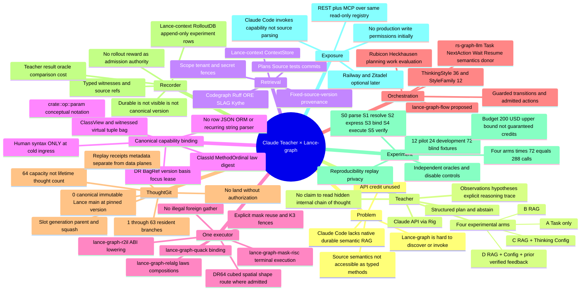

# Scratchpad Mindmap: Claude Teacher ↔ executable cognitive substrate (2026-11-14)

**Status: PROPOSED / DOCS ONLY / NOT AN IMPLEMENTATION.** This is an idea-capture artifact, not a runtime claim.
**Canonical home:** AdaWorldAPI/lance-graph. **Companion:** `cognitive-teacher-executable-method-feedback-v1.md`.
**North star:** use Claude API tokens as a controlled teacher / falsifier for the existing Lance-graph substrate. Discover which explicitly articulated interpretations can be resolved to witnessed ClassView / F### methods and executed on version-qualified DR bags. Learning history is not canonical world truth.

## Mindmap

## The intended shift

**Wrong:** `LLM text -> parser -> JSON workflow nodes -> ORM objects -> another executor -> stringify -> model`.

**Right:** `LLM interpreted proposal (cold boundary) -> validated typed MethodPlan -> {ClassId, MethodOrdinal, semantic law, BagRef, generation, focus} -> existing ClassView/relalg/Quack/R2IL/mask-RISC -> typed witness + independent oracle -> RolloutDB`.

Requested mnemonic `crate::{op}::{param}::{DR{bag reference}+virtual tuple bag over DR64³}` is a **conceptual addressing grammar**, NOT Rust module syntax, a proven canonical DR64³ address, or a promise all current methods already bind. The runtime ABI must be an explicit stable tuple with positional typed fields; names are aliases at the cold ingress boundary. DR64³ is a possible physical spatial/virtual shape where admitted, never a universal default.

## Immediate questions not to paper over

1. Is `lance-graph-flow` a real crate? No, directory census on 2026-11-14 found no `crates/lance-graph-flow`; D-LFA marks it a proposal.
2. Is there a reusable thought-git production crate? Current inspected `thought-git-probe` is lab-only; no production land/rebase/persistence.
3. Does `RolloutStore::add` accept a typed execution batch? Public add API is `&[RolloutRecord]` and records-to-Arrow conversion; generic storage internals already accept RecordBatch. Do not claim a direct public ABI batch path.
4. Can CausalEdge64/K3 truth or epistemic certification be inferred from Claude's score? No.
5. Can relalg execute every join over DR64³? No: ADMISSION B and gather/mask constraints remain.
6. Is the `$200/month` budget actually claimable as API credit? Verify entitlement/expiry separately; cap experiments even if not.
7. Can a recorded trajectory be replayed just by rollout_id / sequence_order? Not necessarily: require causal predecessor, codebook and version witnesses, ordered seal, and external effect digest.

## Prior research contracts, do not supersede

- [D-LFA flow / Rubicon assimilation](d-lfa-lance-graph-flow-rubicon-assimilation-v1.md)
- [D-RFT relalg / ThoughtGit frontier](d-rft-relalg-thought-git-frontier-v1.md)
- [ThoughtGit basics](thought-git-basics-v1.md)
- [ThoughtGit proposed API](thought-git-api-v1.md)
- [DR dynamic bag](d-dynbag-holographic-bags-v1.md)
- [Versioned mapping](d-dynbag-4-dr-versioned-mapping-v1.md)
- [Virtual address roadmap](virtual-address-superpowers-roadmap-v1.md)
- [Full companion plan](cognitive-teacher-executable-method-feedback-v1.md)

**Preservation rule:** a semantic claim becomes `CONFIRMED` only with pinned code + independent oracle + negative control, never because this scratchpad repeats it.
