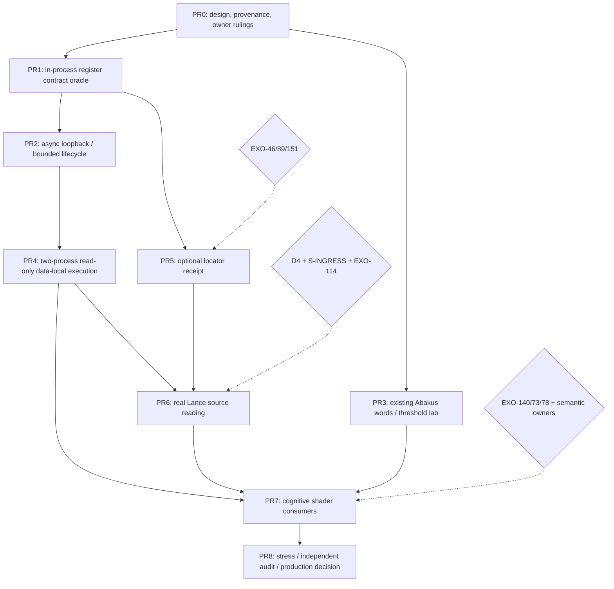

# D-DRISA staged PR charter: proof before driver, driver before promotion

> **2026-11-04 · PRE-REGISTRATION.** This charter describes **future, separately reviewed** PRs, not PRs already opened. Stage 0 is the *only* PR authorized by this request. A passing lab is not permission to extend production APIs. The canonical tracking issue is [EXO-153](https://linear.app/exo-red/issue/EXO-153); [EXO-50](https://linear.app/exo-red/issue/EXO-50) remains append-only handoff.
>
> Invariants from #1949 and #1951 stay binding: existing DR coordinate authority, default canonical SoA borrowing, no generic gather, no invented public `U24x5`/`Abacus`, no new F### or mask backend, no hidden D4/S-INGRESS bridge, no production remote listener before authorization.

## 0. Dependency map and route

Dashed arrows represent **unresolved gates**, never inferred approval. PR3 may proceed without PR2 in a lab; PR5 does **not** require PR4 for local proofs, but is owner-blocked. If the Mer­maid rendering is not supported, the stage table below is the canonical dependency record.

## PR0: D-DRISA-0 docs-only map (this pull request)

**Purpose:** Freeze the exact hypothesis and avoid reproducing a hash table or adding a new execution engine by accident.

**New docs:** [architectural law](d-drisa-remote-register-shader-v1.md), this [stage charter](d-drisa-staged-pr-charter-v1.md), [independent falsifier matrix](d-drisa-falsifier-matrix-v1.md), [board entry](../board/entries/2026-11-04-d-drisa-0-remote-register-contract.md), `STATUS_BOARD.md` / `INTEGRATION_PLANS.md` / generated entries index, and append-only EXO-50 source-linked handoff.

**Acceptance:** all source status claims labeled, no production code, distinct local borrow vs remote message copy, exact decisions named, falsifier matrix with independent oracles, no unbounded promise or invented codec/transport. CI board/index checks green. **No implementation authorization.**

## PR1: D-DRISA-1, *local* ISA/register seam differential probe

**Status:** FUTURE LAB PROPOSAL. **Owner review:** DT64 / mask-risc / R2IL; EXO-46 admission still needed for any indexed cross-population bind.

**Purpose:** Demonstrate the same semantics in existing local execution with (a) direct borrowed planes, (b) a typed opaque local binding descriptor resolving to the same borrowed planes. No transport. Don't change `dr.rs` identity or row storage.

**Suggested artifact:** workspace-excluded `crates/drisa-register-probe/`, fixture README, `oracles.rs`, test disable hooks, bench, RESULT with counters. Prefer wiring existing approved lab crate/fixture if it avoids an unnecessary crate. No new public mask-risc opcode or new registration mechanism.

**Fixtures:** one DR64 tile, one DR256 tile, multiple tiles; distinct global IDs mapped to same local positions across frames; 0/1/all-set, sparse/clustered populations; projected 3 of 64 logical fields; P0 Boolean COUNT, EXISTS, Kleene WHERE; external foreign population must refuse unclassified navigation. Independent scalar oracle uses immutable global IDs, not probe's register map.

**Positive:** repeated calls use the same frame and result, no payload copy in local borrow arm, warm fold uses existing ndarray facade, max scratch fixed.

**Negative:** stale frame, unknown field, wrong scope, mismatched field basis, stale scratch epoch, deliberately swapped coordinate, expired source lease, unauthorized foreign lane. Every refusal has a success control; mutating the source map makes at least one test red.

**Metrics:** hot allocations, `n_records`, borrowed bytes, ingress, route calls per Q, p50/p95, MB peak, same source version. Report ≥1ms warm fold as FAILED-GATE in this existing policy, no hidden full scan.

**Exit:** source-backed evidence of semantics and local lifetime only, not network performance.

## PR2: D-DRISA-2, bounded async loopback *control plane*

**Status:** FUTURE LAB. **Predecessor:** PR1. **Owner:** runtime/transport + security review. No TCP listener by default.

**Purpose:** Test descriptor → admission → queue → run → completion against the *same process* worker and borrowed canonical source. No raw pointer serialized; no untrusted bytecode; no new persistent result store.

**Cases:** N1–N9: concurrent bounded requests, queue overflow typed refusal, duplicate request ID, cancellation before admission/queued/running, timeout, lease revocation, fairness with two tenants, stale frame while waiting, source change between admit and run. Completion includes operation and effective witness digests.

**Oracle:** direct synchronous executor on same snapshot and rule; negative-disable controls bypass admission, drop cancellation, allow outdated permit, mix request IDs; each should turn a check red. Never equate CancelAck with rollback.

**Exit:** deterministic read-only lifecycle and bounded resource accounting. **Not** an externally exposed endpoint.

## PR3: D-DRISA-3, Abakus ALU / dynamic-lens lab

**Status:** FUTURE LAB; can run in parallel with PR2 after PR0. **Owner:** ndarray + Quack + mask-risc. Does not change their public APIs by assumption.

**Purpose:** Test semantic arithmetic on a bounded mask-register window using shipped `half_add_mask`, `full_add_mask`, native AND/OR/ternlog, and explicit scalar oracle. No `U24x5` example import.

**Fixtures:** n=1/2/4/5/16/24 independent predicate masks, k=0,1,half,n,n+1, 64-lane one-hot/alternating/sparse/dense/random and tail bits, missing vs zero, Bag multiplicity, SQL NULL/Kleene unknown. Distinguish k-of-n count from Bag support and from u8-in-u32 ordered compare.

**Cost test:** cold bit-plane construction + hot threshold, repeated Q, first and later values, scalar/AVX2/AVX-512/NEON/wasm where available. A simple 2-mask AND *must* remain preferable to extra adder work unless independently measured otherwise.

**Stop:** if existing public words insufficient, report NO-EXISTING-WORD and ndarray-owner proposal; do not handroll ISA in Quack. A direct ordered-u8 compare remains a separate kernel/codec admission from #1950.

## PR4: D-DRISA-4, two-process read-only data-local execution

**Status:** FUTURE LAB, REQUIRES transport/security-owner approval. **Predecessors:** PR1, PR2. Not coupled to D4: use a single data owner's already-resident SoA with existing frame.

**Purpose:** Differentially evaluate B1 (client receives rows/columns and executes) versus B2 (client sends a typed instruction; source executor borrows and returns scalar/mask). Same process-local semantic IR on the server. No external code execution; no claim of RDMA/zero-copy packets.

**Transport:** perform a bounded comparative study of a minimal framed in-house lab protocol versus **optional** Arrow Flight action/exchange only if justified by features and security constraints. This charter does not choose gRPC, Flight, Cap'n Proto, UCX or HTTP. No new persistent daemon or broad network exposure. Prefer local Unix-domain sockets initially.

**Cases:** 1M/10M in-memory data-owner single-host, 2 hosts only as a *separate* measured lane; payload sizes 0 / small / large, scalar vs mask output, repetitive Q and both resident vs cold-source setups; p50/p95/p99, wire bytes (request/response), TLS/auth cost if enabled, CPU, allocations, queue, compression, network contention.

**Oracle:** same query fully evaluated on an isolated copy of the input under same source revision. Prove the B2 implementation transfers no payload columns on the wire; inspect packet bytes or endpoint counters. An identical-answer check is necessary but does not prove zero intermediate copies.

**Stop:** if transport overhead dominates under relevant workloads, or remote ref accidentally becomes addressable outside the source owner, mark "NO BENEFIT / REFUSED" and do not introduce a production listener.

## PR5: D-DRISA-5, optional location receipt and prefetch

**Status:** **BLOCKED** EXO-46 + EXO-89 + EXO-151. **Predecessor:** PR1; proceed as architectural decision memo until admission.

**Purpose:** Memoize validated canonical SoA *location* from already-attested DR frame/position, not value. The #1951 census found **no production lease host**: `dt64::Focus` is only a tile revision; `drf-focus-probe::FocusKey` is excluded lab code with a gathered-value cache, not a receipt.

**Required owner decision:** designate exactly one lease owner without adding global→row-ID authority or editing `LocalMap::globals`; key by frame+source version+facet+scope+index seal; differentiate coordinate lease vs value snapshot. The receipt may be evicted without changing truth.

**Fixtures:** L1–L8 from #1949, repeated random/clustered source locations, Q=1..256, source overwrite, compaction, tombstone, invalidation, focus-slot ABA, concurrent readers, cache evict, revoked scope, 0/4/8/16/32/64 lookahead. Compare: borrowed direct, borrowed with receipt, borrowed receipt+prefetch, and separately *admitted* exceptional foreign cache. No payload copy in main arms.

**Stop:** if binding cannot be expressed under a lawful owner, block indefinitely rather than minting a map. A faster copied facet is not permission for an implicit gather planner.

## PR6: D-DRISA-6, DR→Lance source-backed register execution

**Status:** **BLOCKED D4 + S-INGRESS; EXO-114 ordering witness and #1633 ownership**. **Predecessors:** PR4 plus owner-approved source binding; optional PR5 receipt not required for first correctness arm.

**Purpose:** Bridge one sealed DR ordinal and one Lance `_rowid` under exactly ONE source/version witness, then execute the same logical program with selective columns; no additional row mapping table.

**Reuse:** #1950 `where_lance_arm`, `AddressedRelation`, `SealedFacetLane`, `ranges`/`range_mask`/`range_tree`, `Scanner::project` and `with_row_addr_prefilter`; mark `S_INGRESS_COPY`. Disable stable `_rowid` identity equality shortcut in a fixture and insist on refusal or lawful witness. Never treat `_rowaddr` as `_rowid` after remap.

**Tests:** 0.1/1/10/50/95% clustered/scattered, 1 to 16 demanded columns, 1 vs 10M; page-cache and disk separately; physical pages touched rather than solely `range_count*4096`; exact source versions, fragment splits, abort/cancel, invalidation. Full-projection oracle and independent row-ID oracle. ReadPolicy heuristic recorded, not promoted to a calibrated optimizer.

**Stop:** D4 missing, unguarded source patch, fake zero-copy or hidden source bytes → `BLOCKED_D4`, not a copied map.

## PR7: D-DRISA-7, read-only cognitive/relational shader consumers

**Status:** **GATED** EXO-46, EXO-140, EXO-73, EXO-78 and DT64/Quack/XLOG/NAL owners. **Predecessors:** PR1/3/4, and PR6 only for a storage-backed case.

**Consumer 1:** #1948 German grammar dependent/head co-addressed candidate, two read-only methods. Producer has 35 cold head lookups; DO NOT call its `Vec<u32> head_frame` a source-locator receipt. Validate language/lexicon revision and frame/scope. Preserve ambiguity; no WORLD promotion.

**Consumer 2:** XLOG/MeTTa/NAL syntax front end lowers through existing semantic Quack/RelAlg/R2IL only when already supported. A cross-frame join, recursion and unclassified `EqU32Via` are explicit stops, not an opportunity to reimplement execution.

**In-program vs cross-call continuation:** Within one mask-risc `Program`, scratch slots are legal under their epoch. A returned `MaskReceipt` that survives *across* operations would require an explicit owner-approved, bounded result-sink lifetime and source/scope witness. Never reuse a prior `Scratch` slot across epochs (`StaleSlot`); never create a new unbounded global mask store. Until this decision, allow scalar result or materialized *egress mask* only, with counted bytes.

**Refusal:** unknown method, unauthorized ClassView field, divergent frame, unknown truth, ambiguous candidate, missing source or Rubicon gate. No writing, hydration or separate grammar/NAL interpreter.

## PR8: D-DRISA-8, adversarial and end-to-end evidence / promotion ruling

**Status:** FUTURE, NOT AUTHORIZED. **Predecessors:** sufficient stage evidence, **all** owner decisions, explicit security review. Not automatically the merge of PR1–7.

**Evidence packet:** independently reviewed oracle/falsifier matrix, negative-control disable logs, B0..B6 cost table with cold/warm separation, 2-host/1-host comparisons, source invalidation under concurrency, ACL bypass attempts, replay/dedup, cancellation/partitions, predictable resource ceilings, code coverage + CI, cross-ISA parity, actual storage/page bytes and transport bytes. 10M row performance is not inferred from in-memory microbench.

**Owner decision:** one of `REUSE EXISTING / WIRE LAB / ADMIT LIMITED PRODUCTION / REVISE / REFUSE`. The production decision may authorize only a small read-only same-process path; full remote support and writeback are separate milestones.

## Shared PR gates and publication policy

1. **Every PR starts from current main** or explicitly states dependencies; no accidental stacking onto CC's active #1951 branch. Track base SHA and source revision.
2. **One purpose per PR** and an append-only cross-reference to EXO-153/EXO-50. Commit reports, raw evidence and independent oracles to an explicit research branch when large, with SHA and retrieval links; docs on main must not falsely imply raw logs are there (lesson #1950).
3. **One independent oracle and at least one deliberate disable** per semantic feature. A negative expected count of zero cannot certify a compare. Source, null and invalidation traps are required.
4. **No special low-level crate until needed**; reuse existing facade and algebra vocabulary. A proposed type name is not an implemented contract.
5. **Label evidence honestly**: source-verified, lab measured, proposed, owner-gated, refused. Answer parity ≠ performance parity ≠ engineering parity.
6. **No production merge without named owner approval**, and no EXO-50 message or passing CI substitutes for the approval.
7. **Board index & supersession index are generated** via their repository scripts; never overwrite curated rows, never claim CI green without a run on the head SHA.

## Links

- [D-DRISA master](d-drisa-remote-register-shader-v1.md) and [test matrix](d-drisa-falsifier-matrix-v1.md).
- [#1949](https://github.com/AdaWorldAPI/lance-graph/pull/1949) / [#1950](https://github.com/AdaWorldAPI/lance-graph/pull/1950) / [#1951](https://github.com/AdaWorldAPI/lance-graph/pull/1951) / [#1948](https://github.com/AdaWorldAPI/lance-graph/pull/1948).
- [EXO-153](https://linear.app/exo-red/issue/EXO-153), [EXO-50](https://linear.app/exo-red/issue/EXO-50), [EXO-46](https://linear.app/exo-red/issue/EXO-46), [EXO-89](https://linear.app/exo-red/issue/EXO-89), [EXO-151](https://linear.app/exo-red/issue/EXO-151), [EXO-140](https://linear.app/exo-red/issue/EXO-140), [EXO-114](https://linear.app/exo-red/issue/EXO-114), [EXO-73](https://linear.app/exo-red/issue/EXO-73), [EXO-78](https://linear.app/exo-red/issue/EXO-78).
