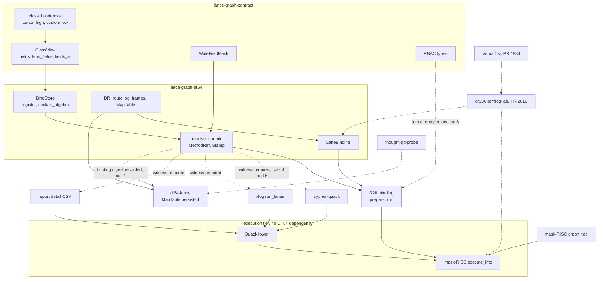

# D-DRDT-CLASS-GOVERNANCE-1 — Class-governed DR / DT64 execution, plan v2

**Status:** PROPOSED, docs only. No code, contract, codebook or test lands
with this plan. Read at `main` `238b6d1e4` (2026-11-11). Coordination:
Linear EXO-253.

**Evidence files** (`.claude/probes/dr-dt64-class-governance/`):
CURRENT-STATE, NAMESPACE-CROSSWALK, METHOD-RESOLUTION, BYPASS-MATRIX,
SNAPSHOT-VERSIONING, DR-DYNAMIC-COST, THOUGHT-REUSE, FALSIFIERS,
COUNCIL-DECISIONS. This plan states conclusions and cuts; the files carry
the file:line evidence. How the census was made is in §7.

## 1. The brief in one paragraph

All domain behaviour should run through classes, methods and registered
behaviour addresses, enforced centrally and without one interpreter that
knows everything. DR routes identities, coordinates and masks. DT64
interprets classes and methods. One global polyfill supplies the execution
vocabulary. The classid says where ON × WHEN × DO applies.

## 2. What the census found

| # | finding | evidence |
|---|---|---|
| F1 | The address rule in the brief is mostly on main already, under other names. Right half `0xF###` = behaviour lens; second digit = concern; a consumer's left half can carry its own lens. | NAMESPACE-CROSSWALK §2, §3 |
| F2 | Three points the brief treats as open are already code or a logged decision: `0xFFFF` as the left half of hardcoded behaviour, concern digits `F0`–`F5`, and the low byte as a lens index (not a method). | NAMESPACE-CROSSWALK §4 |
| F3 | Registration, schema revision, guard, effect order, basis identity and issuer are all checked by `BindStore::resolve` / `admit`, with tests. 9 of the brief's 25 falsifiers already have a test of that intent. | METHOD-RESOLUTION, FALSIFIERS |
| F4 | Admission is opt-in. Exactly one production call path in member crates reaches the executor through `admit` (the R2IL binding). Four reach it directly: `lance-graph-cypher-quack`, `lance-graph-xlog`, `lance-graph-report` (detail CSV) and mask-RISC's graph hop. Quack lowers a query to a program that carries no classid. | BYPASS-MATRIX |
| F5 | `mask-risc`, `quack` and `cypher-quack` do not depend on `lance-graph-dt64`, by design: they are the lower tier. Central enforcement therefore cannot be "the executor checks". | BYPASS-MATRIX, dependency section |
| F6 | Nothing represents authorized execution. `admit` takes no actor or scope. RBAC lives in the contract and in callcenter and is not joined to admission anywhere on the mask-RISC paths. `ExecPermit` exists in `lance-graph-r2il/src/binding.rs:128` and is required by `run`; what it proves is recorded in METHOD-RESOLUTION. | METHOD-RESOLUTION step 6 |
| F7 | A method reference is valid only inside the process that issued it: its stamp holds a pointer to the store. The store itself is not persisted. Field-basis history is replayable only if the source keeps it. | SNAPSHOT-VERSIONING §3 |
| F8 | What is persisted and replayable is the DR map table (PR 1993 line, `lance-graph-dt64-lance`). Bindings refuse any frame that is not current, so they cannot be replayed at an old version. | SNAPSHOT-VERSIONING |
| F9 | The DR64/DR256 choice on main is by survivor count only. No cost model exists. The only timings are from the lab on PR 2010, and they cover one of twelve cells of the comparison the brief asks for. `VirtualCsr` (PR 1984) is not on main. | DR-DYNAMIC-COST |
| F10 | The thought-git probe has 63 live slots and an in-memory version store, and no shared prepared selection. Nothing in DT64 mentions thoughts. | THOUGHT-REUSE |

## 3. The four questions

**Global: can each technology register its polyfill methods centrally and
use them without an application context?** Partly. One technology does: the
relational polyfill is a frozen table declared through
`BindStore::declare_algebra` under `0xFFFF_F000`, and its words are used by
position. XLOG declares a lens that the binding path does not execute. "No
application context" has no encoding: every lookup takes a full classid, and
`0xFFFF` today means "DT64-registered hardcoded behaviour", which is not the
same statement. Smallest falsifier: FALSIFIERS row 2, blocked on council Q2.

**Local: can the same address be read under different class contexts
without losing the global meaning?** Yes for lenses, with tests: two lenses
under one left half resolve independently, and a data class and a lens
sharing a left half do not cross-read. Not shown for one right half under
three left halves at once (FALSIFIERS row 1, a test-only cut).

**Governance: can a production consumer run domain behaviour without
passing registered ClassView, schema, method and IAM boundaries?** Yes,
today. Four member-crate paths execute programs with no admission (F4), and
no path joins IAM to admission (F6). Smallest falsifier: FALSIFIERS rows 6,
16 and 25.

**Replay: can a historical execution be traced to the classid, technology,
method code, binding revision, coordinates and data version that were valid
then?** No. Coordinates and the DR map are replayable. The binding is not
(F7, F8), and no execution record names the binding it ran under. Smallest
falsifier: FALSIFIERS row 17.

## 4. Target shape (WORKING-MODEL, not decided)

No interpreter in the middle. Three small things instead:

1. **One address grammar, ratified once** (council Q1–Q4). No new ids.
2. **Admission as a witness, not a wrapper.** Code that prepares a program
   for a class method holds a value that only `admit` can produce. Lower
   tiers (`mask-risc`, `quack`) stay free of DT64. The boundary is the crate
   that turns a class method into a program, and a census test lists every
   call into the executor with its route, failing on an unlisted one. The
   repo already uses this pattern for lenses
   (`lance-graph-r2il/tests/integration/dt64_census.rs`).
3. **A binding witness that outlives the process**: the binding digest the
   stamp already carries, recorded with each execution and with the DR
   version it ran at. The pointer check stays for same-process use.

Authorization stays independent of DT64 (the locality contract's fifth
boundary) and is joined at the entry points, proved by a test per entry.

## 5. Smallest PR cuts

Order matters: cuts 1–3 need no decision; the rest are gated.

| cut | content | gate | needs |
|---|---|---|---|
| 1 | This plan and the nine evidence files | docs review | — |
| 2 | Recovery of PR 1984 (`vcsr.rs`, `spmm.rs`, its tests and bench note) onto main as its own PR. No caller changes, no promotion. | its 3 commits cherry-pick with two conflicts (`src/lib.rs`, `tests/integration/main.rs`); crate tests green | your go-ahead (council Q9) |
| 3 | Tests only, green on main today: falsifier rows 1 (one right half, three left halves), 7 (left `0xF000..=0xFFFF` has no codebook row), 21 (exactly 37 properties stays DR64), 24 (4×4 witness matrix) | each test red under a one-line disable | — |
| 4 | Executor call-site census as a test: a TSV of every `execute_into` / `execute` / `execute_compiled` call in member crates with its route (ADMITTED / BOUND / DIRECT) and a reason; red when a call site is missing from the table | red on a planted call site | council Q5 |
| 5 | Decision record for Q1–Q4 in the D-DT64-7 plan (append-only), plus the contract tests that pin the chosen grammar | council | Q1–Q4 |
| 6 | Join of authorization and admission at one entry point (the R2IL binding), with falsifier row 16 | row 16 red first | Q6 |
| 7 | Binding witness recorded with an execution; replay falsifier row 17 | row 17 red first | Q7, Q8 |
| 8 | The owed cost comparison (DR-DYNAMIC-COST §4) in the lab, after cut 2 | every cell reports ns or µs, or is named a failed gate | Q10 |
| 9 | Thought reuse probe (THOUGHT-REUSE §4) | its oracles and negative controls | after 7 |

Cuts 4–9 change public behaviour or contracts and stay blocked until the
council answers.

## 6. Architecture

Solid edges are code on main. Dashed edges are lab or excluded crates.
Dotted edges are proposed in this plan.

The four arrows from `cypher-quack`, `xlog`, `report` and the graph hop into
the execution tier are the direct paths of F4.

## 7. How this was made, and what is not verified

- Discovery by read-only Haiku cards (two searches, six fact maps), drafting
  of five evidence files by Sonnet from those maps, plan, crosswalk,
  falsifier table and council questions by the orchestrator.
- The orchestrator read itself: `class_view.rs:1040-1105`,
  `ogar_codebook.rs:458-590`, `lance-graph-dt64/src/lib.rs:105-140, 345-400,
  1136-1200`, `lance-graph-r2il/src/binding.rs:285-340`,
  `lance-graph-xlog/src/lens.rs:25-40`, and the D-DT64-7 plan §1–§1d, §3, §7,
  §8. Everything else in the evidence files rests on the drafting agents'
  own reads, which they cite by file:line.
- Not read by anyone: ndarray PRs 414 and 418 (no API access from this
  session), the tests of `lance-graph-dt64-lance`, most test bodies named in
  FALSIFIERS.
- Nothing was built or run for this plan.
- The timings in DR-DYNAMIC-COST come from PR 2010, which is not merged.

## 8. Next step

The 5+3 council over COUNCIL-DECISIONS, Q1 and Q2 first. Cuts 1 and 3 can
proceed in parallel; cut 2 on your word.
