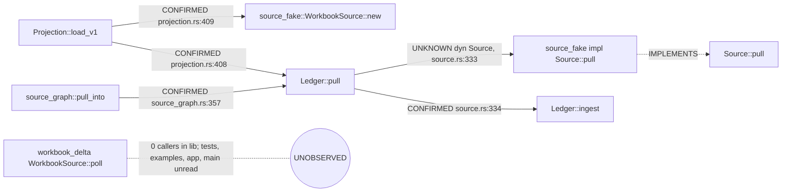

# D-CODEGRAPH-RECON-2: coverage-aware impact, and report-rs #33 from compiler facts

D-CODEGRAPH-RECON-1 (#2000) showed that `Codegraph::impact` returns an empty set for a public
symbol whose callers live in crates the store does not hold. This probe keeps `impact` as it is
and adds `Codegraph::impact_report`, which returns the same masks plus a typed list of what the
answer could not see. It then answers three questions about report-rs PR #33 from a Charon store
and grades the answers against the manual EXO-185 findings, which were held out.

Result: the store recovers the first #33 finding (the SharePoint drive source never reaches
`Ledger::ingest` from library code), explains it correctly, and names every region it could not
see. Both arms made no wrong statement. The source-reading arm was more complete, because the
store sees one build configuration and one target.

## 1. `impact_report` (Gate A)

`crates/lance-graph-codegraph/src/impact_report.rs`. `Codegraph::impact` is unchanged and
`ImpactReport.graded` is exactly its output. Missing coverage is never written into
`Graded.unknown`, which stays "observed functions a dynamic call may reach".

| gap | source of the fact |
|---|---|
| `ExternalConsumersUnobserved` | `PUBLIC` row, and the consumer set is not declared closed |
| `TargetsNotExtracted` / `TargetsUndeclared` | declared per crate (the store does not record targets) |
| `RegionsExcluded` | declared: opaque modules, features left off |
| `UnresolvedDispatch` | `UNRESOLVED_CALL` rows that may reach the symbol |
| `HarvestIncomplete` | residuals file, CRATE status |
| `StaleSource` / `FilesUnrecorded` / `FreshnessUnchecked` | `<crate>.files.tsv` digests against the source root |
| `SourceFilesUnread` | `.rs` files below a directory the extraction read from, absent from `files.tsv` |

A missing symbol in a stored crate carries its crate's target, region and file gaps, because each
is a place it may still be defined. `closed_in_scope()` is true only for a found symbol with no
gap, and it claims nothing about code outside the scope. `Coverage::no_known_gap()` alone is not
treated as closure: test 2 asserts it is true while the report is not closed.

`tests/impact_coverage.rs`, 11 tests, one per case in the brief plus three found while running
Gate B (excluded regions, target gaps of a missing symbol, unread files). Every guard was disabled
and its test went red: external consumers, missing targets, undeclared targets, dispatch fire,
dispatch silence, stale source, owner stored, observed consumers, closed symbol, harvest,
missing-symbol scope gaps, excluded regions, unread files (fire and silence), missing-symbol file
gaps.

## 2. The report-rs store (Gate B)

Inputs: report-rs `81705d9` (#33 head). Charon `c69e231`, nightly-2026-09-17, library target,
default features, `--opaque 'crate::app'` (the full crate ran out of memory at 15 GB). ruff_charon
from ruff `9752608`.

| step | time (µs, reported, not gates) | result |
|---|---|---|
| charon | 42,192,655 | exit 0 |
| ruff_charon import | 25,202,579 | 29,542 harvested, 1 residual (`REFERENCE_NOT_NAMED view::Scope::only`) |
| six cg_query runs (cold open each) | 435,149 | |

The CRATE row says `COMPLETE`, yet 14 of 59 files under `src/` were never read: `app.rs` and
`app/plan_routes.rs` (opaque), `iam.rs`, `login.rs`, `flow_scratch.rs`, `project_plan/*` (features
off), `main.rs` (binary target), `workbook_delta/dt64/p21_lane_socket_lab.rs`. That is what
`SourceFilesUnread` reports, from `files.tsv` alone. Nothing was inserted into the store by hand.

Raw query output is in `store-output/`.

### Q1: the two `WorkbookSource` types

- Confirmed: two identities, `report_rs::source_fake::WorkbookSource` and
  `report_rs::workbook_delta::source::WorkbookSource<T>`; only the first implements `Source`.
  `Ledger::pull` calls `Ledger::ingest` (source.rs:334). `Projection::load_v1` builds the
  `source_fake` source (projection.rs:409) and passes it to `Ledger::pull`.
- Possible / unknown: `Ledger::pull` reaches `source_fake::pull` only through `&mut dyn Source`
  (source.rs:333). The compiler does not name that target, so the store reports UNKNOWN, not an edge.
- Absent in scope: `poll` has no caller in the library target with default features, and no path
  from it reaches `Ledger::ingest`. Gaps: tests and examples not extracted, `crate::app` opaque,
  `main.rs` unread, the symbol is public.
- Falsifier: one `src/` call of `WorkbookSource::poll` whose result reaches `Ledger::ingest`
  (for example an `impl Source` for the delta type) turns this into a confirmed edge on re-import.

### Q2: authorization

`lance_graph_rbac` symbols are missing with `owner_stored: false`; `report_rs::iam::*` is missing
with `SourceFilesUnread` naming `src/iam.rs`. The store therefore cannot say whether report-rs
authorizes: the module that would do it was not compiled. Falsifier: re-extract with
`--features iam` and query `iam` callers.

### Q3: map persistence

No `lance_graph_dt64_lance` symbol in scope. `IdentityFrame::commit` calls
`lance_graph_dt64::dr::MapTable::advance` (frame.rs:195), CONFIRMED. Whether report-rs depends on
`lance-graph-dt64-lance` is a manifest fact the store does not hold; the store answer is
"absent in scope". Falsifier: a `MapLog` call in any compiled file.

## 3. Graded comparison (Gate D)

Two blind arms on the same model, the same questions (`questions.md`) and the same revision.
Arm M read source only. Arm C queried the store with `cg_query` and read source only at lines the
store printed. Grading against `answer-key.md`, strict: a materially false statement is WRONG even
with a coverage disclaimer. Full grades in `GRADES.tsv`; answers in `answers/`.

| | correct | partial | unsupported | wrong | tool calls | elapsed s | tokens |
|---|---|---|---|---|---|---|---|
| M (source) | 12 | 0 | 0 | 0 | 13 | 71.0 | 456,784 |
| C (store) | 7 | 3 | 2 | 0 | 8 | 59.8 | 456,309 |

The token counts are dominated by the shared session context both arms load, so they do not
separate the arms. n = 1 per arm; this is an observation, not a ranking.

Where the store was weaker, and why:

- **Build configuration.** Source text includes `#[cfg(feature = "iam")]` code; the store holds
  one configuration. K2.1 (the `authorize_memberships` call) is visible only to arm M.
- **Targets.** The store holds the library target, so the test and example callers of `poll`
  (K1.5) are unobserved. Arm C reported the gap; it did not name the callers.
- **Manifest facts.** "report-rs does not depend on dt64-lance" (K3.1, K3.3) comes from
  Cargo.toml, which the store does not read.
- **Definition lines.** The store records function spans, not struct lines (K1.1).

Where the store was stronger: arm C's `Ledger::pull → source_fake::pull` is reported UNKNOWN
(dynamic dispatch) instead of asserted, and every absence it states carries its scope. Arm M's
text search is feature-blind in both directions: it saw the `iam` call, and it would equally have
reported a cfg-dead call as live.

Acceptance (brief): the store independently recovers the first #33 missing-integration finding,
explains it correctly, and reports what it cannot prove. Met.

## 4. #2000 checks

- The PR description, REPORT.md §4 and `recon.py --self-test` all give 15 tests; the self-test
  passes.
- CI at the head (`90fc5a7`) and the merge (`317c4ff`) is green on every workflow.
- Reproduction from the documented commands, in a fresh worktree at `317c4ff` with sibling ndarray
  at `fd3d2e7`: rows per crate equal REPORT.md's table (represented + 3), `machine-recovered.mmd`
  is byte-identical, and the Charon column of `score.tsv` is identical (61 HIT, 26 MISS,
  32 UNOBSERVED). The rust-analyzer column was not re-run.

## 5. Open

- Feature and target matrices: one store per configuration, merged, would close K1.5 and K2.1.
  Charon needs `crate::app` opaque at 15 GB.
- `RegionsExcluded` and `Targets` are declared by the caller. The extractor could record both in
  the store (they are its own arguments), which would turn them into store facts.
- `SourceFilesUnread` scans the top directory of each recorded path; files recorded at the source
  root trigger no scan.
