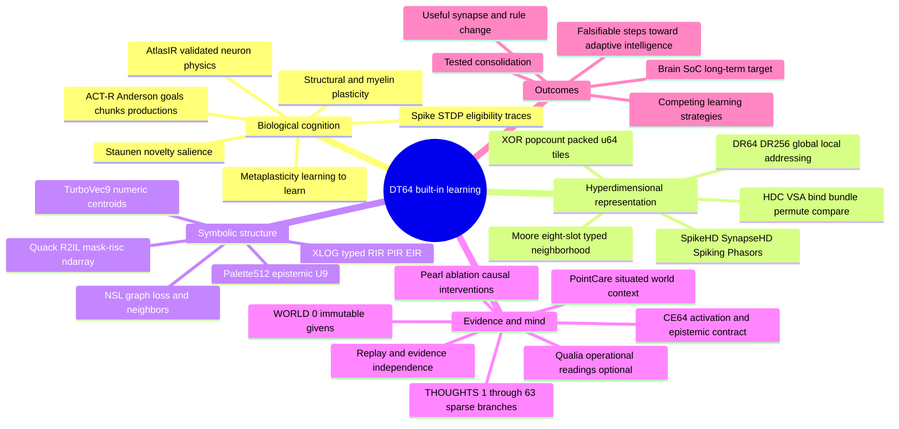

# D-STAUNEN-0 | Convergence scratchpad | 2026-10-31

**Status: INCEPTION / WORKING HYPOTHESIS, NOT ADMITTED ARCHITECTURE.** Preserve the entire research thread before it fragments. Source-derived fact, repository-measured result, user decision and untested hypothesis must remain distinct. CC owns any implementation only after current source re-audit, explicit operator decision and falsifier.

## North star
Make **plasticity an intrinsic DT64 hypercube capability**: an activated pattern can influence which local neural/symbolic connections become eligible for adaptation; competing sparse thoughts test changes; only external evidence licenses consolidation into the next sealed WORLD version. Not a second runtime, storage engine, palette registry, graph or truth oracle. Faster bit primitives are not equivalent to biologically faithful or general learning.

## Convergence mindmap

## Important distinctions
1. Staunen = candidate novelty/salience *event* modulating plasticity; it is neither facial expression nor an automatic claim of synaptic growth.
2. Wisdom = evidentially warranted consolidation/reuse; not a biological synapse, not certification by novelty.
3. Brain mirror neurons specifically concern observation/action coupling, not arbitrary routing to brain regions. Proposed cross-assembly recruitment is a distinct hypothesis.
4. Gray matter synaptic/structural change and white-matter myelination are both plasticity on different mechanisms/timescales; explicit distinct simulator models required.
5. BNN is ambiguous: binary, Bayesian or biological neural network. Always spell out.
6. Atlas supports bounded STDP and separate surrogate-gradient/BPTT/SGD/Adam training; no universal Bayesian learner or brain-complete simulation.
7. A Moore8 palette projection is not a biological adjacency index; any true neighbors must come from the authenticated synaptic topology.
8. 64 CE64 bits are typed word semantics; a hypervector has many 64-bit tiles; 64 thought slots are a different axis.
9. CE64 46..49 activation *decision* conflicts with legacy opcode reader; 50..52 novelty/wisdom vs plasticity owner ruling OPEN; W 53..58 denotes ephemeral thought slot, not durable evidence ID.
10. No copy of WORLD per thought: 0 sealed givens, 1..63 sparse deltas over one frame; per-thought evidence roots prevent self-confirmation.
11. CE64 is an ISA, **not a storage contract** (#1628); physiology, eligibility traces, gradients and synaptic topology belong to typed external state.
12. Do not market subjective experience, mirror-neuron routing, AGI attainment, permanent structural synapse growth, physical Brain SoC power or nanosecond whole-brain simulation as demonstrated.

## Proposed learning loop
Observed spike / event -> HDC pattern -> novelty prediction residual -> authenticated Moore/graph neighborhood -> eligibility + signed 3rd factor -> bounded synaptic/structural candidate -> XLOG/NSL symbolic hypotheses -> 64 sparse thoughts with root-disjoint comparison and held-out external observations -> revision, ablation, consolidation, or abstention. Re-evaluate future plasticity policies = *metaplasticity*.

## Concrete existing anchors
- #1400 Moore/NARS delayed consequence recipe learning: evidence of structure-based selection; later #1440 found delayed credit inconclusive under Holm. No claim of neuronal validity.
- #1405 Morton Moore shifts; #1408 historical tenants 18..20 not a license to ratify production slots; #1336 256×256 palette pair LUT.
- #1839 ClassView per-class U8/U9; #1846 NSL neighbor and graph-loss oracles; #1847 distinguishes DR512 SM9 never-touched vs TurboVec9 centroids, and proposes P64×T64×CE64 (32 KiB ideal dense logical payload).
- #1869 DT64 bind store; #1884 XLOG compiled plan/count bound to native ndarray::simd with Epi5 base `Direct×Open`, composition `IndirectKnown×Open`; joins do not certify causality.
- #1597 bit decisions and conflicts, #1628 64 thought slots / CE64 ISA not storage, D-TGB distinct live slot generations and durable commits.
- AtlasIR Definition/Instance/Run hashes, effect algebra and ordered events (manuscript §§2.2–2.4); Pair/Triplet STDP + bounded native BPTT (§§3.7–3.8). Biological equivalence remains empirical.
- ACT-R bridges goal/chunk/production dynamics at cognitive level, not an assumed neural-lowering compiler. PointCare/WorldModel are candidate situated contexts only.

## Stage map
- D-STAUNEN-0 this conservation map.
- D-STAUNEN-1 typed CE64 / DT64 plasticity and ownership admission.
- D-STAUNEN-2 AtlasIR × SNN × HDC × Moore experimental bridge.
- D-STAUNEN-3 XLOG × NSL × Palette512 / TurboVec9 structure and learning adapters.
- D-STAUNEN-4 64-thought metaplasticity, evidence-root independence, evaluation and integration gates.

## Minimum falsifiers
- Novelty shuffled vs genuine; time-shuffled spikes; neuron ID permutation; topology- and Moore-shuffled; duplicate evidence across 63 thoughts; silent loss of spike timing; synaptic weights changed without Atlas permission; equality of candidate neighbors under quantization; no-learning and no-meta baselines; stale DR frame refusal; thought slot reuse; K3 UNKNOWN; bag multiplicity loss; replay determinism; OOD / held-out behavior; end-to-end runtime with preparation and state movement charged.

## Source and evidence register (do not flatten status)
- Uploaded primary manuscript: Xinjun Li, *A Unified Intermediate Representation and Execution Architecture for Heterogeneous and Distributed Neural Simulation*, 44-page manuscript, §2.2–2.5, §3.7–3.8, §4–6; https://github.com/RockLi/brian2-atlas-preprint/blob/main/paper/MANUSCRIPT.md ; source-pinned Atlas commit `ae649a244e28d7d4b3eb5df4e35215e14c1378c7`, archive `biorxiv-v1` (the tag name does not assert journal review). Atlas source https://github.com/RockLi/brian2-atlas ; frozen AtlasIR https://github.com/RockLi/brian2-atlas/blob/dev/brian2-rust/AtlasIR.md . Atlas original Apache-2.0, inherited Brian2 CeCILL-2.1.
- A. Anderson & Lebiere, *The Atomic Components of Thought* (1998): ACT-R goals, chunks and productions: https://www.routledge.com/The-Atomic-Components-of-Thought-1st-Edition/Anderson-Lebiere/p/book/9780805828160
- B. Lisman & Grace (2005), hippocampus–VTA novelty/LTP loop: https://doi.org/10.1016/j.neuron.2005.05.002
- C. Frey & Morris (1997), synaptic tagging: https://doi.org/10.1038/385533a0
- D. Gerstner et al. (2018), eligibility and neo-Hebbian three-factor rules: https://doi.org/10.3389/fncir.2018.00053
- E. Abraham & Bear (1996), metaplasticity: https://doi.org/10.1016/S0166-2236(96)80018-X
- F. Miconi, Stanley & Clune (2018), differentiable plasticity/meta-learning: https://arxiv.org/abs/1804.02464
- G. Zou et al. (2022), SpikeHD SNN/HDC co-learning: https://doi.org/10.1038/s41598-022-11073-3
- H. Orchard et al. (2024), spiking phasor/FHRR operations: https://pubmed.ncbi.nlm.nih.gov/39106467/
- I. Zhou et al. (2026), SynapseHD SNN/HDC training: https://doi.org/10.1016/j.neucom.2025.131757
- J. Kinavuidi, Peres & Rhodes (2026), hyperdimensional SNN decoding: https://doi.org/10.1088/2634-4386/ae4f1e
- K. Bui, Ravi & Ramavajjala (2017), Neural Graph Machines/structured graph regularization: https://arxiv.org/abs/1703.04818
- L. XLOG typed logic, distinct RIR/PIR/EIR/NN semantic lanes: https://github.com/BrainyBlaze/xlog
- M. Chalmers' hard problem/qualia is philosophical framing only; no computational variable proves phenomenal experience. Do not make consciousness claims.
- Internal: CE64 capstone https://github.com/AdaWorldAPI/lance-graph/blob/main/.claude/knowledge/epistemic-frontier-capstone.md ; CE64 layout https://github.com/AdaWorldAPI/lance-graph/blob/main/docs/architecture/ce64-semantic-upper-half.md ; #1597, #1628, #1400, #1405, #1408, #1440, #1839, #1846, #1847, #1884, #1869.
