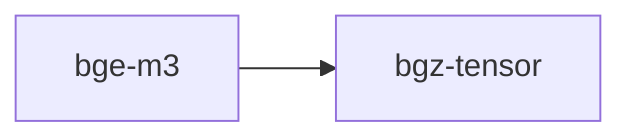

# bge-m3

crate: bge-m3
path: crates/bge-m3
workspace: excluded
digest: aefb02c857c31568
evidence legend: ../index.md#evidence-legend

Generated; the code is the truth. See ../index.md.

## Depends on

- dep bgz-tensor normal — crates/bge-m3/Cargo.toml:11 CONFIRMED
- dep ndarray normal — crates/bge-m3/Cargo.toml:10 CONFIRMED
- dep tokenizers normal optional — crates/bge-m3/Cargo.toml:12 CONFIRMED

## Depended on by

## Public items

- struct LayerWeights [pub] — crates/bge-m3/src/embed.rs:14 CONFIRMED
- struct BgeM3Model [pub] — crates/bge-m3/src/embed.rs:28 CONFIRMED
- struct BgeM3Engine [pub] — crates/bge-m3/src/embed.rs:41 CONFIRMED
- fn BgeM3Engine::new [pub] — crates/bge-m3/src/embed.rs:46 CONFIRMED
- fn BgeM3Engine::load_model [pub] — crates/bge-m3/src/embed.rs:50 CONFIRMED
- fn BgeM3Engine::embed_tokens [pub] — crates/bge-m3/src/embed.rs:56 CONFIRMED
- fn BgeM3Engine::embed_text [pub] — crates/bge-m3/src/embed.rs:119 CONFIRMED
- fn BgeM3Engine::embed_to_base17 [pub] — crates/bge-m3/src/embed.rs:126 CONFIRMED
- fn BgeM3Engine::distance [pub] — crates/bge-m3/src/embed.rs:155 CONFIRMED
- fn BgeM3Engine::similarity [pub] — crates/bge-m3/src/embed.rs:162 CONFIRMED
- fn BgeM3Engine::most_similar [pub] — crates/bge-m3/src/embed.rs:167 CONFIRMED
- fn BgeM3Engine::batch_embed [pub] — crates/bge-m3/src/embed.rs:185 CONFIRMED
- fn embed_text [pub] — crates/bge-m3/src/embed.rs:353 CONFIRMED
- fn distance [pub] — crates/bge-m3/src/embed.rs:359 CONFIRMED
- fn similarity [pub] — crates/bge-m3/src/embed.rs:365 CONFIRMED
- fn most_similar [pub] — crates/bge-m3/src/embed.rs:371 CONFIRMED
- fn batch_embed [pub] — crates/bge-m3/src/embed.rs:377 CONFIRMED
- mod weights [pub] — crates/bge-m3/src/lib.rs:6 CONFIRMED
- mod embed [pub] — crates/bge-m3/src/lib.rs:7 CONFIRMED
- mod tokenizer [pub] — crates/bge-m3/src/lib.rs:8 CONFIRMED
- fn tokenize [pub] — crates/bge-m3/src/tokenizer.rs:18 CONFIRMED
- fn token_count [pub] — crates/bge-m3/src/tokenizer.rs:39 CONFIRMED
- fn load_real_tokenizer [pub] cfg=feature="real-tokenizer" — crates/bge-m3/src/tokenizer.rs:47 CONFIRMED
- fn tokenize_real [pub] cfg=feature="real-tokenizer" — crates/bge-m3/src/tokenizer.rs:54 CONFIRMED
- const DEFAULT_BGZ7_PATH [pub] — crates/bge-m3/src/weights.rs:11 CONFIRMED
- const VOCAB_SIZE [pub] — crates/bge-m3/src/weights.rs:14 CONFIRMED
- const HIDDEN_DIM [pub] — crates/bge-m3/src/weights.rs:15 CONFIRMED
- const NUM_LAYERS [pub] — crates/bge-m3/src/weights.rs:16 CONFIRMED
- const NUM_HEADS [pub] — crates/bge-m3/src/weights.rs:17 CONFIRMED
- const HEAD_DIM [pub] — crates/bge-m3/src/weights.rs:18 CONFIRMED
- const MLP_DIM [pub] — crates/bge-m3/src/weights.rs:19 CONFIRMED
- const MAX_SEQ_LEN [pub] — crates/bge-m3/src/weights.rs:20 CONFIRMED
- const DEFAULT_SPD [pub] — crates/bge-m3/src/weights.rs:22 CONFIRMED
- struct BgeM3StackedWeights [pub] — crates/bge-m3/src/weights.rs:29 CONFIRMED
- struct BgeM3LayerWeights [pub] — crates/bge-m3/src/weights.rs:37 CONFIRMED
- fn BgeM3LayerWeights::role [pub] — crates/bge-m3/src/weights.rs:67 CONFIRMED
- fn BgeM3StackedWeights::load_from_gguf [pub] — crates/bge-m3/src/weights.rs:78 CONFIRMED
- fn BgeM3StackedWeights::load_from_gguf_bytes [pub] — crates/bge-m3/src/weights.rs:84 CONFIRMED
- fn BgeM3StackedWeights::hydrate_role [pub] — crates/bge-m3/src/weights.rs:120 CONFIRMED
- struct BgeM3Weights [pub] — crates/bge-m3/src/weights.rs:130 CONFIRMED
- fn BgeM3Weights::load [pub] — crates/bge-m3/src/weights.rs:136 CONFIRMED
- fn BgeM3Weights::load_default [pub] — crates/bge-m3/src/weights.rs:146 CONFIRMED
- fn BgeM3Weights::embedding_rows [pub] — crates/bge-m3/src/weights.rs:148 CONFIRMED
- fn BgeM3Weights::attention_rows [pub] — crates/bge-m3/src/weights.rs:152 CONFIRMED
- struct GgufHeader [pub(crate)] — crates/bge-m3/src/weights.rs:166 CONFIRMED
- struct TensorMeta [pub(crate)] — crates/bge-m3/src/weights.rs:167 CONFIRMED
- fn parse_layer_idx [pub(crate)] — crates/bge-m3/src/weights.rs:169 CONFIRMED
- fn parse_gguf_header [pub(crate)] — crates/bge-m3/src/weights.rs:176 CONFIRMED
- fn read_tensor_f32 [pub(crate)] — crates/bge-m3/src/weights.rs:222 CONFIRMED

## Imports from in-scope crates

### bgz-tensor
- use bgz_tensor::stacked_n::StackedN — crates/bge-m3/src/weights.rs:8 CONFIRMED
- use bgz_tensor::variance::Role — crates/bge-m3/src/weights.rs:9 CONFIRMED

## Calls

CALL_GRAPH=ARTIFACT_MISSING
- calls ARTIFACT_MISSING — no ruff_charon artifact for this crate UNKNOWN

## Architecture

- none

Generated from Cargo manifests — extracted relationships only.

