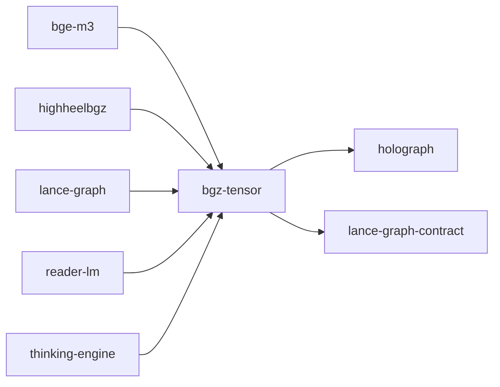

# bgz-tensor

crate: bgz-tensor
path: crates/bgz-tensor
workspace: member
digest: 5d1e33d8228a9cf4
evidence legend: ../index.md#evidence-legend

Generated; the code is the truth. See ../index.md.

## Depends on

- dep holograph normal — crates/bgz-tensor/Cargo.toml:26 CONFIRMED
- dep lance-graph-contract normal optional — crates/bgz-tensor/Cargo.toml:27 CONFIRMED
- dep ndarray normal — crates/bgz-tensor/Cargo.toml:25 CONFIRMED
- dep serde normal optional — crates/bgz-tensor/Cargo.toml:28 CONFIRMED
- dep serde_json normal optional — crates/bgz-tensor/Cargo.toml:29 CONFIRMED
- dep sha2 normal optional — crates/bgz-tensor/Cargo.toml:30 CONFIRMED

## Depended on by

- rdep bge-m3 normal — crates/bge-m3/Cargo.toml:11 CONFIRMED
- rdep cognitive-shader-driver dev — crates/cognitive-shader-driver/Cargo.toml:298 CONFIRMED
- rdep highheelbgz normal optional — crates/highheelbgz/Cargo.toml:19 CONFIRMED
- rdep lance-graph normal optional — crates/lance-graph/Cargo.toml:104 CONFIRMED
- rdep reader-lm normal — crates/reader-lm/Cargo.toml:11 CONFIRMED
- rdep thinking-engine normal — crates/thinking-engine/Cargo.toml:19 CONFIRMED

## Public items

- enum RowPrecision [pub] — crates/bgz-tensor/src/adaptive_codec.rs:28 CONFIRMED
- struct AdaptiveRow [pub] — crates/bgz-tensor/src/adaptive_codec.rs:35 CONFIRMED
- struct AdaptiveCodecTensor [pub] — crates/bgz-tensor/src/adaptive_codec.rs:46 CONFIRMED
- struct AdaptiveStats [pub] — crates/bgz-tensor/src/adaptive_codec.rs:57 CONFIRMED
- fn AdaptiveCodecTensor::encode [pub] — crates/bgz-tensor/src/adaptive_codec.rs:139 CONFIRMED
- fn AdaptiveCodecTensor::reconstruct_row [pub] — crates/bgz-tensor/src/adaptive_codec.rs:288 CONFIRMED
- fn AdaptiveCodecTensor::reconstruct_all [pub] — crates/bgz-tensor/src/adaptive_codec.rs:345 CONFIRMED
- fn AdaptiveCodecTensor::compression_summary [pub] — crates/bgz-tensor/src/adaptive_codec.rs:349 CONFIRMED
- struct AttentionTable [pub] — crates/bgz-tensor/src/attention.rs:34 CONFIRMED
- struct ComposeTable [pub] — crates/bgz-tensor/src/attention.rs:49 CONFIRMED
- struct AttentionSemiring [pub] — crates/bgz-tensor/src/attention.rs:58 CONFIRMED
- fn AttentionTable::build [pub] — crates/bgz-tensor/src/attention.rs:72 CONFIRMED
- fn AttentionTable::build_weighted [pub] — crates/bgz-tensor/src/attention.rs:91 CONFIRMED
- fn AttentionTable::distance [pub] — crates/bgz-tensor/src/attention.rs:110 CONFIRMED
- fn AttentionTable::attention_scores [pub] — crates/bgz-tensor/src/attention.rs:120 CONFIRMED
- fn AttentionTable::attention_sparse [pub] — crates/bgz-tensor/src/attention.rs:141 CONFIRMED
- fn AttentionTable::byte_size [pub] — crates/bgz-tensor/src/attention.rs:164 CONFIRMED
- fn ComposeTable::build [pub] — crates/bgz-tensor/src/attention.rs:176 CONFIRMED
- fn ComposeTable::compose [pub] — crates/bgz-tensor/src/attention.rs:206 CONFIRMED
- fn ComposeTable::compose_chain [pub] — crates/bgz-tensor/src/attention.rs:221 CONFIRMED
- fn ComposeTable::byte_size [pub] — crates/bgz-tensor/src/attention.rs:227 CONFIRMED
- fn AttentionSemiring::build [pub] — crates/bgz-tensor/src/attention.rs:234 CONFIRMED
- fn AttentionSemiring::query [pub] — crates/bgz-tensor/src/attention.rs:249 CONFIRMED
- fn AttentionSemiring::byte_size [pub] — crates/bgz-tensor/src/attention.rs:254 CONFIRMED
- fn AttentionSemiring::identity [pub] — crates/bgz-tensor/src/attention.rs:259 CONFIRMED
- struct CompiledHead [pub] — crates/bgz-tensor/src/attention.rs:286 CONFIRMED
- fn CompiledHead::compile [pub] — crates/bgz-tensor/src/attention.rs:313 CONFIRMED
- fn CompiledHead::attention_scores [pub] — crates/bgz-tensor/src/attention.rs:354 CONFIRMED
- fn CompiledHead::byte_size [pub] — crates/bgz-tensor/src/attention.rs:369 CONFIRMED
- const N_BANDS [pub] — crates/bgz-tensor/src/belichtungsmesser.rs:15 CONFIRMED
- struct Band [pub] — crates/bgz-tensor/src/belichtungsmesser.rs:19 CONFIRMED
- struct Belichtungsmesser [pub] — crates/bgz-tensor/src/belichtungsmesser.rs:30 CONFIRMED
- fn Belichtungsmesser::calibrate [pub] — crates/bgz-tensor/src/belichtungsmesser.rs:46 CONFIRMED
- fn Belichtungsmesser::classify [pub] — crates/bgz-tensor/src/belichtungsmesser.rs:131 CONFIRMED
- fn Belichtungsmesser::three_stroke [pub] — crates/bgz-tensor/src/belichtungsmesser.rs:147 CONFIRMED
- fn Belichtungsmesser::validate [pub] — crates/bgz-tensor/src/belichtungsmesser.rs:171 CONFIRMED
- fn Belichtungsmesser::summary [pub] — crates/bgz-tensor/src/belichtungsmesser.rs:212 CONFIRMED
- enum CascadeLevel [pub] — crates/bgz-tensor/src/cascade.rs:35 CONFIRMED
- struct CascadeConfig [pub] — crates/bgz-tensor/src/cascade.rs:48 CONFIRMED
- struct CascadeStats [pub] — crates/bgz-tensor/src/cascade.rs:75 CONFIRMED
- fn CascadeStats::elimination_rate [pub] — crates/bgz-tensor/src/cascade.rs:86 CONFIRMED
- fn CascadeStats::summary [pub] — crates/bgz-tensor/src/cascade.rs:95 CONFIRMED
- struct CascadeResult [pub] — crates/bgz-tensor/src/cascade.rs:114 CONFIRMED
- struct ScentByte [pub] — crates/bgz-tensor/src/cascade.rs:133 CONFIRMED
- fn ScentByte::compute [pub] — crates/bgz-tensor/src/cascade.rs:142 CONFIRMED
- fn ScentByte::agreement_count [pub] — crates/bgz-tensor/src/cascade.rs:164 CONFIRMED
- fn ScentByte::all_agree [pub] — crates/bgz-tensor/src/cascade.rs:170 CONFIRMED
- fn ScentByte::any_agree [pub] — crates/bgz-tensor/src/cascade.rs:176 CONFIRMED
- fn cascade_attention [pub] — crates/bgz-tensor/src/cascade.rs:196 CONFIRMED
- struct CodebookIndex [pub] — crates/bgz-tensor/src/codebook4096.rs:23 CONFIRMED
- fn CodebookIndex::new [pub] — crates/bgz-tensor/src/codebook4096.rs:27 CONFIRMED
- fn CodebookIndex::cluster [pub] — crates/bgz-tensor/src/codebook4096.rs:32 CONFIRMED
- fn CodebookIndex::entry [pub] — crates/bgz-tensor/src/codebook4096.rs:37 CONFIRMED
- struct Cluster [pub] — crates/bgz-tensor/src/codebook4096.rs:44 CONFIRMED
- struct Codebook4096 [pub] — crates/bgz-tensor/src/codebook4096.rs:60 CONFIRMED
- struct CodebookAssignment [pub] — crates/bgz-tensor/src/codebook4096.rs:69 CONFIRMED
- fn Codebook4096::build [pub] — crates/bgz-tensor/src/codebook4096.rs:84 CONFIRMED
- fn Codebook4096::assign [pub] — crates/bgz-tensor/src/codebook4096.rs:164 CONFIRMED
- fn Codebook4096::assign_all [pub] — crates/bgz-tensor/src/codebook4096.rs:208 CONFIRMED
- fn Codebook4096::lookup [pub] — crates/bgz-tensor/src/codebook4096.rs:213 CONFIRMED
- fn Codebook4096::byte_size [pub] — crates/bgz-tensor/src/codebook4096.rs:220 CONFIRMED
- fn Codebook4096::summary [pub] — crates/bgz-tensor/src/codebook4096.rs:228 CONFIRMED
- struct CalibratedCodebook [pub] — crates/bgz-tensor/src/codebook_calibrated.rs:24 CONFIRMED
- fn CalibratedCodebook::build [pub] — crates/bgz-tensor/src/codebook_calibrated.rs:48 CONFIRMED
- fn CalibratedCodebook::assign [pub] — crates/bgz-tensor/src/codebook_calibrated.rs:188 CONFIRMED
- fn CalibratedCodebook::assign_all [pub] — crates/bgz-tensor/src/codebook_calibrated.rs:198 CONFIRMED
- fn CalibratedCodebook::summary [pub] — crates/bgz-tensor/src/codebook_calibrated.rs:203 CONFIRMED
- struct ClamFamily [pub] — crates/bgz-tensor/src/euler_fold.rs:35 CONFIRMED
- fn clam_group [pub] — crates/bgz-tensor/src/euler_fold.rs:46 CONFIRMED
- struct FoldedFamily [pub] — crates/bgz-tensor/src/euler_fold.rs:152 CONFIRMED
- fn FoldedFamily::byte_size [pub] — crates/bgz-tensor/src/euler_fold.rs:167 CONFIRMED
- fn FoldedFamily::compression_ratio [pub] — crates/bgz-tensor/src/euler_fold.rs:172 CONFIRMED
- fn euler_gamma_fold [pub] — crates/bgz-tensor/src/euler_fold.rs:185 CONFIRMED
- fn euler_gamma_unfold [pub] — crates/bgz-tensor/src/euler_fold.rs:257 CONFIRMED
- struct FoldResult [pub] — crates/bgz-tensor/src/euler_fold.rs:308 CONFIRMED
- fn gate_test [pub] — crates/bgz-tensor/src/euler_fold.rs:324 CONFIRMED
- fn neuronprint_fold_test [pub] — crates/bgz-tensor/src/euler_fold.rs:360 CONFIRMED
- struct FamilyGamma [pub] — crates/bgz-tensor/src/fisher_z.rs:28 CONFIRMED
- const FamilyGamma::BYTE_SIZE [pub] — crates/bgz-tensor/src/fisher_z.rs:36 CONFIRMED
- fn FamilyGamma::from_cosines [pub] — crates/bgz-tensor/src/fisher_z.rs:39 CONFIRMED
- fn FamilyGamma::encode [pub] — crates/bgz-tensor/src/fisher_z.rs:63 CONFIRMED
- fn FamilyGamma::decode [pub] — crates/bgz-tensor/src/fisher_z.rs:72 CONFIRMED
- fn FamilyGamma::to_le_bytes [pub] — crates/bgz-tensor/src/fisher_z.rs:79 CONFIRMED
- fn FamilyGamma::from_le_bytes [pub] — crates/bgz-tensor/src/fisher_z.rs:87 CONFIRMED
- struct FisherZTable [pub] — crates/bgz-tensor/src/fisher_z.rs:100 CONFIRMED
- fn FisherZTable::build [pub] — crates/bgz-tensor/src/fisher_z.rs:115 CONFIRMED
- fn FisherZTable::build_from_palette [pub] — crates/bgz-tensor/src/fisher_z.rs:150 CONFIRMED
- fn FisherZTable::lookup_i8 [pub] — crates/bgz-tensor/src/fisher_z.rs:158 CONFIRMED
- fn FisherZTable::lookup_f32 [pub] — crates/bgz-tensor/src/fisher_z.rs:170 CONFIRMED
- fn FisherZTable::byte_size [pub] — crates/bgz-tensor/src/fisher_z.rs:175 CONFIRMED
- fn FisherZTable::to_bytes [pub] — crates/bgz-tensor/src/fisher_z.rs:180 CONFIRMED
- fn FisherZTable::from_bytes [pub] — crates/bgz-tensor/src/fisher_z.rs:189 CONFIRMED
- struct FractalDescriptor [pub] cfg=feature="lab" — crates/bgz-tensor/src/fractal_descriptor.rs:31 CONFIRMED
- const FractalDescriptor::SIZE_BYTES [pub] cfg=feature="lab" — crates/bgz-tensor/src/fractal_descriptor.rs:43 CONFIRMED
- fn FractalDescriptor::pack [pub] cfg=feature="lab" — crates/bgz-tensor/src/fractal_descriptor.rs:45 CONFIRMED
- fn FractalDescriptor::unpack [pub] cfg=feature="lab" — crates/bgz-tensor/src/fractal_descriptor.rs:54 CONFIRMED
- fn FractalDescriptor::d_local_f32 [pub] cfg=feature="lab" — crates/bgz-tensor/src/fractal_descriptor.rs:63 CONFIRMED
- fn FractalDescriptor::w_mfs_f32 [pub] cfg=feature="lab" — crates/bgz-tensor/src/fractal_descriptor.rs:66 CONFIRMED
- fn FractalDescriptor::h_hurst_f32 [pub] cfg=feature="lab" — crates/bgz-tensor/src/fractal_descriptor.rs:69 CONFIRMED
- fn FractalDescriptor::sigma_energy_f32 [pub] cfg=feature="lab" — crates/bgz-tensor/src/fractal_descriptor.rs:72 CONFIRMED
- fn compute_mfdfa_descriptor [pub] cfg=feature="lab" — crates/bgz-tensor/src/fractal_descriptor.rs:83 CONFIRMED
- struct PhaseDescriptor [pub] cfg=feature="lab" — crates/bgz-tensor/src/fractal_descriptor.rs:276 CONFIRMED
- const PhaseDescriptor::SCALES [pub] cfg=feature="lab" — crates/bgz-tensor/src/fractal_descriptor.rs:283 CONFIRMED
- fn PhaseDescriptor::from_row [pub] cfg=feature="lab" — crates/bgz-tensor/src/fractal_descriptor.rs:290 CONFIRMED
- fn PhaseDescriptor::cosine [pub] cfg=feature="lab" — crates/bgz-tensor/src/fractal_descriptor.rs:337 CONFIRMED
- struct RoleGamma [pub] — crates/bgz-tensor/src/gamma_calibration.rs:52 CONFIRMED
- const RoleGamma::BYTE_SIZE [pub] — crates/bgz-tensor/src/gamma_calibration.rs:60 CONFIRMED
- const RoleGamma::Q [pub] — crates/bgz-tensor/src/gamma_calibration.rs:64 CONFIRMED
- const RoleGamma::K [pub] — crates/bgz-tensor/src/gamma_calibration.rs:65 CONFIRMED
- const RoleGamma::V [pub] — crates/bgz-tensor/src/gamma_calibration.rs:66 CONFIRMED
- const RoleGamma::GATE [pub] — crates/bgz-tensor/src/gamma_calibration.rs:67 CONFIRMED
- const RoleGamma::UP [pub] — crates/bgz-tensor/src/gamma_calibration.rs:68 CONFIRMED
- const RoleGamma::DOWN [pub] — crates/bgz-tensor/src/gamma_calibration.rs:69 CONFIRMED
- const RoleGamma::O [pub] — crates/bgz-tensor/src/gamma_calibration.rs:70 CONFIRMED
- const RoleGamma::EMBED [pub] — crates/bgz-tensor/src/gamma_calibration.rs:71 CONFIRMED
- fn RoleGamma::calibrate [pub] — crates/bgz-tensor/src/gamma_calibration.rs:89 CONFIRMED
- fn RoleGamma::encode [pub] — crates/bgz-tensor/src/gamma_calibration.rs:120 CONFIRMED
- fn RoleGamma::decode [pub] — crates/bgz-tensor/src/gamma_calibration.rs:128 CONFIRMED
- struct CosineGamma [pub] — crates/bgz-tensor/src/gamma_calibration.rs:142 CONFIRMED
- const CosineGamma::BYTE_SIZE [pub] — crates/bgz-tensor/src/gamma_calibration.rs:154 CONFIRMED
- fn CosineGamma::calibrate [pub] — crates/bgz-tensor/src/gamma_calibration.rs:157 CONFIRMED
- fn CosineGamma::cosine_to_u8 [pub] — crates/bgz-tensor/src/gamma_calibration.rs:186 CONFIRMED
- fn CosineGamma::u8_to_cosine [pub] — crates/bgz-tensor/src/gamma_calibration.rs:203 CONFIRMED
- struct MetaGamma [pub] — crates/bgz-tensor/src/gamma_calibration.rs:226 CONFIRMED
- fn MetaGamma::calibrate [pub] — crates/bgz-tensor/src/gamma_calibration.rs:239 CONFIRMED
- fn MetaGamma::offset [pub] — crates/bgz-tensor/src/gamma_calibration.rs:271 CONFIRMED
- fn MetaGamma::translate [pub] — crates/bgz-tensor/src/gamma_calibration.rs:281 CONFIRMED
- struct CalibrationProfile [pub] — crates/bgz-tensor/src/gamma_calibration.rs:293 CONFIRMED
- fn CalibrationProfile::byte_size [pub] — crates/bgz-tensor/src/gamma_calibration.rs:303 CONFIRMED
- fn CalibrationProfile::calibrate [pub] — crates/bgz-tensor/src/gamma_calibration.rs:308 CONFIRMED
- struct GammaProfile [pub] — crates/bgz-tensor/src/gamma_phi.rs:51 CONFIRMED
- const GammaProfile::METADATA_BYTES [pub] — crates/bgz-tensor/src/gamma_phi.rs:67 CONFIRMED
- const GammaProfile::Q [pub] — crates/bgz-tensor/src/gamma_phi.rs:70 CONFIRMED
- const GammaProfile::K [pub] — crates/bgz-tensor/src/gamma_phi.rs:71 CONFIRMED
- const GammaProfile::V [pub] — crates/bgz-tensor/src/gamma_phi.rs:72 CONFIRMED
- const GammaProfile::GATE [pub] — crates/bgz-tensor/src/gamma_phi.rs:73 CONFIRMED
- const GammaProfile::UP [pub] — crates/bgz-tensor/src/gamma_phi.rs:74 CONFIRMED
- const GammaProfile::DOWN [pub] — crates/bgz-tensor/src/gamma_phi.rs:75 CONFIRMED
- const GammaProfile::O [pub] — crates/bgz-tensor/src/gamma_phi.rs:76 CONFIRMED
- const GammaProfile::EMBED [pub] — crates/bgz-tensor/src/gamma_phi.rs:77 CONFIRMED
- fn calibrate_gamma [pub] — crates/bgz-tensor/src/gamma_phi.rs:97 CONFIRMED
- fn gamma_encode [pub] — crates/bgz-tensor/src/gamma_phi.rs:158 CONFIRMED
- fn gamma_decode [pub] — crates/bgz-tensor/src/gamma_phi.rs:167 CONFIRMED
- fn phi_encode [pub] — crates/bgz-tensor/src/gamma_phi.rs:183 CONFIRMED
- fn phi_decode [pub] — crates/bgz-tensor/src/gamma_phi.rs:195 CONFIRMED
- fn gamma_phi_encode [pub] — crates/bgz-tensor/src/gamma_phi.rs:212 CONFIRMED
- fn gamma_phi_decode [pub] — crates/bgz-tensor/src/gamma_phi.rs:219 CONFIRMED
- fn encode_row [pub] — crates/bgz-tensor/src/gamma_phi.rs:229 CONFIRMED
- fn decode_row [pub] — crates/bgz-tensor/src/gamma_phi.rs:236 CONFIRMED
- fn roundtrip_error [pub] — crates/bgz-tensor/src/gamma_phi.rs:244 CONFIRMED
- fn compare_strategies [pub] — crates/bgz-tensor/src/gamma_phi.rs:264 CONFIRMED
- struct StrategyComparison [pub] — crates/bgz-tensor/src/gamma_phi.rs:319 CONFIRMED
- fn StrategyComparison::summary [pub] — crates/bgz-tensor/src/gamma_phi.rs:332 CONFIRMED
- enum TensorRegime [pub] — crates/bgz-tensor/src/had_cascade.rs:51 CONFIRMED
- fn TensorRegime::from_role [pub] — crates/bgz-tensor/src/had_cascade.rs:57 CONFIRMED
- fn TensorRegime::should_compress [pub] — crates/bgz-tensor/src/had_cascade.rs:66 CONFIRMED
- struct HadCascadeRow [pub] — crates/bgz-tensor/src/had_cascade.rs:72 CONFIRMED
- fn HadCascadeRow::byte_size [pub] — crates/bgz-tensor/src/had_cascade.rs:81 CONFIRMED
- struct HadCascadeTensor [pub] — crates/bgz-tensor/src/had_cascade.rs:87 CONFIRMED
- fn HadCascadeTensor::encode [pub] — crates/bgz-tensor/src/had_cascade.rs:98 CONFIRMED
- fn HadCascadeTensor::encode_i8 [pub] — crates/bgz-tensor/src/had_cascade.rs:102 CONFIRMED
- fn HadCascadeTensor::reconstruct_row [pub] — crates/bgz-tensor/src/had_cascade.rs:181 CONFIRMED
- fn HadCascadeTensor::reconstruct_all [pub] — crates/bgz-tensor/src/had_cascade.rs:231 CONFIRMED
- fn HadCascadeTensor::bytes_per_row [pub] — crates/bgz-tensor/src/had_cascade.rs:235 CONFIRMED
- fn HadCascadeTensor::total_bytes [pub] — crates/bgz-tensor/src/had_cascade.rs:243 CONFIRMED
- fn HadCascadeTensor::compression_ratio [pub] — crates/bgz-tensor/src/had_cascade.rs:249 CONFIRMED
- fn HadCascadeTensor::to_bytes [pub] — crates/bgz-tensor/src/had_cascade.rs:258 CONFIRMED
- fn measure_quality [pub] — crates/bgz-tensor/src/had_cascade.rs:317 CONFIRMED
- const N_BANDS [pub] — crates/bgz-tensor/src/hdr_belichtung.rs:33 CONFIRMED
- struct QuarterSigmaBand [pub] — crates/bgz-tensor/src/hdr_belichtung.rs:40 CONFIRMED
- fn quarter_sigma_bands [pub] — crates/bgz-tensor/src/hdr_belichtung.rs:51 CONFIRMED
- fn classify_band [pub] — crates/bgz-tensor/src/hdr_belichtung.rs:67 CONFIRMED
- fn cascade_band_to_quarter_sigma [pub] — crates/bgz-tensor/src/hdr_belichtung.rs:85 CONFIRMED
- fn heel_distance_l1 [pub] — crates/bgz-tensor/src/hdr_belichtung.rs:106 CONFIRMED
- fn heel_distance_palette [pub] — crates/bgz-tensor/src/hdr_belichtung.rs:115 CONFIRMED
- fn hip_palette_candidates [pub] — crates/bgz-tensor/src/hdr_belichtung.rs:124 CONFIRMED
- fn twig_distance_l1 [pub] — crates/bgz-tensor/src/hdr_belichtung.rs:148 CONFIRMED
- fn leaf_hydrate_cosine [pub] — crates/bgz-tensor/src/hdr_belichtung.rs:156 CONFIRMED
- struct PaletteCascade [pub] — crates/bgz-tensor/src/hdr_belichtung.rs:165 CONFIRMED
- fn PaletteCascade::calibrate [pub] — crates/bgz-tensor/src/hdr_belichtung.rs:179 CONFIRMED
- fn PaletteCascade::observe [pub] — crates/bgz-tensor/src/hdr_belichtung.rs:191 CONFIRMED
- fn PaletteCascade::ndarray_cascade [pub] — crates/bgz-tensor/src/hdr_belichtung.rs:196 CONFIRMED
- fn PaletteCascade::ndarray_cascade_mut [pub] — crates/bgz-tensor/src/hdr_belichtung.rs:201 CONFIRMED
- fn PaletteCascade::mu [pub] — crates/bgz-tensor/src/hdr_belichtung.rs:206 CONFIRMED
- fn PaletteCascade::sigma [pub] — crates/bgz-tensor/src/hdr_belichtung.rs:211 CONFIRMED
- fn PaletteCascade::bands [pub] — crates/bgz-tensor/src/hdr_belichtung.rs:216 CONFIRMED
- fn PaletteCascade::classify [pub] — crates/bgz-tensor/src/hdr_belichtung.rs:222 CONFIRMED
- fn PaletteCascade::should_reject [pub] — crates/bgz-tensor/src/hdr_belichtung.rs:228 CONFIRMED
- struct PaletteCascadeStats [pub] — crates/bgz-tensor/src/hdr_belichtung.rs:235 CONFIRMED
- fn PaletteCascadeStats::elimination_rate [pub] — crates/bgz-tensor/src/hdr_belichtung.rs:244 CONFIRMED
- fn PaletteCascadeStats::summary [pub] — crates/bgz-tensor/src/hdr_belichtung.rs:251 CONFIRMED
- fn run_palette_cascade [pub] — crates/bgz-tensor/src/hdr_belichtung.rs:281 CONFIRMED
- enum RouteAction [pub] — crates/bgz-tensor/src/hhtl_cache.rs:37 CONFIRMED
- struct HhtlCache [pub] — crates/bgz-tensor/src/hhtl_cache.rs:67 CONFIRMED
- fn HhtlCache::from_palette [pub] — crates/bgz-tensor/src/hhtl_cache.rs:83 CONFIRMED
- fn HhtlCache::from_palette_with_config [pub] — crates/bgz-tensor/src/hhtl_cache.rs:88 CONFIRMED
- fn HhtlCache::from_base17_rows [pub] — crates/bgz-tensor/src/hhtl_cache.rs:103 CONFIRMED
- fn HhtlCache::k [pub] — crates/bgz-tensor/src/hhtl_cache.rs:183 CONFIRMED
- fn HhtlCache::distance [pub] — crates/bgz-tensor/src/hhtl_cache.rs:189 CONFIRMED
- fn HhtlCache::route [pub] — crates/bgz-tensor/src/hhtl_cache.rs:200 CONFIRMED
- truncated (567 total), see symbols.tsv

## Imports from in-scope crates

### lance-graph-contract
- use lance_graph_contract::cam::CodecRoute — crates/bgz-tensor/src/bin/cam_pq_calibrate.rs:58 CONFIRMED
- use lance_graph_contract::cam::route_tensor — crates/bgz-tensor/src/bin/cam_pq_calibrate.rs:58 CONFIRMED

## Calls

CALL_GRAPH=ARTIFACT_MISSING
- calls ARTIFACT_MISSING — no ruff_charon artifact for this crate UNKNOWN

## Architecture

- arch Quack lance-selective-read allow/block prefilter + attested range read [LAB] validation=OK — crates/crepe-plan-probe/examples/where_lance_arm.rs:45 LAB

Generated from Cargo manifests — extracted relationships only.

