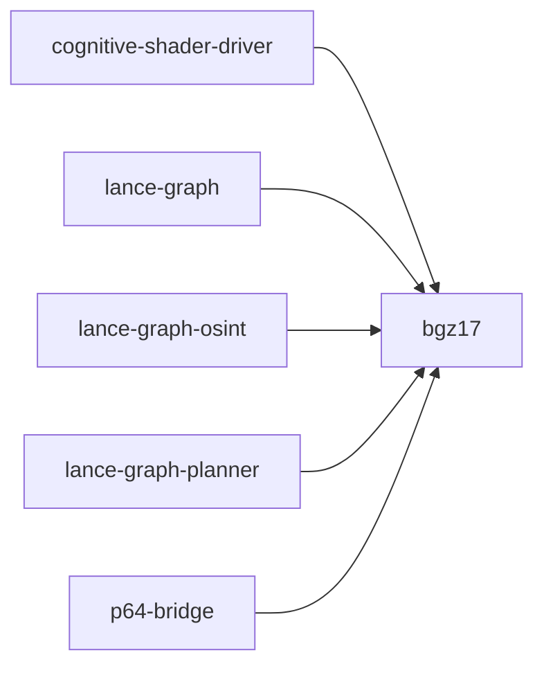

# bgz17

crate: bgz17
path: crates/bgz17
workspace: excluded
digest: 8bec2499622cf1d7
evidence legend: ../index.md#evidence-legend

Generated; the code is the truth. See ../index.md.

## Depends on

## Depended on by

- rdep cognitive-shader-driver normal — crates/cognitive-shader-driver/Cargo.toml:236 CONFIRMED
- rdep lance-graph normal optional — crates/lance-graph/Cargo.toml:101 CONFIRMED
- rdep lance-graph-osint normal — crates/lance-graph-osint/Cargo.toml:15 CONFIRMED
- rdep lance-graph-planner normal — crates/lance-graph-planner/Cargo.toml:36 CONFIRMED
- rdep p64-bridge normal — crates/p64-bridge/Cargo.toml:11 CONFIRMED
- rdep thinking-engine dev — crates/thinking-engine/Cargo.toml:50 CONFIRMED

## Public items

- struct Base17 [pub] — crates/bgz17/src/base17.rs:25 CONFIRMED
- const Base17::BYTE_SIZE [pub] — crates/bgz17/src/base17.rs:30 CONFIRMED
- fn Base17::encode [pub] — crates/bgz17/src/base17.rs:33 CONFIRMED
- fn Base17::l1 [pub] — crates/bgz17/src/base17.rs:60 CONFIRMED
- fn Base17::l1_weighted [pub] — crates/bgz17/src/base17.rs:77 CONFIRMED
- fn Base17::sign_agreement [pub] — crates/bgz17/src/base17.rs:95 CONFIRMED
- fn Base17::zero [pub] — crates/bgz17/src/base17.rs:106 CONFIRMED
- fn Base17::xor_bind [pub] — crates/bgz17/src/base17.rs:118 CONFIRMED
- fn Base17::bundle [pub] — crates/bgz17/src/base17.rs:130 CONFIRMED
- fn Base17::permute [pub] — crates/bgz17/src/base17.rs:153 CONFIRMED
- fn Base17::to_bytes [pub] — crates/bgz17/src/base17.rs:162 CONFIRMED
- fn Base17::from_bytes [pub] — crates/bgz17/src/base17.rs:173 CONFIRMED
- struct SpoBase17 [pub] — crates/bgz17/src/base17.rs:185 CONFIRMED
- const SpoBase17::BYTE_SIZE [pub] — crates/bgz17/src/base17.rs:192 CONFIRMED
- fn SpoBase17::encode [pub] — crates/bgz17/src/base17.rs:195 CONFIRMED
- fn SpoBase17::l1 [pub] — crates/bgz17/src/base17.rs:205 CONFIRMED
- fn SpoBase17::l1_per_plane [pub] — crates/bgz17/src/base17.rs:213 CONFIRMED
- fn SpoBase17::scent [pub] — crates/bgz17/src/base17.rs:222 CONFIRMED
- fn SpoBase17::zeckf64 [pub] — crates/bgz17/src/base17.rs:239 CONFIRMED
- trait Bgz17Distance [pub] — crates/bgz17/src/bridge.rs:55 CONFIRMED
- struct Bgz17Metric [pub] — crates/bgz17/src/bridge.rs:96 CONFIRMED
- fn Bgz17Metric::new [pub] — crates/bgz17/src/bridge.rs:101 CONFIRMED
- fn cakes_sieve [pub] — crates/bgz17/src/bridge.rs:147 CONFIRMED
- fn cakes_sieve_adaptive [pub] — crates/bgz17/src/bridge.rs:169 CONFIRMED
- fn search_prefilter_then_sieve [pub] — crates/bgz17/src/bridge.rs:199 CONFIRMED
- fn hhtl_leaf_bgz17 [pub] — crates/bgz17/src/bridge.rs:241 CONFIRMED
- struct LayerStats [pub] — crates/bgz17/src/clam_bridge.rs:38 CONFIRMED
- fn LayerStats::reset [pub] — crates/bgz17/src/clam_bridge.rs:51 CONFIRMED
- fn LayerStats::report [pub] — crates/bgz17/src/clam_bridge.rs:56 CONFIRMED
- struct Bgz17Metric [pub] — crates/bgz17/src/clam_bridge.rs:85 CONFIRMED
- fn Bgz17Metric::from_scope [pub] — crates/bgz17/src/clam_bridge.rs:105 CONFIRMED
- fn Bgz17Metric::distance [pub] — crates/bgz17/src/clam_bridge.rs:122 CONFIRMED
- fn Bgz17Metric::stats [pub] — crates/bgz17/src/clam_bridge.rs:164 CONFIRMED
- fn Bgz17Metric::reset_stats [pub] — crates/bgz17/src/clam_bridge.rs:169 CONFIRMED
- struct Lfd [pub] — crates/bgz17/src/clam_bridge.rs:198 CONFIRMED
- struct Bgz17Cluster [pub] — crates/bgz17/src/clam_bridge.rs:215 CONFIRMED
- fn Bgz17Cluster::is_leaf [pub] — crates/bgz17/src/clam_bridge.rs:228 CONFIRMED
- fn Bgz17Cluster::delta_plus [pub] — crates/bgz17/src/clam_bridge.rs:233 CONFIRMED
- fn Bgz17Cluster::delta_minus [pub] — crates/bgz17/src/clam_bridge.rs:238 CONFIRMED
- struct Bgz17ClamTree [pub] — crates/bgz17/src/clam_bridge.rs:244 CONFIRMED
- fn Bgz17ClamTree::build [pub] — crates/bgz17/src/clam_bridge.rs:253 CONFIRMED
- fn Bgz17ClamTree::rho_nn [pub] — crates/bgz17/src/clam_bridge.rs:433 CONFIRMED
- fn Bgz17ClamTree::knn_repeated_rho [pub] — crates/bgz17/src/clam_bridge.rs:470 CONFIRMED
- fn Bgz17ClamTree::knn_dfs_sieve [pub] — crates/bgz17/src/clam_bridge.rs:501 CONFIRMED
- fn Bgz17ClamTree::brute_force_knn [pub] — crates/bgz17/src/clam_bridge.rs:568 CONFIRMED
- fn build_clam_tree [pub] — crates/bgz17/src/clam_bridge.rs:588 CONFIRMED
- const CONTAINER_WORDS [pub] — crates/bgz17/src/container.rs:35 CONFIRMED
- const CONTAINER_BYTES [pub] — crates/bgz17/src/container.rs:38 CONFIRMED
- const W_DN_ADDR [pub] — crates/bgz17/src/container.rs:43 CONFIRMED
- const W_NODE_META [pub] — crates/bgz17/src/container.rs:45 CONFIRMED
- const W_TEMPORAL [pub] — crates/bgz17/src/container.rs:47 CONFIRMED
- const W_TREE_POS [pub] — crates/bgz17/src/container.rs:49 CONFIRMED
- const W_NARS_START [pub] — crates/bgz17/src/container.rs:52 CONFIRMED
- const W_NARS_END [pub] — crates/bgz17/src/container.rs:53 CONFIRMED
- const W_RUNG_START [pub] — crates/bgz17/src/container.rs:56 CONFIRMED
- const W_LAYER_MARKERS_END [pub] — crates/bgz17/src/container.rs:58 CONFIRMED
- const W_INLINE_EDGES_START [pub] — crates/bgz17/src/container.rs:61 CONFIRMED
- const W_INLINE_EDGES_END [pub] — crates/bgz17/src/container.rs:62 CONFIRMED
- const MAX_INLINE_EDGES [pub] — crates/bgz17/src/container.rs:64 CONFIRMED
- const W_RL_START [pub] — crates/bgz17/src/container.rs:67 CONFIRMED
- const W_RL_END [pub] — crates/bgz17/src/container.rs:68 CONFIRMED
- const W_BLOOM_START [pub] — crates/bgz17/src/container.rs:71 CONFIRMED
- const W_BLOOM_END [pub] — crates/bgz17/src/container.rs:72 CONFIRMED
- const W_GRAPH_METRICS_START [pub] — crates/bgz17/src/container.rs:75 CONFIRMED
- const W_GRAPH_METRICS_END [pub] — crates/bgz17/src/container.rs:76 CONFIRMED
- const W_QUALIA_START [pub] — crates/bgz17/src/container.rs:79 CONFIRMED
- const W_QUALIA_END [pub] — crates/bgz17/src/container.rs:80 CONFIRMED
- const W_RUNG_HISTORY_START [pub] — crates/bgz17/src/container.rs:83 CONFIRMED
- const W_RUNG_HISTORY_END [pub] — crates/bgz17/src/container.rs:84 CONFIRMED
- const W_REPR_DESC_START [pub] — crates/bgz17/src/container.rs:87 CONFIRMED
- const W_REPR_DESC_END [pub] — crates/bgz17/src/container.rs:88 CONFIRMED
- const W_DN_SPARSE_START [pub] — crates/bgz17/src/container.rs:91 CONFIRMED
- const W_DN_SPARSE_END [pub] — crates/bgz17/src/container.rs:92 CONFIRMED
- const W_BGZ17_ANNEX_START [pub] — crates/bgz17/src/container.rs:95 CONFIRMED
- const W_BGZ17_ANNEX_END [pub] — crates/bgz17/src/container.rs:96 CONFIRMED
- const W_PALETTE_PACK [pub] — crates/bgz17/src/container.rs:100 CONFIRMED
- const W_CHECKSUM [pub] — crates/bgz17/src/container.rs:103 CONFIRMED
- const W_VERSION [pub] — crates/bgz17/src/container.rs:104 CONFIRMED
- const W_SPO_CRYSTAL_START [pub] — crates/bgz17/src/container.rs:109 CONFIRMED
- const W_SPO_CRYSTAL_END [pub] — crates/bgz17/src/container.rs:110 CONFIRMED
- const W_EXT_EDGES_START [pub] — crates/bgz17/src/container.rs:113 CONFIRMED
- const W_EXT_EDGES_END [pub] — crates/bgz17/src/container.rs:114 CONFIRMED
- const MAX_TOTAL_EDGES [pub] — crates/bgz17/src/container.rs:116 CONFIRMED
- const W_WIDE_CHECKSUM [pub] — crates/bgz17/src/container.rs:119 CONFIRMED
- const W_FORMAT_TAG [pub] — crates/bgz17/src/container.rs:121 CONFIRMED
- const FORMAT_BGZ17_ANNEX [pub] — crates/bgz17/src/container.rs:126 CONFIRMED
- const FORMAT_COGREC_8K [pub] — crates/bgz17/src/container.rs:129 CONFIRMED
- fn pack_base17_annex [pub] — crates/bgz17/src/container.rs:143 CONFIRMED
- fn unpack_base17_annex [pub] — crates/bgz17/src/container.rs:174 CONFIRMED
- fn pack_palette_word [pub] — crates/bgz17/src/container.rs:192 CONFIRMED
- fn unpack_palette_word [pub] — crates/bgz17/src/container.rs:205 CONFIRMED
- fn pack_annex [pub] — crates/bgz17/src/container.rs:217 CONFIRMED
- fn unpack_annex [pub] — crates/bgz17/src/container.rs:229 CONFIRMED
- struct CrystalTriple [pub] — crates/bgz17/src/container.rs:243 CONFIRMED
- const CrystalTriple::BYTE_SIZE [pub] — crates/bgz17/src/container.rs:265 CONFIRMED
- const CrystalTriple::MAX_CRYSTAL_TRIPLES [pub] — crates/bgz17/src/container.rs:267 CONFIRMED
- fn pack_spo_crystal [pub] — crates/bgz17/src/container.rs:299 CONFIRMED
- fn unpack_spo_crystal [pub] — crates/bgz17/src/container.rs:322 CONFIRMED
- struct InlineEdge [pub] — crates/bgz17/src/container.rs:344 CONFIRMED
- fn InlineEdge::pack4 [pub] — crates/bgz17/src/container.rs:351 CONFIRMED
- fn InlineEdge::unpack4 [pub] — crates/bgz17/src/container.rs:363 CONFIRMED
- fn pack_extended_edges [pub] — crates/bgz17/src/container.rs:387 CONFIRMED
- fn unpack_extended_edges [pub] — crates/bgz17/src/container.rs:414 CONFIRMED
- fn compute_wide_checksum [pub] — crates/bgz17/src/container.rs:436 CONFIRMED
- fn seal_wide_meta [pub] — crates/bgz17/src/container.rs:445 CONFIRMED
- fn verify_wide_checksum [pub] — crates/bgz17/src/container.rs:451 CONFIRMED
- fn has_bgz17_annex [pub] — crates/bgz17/src/container.rs:477 CONFIRMED
- fn cascade_stride16_positions [pub] — crates/bgz17/src/container.rs:483 CONFIRMED
- struct DistanceMatrix [pub] — crates/bgz17/src/distance_matrix.rs:15 CONFIRMED
- fn DistanceMatrix::build [pub] — crates/bgz17/src/distance_matrix.rs:24 CONFIRMED
- fn DistanceMatrix::distance [pub] — crates/bgz17/src/distance_matrix.rs:45 CONFIRMED
- fn DistanceMatrix::build_pcdvq_weighted [pub] — crates/bgz17/src/distance_matrix.rs:53 CONFIRMED
- fn DistanceMatrix::byte_size [pub] — crates/bgz17/src/distance_matrix.rs:73 CONFIRMED
- struct SpoDistanceMatrices [pub] — crates/bgz17/src/distance_matrix.rs:80 CONFIRMED
- fn SpoDistanceMatrices::build [pub] — crates/bgz17/src/distance_matrix.rs:88 CONFIRMED
- fn SpoDistanceMatrices::spo_distance [pub] — crates/bgz17/src/distance_matrix.rs:98 CONFIRMED
- fn SpoDistanceMatrices::scent [pub] — crates/bgz17/src/distance_matrix.rs:106 CONFIRMED
- fn SpoDistanceMatrices::byte_size [pub] — crates/bgz17/src/distance_matrix.rs:126 CONFIRMED
- struct LfdProfile [pub] — crates/bgz17/src/generative.rs:52 CONFIRMED
- fn correction_factor [pub] — crates/bgz17/src/generative.rs:73 CONFIRMED
- fn generative_distance [pub] — crates/bgz17/src/generative.rs:90 CONFIRMED
- fn generative_batch [pub] — crates/bgz17/src/generative.rs:99 CONFIRMED
- fn anomaly_to_layer [pub] — crates/bgz17/src/generative.rs:125 CONFIRMED
- fn mismatch_penalty [pub] — crates/bgz17/src/generative.rs:143 CONFIRMED
- struct LayeredHit [pub] — crates/bgz17/src/layered.rs:19 CONFIRMED
- struct LayeredScope [pub] — crates/bgz17/src/layered.rs:40 CONFIRMED
- fn LayeredScope::search_scent [pub] — crates/bgz17/src/layered.rs:58 CONFIRMED
- fn LayeredScope::refine_palette [pub] — crates/bgz17/src/layered.rs:84 CONFIRMED
- fn LayeredScope::refine_base [pub] — crates/bgz17/src/layered.rs:106 CONFIRMED
- fn LayeredScope::search [pub] — crates/bgz17/src/layered.rs:122 CONFIRMED
- fn LayeredScope::storage_breakdown [pub] — crates/bgz17/src/layered.rs:146 CONFIRMED
- struct StorageBreakdown [pub] — crates/bgz17/src/layered.rs:160 CONFIRMED
- mod base17 [pub] — crates/bgz17/src/lib.rs:29 CONFIRMED
- mod bridge [pub] — crates/bgz17/src/lib.rs:30 CONFIRMED
- mod clam_bridge [pub] — crates/bgz17/src/lib.rs:31 CONFIRMED
- mod container [pub] — crates/bgz17/src/lib.rs:32 CONFIRMED
- mod distance_matrix [pub] — crates/bgz17/src/lib.rs:33 CONFIRMED
- mod generative [pub] — crates/bgz17/src/lib.rs:34 CONFIRMED
- mod layered [pub] — crates/bgz17/src/lib.rs:35 CONFIRMED
- mod palette [pub] — crates/bgz17/src/lib.rs:36 CONFIRMED
- mod palette_csr [pub] — crates/bgz17/src/lib.rs:37 CONFIRMED
- mod palette_matrix [pub] — crates/bgz17/src/lib.rs:38 CONFIRMED
- mod palette_semiring [pub] — crates/bgz17/src/lib.rs:39 CONFIRMED
- mod prefetch [pub] — crates/bgz17/src/lib.rs:40 CONFIRMED
- mod rabitq_compat [pub] — crates/bgz17/src/lib.rs:41 CONFIRMED
- mod router [pub] — crates/bgz17/src/lib.rs:42 CONFIRMED
- mod scalar_sparse [pub] — crates/bgz17/src/lib.rs:43 CONFIRMED
- mod scope [pub] — crates/bgz17/src/lib.rs:44 CONFIRMED
- mod simd [pub] — crates/bgz17/src/lib.rs:45 CONFIRMED
- mod similarity [pub] — crates/bgz17/src/lib.rs:46 CONFIRMED
- mod tripartite [pub] — crates/bgz17/src/lib.rs:47 CONFIRMED
- mod typed_palette_graph [pub] — crates/bgz17/src/lib.rs:48 CONFIRMED
- const MAX_PALETTE_SIZE [pub] — crates/bgz17/src/lib.rs:51 CONFIRMED
- const BASE_DIM [pub] — crates/bgz17/src/lib.rs:54 CONFIRMED
- const FULL_DIM [pub] — crates/bgz17/src/lib.rs:57 CONFIRMED
- const GOLDEN_STEP [pub] — crates/bgz17/src/lib.rs:60 CONFIRMED
- const FP_SCALE [pub] — crates/bgz17/src/lib.rs:63 CONFIRMED
- enum Precision [pub] — crates/bgz17/src/lib.rs:79 CONFIRMED
- struct Palette [pub] — crates/bgz17/src/palette.rs:14 CONFIRMED
- struct PaletteEdge [pub] — crates/bgz17/src/palette.rs:21 CONFIRMED
- fn PaletteEdge::to_bytes [pub] — crates/bgz17/src/palette.rs:29 CONFIRMED
- fn PaletteEdge::from_bytes [pub] — crates/bgz17/src/palette.rs:34 CONFIRMED
- fn Palette::len [pub] — crates/bgz17/src/palette.rs:45 CONFIRMED
- fn Palette::is_empty [pub] — crates/bgz17/src/palette.rs:49 CONFIRMED
- fn Palette::codebook_bytes [pub] — crates/bgz17/src/palette.rs:54 CONFIRMED
- fn Palette::nearest [pub] — crates/bgz17/src/palette.rs:59 CONFIRMED
- fn Palette::build_distance_table [pub] — crates/bgz17/src/palette.rs:77 CONFIRMED
- fn Palette::encode_edge [pub] — crates/bgz17/src/palette.rs:91 CONFIRMED
- fn Palette::decode_edge [pub] — crates/bgz17/src/palette.rs:100 CONFIRMED
- fn Palette::build [pub] — crates/bgz17/src/palette.rs:112 CONFIRMED
- fn Palette::build_hierarchical [pub] — crates/bgz17/src/palette.rs:214 CONFIRMED
- fn Palette::from_sigma_bands [pub] — crates/bgz17/src/palette.rs:277 CONFIRMED
- fn Palette::build_spo [pub] — crates/bgz17/src/palette.rs:323 CONFIRMED
- struct HierarchicalPalette [pub] — crates/bgz17/src/palette.rs:451 CONFIRMED
- fn HierarchicalPalette::coarse_len [pub] — crates/bgz17/src/palette.rs:462 CONFIRMED
- fn HierarchicalPalette::leaf_len [pub] — crates/bgz17/src/palette.rs:467 CONFIRMED
- fn HierarchicalPalette::coarse_index [pub] — crates/bgz17/src/palette.rs:473 CONFIRMED
- fn HierarchicalPalette::coarse_of [pub] — crates/bgz17/src/palette.rs:479 CONFIRMED
- fn HierarchicalPalette::coarse_is_ancestor_of [pub] — crates/bgz17/src/palette.rs:493 CONFIRMED
- struct PaletteDistanceTable [pub] — crates/bgz17/src/palette.rs:506 CONFIRMED
- fn PaletteDistanceTable::distance [pub] — crates/bgz17/src/palette.rs:514 CONFIRMED
- fn PaletteDistanceTable::size [pub] — crates/bgz17/src/palette.rs:519 CONFIRMED
- fn PaletteDistanceTable::edge_distance [pub] — crates/bgz17/src/palette.rs:525 CONFIRMED
- fn PaletteDistanceTable::byte_size [pub] — crates/bgz17/src/palette.rs:532 CONFIRMED
- enum PaletteResolution [pub] — crates/bgz17/src/palette.rs:543 CONFIRMED
- fn PaletteResolution::auto_select [pub] — crates/bgz17/src/palette.rs:558 CONFIRMED
- fn PaletteResolution::k [pub] — crates/bgz17/src/palette.rs:569 CONFIRMED
- fn PaletteResolution::matrix_bytes [pub] — crates/bgz17/src/palette.rs:578 CONFIRMED
- struct PaletteCsr [pub] — crates/bgz17/src/palette_csr.rs:20 CONFIRMED
- struct ArchetypeNode [pub] — crates/bgz17/src/palette_csr.rs:37 CONFIRMED
- struct ArchetypeTree [pub] — crates/bgz17/src/palette_csr.rs:52 CONFIRMED
- fn PaletteCsr::from_scope_with_edges [pub] — crates/bgz17/src/palette_csr.rs:62 CONFIRMED
- fn PaletteCsr::build_archetype_tree [pub] — crates/bgz17/src/palette_csr.rs:117 CONFIRMED
- fn PaletteCsr::search [pub] — crates/bgz17/src/palette_csr.rs:224 CONFIRMED
- struct PaletteMatrix [pub] — crates/bgz17/src/palette_matrix.rs:17 CONFIRMED
- fn PaletteMatrix::new [pub] — crates/bgz17/src/palette_matrix.rs:30 CONFIRMED
- fn PaletteMatrix::nnz [pub] — crates/bgz17/src/palette_matrix.rs:41 CONFIRMED
- fn PaletteMatrix::get [pub] — crates/bgz17/src/palette_matrix.rs:46 CONFIRMED
- fn PaletteMatrix::from_triples [pub] — crates/bgz17/src/palette_matrix.rs:58 CONFIRMED
- fn PaletteMatrix::mxm [pub] — crates/bgz17/src/palette_matrix.rs:109 CONFIRMED
- truncated (275 total), see symbols.tsv

## Imports from in-scope crates

- none

## Calls

CALL_GRAPH=ARTIFACT_MISSING
- calls ARTIFACT_MISSING — no ruff_charon artifact for this crate UNKNOWN

## Architecture

- none

Generated from Cargo manifests — extracted relationships only.

