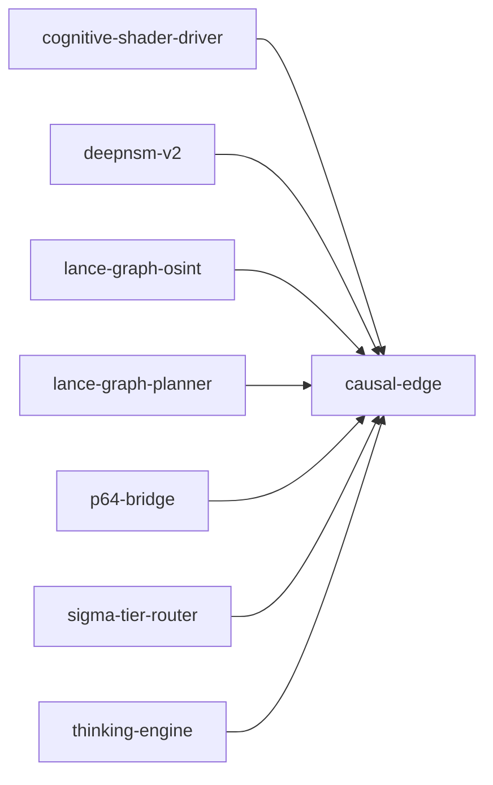

# causal-edge

crate: causal-edge
path: crates/causal-edge
workspace: excluded
digest: c0fc81913c25420a
evidence legend: ../index.md#evidence-legend

Generated; the code is the truth. See ../index.md.

## Depends on

## Depended on by

- rdep cognitive-shader-driver normal — crates/cognitive-shader-driver/Cargo.toml:237 CONFIRMED
- rdep deepnsm-v2 normal — crates/deepnsm-v2/Cargo.toml:32 CONFIRMED
- rdep lance-graph dev — crates/lance-graph/Cargo.toml:174 CONFIRMED
- rdep lance-graph-mask-risc dev — crates/lance-graph-mask-risc/Cargo.toml:36 CONFIRMED
- rdep lance-graph-osint normal — crates/lance-graph-osint/Cargo.toml:14 CONFIRMED
- rdep lance-graph-planner normal — crates/lance-graph-planner/Cargo.toml:27 CONFIRMED
- rdep lance-graph-quack dev — crates/lance-graph-quack/Cargo.toml:27 CONFIRMED
- rdep p64-bridge normal — crates/p64-bridge/Cargo.toml:10 CONFIRMED
- rdep sigma-tier-router normal — crates/sigma-tier-router/Cargo.toml:8 CONFIRMED
- rdep thinking-engine normal — crates/thinking-engine/Cargo.toml:16 CONFIRMED

## Public items

- enum InferenceType [pub] — crates/causal-edge/src/edge.rs:13 CONFIRMED
- fn InferenceType::to_mantissa [pub] — crates/causal-edge/src/edge.rs:67 CONFIRMED
- fn InferenceType::from_mantissa [pub] — crates/causal-edge/src/edge.rs:92 CONFIRMED
- struct CausalEdge64 [pub] — crates/causal-edge/src/edge.rs:181 CONFIRMED
- fn CausalEdge64::to_le_bytes [pub] — crates/causal-edge/src/edge.rs:208 CONFIRMED
- fn CausalEdge64::from_le_bytes [pub] — crates/causal-edge/src/edge.rs:215 CONFIRMED
- const CausalEdge64::ZERO [pub] — crates/causal-edge/src/edge.rs:220 CONFIRMED
- fn CausalEdge64::pack [pub] — crates/causal-edge/src/edge.rs:236 CONFIRMED
- fn CausalEdge64::s_idx [pub] — crates/causal-edge/src/edge.rs:284 CONFIRMED
- fn CausalEdge64::p_idx [pub] — crates/causal-edge/src/edge.rs:290 CONFIRMED
- fn CausalEdge64::o_idx [pub] — crates/causal-edge/src/edge.rs:296 CONFIRMED
- fn CausalEdge64::set_s_idx [pub] — crates/causal-edge/src/edge.rs:302 CONFIRMED
- fn CausalEdge64::set_p_idx [pub] — crates/causal-edge/src/edge.rs:308 CONFIRMED
- fn CausalEdge64::set_o_idx [pub] — crates/causal-edge/src/edge.rs:314 CONFIRMED
- fn CausalEdge64::frequency_u8 [pub] — crates/causal-edge/src/edge.rs:322 CONFIRMED
- fn CausalEdge64::confidence_u8 [pub] — crates/causal-edge/src/edge.rs:328 CONFIRMED
- fn CausalEdge64::frequency [pub] — crates/causal-edge/src/edge.rs:334 CONFIRMED
- fn CausalEdge64::confidence [pub] — crates/causal-edge/src/edge.rs:340 CONFIRMED
- fn CausalEdge64::expectation [pub] — crates/causal-edge/src/edge.rs:346 CONFIRMED
- fn CausalEdge64::evidence_weight [pub] — crates/causal-edge/src/edge.rs:354 CONFIRMED
- fn CausalEdge64::set_frequency_u8 [pub] — crates/causal-edge/src/edge.rs:360 CONFIRMED
- fn CausalEdge64::set_confidence_u8 [pub] — crates/causal-edge/src/edge.rs:366 CONFIRMED
- fn CausalEdge64::set_frequency [pub] — crates/causal-edge/src/edge.rs:372 CONFIRMED
- fn CausalEdge64::set_confidence [pub] — crates/causal-edge/src/edge.rs:378 CONFIRMED
- fn CausalEdge64::causal_mask [pub] — crates/causal-edge/src/edge.rs:386 CONFIRMED
- fn CausalEdge64::set_causal_mask [pub] — crates/causal-edge/src/edge.rs:392 CONFIRMED
- fn CausalEdge64::matches_causal [pub] — crates/causal-edge/src/edge.rs:416 CONFIRMED
- fn CausalEdge64::matches_causal_mask [pub] — crates/causal-edge/src/edge.rs:424 CONFIRMED
- fn CausalEdge64::s_active [pub] — crates/causal-edge/src/edge.rs:430 CONFIRMED
- fn CausalEdge64::p_active [pub] — crates/causal-edge/src/edge.rs:436 CONFIRMED
- fn CausalEdge64::o_active [pub] — crates/causal-edge/src/edge.rs:442 CONFIRMED
- fn CausalEdge64::orientation [pub] — crates/causal-edge/src/edge.rs:450 CONFIRMED
- fn CausalEdge64::set_orientation [pub] — crates/causal-edge/src/edge.rs:456 CONFIRMED
- fn CausalEdge64::inference [pub] — crates/causal-edge/src/edge.rs:471 CONFIRMED
- fn CausalEdge64::inference_type [pub] — crates/causal-edge/src/edge.rs:498 CONFIRMED
- fn CausalEdge64::set_inference [pub] — crates/causal-edge/src/edge.rs:506 CONFIRMED
- fn CausalEdge64::set_inference_type [pub] — crates/causal-edge/src/edge.rs:522 CONFIRMED
- fn CausalEdge64::plasticity [pub] — crates/causal-edge/src/edge.rs:534 CONFIRMED
- fn CausalEdge64::set_plasticity [pub] — crates/causal-edge/src/edge.rs:550 CONFIRMED
- fn CausalEdge64::temporal [pub] — crates/causal-edge/src/edge.rs:580 CONFIRMED
- fn CausalEdge64::set_temporal [pub] — crates/causal-edge/src/edge.rs:597 CONFIRMED
- fn CausalEdge64::causal_distance [pub] — crates/causal-edge/src/edge.rs:615 CONFIRMED
- fn CausalEdge64::forward [pub] — crates/causal-edge/src/edge.rs:650 CONFIRMED
- fn CausalEdge64::deduction [pub] — crates/causal-edge/src/edge.rs:676 CONFIRMED
- fn CausalEdge64::induction [pub] — crates/causal-edge/src/edge.rs:683 CONFIRMED
- fn CausalEdge64::abduction [pub] — crates/causal-edge/src/edge.rs:690 CONFIRMED
- fn CausalEdge64::revision [pub] — crates/causal-edge/src/edge.rs:705 CONFIRMED
- fn CausalEdge64::synthesis [pub] — crates/causal-edge/src/edge.rs:721 CONFIRMED
- fn CausalEdge64::counterfactual [pub] — crates/causal-edge/src/edge.rs:733 CONFIRMED
- fn CausalEdge64::intervention [pub] — crates/causal-edge/src/edge.rs:745 CONFIRMED
- fn CausalEdge64::execute [pub] — crates/causal-edge/src/edge.rs:763 CONFIRMED
- fn CausalEdge64::learn [pub] — crates/causal-edge/src/edge.rs:809 CONFIRMED
- fn CausalEdge64::is_interventional [pub] — crates/causal-edge/src/edge.rs:870 CONFIRMED
- fn CausalEdge64::is_counterfactual [pub] — crates/causal-edge/src/edge.rs:876 CONFIRMED
- fn CausalEdge64::counterfactual_ready [pub] — crates/causal-edge/src/edge.rs:883 CONFIRMED
- fn CausalEdge64::is_frozen [pub] — crates/causal-edge/src/edge.rs:889 CONFIRMED
- fn CausalEdge64::pack_v2 [pub] cfg=feature="causal-edge-v2-layout" — crates/causal-edge/src/edge.rs:906 CONFIRMED
- fn CausalEdge64::w_slot [pub] cfg=feature="causal-edge-v2-layout" — crates/causal-edge/src/edge.rs:950 CONFIRMED
- fn CausalEdge64::inference_mantissa [pub] cfg=feature="causal-edge-v2-layout" — crates/causal-edge/src/edge.rs:964 CONFIRMED
- fn CausalEdge64::inference_direction [pub] cfg=feature="causal-edge-v2-layout" — crates/causal-edge/src/edge.rs:976 CONFIRMED
- fn CausalEdge64::inference_rule_index [pub] cfg=feature="causal-edge-v2-layout" — crates/causal-edge/src/edge.rs:989 CONFIRMED
- fn CausalEdge64::truth [pub] cfg=feature="causal-edge-v2-layout" — crates/causal-edge/src/edge.rs:998 CONFIRMED
- fn CausalEdge64::truth_raw [pub] cfg=feature="causal-edge-v2-layout" — crates/causal-edge/src/edge.rs:1006 CONFIRMED
- fn CausalEdge64::topology [pub] cfg=feature="causal-edge-v2-layout" — crates/causal-edge/src/edge.rs:1023 CONFIRMED
- fn CausalEdge64::spare [pub] cfg=feature="causal-edge-v2-layout" — crates/causal-edge/src/edge.rs:1038 CONFIRMED
- fn CausalEdge64::reasoning_band [pub] cfg=feature="causal-edge-v2-layout" — crates/causal-edge/src/edge.rs:1050 CONFIRMED
- fn CausalEdge64::epistemic_raw5 [pub] cfg=feature="causal-edge-v2-layout" — crates/causal-edge/src/edge.rs:1066 CONFIRMED
- fn CausalEdge64::with_w_slot [pub] cfg=feature="causal-edge-v2-layout" — crates/causal-edge/src/edge.rs:1075 CONFIRMED
- fn CausalEdge64::novelty_wisdom [pub] cfg=feature="causal-edge-v2-layout" — crates/causal-edge/src/edge.rs:1095 CONFIRMED
- fn CausalEdge64::with_novelty_wisdom [pub] cfg=feature="causal-edge-v2-layout" — crates/causal-edge/src/edge.rs:1102 CONFIRMED
- fn CausalEdge64::activation [pub] cfg=feature="causal-edge-v2-layout" — crates/causal-edge/src/edge.rs:1118 CONFIRMED
- fn CausalEdge64::with_activation [pub] cfg=feature="causal-edge-v2-layout" — crates/causal-edge/src/edge.rs:1125 CONFIRMED
- fn CausalEdge64::with_epistemic_raw5 [pub] cfg=feature="causal-edge-v2-layout" — crates/causal-edge/src/edge.rs:1137 CONFIRMED
- fn CausalEdge64::with_truth [pub] cfg=feature="causal-edge-v2-layout" — crates/causal-edge/src/edge.rs:1152 CONFIRMED
- fn CausalEdge64::with_topology [pub] cfg=feature="causal-edge-v2-layout" — crates/causal-edge/src/edge.rs:1171 CONFIRMED
- fn CausalEdge64::with_inference_mantissa [pub] cfg=feature="causal-edge-v2-layout" — crates/causal-edge/src/edge.rs:1181 CONFIRMED
- fn CausalEdge64::with_spare [pub] cfg=feature="causal-edge-v2-layout" — crates/causal-edge/src/edge.rs:1194 CONFIRMED
- fn CausalEdge64::with_reasoning_band [pub] cfg=feature="causal-edge-v2-layout" — crates/causal-edge/src/edge.rs:1227 CONFIRMED
- fn CausalEdge64::with_routing [pub] cfg=feature="causal-edge-v2-layout" — crates/causal-edge/src/edge.rs:1245 CONFIRMED
- fn CausalEdge64::set_w_slot [pub] cfg=feature="causal-edge-v2-layout" — crates/causal-edge/src/edge.rs:1257 CONFIRMED
- fn CausalEdge64::set_truth [pub] cfg=feature="causal-edge-v2-layout" — crates/causal-edge/src/edge.rs:1269 CONFIRMED
- fn CausalEdge64::set_inference_mantissa [pub] cfg=feature="causal-edge-v2-layout" — crates/causal-edge/src/edge.rs:1276 CONFIRMED
- fn CausalEdge64::set_spare [pub] cfg=feature="causal-edge-v2-layout" — crates/causal-edge/src/edge.rs:1289 CONFIRMED
- fn CausalEdge64::w_slot [pub] cfg=not(feature="causal-edge-v2-layout") — crates/causal-edge/src/edge.rs:1303 CONFIRMED
- fn CausalEdge64::inference_mantissa [pub] cfg=not(feature="causal-edge-v2-layout") — crates/causal-edge/src/edge.rs:1307 CONFIRMED
- fn CausalEdge64::inference_direction [pub] cfg=not(feature="causal-edge-v2-layout") — crates/causal-edge/src/edge.rs:1311 CONFIRMED
- fn CausalEdge64::inference_rule_index [pub] cfg=not(feature="causal-edge-v2-layout") — crates/causal-edge/src/edge.rs:1315 CONFIRMED
- fn CausalEdge64::truth [pub] cfg=not(feature="causal-edge-v2-layout") — crates/causal-edge/src/edge.rs:1319 CONFIRMED
- fn CausalEdge64::truth_raw [pub] cfg=not(feature="causal-edge-v2-layout") — crates/causal-edge/src/edge.rs:1323 CONFIRMED
- fn CausalEdge64::topology [pub] cfg=not(feature="causal-edge-v2-layout") — crates/causal-edge/src/edge.rs:1329 CONFIRMED
- fn CausalEdge64::spare [pub] cfg=not(feature="causal-edge-v2-layout") — crates/causal-edge/src/edge.rs:1333 CONFIRMED
- fn CausalEdge64::reasoning_band [pub] cfg=not(feature="causal-edge-v2-layout") — crates/causal-edge/src/edge.rs:1339 CONFIRMED
- fn CausalEdge64::epistemic_raw5 [pub] cfg=not(feature="causal-edge-v2-layout") — crates/causal-edge/src/edge.rs:1345 CONFIRMED
- fn CausalEdge64::with_epistemic_raw5 [pub] cfg=not(feature="causal-edge-v2-layout") — crates/causal-edge/src/edge.rs:1350 CONFIRMED
- fn CausalEdge64::with_w_slot [pub] cfg=not(feature="causal-edge-v2-layout") — crates/causal-edge/src/edge.rs:1354 CONFIRMED
- fn CausalEdge64::novelty_wisdom [pub] cfg=not(feature="causal-edge-v2-layout") — crates/causal-edge/src/edge.rs:1358 CONFIRMED
- fn CausalEdge64::with_novelty_wisdom [pub] cfg=not(feature="causal-edge-v2-layout") — crates/causal-edge/src/edge.rs:1362 CONFIRMED
- fn CausalEdge64::activation [pub] cfg=not(feature="causal-edge-v2-layout") — crates/causal-edge/src/edge.rs:1366 CONFIRMED
- fn CausalEdge64::with_activation [pub] cfg=not(feature="causal-edge-v2-layout") — crates/causal-edge/src/edge.rs:1370 CONFIRMED
- fn CausalEdge64::with_truth [pub] cfg=not(feature="causal-edge-v2-layout") — crates/causal-edge/src/edge.rs:1378 CONFIRMED
- fn CausalEdge64::with_topology [pub] cfg=not(feature="causal-edge-v2-layout") — crates/causal-edge/src/edge.rs:1382 CONFIRMED
- fn CausalEdge64::with_inference_mantissa [pub] cfg=not(feature="causal-edge-v2-layout") — crates/causal-edge/src/edge.rs:1386 CONFIRMED
- fn CausalEdge64::with_spare [pub] cfg=not(feature="causal-edge-v2-layout") — crates/causal-edge/src/edge.rs:1394 CONFIRMED
- fn CausalEdge64::with_reasoning_band [pub] cfg=not(feature="causal-edge-v2-layout") — crates/causal-edge/src/edge.rs:1402 CONFIRMED
- fn CausalEdge64::with_routing [pub] cfg=not(feature="causal-edge-v2-layout") — crates/causal-edge/src/edge.rs:1410 CONFIRMED
- fn CausalEdge64::set_w_slot [pub] cfg=not(feature="causal-edge-v2-layout") — crates/causal-edge/src/edge.rs:1414 CONFIRMED
- fn CausalEdge64::set_truth [pub] cfg=not(feature="causal-edge-v2-layout") — crates/causal-edge/src/edge.rs:1420 CONFIRMED
- fn CausalEdge64::set_inference_mantissa [pub] cfg=not(feature="causal-edge-v2-layout") — crates/causal-edge/src/edge.rs:1422 CONFIRMED
- fn CausalEdge64::set_spare [pub] cfg=not(feature="causal-edge-v2-layout") — crates/causal-edge/src/edge.rs:1428 CONFIRMED
- struct CausalEdgeV3 [pub] — crates/causal-edge/src/edge_v3.rs:96 CONFIRMED
- fn CausalEdgeV3::from_v1 [pub] — crates/causal-edge/src/edge_v3.rs:122 CONFIRMED
- fn CausalEdgeV3::from_v1_tail_unstated [pub] — crates/causal-edge/src/edge_v3.rs:181 CONFIRMED
- fn CausalEdgeV3::frequency [pub] — crates/causal-edge/src/edge_v3.rs:189 CONFIRMED
- fn CausalEdgeV3::confidence [pub] — crates/causal-edge/src/edge_v3.rs:194 CONFIRMED
- fn CausalEdgeV3::causal_mask [pub] — crates/causal-edge/src/edge_v3.rs:199 CONFIRMED
- fn CausalEdgeV3::orientation [pub] — crates/causal-edge/src/edge_v3.rs:204 CONFIRMED
- fn CausalEdgeV3::inference_mantissa [pub] — crates/causal-edge/src/edge_v3.rs:214 CONFIRMED
- fn CausalEdgeV3::plasticity [pub] — crates/causal-edge/src/edge_v3.rs:225 CONFIRMED
- fn CausalEdgeV3::w_slot [pub] — crates/causal-edge/src/edge_v3.rs:231 CONFIRMED
- fn CausalEdgeV3::truth_raw [pub] — crates/causal-edge/src/edge_v3.rs:244 CONFIRMED
- fn CausalEdgeV3::spare_raw [pub] — crates/causal-edge/src/edge_v3.rs:251 CONFIRMED
- fn CausalEdgeV3::epistemic_raw5 [pub] — crates/causal-edge/src/edge_v3.rs:261 CONFIRMED
- fn CausalEdgeV3::rehydrate [pub] — crates/causal-edge/src/edge_v3.rs:277 CONFIRMED
- fn CausalEdgeV3::target [pub] — crates/causal-edge/src/edge_v3.rs:301 CONFIRMED
- fn CausalEdgeV3::anaphora [pub] — crates/causal-edge/src/edge_v3.rs:307 CONFIRMED
- fn CausalEdgeV3::set_anaphora [pub] — crates/causal-edge/src/edge_v3.rs:319 CONFIRMED
- fn CausalEdgeV3::temporal [pub] — crates/causal-edge/src/edge_v3.rs:328 CONFIRMED
- fn CausalEdgeV3::set_temporal [pub] — crates/causal-edge/src/edge_v3.rs:334 CONFIRMED
- fn CausalEdgeV3::to_le_bytes [pub] — crates/causal-edge/src/edge_v3.rs:339 CONFIRMED
- fn CausalEdgeV3::from_le_bytes [pub] — crates/causal-edge/src/edge_v3.rs:344 CONFIRMED
- enum Opcode [pub] — crates/causal-edge/src/isa.rs:50 CONFIRMED
- struct Compose [pub] — crates/causal-edge/src/isa.rs:69 CONFIRMED
- enum IsaFault [pub] — crates/causal-edge/src/isa.rs:80 CONFIRMED
- fn IsaFault::unsupported [pub] — crates/causal-edge/src/isa.rs:96 CONFIRMED
- const Opcode::ALL [pub] — crates/causal-edge/src/isa.rs:122 CONFIRMED
- fn Opcode::encoding [pub] — crates/causal-edge/src/isa.rs:132 CONFIRMED
- fn Opcode::decode [pub] — crates/causal-edge/src/isa.rs:150 CONFIRMED
- fn Opcode::decode_v1 [pub] — crates/causal-edge/src/isa.rs:163 CONFIRMED
- fn Opcode::inference_type [pub] — crates/causal-edge/src/isa.rs:176 CONFIRMED
- fn Opcode::truth [pub] — crates/causal-edge/src/isa.rs:192 CONFIRMED
- fn Opcode::truth_code [pub] — crates/causal-edge/src/isa.rs:209 CONFIRMED
- mod truth [pub] — crates/causal-edge/src/isa.rs:228 CONFIRMED
- fn evidence_weight [pub] — crates/causal-edge/src/isa.rs:236 CONFIRMED
- fn deduction [pub] — crates/causal-edge/src/isa.rs:246 CONFIRMED
- fn induction [pub] — crates/causal-edge/src/isa.rs:253 CONFIRMED
- fn abduction [pub] — crates/causal-edge/src/isa.rs:260 CONFIRMED
- fn revision [pub] — crates/causal-edge/src/isa.rs:272 CONFIRMED
- fn synthesis [pub] — crates/causal-edge/src/isa.rs:285 CONFIRMED
- fn pack [pub] — crates/causal-edge/src/isa.rs:292 CONFIRMED
- mod code [pub] — crates/causal-edge/src/isa.rs:304 CONFIRMED
- fn deduction [pub] — crates/causal-edge/src/isa.rs:322 CONFIRMED
- fn induction [pub] — crates/causal-edge/src/isa.rs:332 CONFIRMED
- fn abduction [pub] — crates/causal-edge/src/isa.rs:338 CONFIRMED
- enum Field [pub] cfg=feature="causal-edge-v2-layout" — crates/causal-edge/src/isa.rs:347 CONFIRMED
- const Field::ALL [pub] cfg=feature="causal-edge-v2-layout" — crates/causal-edge/src/isa.rs:371 CONFIRMED
- fn Field::span [pub] cfg=feature="causal-edge-v2-layout" — crates/causal-edge/src/isa.rs:384 CONFIRMED
- fn Field::mask [pub] cfg=feature="causal-edge-v2-layout" — crates/causal-edge/src/isa.rs:399 CONFIRMED
- fn Field::get [pub] cfg=feature="causal-edge-v2-layout" — crates/causal-edge/src/isa.rs:405 CONFIRMED
- enum Operand [pub] — crates/causal-edge/src/isa.rs:412 CONFIRMED
- struct Contract [pub] cfg=feature="causal-edge-v2-layout" — crates/causal-edge/src/isa.rs:427 CONFIRMED
- mod contracts [pub] cfg=feature="causal-edge-v2-layout" — crates/causal-edge/src/isa.rs:445 CONFIRMED
- const FORWARD [pub] cfg=feature="causal-edge-v2-layout" — crates/causal-edge/src/isa.rs:451 CONFIRMED
- const LEARN [pub] cfg=feature="causal-edge-v2-layout" — crates/causal-edge/src/isa.rs:472 CONFIRMED
- const SYLLOGIZE [pub] cfg=feature="causal-edge-v2-layout" — crates/causal-edge/src/isa.rs:497 CONFIRMED
- const REVISION [pub] cfg=feature="causal-edge-v2-layout" — crates/causal-edge/src/isa.rs:522 CONFIRMED
- const ALL [pub] cfg=feature="causal-edge-v2-layout" — crates/causal-edge/src/isa.rs:546 CONFIRMED
- const S_SHIFT [pub] — crates/causal-edge/src/layout.rs:8 CONFIRMED
- const P_SHIFT [pub] — crates/causal-edge/src/layout.rs:9 CONFIRMED
- const O_SHIFT [pub] — crates/causal-edge/src/layout.rs:10 CONFIRMED
- const FREQ_SHIFT [pub] — crates/causal-edge/src/layout.rs:11 CONFIRMED
- const CONF_SHIFT [pub] — crates/causal-edge/src/layout.rs:12 CONFIRMED
- const CAUSAL_SHIFT [pub] — crates/causal-edge/src/layout.rs:13 CONFIRMED
- const ORIENT_SHIFT [pub] — crates/causal-edge/src/layout.rs:15 CONFIRMED
- const INFER_SHIFT [pub] — crates/causal-edge/src/layout.rs:27 CONFIRMED
- const BITS4_MASK [pub] — crates/causal-edge/src/layout.rs:30 CONFIRMED
- const INFER_MASK [pub] — crates/causal-edge/src/layout.rs:33 CONFIRMED
- const PLAST_SHIFT [pub] — crates/causal-edge/src/layout.rs:38 CONFIRMED
- const V1_TEMPORAL_SHIFT [pub] — crates/causal-edge/src/layout.rs:50 CONFIRMED
- const W_SHIFT [pub] — crates/causal-edge/src/layout.rs:55 CONFIRMED
- const TRUTH_SHIFT [pub] — crates/causal-edge/src/layout.rs:72 CONFIRMED
- const SPARE_SHIFT [pub] — crates/causal-edge/src/layout.rs:90 CONFIRMED
- const BYTE_MASK [pub] — crates/causal-edge/src/layout.rs:93 CONFIRMED
- const BITS3_MASK [pub] — crates/causal-edge/src/layout.rs:94 CONFIRMED
- const BITS6_MASK [pub] — crates/causal-edge/src/layout.rs:95 CONFIRMED
- const BITS2_MASK [pub] — crates/causal-edge/src/layout.rs:96 CONFIRMED
- const PLAST_MASK [pub] — crates/causal-edge/src/layout.rs:98 CONFIRMED
- const W_MASK [pub] — crates/causal-edge/src/layout.rs:99 CONFIRMED
- const TRUTH_MASK [pub] — crates/causal-edge/src/layout.rs:100 CONFIRMED
- const SPARE_MASK [pub] — crates/causal-edge/src/layout.rs:101 CONFIRMED
- const EPISTEMIC_SHIFT [pub] — crates/causal-edge/src/layout.rs:110 CONFIRMED
- const BITS5_MASK [pub] — crates/causal-edge/src/layout.rs:112 CONFIRMED
- const EPISTEMIC_MASK [pub] — crates/causal-edge/src/layout.rs:114 CONFIRMED
- enum TrustTexture [pub] — crates/causal-edge/src/layout.rs:177 CONFIRMED
- fn TrustTexture::from_bits_2 [pub] — crates/causal-edge/src/layout.rs:192 CONFIRMED
- fn TrustTexture::to_bits_2 [pub] — crates/causal-edge/src/layout.rs:203 CONFIRMED
- enum CausalTopology [pub] — crates/causal-edge/src/layout.rs:277 CONFIRMED
- fn CausalTopology::from_bits_2 [pub] — crates/causal-edge/src/layout.rs:295 CONFIRMED
- fn CausalTopology::to_bits_2 [pub] — crates/causal-edge/src/layout.rs:306 CONFIRMED
- enum ReasoningBand [pub] — crates/causal-edge/src/layout.rs:391 CONFIRMED
- fn ReasoningBand::from_bits_3 [pub] — crates/causal-edge/src/layout.rs:416 CONFIRMED
- truncated (264 total), see symbols.tsv

## Imports from in-scope crates

- none

## Calls

CALL_GRAPH=ARTIFACT_MISSING
- calls ARTIFACT_MISSING — no ruff_charon artifact for this crate UNKNOWN

## Architecture

- none

Generated from Cargo manifests — extracted relationships only.

