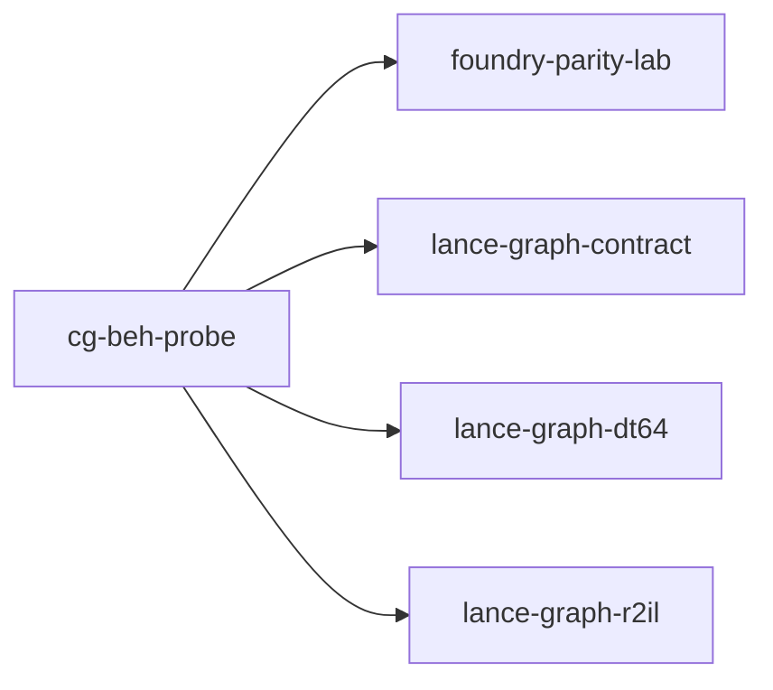

# cg-beh-probe

crate: cg-beh-probe
path: crates/cg-beh-probe
workspace: excluded
digest: 419a2e4c6456dda0
evidence legend: ../index.md#evidence-legend

Generated; the code is the truth. See ../index.md.

## Depends on

- dep foundry-parity-lab normal — crates/cg-beh-probe/Cargo.toml:29 CONFIRMED
- dep lance-graph-contract normal — crates/cg-beh-probe/Cargo.toml:22 CONFIRMED
- dep lance-graph-dt64 normal — crates/cg-beh-probe/Cargo.toml:21 CONFIRMED
- dep lance-graph-r2il normal — crates/cg-beh-probe/Cargo.toml:24 CONFIRMED
- dep ogar-loco normal — crates/cg-beh-probe/Cargo.toml:27 CONFIRMED
- dep ogar-r2il normal — crates/cg-beh-probe/Cargo.toml:26 CONFIRMED

## Depended on by

## Public items

- const OPCODES [pub] — crates/cg-beh-probe/src/dispatch.rs:23 CONFIRMED
- fn word_of [pub] — crates/cg-beh-probe/src/dispatch.rs:30 CONFIRMED
- fn opcode_name [pub] — crates/cg-beh-probe/src/dispatch.rs:39 CONFIRMED
- struct Arm [pub] — crates/cg-beh-probe/src/dispatch.rs:50 CONFIRMED
- struct Dispatch [pub] — crates/cg-beh-probe/src/dispatch.rs:59 CONFIRMED
- enum DispatchError [pub] — crates/cg-beh-probe/src/dispatch.rs:65 CONFIRMED
- fn text_fnv [pub] — crates/cg-beh-probe/src/dispatch.rs:75 CONFIRMED
- fn read [pub] — crates/cg-beh-probe/src/dispatch.rs:102 CONFIRMED
- fn Dispatch::arm_at [pub] — crates/cg-beh-probe/src/dispatch.rs:138 CONFIRMED
- fn Dispatch::arm_of_word [pub] — crates/cg-beh-probe/src/dispatch.rs:143 CONFIRMED
- fn Dispatch::words_without_arm [pub] — crates/cg-beh-probe/src/dispatch.rs:149 CONFIRMED
- fn Dispatch::to_tsv [pub] — crates/cg-beh-probe/src/dispatch.rs:157 CONFIRMED
- struct Field [pub] — crates/cg-beh-probe/src/facts.rs:13 CONFIRMED
- enum GuardConvention [pub] — crates/cg-beh-probe/src/facts.rs:22 CONFIRMED
- enum DepKind [pub] — crates/cg-beh-probe/src/facts.rs:33 CONFIRMED
- struct Dep [pub] — crates/cg-beh-probe/src/facts.rs:42 CONFIRMED
- struct WhenFacts [pub] — crates/cg-beh-probe/src/facts.rs:51 CONFIRMED
- enum ArgFact [pub] — crates/cg-beh-probe/src/facts.rs:59 CONFIRMED
- struct DoStep [pub] — crates/cg-beh-probe/src/facts.rs:66 CONFIRMED
- struct MethodFacts [pub] — crates/cg-beh-probe/src/facts.rs:80 CONFIRMED
- struct ClassFacts [pub] — crates/cg-beh-probe/src/facts.rs:99 CONFIRMED
- enum Missing [pub] — crates/cg-beh-probe/src/facts.rs:109 CONFIRMED
- struct Read [pub] — crates/cg-beh-probe/src/facts.rs:132 CONFIRMED
- fn positions [pub(crate)] — crates/cg-beh-probe/src/facts.rs:140 CONFIRMED
- fn class_facts [pub] — crates/cg-beh-probe/src/facts.rs:157 CONFIRMED
- fn extract [pub] — crates/cg-beh-probe/src/facts.rs:190 CONFIRMED
- struct Snapshot [pub] — crates/cg-beh-probe/src/facts.rs:307 CONFIRMED
- fn Snapshot::new [pub] — crates/cg-beh-probe/src/facts.rs:317 CONFIRMED
- fn Snapshot::add_class [pub] — crates/cg-beh-probe/src/facts.rs:332 CONFIRMED
- fn Snapshot::method [pub] — crates/cg-beh-probe/src/facts.rs:353 CONFIRMED
- fn Snapshot::class [pub] — crates/cg-beh-probe/src/facts.rs:359 CONFIRMED
- fn Snapshot::to_tsv [pub] — crates/cg-beh-probe/src/facts.rs:365 CONFIRMED
- const CLASS [pub] — crates/cg-beh-probe/src/fixture.rs:30 CONFIRMED
- const VIEW_CLASS [pub] — crates/cg-beh-probe/src/fixture.rs:31 CONFIRMED
- const REV [pub] — crates/cg-beh-probe/src/fixture.rs:32 CONFIRMED
- const FIELDS [pub] — crates/cg-beh-probe/src/fixture.rs:33 CONFIRMED
- const GUARDED [pub] — crates/cg-beh-probe/src/fixture.rs:37 CONFIRMED
- const INDEPENDENT [pub] — crates/cg-beh-probe/src/fixture.rs:39 CONFIRMED
- const UNRELATED [pub] — crates/cg-beh-probe/src/fixture.rs:41 CONFIRMED
- const METHODS [pub] — crates/cg-beh-probe/src/fixture.rs:42 CONFIRMED
- const READ [pub] — crates/cg-beh-probe/src/fixture.rs:45 CONFIRMED
- enum Variant [pub] — crates/cg-beh-probe/src/fixture.rs:52 CONFIRMED
- struct TestView [pub] — crates/cg-beh-probe/src/fixture.rs:67 CONFIRMED
- fn TestView::new [pub] — crates/cg-beh-probe/src/fixture.rs:73 CONFIRMED
- struct TestWorld [pub] — crates/cg-beh-probe/src/fixture.rs:107 CONFIRMED
- fn methods [pub] — crates/cg-beh-probe/src/fixture.rs:145 CONFIRMED
- fn world_with [pub] — crates/cg-beh-probe/src/fixture.rs:184 CONFIRMED
- fn world_at [pub] — crates/cg-beh-probe/src/fixture.rs:190 CONFIRMED
- fn world [pub] — crates/cg-beh-probe/src/fixture.rs:211 CONFIRMED
- const CAN_COOK [pub] — crates/cg-beh-probe/src/fixture.rs:218 CONFIRMED
- const FOUNDRY_READ [pub] — crates/cg-beh-probe/src/fixture.rs:222 CONFIRMED
- enum FoundryVariant [pub] — crates/cg-beh-probe/src/fixture.rs:229 CONFIRMED
- fn foundry_methods [pub] — crates/cg-beh-probe/src/fixture.rs:252 CONFIRMED
- fn foundry [pub] — crates/cg-beh-probe/src/fixture.rs:273 CONFIRMED
- fn foundry_ids [pub] — crates/cg-beh-probe/src/fixture.rs:278 CONFIRMED
- struct SwappedBasis [pub] — crates/cg-beh-probe/src/fixture.rs:284 CONFIRMED
- fn SwappedBasis::of [pub] — crates/cg-beh-probe/src/fixture.rs:287 CONFIRMED
- const FOUNDRY_CLASS [pub] — crates/cg-beh-probe/src/fixture.rs:310 CONFIRMED
- mod dispatch [pub] — crates/cg-beh-probe/src/lib.rs:32 CONFIRMED
- mod facts [pub] — crates/cg-beh-probe/src/lib.rs:33 CONFIRMED
- mod fixture [pub] — crates/cg-beh-probe/src/lib.rs:34 CONFIRMED
- mod query [pub] — crates/cg-beh-probe/src/lib.rs:35 CONFIRMED
- enum Grade [pub] — crates/cg-beh-probe/src/lib.rs:39 CONFIRMED
- fn Grade::name [pub] — crates/cg-beh-probe/src/lib.rs:46 CONFIRMED
- struct Evidence [pub] — crates/cg-beh-probe/src/lib.rs:57 CONFIRMED
- fn Evidence::registration [pub(crate)] — crates/cg-beh-probe/src/lib.rs:63 CONFIRMED
- fn Evidence::source [pub(crate)] — crates/cg-beh-probe/src/lib.rs:69 CONFIRMED
- fn fnv64 [pub(crate)] — crates/cg-beh-probe/src/lib.rs:79 CONFIRMED
- const FNV64_OFFSET [pub(crate)] — crates/cg-beh-probe/src/lib.rs:87 CONFIRMED
- enum Component [pub] — crates/cg-beh-probe/src/query.rs:20 CONFIRMED
- enum Obligation [pub] — crates/cg-beh-probe/src/query.rs:42 CONFIRMED
- enum Status [pub] — crates/cg-beh-probe/src/query.rs:66 CONFIRMED
- enum OldRef [pub] — crates/cg-beh-probe/src/query.rs:77 CONFIRMED
- struct MethodDelta [pub] — crates/cg-beh-probe/src/query.rs:85 CONFIRMED
- fn MethodDelta::has [pub] — crates/cg-beh-probe/src/query.rs:95 CONFIRMED
- fn MethodDelta::old_ref [pub] — crates/cg-beh-probe/src/query.rs:100 CONFIRMED
- enum DiffRefusal [pub] — crates/cg-beh-probe/src/query.rs:118 CONFIRMED
- fn diff [pub] — crates/cg-beh-probe/src/query.rs:300 CONFIRMED
- struct WordUse [pub] — crates/cg-beh-probe/src/query.rs:334 CONFIRMED
- struct ImplImpact [pub] — crates/cg-beh-probe/src/query.rs:346 CONFIRMED
- enum ImplRefusal [pub] — crates/cg-beh-probe/src/query.rs:353 CONFIRMED
- fn impl_change [pub] — crates/cg-beh-probe/src/query.rs:406 CONFIRMED
- fn word_impact [pub] — crates/cg-beh-probe/src/query.rs:452 CONFIRMED

## Imports from in-scope crates

### foundry-parity-lab
- use foundry_parity_lab::bind — crates/cg-beh-probe/src/fixture.rs:12 CONFIRMED
- use foundry_parity_lab::bind::VIEW_CLASS as FOUNDRY_VIEW_CLASS — crates/cg-beh-probe/src/fixture.rs:12 CONFIRMED
- use foundry_parity_lab::bind::World — crates/cg-beh-probe/src/fixture.rs:12 CONFIRMED
- use foundry_parity_lab::method — crates/cg-beh-probe/src/fixture.rs:13 CONFIRMED
### lance-graph-contract
- use lance_graph_contract::class_view::ClassView — crates/cg-beh-probe/src/facts.rs:3 CONFIRMED
- use lance_graph_contract::class_view::WideFieldMask — crates/cg-beh-probe/src/facts.rs:3 CONFIRMED
- use lance_graph_contract::set_algebra::Logic — crates/cg-beh-probe/src/facts.rs:4 CONFIRMED
- use lance_graph_contract::set_algebra::Res — crates/cg-beh-probe/src/facts.rs:4 CONFIRMED
- use lance_graph_contract::set_algebra::SetExpr — crates/cg-beh-probe/src/facts.rs:4 CONFIRMED
- use lance_graph_contract::set_rules::Population — crates/cg-beh-probe/src/facts.rs:5 CONFIRMED
- use lance_graph_contract::set_rules::Truth — crates/cg-beh-probe/src/facts.rs:5 CONFIRMED
- use lance_graph_contract::class_view::ClassId — crates/cg-beh-probe/src/fixture.rs:14 CONFIRMED
- use lance_graph_contract::class_view::ClassView — crates/cg-beh-probe/src/fixture.rs:14 CONFIRMED
- use lance_graph_contract::class_view::WideFieldMask — crates/cg-beh-probe/src/fixture.rs:14 CONFIRMED
- use lance_graph_contract::ontology::DisplayTemplate — crates/cg-beh-probe/src/fixture.rs:15 CONFIRMED
- use lance_graph_contract::ontology::FieldRef — crates/cg-beh-probe/src/fixture.rs:15 CONFIRMED
- use lance_graph_contract::set_algebra::Cmp — crates/cg-beh-probe/src/fixture.rs:16 CONFIRMED
- use lance_graph_contract::set_algebra::Logic — crates/cg-beh-probe/src/fixture.rs:16 CONFIRMED
- use lance_graph_contract::set_algebra::Res — crates/cg-beh-probe/src/fixture.rs:16 CONFIRMED
- use lance_graph_contract::set_algebra::SetExpr — crates/cg-beh-probe/src/fixture.rs:16 CONFIRMED
- use lance_graph_contract::set_rules::Population — crates/cg-beh-probe/src/fixture.rs:17 CONFIRMED
- use lance_graph_contract::set_rules::Truth — crates/cg-beh-probe/src/fixture.rs:17 CONFIRMED
### lance-graph-dt64
- use lance_graph_dt64::Arg — crates/cg-beh-probe/src/facts.rs:6 CONFIRMED
- use lance_graph_dt64::BindStore — crates/cg-beh-probe/src/facts.rs:6 CONFIRMED
- use lance_graph_dt64::MethodId — crates/cg-beh-probe/src/facts.rs:6 CONFIRMED
- use lance_graph_dt64::MethodRef — crates/cg-beh-probe/src/facts.rs:6 CONFIRMED
- use lance_graph_dt64::Refusal — crates/cg-beh-probe/src/facts.rs:6 CONFIRMED
- use lance_graph_dt64::SchemaRev — crates/cg-beh-probe/src/facts.rs:6 CONFIRMED
- use lance_graph_dt64::ValueDemand — crates/cg-beh-probe/src/facts.rs:6 CONFIRMED
- use lance_graph_dt64::dr::Extent — crates/cg-beh-probe/src/fixture.rs:18 CONFIRMED
- use lance_graph_dt64::AlgebraRef — crates/cg-beh-probe/src/fixture.rs:20 CONFIRMED
- use lance_graph_dt64::Arg — crates/cg-beh-probe/src/fixture.rs:20 CONFIRMED
- use lance_graph_dt64::BindStore — crates/cg-beh-probe/src/fixture.rs:20 CONFIRMED
- use lance_graph_dt64::ClassSchema — crates/cg-beh-probe/src/fixture.rs:20 CONFIRMED
- use lance_graph_dt64::Effect — crates/cg-beh-probe/src/fixture.rs:20 CONFIRMED
- use lance_graph_dt64::Guard — crates/cg-beh-probe/src/fixture.rs:20 CONFIRMED
- use lance_graph_dt64::MethodBinding — crates/cg-beh-probe/src/fixture.rs:20 CONFIRMED
- use lance_graph_dt64::MethodId — crates/cg-beh-probe/src/fixture.rs:20 CONFIRMED
- use lance_graph_dt64::SchemaRev — crates/cg-beh-probe/src/fixture.rs:20 CONFIRMED
- use lance_graph_dt64::SigRev — crates/cg-beh-probe/src/fixture.rs:21 CONFIRMED
- use lance_graph_dt64::ValueDemand — crates/cg-beh-probe/src/fixture.rs:21 CONFIRMED
### lance-graph-r2il
- use lance_graph_r2il::polyfill::POLYFILL — crates/cg-beh-probe/src/dispatch.rs:7 CONFIRMED
- use lance_graph_r2il::INT_ADD — crates/cg-beh-probe/src/dispatch.rs:9 CONFIRMED
- use lance_graph_r2il::INT_AND — crates/cg-beh-probe/src/dispatch.rs:9 CONFIRMED
- use lance_graph_r2il::INT_EQUAL — crates/cg-beh-probe/src/dispatch.rs:9 CONFIRMED
- use lance_graph_r2il::INT_MULT — crates/cg-beh-probe/src/dispatch.rs:9 CONFIRMED
- use lance_graph_r2il::INT_NOT — crates/cg-beh-probe/src/dispatch.rs:9 CONFIRMED
- use lance_graph_r2il::INT_OR — crates/cg-beh-probe/src/dispatch.rs:9 CONFIRMED
- use lance_graph_r2il::INT_SUB — crates/cg-beh-probe/src/dispatch.rs:9 CONFIRMED
- use lance_graph_r2il::INT_S_DIV — crates/cg-beh-probe/src/dispatch.rs:9 CONFIRMED
- use lance_graph_r2il::INT_S_LESS — crates/cg-beh-probe/src/dispatch.rs:9 CONFIRMED
- use lance_graph_r2il::INT_XOR — crates/cg-beh-probe/src/dispatch.rs:10 CONFIRMED
- use lance_graph_r2il::POP_COUNT — crates/cg-beh-probe/src/dispatch.rs:10 CONFIRMED
- use lance_graph_r2il::polyfill::AliasLanguage — crates/cg-beh-probe/src/fixture.rs:24 CONFIRMED
- use lance_graph_r2il::polyfill::POLYFILL_LENS — crates/cg-beh-probe/src/fixture.rs:24 CONFIRMED
- use lance_graph_r2il::polyfill::PolyfillView — crates/cg-beh-probe/src/fixture.rs:24 CONFIRMED
- use lance_graph_r2il::polyfill::polyfill_arities — crates/cg-beh-probe/src/fixture.rs:24 CONFIRMED
- use lance_graph_r2il::polyfill::position_of — crates/cg-beh-probe/src/fixture.rs:24 CONFIRMED

## Calls

CALL_GRAPH=ARTIFACT_MISSING
- calls ARTIFACT_MISSING — no ruff_charon artifact for this crate UNKNOWN

## Architecture

- arch Quack lance-selective-read allow/block prefilter + attested range read [LAB] validation=OK — crates/crepe-plan-probe/examples/where_lance_arm.rs:45 LAB

Generated from Cargo manifests — extracted relationships only.

