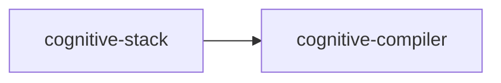

# cognitive-compiler

crate: cognitive-compiler
path: crates/cognitive-compiler
workspace: excluded
digest: d1353bc629a93ad2
evidence legend: ../index.md#evidence-legend

Generated; the code is the truth. See ../index.md.

## Depends on

## Depended on by

- rdep cognitive-stack normal — crates/cognitive-stack/Cargo.toml:41 CONFIRMED

## Public items

- enum RubiconPhase [pub] — crates/cognitive-compiler/src/lib.rs:21 CONFIRMED
- struct SourceSpan [pub] — crates/cognitive-compiler/src/lib.rs:32 CONFIRMED
- struct ToolCall [pub] — crates/cognitive-compiler/src/lib.rs:40 CONFIRMED
- struct TraceAction [pub] — crates/cognitive-compiler/src/lib.rs:48 CONFIRMED
- struct Claim [pub] — crates/cognitive-compiler/src/lib.rs:58 CONFIRMED
- struct ExecutionTrace [pub] — crates/cognitive-compiler/src/lib.rs:65 CONFIRMED
- struct TemplateStep [pub] — crates/cognitive-compiler/src/lib.rs:82 CONFIRMED
- struct TemplateCandidate [pub] — crates/cognitive-compiler/src/lib.rs:89 CONFIRMED
- struct SynthesisInput [pub] — crates/cognitive-compiler/src/lib.rs:103 CONFIRMED
- enum CompileError [pub] — crates/cognitive-compiler/src/lib.rs:111 CONFIRMED
- trait TraceCompiler [pub] — crates/cognitive-compiler/src/lib.rs:134 CONFIRMED
- struct ScaffoldCompiler [pub] — crates/cognitive-compiler/src/lib.rs:143 CONFIRMED

## Imports from in-scope crates

- none

## Calls

CALL_GRAPH=ARTIFACT_MISSING
- calls ARTIFACT_MISSING — no ruff_charon artifact for this crate UNKNOWN

## Architecture

- none

Generated from Cargo manifests — extracted relationships only.

