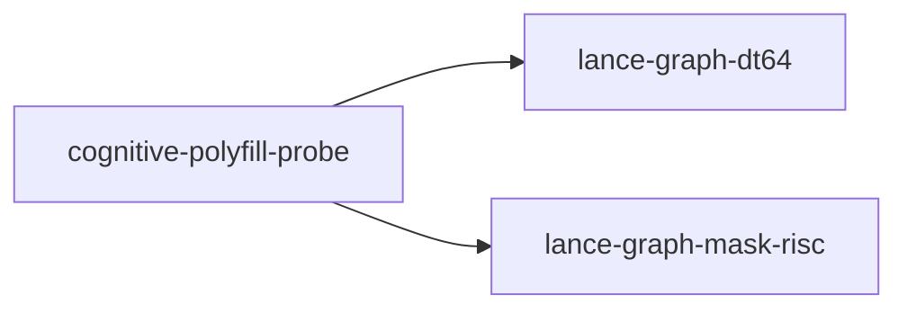

# cognitive-polyfill-probe

crate: cognitive-polyfill-probe
path: crates/cognitive-polyfill-probe
workspace: excluded
digest: 142eccf61ff99e10
evidence legend: ../index.md#evidence-legend

Generated; the code is the truth. See ../index.md.

## Depends on

- dep lance-graph-dt64 normal — crates/cognitive-polyfill-probe/Cargo.toml:14 CONFIRMED
- dep lance-graph-mask-risc normal — crates/cognitive-polyfill-probe/Cargo.toml:16 CONFIRMED

## Depended on by

## Public items

- const TILE [pub] — crates/cognitive-polyfill-probe/src/lib.rs:58 CONFIRMED
- const WIDTH [pub] — crates/cognitive-polyfill-probe/src/lib.rs:60 CONFIRMED
- enum Term [pub] — crates/cognitive-polyfill-probe/src/lib.rs:68 CONFIRMED
- struct Atom [pub] — crates/cognitive-polyfill-probe/src/lib.rs:79 CONFIRMED
- struct Pattern [pub] — crates/cognitive-polyfill-probe/src/lib.rs:87 CONFIRMED
- struct Hop2 [pub] — crates/cognitive-polyfill-probe/src/lib.rs:93 CONFIRMED
- enum Refusal [pub] — crates/cognitive-polyfill-probe/src/lib.rs:102 CONFIRMED
- fn lower [pub] — crates/cognitive-polyfill-probe/src/lib.rs:121 CONFIRMED
- enum NativeRefusal [pub] — crates/cognitive-polyfill-probe/src/lib.rs:162 CONFIRMED
- struct Relation [pub] — crates/cognitive-polyfill-probe/src/lib.rs:174 CONFIRMED
- fn Relation::ingest [pub] — crates/cognitive-polyfill-probe/src/lib.rs:188 CONFIRMED
- fn Relation::out_row [pub] — crates/cognitive-polyfill-probe/src/lib.rs:215 CONFIRMED
- fn Relation::inn_row [pub] — crates/cognitive-polyfill-probe/src/lib.rs:221 CONFIRMED
- fn Relation::bag_derivations [pub] — crates/cognitive-polyfill-probe/src/lib.rs:235 CONFIRMED
- struct Selection [pub] — crates/cognitive-polyfill-probe/src/lib.rs:255 CONFIRMED
- fn Selection::route [pub] — crates/cognitive-polyfill-probe/src/lib.rs:263 CONFIRMED
- struct Routed [pub] — crates/cognitive-polyfill-probe/src/lib.rs:296 CONFIRMED
- enum Fold [pub] — crates/cognitive-polyfill-probe/src/lib.rs:308 CONFIRMED
- struct Prepared [pub] — crates/cognitive-polyfill-probe/src/lib.rs:318 CONFIRMED
- fn Prepared::prepare [pub] — crates/cognitive-polyfill-probe/src/lib.rs:333 CONFIRMED
- fn Prepared::without_join [pub] — crates/cognitive-polyfill-probe/src/lib.rs:392 CONFIRMED
- fn Prepared::run [pub] — crates/cognitive-polyfill-probe/src/lib.rs:400 CONFIRMED
- fn Prepared::kept [pub] — crates/cognitive-polyfill-probe/src/lib.rs:420 CONFIRMED
- fn tile [pub] — crates/cognitive-polyfill-probe/src/lib.rs:426 CONFIRMED

## Imports from in-scope crates

### lance-graph-dt64
- use lance_graph_dt64::dr::Frame — crates/cognitive-polyfill-probe/src/lib.rs:51 CONFIRMED
- use lance_graph_dt64::dr::LocalMap — crates/cognitive-polyfill-probe/src/lib.rs:51 CONFIRMED
- use lance_graph_dt64::dr::MapRead — crates/cognitive-polyfill-probe/src/lib.rs:51 CONFIRMED
- use lance_graph_dt64::dr::MapRefusal — crates/cognitive-polyfill-probe/src/lib.rs:51 CONFIRMED
- use lance_graph_dt64::dr::MapTable — crates/cognitive-polyfill-probe/src/lib.rs:51 CONFIRMED
- use lance_graph_dt64::dr::TileId — crates/cognitive-polyfill-probe/src/lib.rs:51 CONFIRMED
- use lance_graph_dt64::dr::Width — crates/cognitive-polyfill-probe/src/lib.rs:51 CONFIRMED
### lance-graph-mask-risc
- use lance_graph_mask_risc::Foreign — crates/cognitive-polyfill-probe/src/lib.rs:53 CONFIRMED
- use lance_graph_mask_risc::MaskOp — crates/cognitive-polyfill-probe/src/lib.rs:53 CONFIRMED
- use lance_graph_mask_risc::Operand — crates/cognitive-polyfill-probe/src/lib.rs:53 CONFIRMED
- use lance_graph_mask_risc::Out — crates/cognitive-polyfill-probe/src/lib.rs:53 CONFIRMED
- use lance_graph_mask_risc::Planes — crates/cognitive-polyfill-probe/src/lib.rs:53 CONFIRMED
- use lance_graph_mask_risc::Program — crates/cognitive-polyfill-probe/src/lib.rs:53 CONFIRMED
- use lance_graph_mask_risc::Scratch — crates/cognitive-polyfill-probe/src/lib.rs:53 CONFIRMED
- use lance_graph_mask_risc::Terminal — crates/cognitive-polyfill-probe/src/lib.rs:53 CONFIRMED
- use lance_graph_mask_risc::execute_into — crates/cognitive-polyfill-probe/src/lib.rs:53 CONFIRMED
- use lance_graph_mask_risc::words_for — crates/cognitive-polyfill-probe/src/lib.rs:53 CONFIRMED
- use lance_graph_mask_risc::Value — crates/cognitive-polyfill-probe/src/lib.rs:54 CONFIRMED

## Calls

CALL_GRAPH=ARTIFACT_MISSING
- calls ARTIFACT_MISSING — no ruff_charon artifact for this crate UNKNOWN

## Architecture

- none

Generated from Cargo manifests — extracted relationships only.

