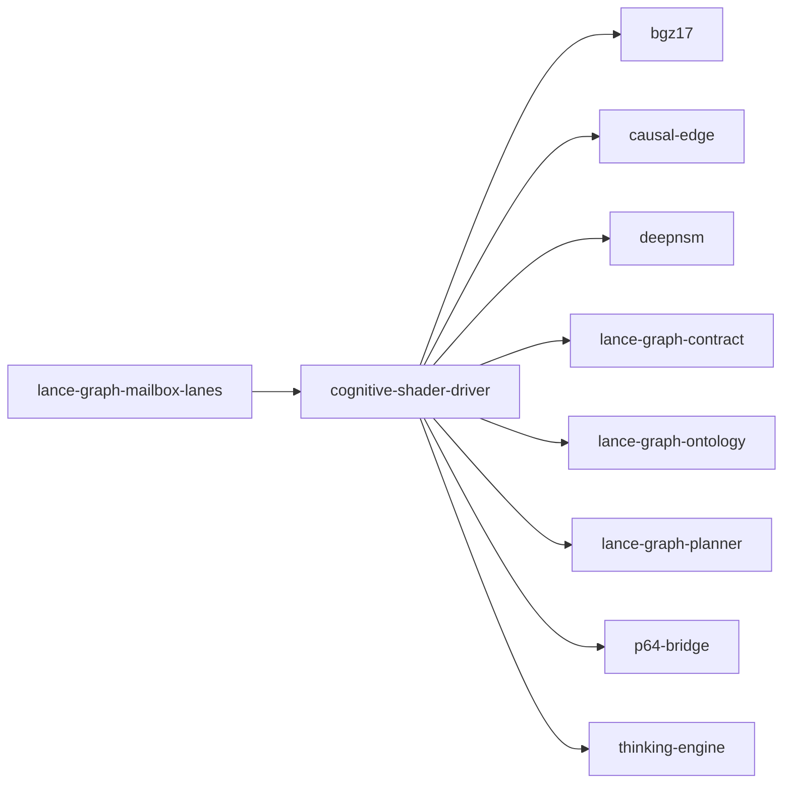

# cognitive-shader-driver

crate: cognitive-shader-driver
path: crates/cognitive-shader-driver
workspace: member
digest: e8ca32e1654c0483
evidence legend: ../index.md#evidence-legend

Generated; the code is the truth. See ../index.md.

## Depends on

- dep bgz-tensor dev — crates/cognitive-shader-driver/Cargo.toml:298 CONFIRMED
- dep bgz17 normal — crates/cognitive-shader-driver/Cargo.toml:236 CONFIRMED
- dep causal-edge normal — crates/cognitive-shader-driver/Cargo.toml:237 CONFIRMED
- dep deepnsm normal optional — crates/cognitive-shader-driver/Cargo.toml:262 CONFIRMED
- dep deepnsm-v2 dev — crates/cognitive-shader-driver/Cargo.toml:301 CONFIRMED
- dep lance-graph-contract normal — crates/cognitive-shader-driver/Cargo.toml:230 CONFIRMED
- dep lance-graph-ontology normal — crates/cognitive-shader-driver/Cargo.toml:234 CONFIRMED
- dep lance-graph-planner normal optional — crates/cognitive-shader-driver/Cargo.toml:248 CONFIRMED
- dep p64-bridge normal — crates/cognitive-shader-driver/Cargo.toml:235 CONFIRMED
- dep thinking-engine normal optional — crates/cognitive-shader-driver/Cargo.toml:242 CONFIRMED
- dep axum normal optional — crates/cognitive-shader-driver/Cargo.toml:253 CONFIRMED
- dep base64 normal optional — crates/cognitive-shader-driver/Cargo.toml:258 CONFIRMED
- dep bytemuck normal optional — crates/cognitive-shader-driver/Cargo.toml:260 CONFIRMED
- dep ndarray normal — crates/cognitive-shader-driver/Cargo.toml:238 CONFIRMED
- dep prost normal optional — crates/cognitive-shader-driver/Cargo.toml:255 CONFIRMED
- dep serde normal optional — crates/cognitive-shader-driver/Cargo.toml:251 CONFIRMED
- dep serde_json normal optional — crates/cognitive-shader-driver/Cargo.toml:252 CONFIRMED
- dep tokio normal optional — crates/cognitive-shader-driver/Cargo.toml:254 CONFIRMED
- dep tonic normal optional — crates/cognitive-shader-driver/Cargo.toml:256 CONFIRMED
- dep tonic-build build optional — crates/cognitive-shader-driver/Cargo.toml:265 CONFIRMED

## Depended on by

- rdep lance-graph-mailbox-lanes normal — crates/lance-graph-mailbox-lanes/Cargo.toml:9 CONFIRMED
- rdep lance-graph-planner dev — crates/lance-graph-planner/Cargo.toml:78 CONFIRMED
- rdep lance-graph-supervisor dev — crates/lance-graph-supervisor/Cargo.toml:61 CONFIRMED
- rdep virtual-address-lab dev — crates/virtual-address-lab/Cargo.toml:21 CONFIRMED

## Public items

- struct AttentionMaskEntry [pub] — crates/cognitive-shader-driver/src/attention_mask.rs:25 CONFIRMED
- struct AttentionMaskSoA [pub] — crates/cognitive-shader-driver/src/attention_mask.rs:46 CONFIRMED
- fn AttentionMaskSoA::new [pub] — crates/cognitive-shader-driver/src/attention_mask.rs:61 CONFIRMED
- fn AttentionMaskSoA::touch [pub] — crates/cognitive-shader-driver/src/attention_mask.rs:80 CONFIRMED
- fn AttentionMaskSoA::evict_lru [pub] — crates/cognitive-shader-driver/src/attention_mask.rs:107 CONFIRMED
- fn AttentionMaskSoA::tick [pub] — crates/cognitive-shader-driver/src/attention_mask.rs:129 CONFIRMED
- fn AttentionMaskSoA::active_count [pub] — crates/cognitive-shader-driver/src/attention_mask.rs:136 CONFIRMED
- fn AttentionMaskSoA::is_active [pub] — crates/cognitive-shader-driver/src/attention_mask.rs:141 CONFIRMED
- fn AttentionMaskSoA::entries [pub] — crates/cognitive-shader-driver/src/attention_mask.rs:148 CONFIRMED
- enum AttentionMaskMsg [pub] — crates/cognitive-shader-driver/src/attention_mask_actor.rs:11 CONFIRMED
- enum AttentionMaskOutcome [pub] — crates/cognitive-shader-driver/src/attention_mask_actor.rs:30 CONFIRMED
- trait AttentionMaskBackend [pub] — crates/cognitive-shader-driver/src/attention_mask_actor.rs:44 CONFIRMED
- struct AttentionMaskActor [pub] — crates/cognitive-shader-driver/src/attention_mask_actor.rs:70 CONFIRMED
- fn AttentionMaskActor<B>::new [pub] — crates/cognitive-shader-driver/src/attention_mask_actor.rs:76 CONFIRMED
- fn AttentionMaskActor<B>::handle [pub] — crates/cognitive-shader-driver/src/attention_mask_actor.rs:83 CONFIRMED
- fn AttentionMaskActor<B>::drain_pending_evictions [pub] — crates/cognitive-shader-driver/src/attention_mask_actor.rs:111 CONFIRMED
- struct ModelFingerprint [pub] cfg=any(feature="serve", feature="grpc") — crates/cognitive-shader-driver/src/auto_detect.rs:31 CONFIRMED
- enum DetectError [pub] cfg=any(feature="serve", feature="grpc") — crates/cognitive-shader-driver/src/auto_detect.rs:57 CONFIRMED
- fn detect [pub] cfg=any(feature="serve", feature="grpc") — crates/cognitive-shader-driver/src/auto_detect.rs:118 CONFIRMED
- const DELIBERATE [pub] — crates/cognitive-shader-driver/src/auto_style.rs:23 CONFIRMED
- const ANALYTICAL [pub] — crates/cognitive-shader-driver/src/auto_style.rs:24 CONFIRMED
- const CONVERGENT [pub] — crates/cognitive-shader-driver/src/auto_style.rs:25 CONFIRMED
- const SYSTEMATIC [pub] — crates/cognitive-shader-driver/src/auto_style.rs:26 CONFIRMED
- const CREATIVE [pub] — crates/cognitive-shader-driver/src/auto_style.rs:27 CONFIRMED
- const DIVERGENT [pub] — crates/cognitive-shader-driver/src/auto_style.rs:28 CONFIRMED
- const EXPLORATORY [pub] — crates/cognitive-shader-driver/src/auto_style.rs:29 CONFIRMED
- const FOCUSED [pub] — crates/cognitive-shader-driver/src/auto_style.rs:30 CONFIRMED
- const DIFFUSE [pub] — crates/cognitive-shader-driver/src/auto_style.rs:31 CONFIRMED
- const PERIPHERAL [pub] — crates/cognitive-shader-driver/src/auto_style.rs:32 CONFIRMED
- const INTUITIVE [pub] — crates/cognitive-shader-driver/src/auto_style.rs:33 CONFIRMED
- const METACOGNITIVE [pub] — crates/cognitive-shader-driver/src/auto_style.rs:34 CONFIRMED
- fn style_from_qualia [pub] — crates/cognitive-shader-driver/src/auto_style.rs:37 CONFIRMED
- fn resolve [pub] — crates/cognitive-shader-driver/src/auto_style.rs:84 CONFIRMED
- enum BackingStore [pub(crate)] — crates/cognitive-shader-driver/src/backing.rs:55 CONFIRMED
- fn BackingStore<'a>::prefilter [pub(crate)] — crates/cognitive-shader-driver/src/backing.rs:74 CONFIRMED
- fn BackingStore<'a>::content_row [pub(crate)] — crates/cognitive-shader-driver/src/backing.rs:96 CONFIRMED
- fn BackingStore<'a>::qualia_17d [pub(crate)] — crates/cognitive-shader-driver/src/backing.rs:108 CONFIRMED
- fn BackingStore<'a>::edge [pub(crate)] — crates/cognitive-shader-driver/src/backing.rs:121 CONFIRMED
- fn BackingStore<'a>::entity_type [pub(crate)] — crates/cognitive-shader-driver/src/backing.rs:131 CONFIRMED
- fn BackingStore<'a>::len [pub(crate)] — crates/cognitive-shader-driver/src/backing.rs:141 CONFIRMED
- enum BackingStoreWrite [pub(crate)] — crates/cognitive-shader-driver/src/backing.rs:163 CONFIRMED
- fn BackingStoreWrite<'_>::set_content [pub(crate)] — crates/cognitive-shader-driver/src/backing.rs:175 CONFIRMED
- fn BackingStoreWrite<'_>::set_qualia [pub(crate)] — crates/cognitive-shader-driver/src/backing.rs:185 CONFIRMED
- fn BackingStoreWrite<'_>::set_edge [pub(crate)] — crates/cognitive-shader-driver/src/backing.rs:198 CONFIRMED
- fn BackingStoreWrite<'_>::set_meta [pub(crate)] — crates/cognitive-shader-driver/src/backing.rs:208 CONFIRMED
- fn BackingStoreWrite<'_>::set_entity_type [pub(crate)] — crates/cognitive-shader-driver/src/backing.rs:222 CONFIRMED
- fn BackingStoreWrite<'_>::set_temporal [pub(crate)] — crates/cognitive-shader-driver/src/backing.rs:232 CONFIRMED
- fn BackingStoreWrite<'_>::set_expert [pub(crate)] — crates/cognitive-shader-driver/src/backing.rs:242 CONFIRMED
- fn BackingStoreWrite<'_>::set_sigma [pub(crate)] — crates/cognitive-shader-driver/src/backing.rs:252 CONFIRMED
- fn BackingStoreWrite<'_>::write_row [pub(crate)] — crates/cognitive-shader-driver/src/backing.rs:274 CONFIRMED
- const WORDS_PER_FP [pub] — crates/cognitive-shader-driver/src/bindspace.rs:26 CONFIRMED
- const WIDTH_BITS [pub] — crates/cognitive-shader-driver/src/bindspace.rs:27 CONFIRMED
- const QUALIA_DIMS [pub] — crates/cognitive-shader-driver/src/bindspace.rs:28 CONFIRMED
- const FLOATS_PER_VSA [pub] — crates/cognitive-shader-driver/src/bindspace.rs:29 CONFIRMED
- struct FingerprintColumns [pub] — crates/cognitive-shader-driver/src/bindspace.rs:49 CONFIRMED
- fn FingerprintColumns::zeros [pub] — crates/cognitive-shader-driver/src/bindspace.rs:62 CONFIRMED
- fn FingerprintColumns::sigma_at [pub] — crates/cognitive-shader-driver/src/bindspace.rs:75 CONFIRMED
- fn FingerprintColumns::write_sigma [pub] — crates/cognitive-shader-driver/src/bindspace.rs:81 CONFIRMED
- fn FingerprintColumns::content_row [pub] — crates/cognitive-shader-driver/src/bindspace.rs:87 CONFIRMED
- fn FingerprintColumns::cycle_row [pub] — crates/cognitive-shader-driver/src/bindspace.rs:92 CONFIRMED
- fn FingerprintColumns::topic_row [pub] — crates/cognitive-shader-driver/src/bindspace.rs:97 CONFIRMED
- fn FingerprintColumns::angle_row [pub] — crates/cognitive-shader-driver/src/bindspace.rs:102 CONFIRMED
- fn FingerprintColumns::set_content [pub] — crates/cognitive-shader-driver/src/bindspace.rs:107 CONFIRMED
- fn FingerprintColumns::set_cycle [pub] — crates/cognitive-shader-driver/src/bindspace.rs:112 CONFIRMED
- fn FingerprintColumns::set_cycle_from_bits [pub] — crates/cognitive-shader-driver/src/bindspace.rs:119 CONFIRMED
- struct EdgeColumn [pub] — crates/cognitive-shader-driver/src/bindspace.rs:128 CONFIRMED
- fn EdgeColumn::zeros [pub] — crates/cognitive-shader-driver/src/bindspace.rs:131 CONFIRMED
- fn EdgeColumn::get [pub] — crates/cognitive-shader-driver/src/bindspace.rs:135 CONFIRMED
- fn EdgeColumn::set [pub] — crates/cognitive-shader-driver/src/bindspace.rs:139 CONFIRMED
- struct QualiaColumn [pub] — crates/cognitive-shader-driver/src/bindspace.rs:156 CONFIRMED
- fn QualiaColumn::zeros [pub] — crates/cognitive-shader-driver/src/bindspace.rs:160 CONFIRMED
- fn QualiaColumn::row [pub] — crates/cognitive-shader-driver/src/bindspace.rs:165 CONFIRMED
- fn QualiaColumn::set [pub] — crates/cognitive-shader-driver/src/bindspace.rs:169 CONFIRMED
- struct QualiaI4Column [pub] — crates/cognitive-shader-driver/src/bindspace.rs:182 CONFIRMED
- fn QualiaI4Column::zeros [pub] — crates/cognitive-shader-driver/src/bindspace.rs:185 CONFIRMED
- fn QualiaI4Column::row [pub] — crates/cognitive-shader-driver/src/bindspace.rs:190 CONFIRMED
- fn QualiaI4Column::set [pub] — crates/cognitive-shader-driver/src/bindspace.rs:195 CONFIRMED
- fn QualiaI4Column::len [pub] — crates/cognitive-shader-driver/src/bindspace.rs:200 CONFIRMED
- fn QualiaI4Column::is_empty [pub] — crates/cognitive-shader-driver/src/bindspace.rs:205 CONFIRMED
- fn QualiaI4Column::from_f32 [pub] — crates/cognitive-shader-driver/src/bindspace.rs:215 CONFIRMED
- struct MetaColumn [pub] — crates/cognitive-shader-driver/src/bindspace.rs:234 CONFIRMED
- fn MetaColumn::zeros [pub] — crates/cognitive-shader-driver/src/bindspace.rs:237 CONFIRMED
- fn MetaColumn::get [pub] — crates/cognitive-shader-driver/src/bindspace.rs:241 CONFIRMED
- fn MetaColumn::set [pub] — crates/cognitive-shader-driver/src/bindspace.rs:245 CONFIRMED
- struct BindSpace [pub] — crates/cognitive-shader-driver/src/bindspace.rs:259 CONFIRMED
- fn BindSpace::zeros [pub] — crates/cognitive-shader-driver/src/bindspace.rs:320 CONFIRMED
- fn BindSpace::qualia_f32_row [pub] cfg=feature="with-engine" — crates/cognitive-shader-driver/src/bindspace.rs:344 CONFIRMED
- fn BindSpace::set_qualia_f32 [pub] cfg=feature="with-engine" — crates/cognitive-shader-driver/src/bindspace.rs:354 CONFIRMED
- fn BindSpace::set_ontology [pub] — crates/cognitive-shader-driver/src/bindspace.rs:364 CONFIRMED
- fn BindSpace::ontology [pub] — crates/cognitive-shader-driver/src/bindspace.rs:369 CONFIRMED
- fn BindSpace::byte_footprint [pub] — crates/cognitive-shader-driver/src/bindspace.rs:374 CONFIRMED
- fn BindSpace::meta_prefilter [pub] — crates/cognitive-shader-driver/src/bindspace.rs:399 CONFIRMED
- fn BindSpace::write_cycle_fingerprint [pub] — crates/cognitive-shader-driver/src/bindspace.rs:415 CONFIRMED
- struct BindSpaceBuilder [pub] — crates/cognitive-shader-driver/src/bindspace.rs:426 CONFIRMED
- fn BindSpaceBuilder::new [pub] — crates/cognitive-shader-driver/src/bindspace.rs:432 CONFIRMED
- fn BindSpaceBuilder::push [pub] — crates/cognitive-shader-driver/src/bindspace.rs:451 CONFIRMED
- fn BindSpaceBuilder::push_typed [pub] — crates/cognitive-shader-driver/src/bindspace.rs:481 CONFIRMED
- fn BindSpaceBuilder::build [pub] — crates/cognitive-shader-driver/src/bindspace.rs:510 CONFIRMED
- struct CodecResearchBridge [pub] cfg=any(feature="serve", feature="grpc") — crates/cognitive-shader-driver/src/codec_bridge.rs:28 CONFIRMED
- struct CodecKernelCache [pub] cfg=any(feature="serve", feature="grpc") — crates/cognitive-shader-driver/src/codec_kernel_cache.rs:41 CONFIRMED
- fn CodecKernelCache<H>::new [pub] cfg=any(feature="serve", feature="grpc") — crates/cognitive-shader-driver/src/codec_kernel_cache.rs:49 CONFIRMED
- fn CodecKernelCache<H>::get_or_compile [pub] cfg=any(feature="serve", feature="grpc") — crates/cognitive-shader-driver/src/codec_kernel_cache.rs:65 CONFIRMED
- fn CodecKernelCache<H>::try_get_or_compile [pub] cfg=any(feature="serve", feature="grpc") — crates/cognitive-shader-driver/src/codec_kernel_cache.rs:89 CONFIRMED
- fn CodecKernelCache<H>::len [pub] cfg=any(feature="serve", feature="grpc") — crates/cognitive-shader-driver/src/codec_kernel_cache.rs:114 CONFIRMED
- fn CodecKernelCache<H>::is_empty [pub] cfg=any(feature="serve", feature="grpc") — crates/cognitive-shader-driver/src/codec_kernel_cache.rs:119 CONFIRMED
- fn CodecKernelCache<H>::compile_count [pub] cfg=any(feature="serve", feature="grpc") — crates/cognitive-shader-driver/src/codec_kernel_cache.rs:124 CONFIRMED
- fn CodecKernelCache<H>::hit_count [pub] cfg=any(feature="serve", feature="grpc") — crates/cognitive-shader-driver/src/codec_kernel_cache.rs:129 CONFIRMED
- fn CodecKernelCache<H>::hit_ratio [pub] cfg=any(feature="serve", feature="grpc") — crates/cognitive-shader-driver/src/codec_kernel_cache.rs:135 CONFIRMED
- fn CodecKernelCache<H>::has_signature [pub] cfg=any(feature="serve", feature="grpc") — crates/cognitive-shader-driver/src/codec_kernel_cache.rs:147 CONFIRMED
- fn CodecKernelCache<H>::clear [pub] cfg=any(feature="serve", feature="grpc") — crates/cognitive-shader-driver/src/codec_kernel_cache.rs:152 CONFIRMED
- struct StubKernel [pub] cfg=any(feature="serve", feature="grpc") — crates/cognitive-shader-driver/src/codec_kernel_cache.rs:172 CONFIRMED
- fn StubKernel::from_params [pub] cfg=any(feature="serve", feature="grpc") — crates/cognitive-shader-driver/src/codec_kernel_cache.rs:187 CONFIRMED
- fn list_tensors [pub] cfg=any(feature="serve", feature="grpc") — crates/cognitive-shader-driver/src/codec_research.rs:31 CONFIRMED
- fn calibrate_tensor [pub] cfg=any(feature="serve", feature="grpc") — crates/cognitive-shader-driver/src/codec_research.rs:68 CONFIRMED
- fn row_count_probe [pub] cfg=any(feature="serve", feature="grpc") — crates/cognitive-shader-driver/src/codec_research.rs:127 CONFIRMED
- fn disambiguate_parse_candidates [pub] cfg=any(feature="serve", feature="grpc") — crates/cognitive-shader-driver/src/cypher_bridge.rs:44 CONFIRMED
- struct CypherBridge [pub] cfg=any(feature="serve", feature="grpc") — crates/cognitive-shader-driver/src/cypher_bridge.rs:59 CONFIRMED
- enum DecodeError [pub] cfg=any(feature="serve", feature="grpc") — crates/cognitive-shader-driver/src/decode_kernel.rs:28 CONFIRMED
- trait DecodeKernel [pub] cfg=any(feature="serve", feature="grpc") — crates/cognitive-shader-driver/src/decode_kernel.rs:54 CONFIRMED
- struct StubDecodeKernel [pub] cfg=any(feature="serve", feature="grpc") — crates/cognitive-shader-driver/src/decode_kernel.rs:79 CONFIRMED
- fn StubDecodeKernel::new [pub] cfg=any(feature="serve", feature="grpc") — crates/cognitive-shader-driver/src/decode_kernel.rs:85 CONFIRMED
- struct ResidualComposer [pub] cfg=any(feature="serve", feature="grpc") — crates/cognitive-shader-driver/src/decode_kernel.rs:154 CONFIRMED
- fn ResidualComposer::new [pub] cfg=any(feature="serve", feature="grpc") — crates/cognitive-shader-driver/src/decode_kernel.rs:163 CONFIRMED
- struct ShaderDriver [pub] — crates/cognitive-shader-driver/src/driver.rs:68 CONFIRMED
- fn ShaderDriver::new [pub] — crates/cognitive-shader-driver/src/driver.rs:119 CONFIRMED
- fn ShaderDriver::with_nars_tables [pub] — crates/cognitive-shader-driver/src/driver.rs:149 CONFIRMED
- fn ShaderDriver::nars_tables [pub] — crates/cognitive-shader-driver/src/driver.rs:156 CONFIRMED
- fn ShaderDriver::mailbox [pub] cfg=feature="mailbox-thoughtspace" — crates/cognitive-shader-driver/src/driver.rs:163 CONFIRMED
- fn ShaderDriver::mailbox_mut [pub] cfg=feature="mailbox-thoughtspace" — crates/cognitive-shader-driver/src/driver.rs:178 CONFIRMED
- fn ShaderDriver::selected_mailbox [pub] cfg=feature="mailbox-thoughtspace" — crates/cognitive-shader-driver/src/driver.rs:185 CONFIRMED
- fn ShaderDriver::select_mailbox [pub] cfg=feature="mailbox-thoughtspace" — crates/cognitive-shader-driver/src/driver.rs:194 CONFIRMED
- fn ShaderDriver::bindspace [pub] — crates/cognitive-shader-driver/src/driver.rs:207 CONFIRMED
- fn ShaderDriver::ontology [pub] — crates/cognitive-shader-driver/src/driver.rs:213 CONFIRMED
- fn ShaderDriver::planes [pub] — crates/cognitive-shader-driver/src/driver.rs:224 CONFIRMED
- fn ShaderDriver::update_planes [pub] — crates/cognitive-shader-driver/src/driver.rs:235 CONFIRMED
- fn alpha_front_to_back_composite [pub] — crates/cognitive-shader-driver/src/driver.rs:794 CONFIRMED
- struct CognitiveShaderBuilder [pub] — crates/cognitive-shader-driver/src/driver.rs:885 CONFIRMED
- fn CognitiveShaderBuilder::new [pub] — crates/cognitive-shader-driver/src/driver.rs:899 CONFIRMED
- fn CognitiveShaderBuilder::bindspace [pub] — crates/cognitive-shader-driver/src/driver.rs:914 CONFIRMED
- fn CognitiveShaderBuilder::semiring [pub] — crates/cognitive-shader-driver/src/driver.rs:919 CONFIRMED
- fn CognitiveShaderBuilder::planes [pub] — crates/cognitive-shader-driver/src/driver.rs:924 CONFIRMED
- fn CognitiveShaderBuilder::default_style [pub] — crates/cognitive-shader-driver/src/driver.rs:929 CONFIRMED
- fn CognitiveShaderBuilder::nars_tables [pub] — crates/cognitive-shader-driver/src/driver.rs:935 CONFIRMED
- fn CognitiveShaderBuilder::ontology [pub] — crates/cognitive-shader-driver/src/driver.rs:943 CONFIRMED
- fn CognitiveShaderBuilder::with_mailbox [pub] cfg=feature="mailbox-thoughtspace" — crates/cognitive-shader-driver/src/driver.rs:951 CONFIRMED
- fn CognitiveShaderBuilder::select_mailbox [pub] cfg=feature="mailbox-thoughtspace" — crates/cognitive-shader-driver/src/driver.rs:959 CONFIRMED
- fn CognitiveShaderBuilder::build [pub] — crates/cognitive-shader-driver/src/driver.rs:971 CONFIRMED
- fn lift_emitted [pub] — crates/cognitive-shader-driver/src/edge_v3_compare.rs:53 CONFIRMED
- fn thinking_preserved [pub] — crates/cognitive-shader-driver/src/edge_v3_compare.rs:64 CONFIRMED
- fn ingest_codebook_indices [pub] — crates/cognitive-shader-driver/src/engine_bridge.rs:59 CONFIRMED
- fn ingest_codebook_indices_soa [pub] — crates/cognitive-shader-driver/src/engine_bridge.rs:117 CONFIRMED
- const SCAN_WORTHY_ENERGY [pub] — crates/cognitive-shader-driver/src/engine_bridge.rs:161 CONFIRMED
- fn dispatch_from_top_k [pub] — crates/cognitive-shader-driver/src/engine_bridge.rs:179 CONFIRMED
- struct EngineBusBridge [pub] — crates/cognitive-shader-driver/src/engine_bridge.rs:221 CONFIRMED
- fn EngineBusBridge::from_shader_bus [pub] — crates/cognitive-shader-driver/src/engine_bridge.rs:230 CONFIRMED
- const SUPPORT_ENERGY [pub] cfg=feature="with-engine" — crates/cognitive-shader-driver/src/engine_bridge.rs:286 CONFIRMED
- fn dispatch_busdto [pub] cfg=feature="with-engine" — crates/cognitive-shader-driver/src/engine_bridge.rs:335 CONFIRMED
- fn unbind_busdto [pub] cfg=feature="with-engine" — crates/cognitive-shader-driver/src/engine_bridge.rs:437 CONFIRMED
- const DIM_CLASSIFICATION_DISTANCE [pub] — crates/cognitive-shader-driver/src/engine_bridge.rs:541 CONFIRMED
- fn write_qualia_observed [pub] — crates/cognitive-shader-driver/src/engine_bridge.rs:544 CONFIRMED
- fn read_qualia_decomposed [pub] — crates/cognitive-shader-driver/src/engine_bridge.rs:557 CONFIRMED
- fn classification_distance [pub] — crates/cognitive-shader-driver/src/engine_bridge.rs:576 CONFIRMED
- fn write_qualia_17d [pub] — crates/cognitive-shader-driver/src/engine_bridge.rs:602 CONFIRMED
- fn read_qualia_17d [pub] — crates/cognitive-shader-driver/src/engine_bridge.rs:607 CONFIRMED
- struct UnifiedStyle [pub] — crates/cognitive-shader-driver/src/engine_bridge.rs:623 CONFIRMED
- const UNIFIED_STYLES [pub] — crates/cognitive-shader-driver/src/engine_bridge.rs:641 CONFIRMED
- fn unified_style [pub] — crates/cognitive-shader-driver/src/engine_bridge.rs:824 CONFIRMED
- fn persist_cycle [pub] — crates/cognitive-shader-driver/src/engine_bridge.rs:838 CONFIRMED
- mod pb [pub] cfg=feature="grpc" — crates/cognitive-shader-driver/src/grpc.rs:30 CONFIRMED
- struct ShaderGrpcService [pub] cfg=feature="grpc" — crates/cognitive-shader-driver/src/grpc.rs:36 CONFIRMED
- fn ShaderGrpcService::new [pub] cfg=feature="grpc" — crates/cognitive-shader-driver/src/grpc.rs:42 CONFIRMED
- fn ShaderGrpcService::into_server [pub] cfg=feature="grpc" — crates/cognitive-shader-driver/src/grpc.rs:49 CONFIRMED
- struct Palette [pub] — crates/cognitive-shader-driver/src/immaterial_needle.rs:16 CONFIRMED
- struct Needle [pub] — crates/cognitive-shader-driver/src/immaterial_needle.rs:20 CONFIRMED
- fn Needle::pair [pub] — crates/cognitive-shader-driver/src/immaterial_needle.rs:27 CONFIRMED
- struct ImmaterialNeedle [pub] — crates/cognitive-shader-driver/src/immaterial_needle.rs:36 CONFIRMED
- fn ImmaterialNeedle::pairs [pub] — crates/cognitive-shader-driver/src/immaterial_needle.rs:42 CONFIRMED
- fn ImmaterialNeedle::fold [pub] — crates/cognitive-shader-driver/src/immaterial_needle.rs:50 CONFIRMED
- struct CrossRefused [pub] — crates/cognitive-shader-driver/src/immaterial_needle.rs:61 CONFIRMED
- fn ImmaterialNeedle::cross_table [pub] — crates/cognitive-shader-driver/src/immaterial_needle.rs:64 CONFIRMED
- mod attention_mask [pub] — crates/cognitive-shader-driver/src/lib.rs:93 CONFIRMED
- mod attention_mask_actor [pub] — crates/cognitive-shader-driver/src/lib.rs:94 CONFIRMED
- mod auto_style [pub] — crates/cognitive-shader-driver/src/lib.rs:95 CONFIRMED
- mod backing [pub(crate)] — crates/cognitive-shader-driver/src/lib.rs:96 CONFIRMED
- mod bindspace [pub] — crates/cognitive-shader-driver/src/lib.rs:97 CONFIRMED
- mod driver [pub] — crates/cognitive-shader-driver/src/lib.rs:98 CONFIRMED
- mod edge_v3_compare [pub] — crates/cognitive-shader-driver/src/lib.rs:102 CONFIRMED
- mod engine_bridge [pub] — crates/cognitive-shader-driver/src/lib.rs:103 CONFIRMED
- mod mailbox_soa [pub] — crates/cognitive-shader-driver/src/lib.rs:104 CONFIRMED
- mod sigma_rosetta [pub] — crates/cognitive-shader-driver/src/lib.rs:107 CONFIRMED
- mod wire [pub] cfg=any(feature="serve", feature="grpc") — crates/cognitive-shader-driver/src/lib.rs:129 CONFIRMED
- mod auto_detect [pub] cfg=any(feature="serve", feature="grpc") — crates/cognitive-shader-driver/src/lib.rs:134 CONFIRMED
- mod codec_kernel_cache [pub] cfg=any(feature="serve", feature="grpc") — crates/cognitive-shader-driver/src/lib.rs:139 CONFIRMED
- mod immaterial_needle [pub] — crates/cognitive-shader-driver/src/lib.rs:144 CONFIRMED
- mod palette_perturbation [pub] — crates/cognitive-shader-driver/src/lib.rs:145 CONFIRMED
- mod quad8 [pub] — crates/cognitive-shader-driver/src/lib.rs:146 CONFIRMED
- mod rotation_kernel [pub] cfg=any(feature="serve", feature="grpc") — crates/cognitive-shader-driver/src/lib.rs:148 CONFIRMED
- mod switch16 [pub] — crates/cognitive-shader-driver/src/lib.rs:149 CONFIRMED
- mod decode_kernel [pub] cfg=any(feature="serve", feature="grpc") — crates/cognitive-shader-driver/src/lib.rs:156 CONFIRMED
- mod token_agreement [pub] cfg=any(feature="serve", feature="grpc") — crates/cognitive-shader-driver/src/lib.rs:163 CONFIRMED
- truncated (417 total), see symbols.tsv

## Imports from in-scope crates

### bgz17
- use bgz17::base17::Base17 — crates/cognitive-shader-driver/src/bin/grpc.rs:12 CONFIRMED
- use bgz17::palette::Palette — crates/cognitive-shader-driver/src/bin/grpc.rs:13 CONFIRMED
- use bgz17::palette_semiring::PaletteSemiring — crates/cognitive-shader-driver/src/bin/grpc.rs:14 CONFIRMED
- use bgz17::base17::Base17 — crates/cognitive-shader-driver/src/bin/serve.rs:12 CONFIRMED
- use bgz17::palette::Palette — crates/cognitive-shader-driver/src/bin/serve.rs:13 CONFIRMED
- use bgz17::palette_semiring::PaletteSemiring — crates/cognitive-shader-driver/src/bin/serve.rs:14 CONFIRMED
- use bgz17::palette_semiring::PaletteSemiring — crates/cognitive-shader-driver/src/driver.rs:30 CONFIRMED
- use bgz17::base17::Base17 cfg=test — crates/cognitive-shader-driver/src/driver.rs:1201 CONFIRMED
- use bgz17::palette::Palette cfg=test — crates/cognitive-shader-driver/src/driver.rs:1202 CONFIRMED
### causal-edge
- use causal_edge::edge::CausalEdge64 — crates/cognitive-shader-driver/src/backing.rs:43 CONFIRMED
- use causal_edge::edge::CausalEdge64 — crates/cognitive-shader-driver/src/driver.rs:31 CONFIRMED
- use causal_edge::edge::InferenceType — crates/cognitive-shader-driver/src/driver.rs:31 CONFIRMED
- use causal_edge::pearl::CausalMask — crates/cognitive-shader-driver/src/driver.rs:32 CONFIRMED
- use causal_edge::plasticity::PlasticityState — crates/cognitive-shader-driver/src/driver.rs:33 CONFIRMED
- use causal_edge::tables::NarsTables — crates/cognitive-shader-driver/src/driver.rs:34 CONFIRMED
- use causal_edge::tables::unpack_c — crates/cognitive-shader-driver/src/driver.rs:34 CONFIRMED
- use causal_edge::tables::unpack_f — crates/cognitive-shader-driver/src/driver.rs:34 CONFIRMED
- use causal_edge::edge::CausalEdge64 — crates/cognitive-shader-driver/src/edge_v3_compare.rs:40 CONFIRMED
- use causal_edge::CausalEdgeV3 — crates/cognitive-shader-driver/src/edge_v3_compare.rs:41 CONFIRMED
- use causal_edge::edge::CausalEdge64 cfg=test — crates/cognitive-shader-driver/src/edge_v3_compare.rs:77 CONFIRMED
- use causal_edge::edge::InferenceType cfg=test — crates/cognitive-shader-driver/src/edge_v3_compare.rs:77 CONFIRMED
- use causal_edge::pearl::CausalMask cfg=test — crates/cognitive-shader-driver/src/edge_v3_compare.rs:78 CONFIRMED
- use causal_edge::plasticity::PlasticityState cfg=test — crates/cognitive-shader-driver/src/edge_v3_compare.rs:79 CONFIRMED
- use causal_edge::CausalEdge64 — crates/cognitive-shader-driver/src/mailbox_soa.rs:29 CONFIRMED
- use causal_edge::CausalEdge64 cfg=test — crates/cognitive-shader-driver/src/mailbox_soa.rs:1026 CONFIRMED
### lance-graph-contract
- pub-use lance_graph_contract::collapse_gate::MailboxId — crates/cognitive-shader-driver/src/attention_mask.rs:16 CONFIRMED
- use lance_graph_contract::collapse_gate::MailboxId — crates/cognitive-shader-driver/src/attention_mask_actor.rs:4 CONFIRMED
- use lance_graph_contract::cam::Distance cfg=any(feature="serve", feature="grpc") — crates/cognitive-shader-driver/src/auto_detect.rs:19 CONFIRMED
- use lance_graph_contract::cam::LaneWidth cfg=any(feature="serve", feature="grpc") — crates/cognitive-shader-driver/src/auto_detect.rs:19 CONFIRMED
- use lance_graph_contract::cognitive_shader::StyleSelector — crates/cognitive-shader-driver/src/auto_style.rs:19 CONFIRMED
- use lance_graph_contract::cognitive_shader::ColumnWindow — crates/cognitive-shader-driver/src/backing.rs:44 CONFIRMED
- use lance_graph_contract::cognitive_shader::MetaFilter — crates/cognitive-shader-driver/src/backing.rs:44 CONFIRMED
- use lance_graph_contract::cognitive_shader::MetaWord cfg=test — crates/cognitive-shader-driver/src/backing.rs:319 CONFIRMED
- use lance_graph_contract::qualia::QualiaI4_16D cfg=test — crates/cognitive-shader-driver/src/backing.rs:320 CONFIRMED
- use lance_graph_contract::cognitive_shader::ColumnWindow — crates/cognitive-shader-driver/src/bindspace.rs:15 CONFIRMED
- use lance_graph_contract::cognitive_shader::MetaFilter — crates/cognitive-shader-driver/src/bindspace.rs:15 CONFIRMED
- use lance_graph_contract::cognitive_shader::MetaWord — crates/cognitive-shader-driver/src/bindspace.rs:15 CONFIRMED
- use lance_graph_contract::qualia::QualiaI4_16D — crates/cognitive-shader-driver/src/bindspace.rs:16 CONFIRMED
- use lance_graph_contract::qualia::QualiaVector cfg=feature="with-engine" — crates/cognitive-shader-driver/src/bindspace.rs:23 CONFIRMED
- use lance_graph_contract::nars::InferenceType cfg=any(feature="serve", feature="grpc") — crates/cognitive-shader-driver/src/codec_bridge.rs:18 CONFIRMED
- use lance_graph_contract::orchestration::OrchestrationBridge cfg=any(feature="serve", feature="grpc") — crates/cognitive-shader-driver/src/codec_bridge.rs:20 CONFIRMED
- use lance_graph_contract::orchestration::OrchestrationError cfg=any(feature="serve", feature="grpc") — crates/cognitive-shader-driver/src/codec_bridge.rs:20 CONFIRMED
- use lance_graph_contract::orchestration::StepDomain cfg=any(feature="serve", feature="grpc") — crates/cognitive-shader-driver/src/codec_bridge.rs:20 CONFIRMED
- use lance_graph_contract::orchestration::StepStatus cfg=any(feature="serve", feature="grpc") — crates/cognitive-shader-driver/src/codec_bridge.rs:20 CONFIRMED
- use lance_graph_contract::orchestration::UnifiedStep cfg=any(feature="serve", feature="grpc") — crates/cognitive-shader-driver/src/codec_bridge.rs:20 CONFIRMED
- use lance_graph_contract::plan::ThinkingContext cfg=any(feature="serve", feature="grpc") — crates/cognitive-shader-driver/src/codec_bridge.rs:22 CONFIRMED
- use lance_graph_contract::thinking::ThinkingStyle cfg=any(feature="serve", feature="grpc") — crates/cognitive-shader-driver/src/codec_bridge.rs:23 CONFIRMED
- use lance_graph_contract::cam::CodecParams cfg=any(feature="serve", feature="grpc") — crates/cognitive-shader-driver/src/codec_kernel_cache.rs:32 CONFIRMED
- use lance_graph_contract::cam::CodecParamsError cfg=any(feature="serve", feature="grpc") — crates/cognitive-shader-driver/src/codec_kernel_cache.rs:32 CONFIRMED
- use lance_graph_contract::cam::CodecParamsBuilder cfg=all(any(feature="serve", feature="grpc"), test) — crates/cognitive-shader-driver/src/codec_kernel_cache.rs:203 CONFIRMED
- use lance_graph_contract::cam::LaneWidth cfg=all(any(feature="serve", feature="grpc"), test) — crates/cognitive-shader-driver/src/codec_kernel_cache.rs:203 CONFIRMED
- use lance_graph_contract::cam::Rotation cfg=all(any(feature="serve", feature="grpc"), test) — crates/cognitive-shader-driver/src/codec_kernel_cache.rs:203 CONFIRMED
- use lance_graph_contract::cam::CodecRoute cfg=any(feature="serve", feature="grpc") — crates/cognitive-shader-driver/src/codec_research.rs:19 CONFIRMED
- use lance_graph_contract::cam::NUM_CENTROIDS cfg=any(feature="serve", feature="grpc") — crates/cognitive-shader-driver/src/codec_research.rs:19 CONFIRMED
- use lance_graph_contract::cam::NUM_SUBSPACES cfg=any(feature="serve", feature="grpc") — crates/cognitive-shader-driver/src/codec_research.rs:19 CONFIRMED
- use lance_graph_contract::cam::route_tensor cfg=any(feature="serve", feature="grpc") — crates/cognitive-shader-driver/src/codec_research.rs:19 CONFIRMED
- use lance_graph_contract::crystal::fingerprint::CrystalFingerprint cfg=any(feature="serve", feature="grpc") — crates/cognitive-shader-driver/src/cypher_bridge.rs:26 CONFIRMED
- use lance_graph_contract::grammar::context_chain::ContextChain cfg=any(feature="serve", feature="grpc") — crates/cognitive-shader-driver/src/cypher_bridge.rs:28 CONFIRMED
- use lance_graph_contract::grammar::context_chain::DisambiguateOpts cfg=any(feature="serve", feature="grpc") — crates/cognitive-shader-driver/src/cypher_bridge.rs:28 CONFIRMED
- use lance_graph_contract::grammar::context_chain::DisambiguationResult cfg=any(feature="serve", feature="grpc") — crates/cognitive-shader-driver/src/cypher_bridge.rs:28 CONFIRMED
- use lance_graph_contract::nars::InferenceType cfg=any(feature="serve", feature="grpc") — crates/cognitive-shader-driver/src/cypher_bridge.rs:30 CONFIRMED
- use lance_graph_contract::orchestration::OrchestrationBridge cfg=any(feature="serve", feature="grpc") — crates/cognitive-shader-driver/src/cypher_bridge.rs:32 CONFIRMED
- use lance_graph_contract::orchestration::OrchestrationError cfg=any(feature="serve", feature="grpc") — crates/cognitive-shader-driver/src/cypher_bridge.rs:32 CONFIRMED
- use lance_graph_contract::orchestration::StepDomain cfg=any(feature="serve", feature="grpc") — crates/cognitive-shader-driver/src/cypher_bridge.rs:32 CONFIRMED
- use lance_graph_contract::orchestration::StepStatus cfg=any(feature="serve", feature="grpc") — crates/cognitive-shader-driver/src/cypher_bridge.rs:32 CONFIRMED
- use lance_graph_contract::orchestration::UnifiedStep cfg=any(feature="serve", feature="grpc") — crates/cognitive-shader-driver/src/cypher_bridge.rs:32 CONFIRMED
- use lance_graph_contract::plan::ThinkingContext cfg=any(feature="serve", feature="grpc") — crates/cognitive-shader-driver/src/cypher_bridge.rs:34 CONFIRMED
- use lance_graph_contract::thinking::ThinkingStyle cfg=any(feature="serve", feature="grpc") — crates/cognitive-shader-driver/src/cypher_bridge.rs:35 CONFIRMED
- use lance_graph_contract::cognitive_shader::AlphaComposite — crates/cognitive-shader-driver/src/driver.rs:36 CONFIRMED
- use lance_graph_contract::cognitive_shader::CognitiveShaderDriver — crates/cognitive-shader-driver/src/driver.rs:36 CONFIRMED
- use lance_graph_contract::cognitive_shader::EmitMode — crates/cognitive-shader-driver/src/driver.rs:36 CONFIRMED
- use lance_graph_contract::cognitive_shader::MaterializeProvenance — crates/cognitive-shader-driver/src/driver.rs:36 CONFIRMED
- use lance_graph_contract::cognitive_shader::MetaSummary — crates/cognitive-shader-driver/src/driver.rs:36 CONFIRMED
- use lance_graph_contract::cognitive_shader::NullSink — crates/cognitive-shader-driver/src/driver.rs:36 CONFIRMED
- use lance_graph_contract::cognitive_shader::RungElevator — crates/cognitive-shader-driver/src/driver.rs:37 CONFIRMED
- use lance_graph_contract::cognitive_shader::RungLevel — crates/cognitive-shader-driver/src/driver.rs:37 CONFIRMED
- use lance_graph_contract::cognitive_shader::ShaderBus — crates/cognitive-shader-driver/src/driver.rs:37 CONFIRMED
- use lance_graph_contract::cognitive_shader::ShaderCrystal — crates/cognitive-shader-driver/src/driver.rs:37 CONFIRMED
- use lance_graph_contract::cognitive_shader::ShaderDispatch — crates/cognitive-shader-driver/src/driver.rs:37 CONFIRMED
- use lance_graph_contract::cognitive_shader::ShaderHit — crates/cognitive-shader-driver/src/driver.rs:37 CONFIRMED
- use lance_graph_contract::cognitive_shader::ShaderResonance — crates/cognitive-shader-driver/src/driver.rs:37 CONFIRMED
- use lance_graph_contract::cognitive_shader::ALPHA_COMPOSITE_DIMS — crates/cognitive-shader-driver/src/driver.rs:38 CONFIRMED
- use lance_graph_contract::cognitive_shader::ShaderSink — crates/cognitive-shader-driver/src/driver.rs:38 CONFIRMED
- use lance_graph_contract::collapse_gate::ALPHA_SATURATION_THRESHOLD — crates/cognitive-shader-driver/src/driver.rs:40 CONFIRMED
- use lance_graph_contract::collapse_gate::GateDecision — crates/cognitive-shader-driver/src/driver.rs:40 CONFIRMED
- use lance_graph_contract::collapse_gate::MergeMode — crates/cognitive-shader-driver/src/driver.rs:40 CONFIRMED
- use lance_graph_contract::grammar::free_energy::EPIPHANY_MARGIN — crates/cognitive-shader-driver/src/driver.rs:41 CONFIRMED
- use lance_graph_contract::grammar::free_energy::FreeEnergy — crates/cognitive-shader-driver/src/driver.rs:41 CONFIRMED
- use lance_graph_contract::grammar::inference::NarsInference — crates/cognitive-shader-driver/src/driver.rs:42 CONFIRMED
- use lance_graph_contract::grammar::thinking_styles::GrammarStyleAwareness — crates/cognitive-shader-driver/src/driver.rs:44 CONFIRMED
- use lance_graph_contract::grammar::thinking_styles::ParamKey — crates/cognitive-shader-driver/src/driver.rs:44 CONFIRMED
- use lance_graph_contract::grammar::thinking_styles::ParseOutcome — crates/cognitive-shader-driver/src/driver.rs:44 CONFIRMED
- use lance_graph_contract::materialize::materialize — crates/cognitive-shader-driver/src/driver.rs:46 CONFIRMED
- use lance_graph_contract::mul::MulAssessment — crates/cognitive-shader-driver/src/driver.rs:47 CONFIRMED
- use lance_graph_contract::mul::MulThresholdProfile — crates/cognitive-shader-driver/src/driver.rs:47 CONFIRMED
- use lance_graph_contract::mul::SituationInput — crates/cognitive-shader-driver/src/driver.rs:47 CONFIRMED
- use lance_graph_contract::recipe_kernels::ThoughtCtx — crates/cognitive-shader-driver/src/driver.rs:48 CONFIRMED
- use lance_graph_contract::thinking::ThinkingStyle — crates/cognitive-shader-driver/src/driver.rs:49 CONFIRMED
- use lance_graph_contract::collapse_gate::MailboxId cfg=feature="mailbox-thoughtspace" — crates/cognitive-shader-driver/src/driver.rs:58 CONFIRMED
- use lance_graph_contract::cognitive_shader::MetaWord cfg=test — crates/cognitive-shader-driver/src/driver.rs:1203 CONFIRMED
### lance-graph-ontology
### lance-graph-planner
### p64-bridge
### thinking-engine
- truncated at 100, see imports.tsv

## Calls

CALL_GRAPH=ARTIFACT_MISSING
- calls ARTIFACT_MISSING — no ruff_charon artifact for this crate UNKNOWN

## Architecture

- none

Generated from Cargo manifests — extracted relationships only.

