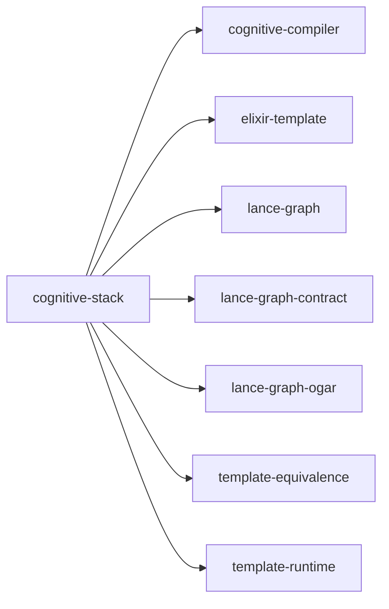

# cognitive-stack

crate: cognitive-stack
path: crates/cognitive-stack
workspace: excluded
digest: ec969e4eb7bf5a21
evidence legend: ../index.md#evidence-legend

Generated; the code is the truth. See ../index.md.

## Depends on

- dep cognitive-compiler normal — crates/cognitive-stack/Cargo.toml:41 CONFIRMED
- dep elixir-template normal — crates/cognitive-stack/Cargo.toml:38 CONFIRMED
- dep lance-graph normal — crates/cognitive-stack/Cargo.toml:47 CONFIRMED
- dep lance-graph-contract normal — crates/cognitive-stack/Cargo.toml:48 CONFIRMED
- dep lance-graph-ogar normal — crates/cognitive-stack/Cargo.toml:95 CONFIRMED
- dep template-equivalence normal — crates/cognitive-stack/Cargo.toml:40 CONFIRMED
- dep template-runtime normal — crates/cognitive-stack/Cargo.toml:39 CONFIRMED
- dep ndarray normal — crates/cognitive-stack/Cargo.toml:53 CONFIRMED
- dep ogar-adapter-surrealql normal — crates/cognitive-stack/Cargo.toml:82 CONFIRMED
- dep ogar-ontology normal — crates/cognitive-stack/Cargo.toml:81 CONFIRMED
- dep ogar-vocab normal — crates/cognitive-stack/Cargo.toml:80 CONFIRMED
- dep ractor normal — crates/cognitive-stack/Cargo.toml:90 CONFIRMED
- dep surrealdb-core normal — crates/cognitive-stack/Cargo.toml:91 CONFIRMED

## Depended on by

## Public items

## Imports from in-scope crates

### cognitive-compiler
- use cognitive_compiler as _ — crates/cognitive-stack/src/main.rs:21 CONFIRMED
### elixir-template
- use elixir_template::source_ranking_v1 — crates/cognitive-stack/src/main.rs:22 CONFIRMED
### lance-graph
- use lance_graph as _ — crates/cognitive-stack/src/main.rs:13 CONFIRMED
### lance-graph-ogar
- use lance_graph_ogar as _ — crates/cognitive-stack/src/main.rs:14 CONFIRMED
### template-equivalence
- use template_equivalence::EquivalenceConfig — crates/cognitive-stack/src/main.rs:23 CONFIRMED
### template-runtime
- use template_runtime::ActionRegistry — crates/cognitive-stack/src/main.rs:24 CONFIRMED

## Calls

CALL_GRAPH=ARTIFACT_MISSING
- calls ARTIFACT_MISSING — no ruff_charon artifact for this crate UNKNOWN

## Architecture

- none

Generated from Cargo manifests — extracted relationships only.

