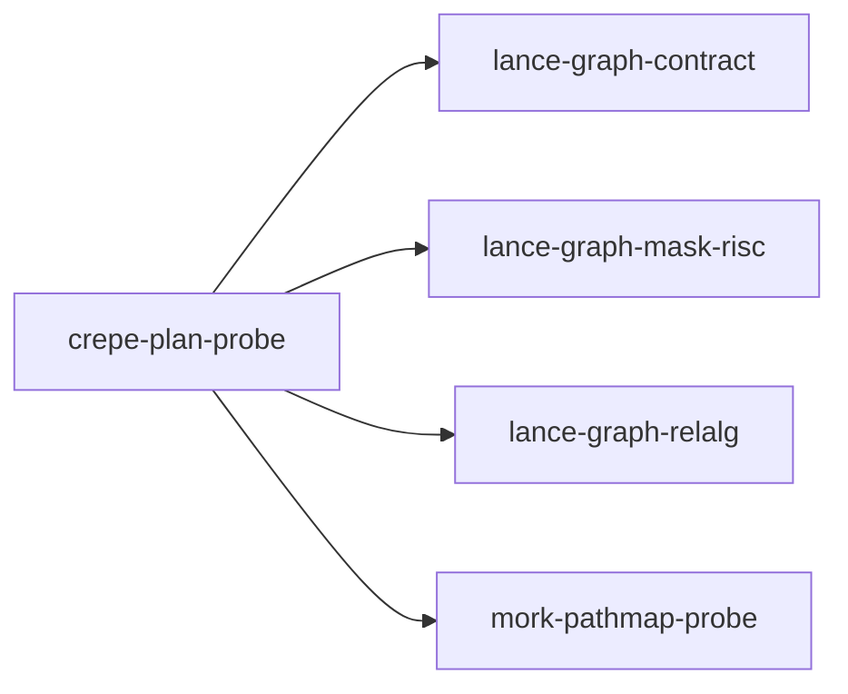

# crepe-plan-probe

crate: crepe-plan-probe
path: crates/crepe-plan-probe
workspace: excluded
digest: 1a96c1672d5828ec
evidence legend: ../index.md#evidence-legend

Generated; the code is the truth. See ../index.md.

## Depends on

- dep lance-graph-contract normal — crates/crepe-plan-probe/Cargo.toml:27 CONFIRMED
- dep lance-graph-mask-risc normal — crates/crepe-plan-probe/Cargo.toml:21 CONFIRMED
- dep lance-graph-relalg normal — crates/crepe-plan-probe/Cargo.toml:20 CONFIRMED
- dep mork-pathmap-probe normal — crates/crepe-plan-probe/Cargo.toml:24 CONFIRMED
- dep arrow-array normal — crates/crepe-plan-probe/Cargo.toml:33 CONFIRMED
- dep arrow-buffer normal — crates/crepe-plan-probe/Cargo.toml:34 CONFIRMED
- dep arrow-schema normal — crates/crepe-plan-probe/Cargo.toml:35 CONFIRMED
- dep ascent dev — crates/crepe-plan-probe/Cargo.toml:47 CONFIRMED
- dep crepe normal — crates/crepe-plan-probe/Cargo.toml:19 CONFIRMED
- dep datafrog dev — crates/crepe-plan-probe/Cargo.toml:45 CONFIRMED
- dep futures normal — crates/crepe-plan-probe/Cargo.toml:36 CONFIRMED
- dep lance normal — crates/crepe-plan-probe/Cargo.toml:31 CONFIRMED
- dep lancedb normal — crates/crepe-plan-probe/Cargo.toml:32 CONFIRMED
- dep ndarray normal — crates/crepe-plan-probe/Cargo.toml:40 CONFIRMED
- dep tempfile dev — crates/crepe-plan-probe/Cargo.toml:44 CONFIRMED
- dep tokio normal — crates/crepe-plan-probe/Cargo.toml:41 CONFIRMED

## Depended on by

## Public items

- fn key [pub] — crates/crepe-plan-probe/src/addressed.rs:40 CONFIRMED
- fn leading [pub] — crates/crepe-plan-probe/src/addressed.rs:47 CONFIRMED
- enum AddressedRefusal [pub] — crates/crepe-plan-probe/src/addressed.rs:52 CONFIRMED
- struct AddressedRelation [pub] — crates/crepe-plan-probe/src/addressed.rs:89 CONFIRMED
- fn attest [pub] — crates/crepe-plan-probe/src/addressed.rs:101 CONFIRMED
- struct Lookup [pub] — crates/crepe-plan-probe/src/addressed.rs:147 CONFIRMED
- enum Read [pub] — crates/crepe-plan-probe/src/addressed.rs:160 CONFIRMED
- struct ReadPolicy [pub] — crates/crepe-plan-probe/src/addressed.rs:175 CONFIRMED
- const ReadPolicy::EXACT [pub] — crates/crepe-plan-probe/src/addressed.rs:191 CONFIRMED
- const ReadPolicy::DEFAULT [pub] — crates/crepe-plan-probe/src/addressed.rs:212 CONFIRMED
- const ReadPolicy::FULL [pub] — crates/crepe-plan-probe/src/addressed.rs:218 CONFIRMED
- fn plan_read [pub] — crates/crepe-plan-probe/src/addressed.rs:228 CONFIRMED
- fn ranges [pub] — crates/crepe-plan-probe/src/addressed.rs:255 CONFIRMED
- fn range_tree [pub] — crates/crepe-plan-probe/src/addressed.rs:285 CONFIRMED
- fn range_mask [pub] — crates/crepe-plan-probe/src/addressed.rs:294 CONFIRMED
- fn check_fresh [pub] — crates/crepe-plan-probe/src/addressed.rs:300 CONFIRMED
- fn prepare_addressed [pub] — crates/crepe-plan-probe/src/addressed.rs:364 CONFIRMED
- fn prepare_addressed_with [pub] — crates/crepe-plan-probe/src/addressed.rs:377 CONFIRMED
- const VALUE_LANE [pub] — crates/crepe-plan-probe/src/coaddressed.rs:56 CONFIRMED
- struct CoSide [pub] — crates/crepe-plan-probe/src/coaddressed.rs:60 CONFIRMED
- fn CoSide::new [pub] — crates/crepe-plan-probe/src/coaddressed.rs:68 CONFIRMED
- fn CoSide::n_rows [pub] — crates/crepe-plan-probe/src/coaddressed.rs:79 CONFIRMED
- struct CoTable [pub] — crates/crepe-plan-probe/src/coaddressed.rs:96 CONFIRMED
- fn layout_key [pub] — crates/crepe-plan-probe/src/coaddressed.rs:106 CONFIRMED
- fn CoTable::prepare [pub] — crates/crepe-plan-probe/src/coaddressed.rs:115 CONFIRMED
- fn CoTable::domain [pub] — crates/crepe-plan-probe/src/coaddressed.rs:130 CONFIRMED
- fn CoTable::sides [pub] — crates/crepe-plan-probe/src/coaddressed.rs:134 CONFIRMED
- fn CoTable::keys [pub] — crates/crepe-plan-probe/src/coaddressed.rs:138 CONFIRMED
- fn CoTable::domain_fp [pub] — crates/crepe-plan-probe/src/coaddressed.rs:144 CONFIRMED
- fn CoTable::rows [pub] — crates/crepe-plan-probe/src/coaddressed.rs:148 CONFIRMED
- fn plan_rels [pub] — crates/crepe-plan-probe/src/coaddressed.rs:155 CONFIRMED
- struct CoCost [pub] — crates/crepe-plan-probe/src/coaddressed.rs:171 CONFIRMED
- enum CoRefusal [pub] — crates/crepe-plan-probe/src/coaddressed.rs:187 CONFIRMED
- struct CoEval [pub] — crates/crepe-plan-probe/src/coaddressed.rs:216 CONFIRMED
- fn eval [pub] — crates/crepe-plan-probe/src/coaddressed.rs:227 CONFIRMED
- fn CoEval::distinct_centers [pub] — crates/crepe-plan-probe/src/coaddressed.rs:438 CONFIRMED
- fn CoEval::bag_count [pub] — crates/crepe-plan-probe/src/coaddressed.rs:444 CONFIRMED
- fn CoEval::matching [pub] — crates/crepe-plan-probe/src/coaddressed.rs:459 CONFIRMED
- enum Layout [pub] — crates/crepe-plan-probe/src/cse.rs:60 CONFIRMED
- struct SharedStars [pub] — crates/crepe-plan-probe/src/cse.rs:71 CONFIRMED
- struct Group [pub] — crates/crepe-plan-probe/src/cse.rs:76 CONFIRMED
- fn prepare_shared [pub] — crates/crepe-plan-probe/src/cse.rs:125 CONFIRMED
- fn rule_sets [pub] — crates/crepe-plan-probe/src/cse.rs:169 CONFIRMED
- fn generations [pub] — crates/crepe-plan-probe/src/cse.rs:178 CONFIRMED
- fn table_version [pub] — crates/crepe-plan-probe/src/cse.rs:195 CONFIRMED
- enum CseRefusal [pub] — crates/crepe-plan-probe/src/cse.rs:207 CONFIRMED
- struct SharedReport [pub] — crates/crepe-plan-probe/src/cse.rs:226 CONFIRMED
- fn program [pub] — crates/crepe-plan-probe/src/cse.rs:258 CONFIRMED
- fn evaluate_shared [pub] — crates/crepe-plan-probe/src/cse.rs:276 CONFIRMED
- fn witness [pub] — crates/crepe-plan-probe/src/cse.rs:302 CONFIRMED
- fn execute_shared [pub] — crates/crepe-plan-probe/src/cse.rs:332 CONFIRMED
- enum LanceStoreError [pub] — crates/crepe-plan-probe/src/lance_store.rs:33 CONFIRMED
- struct LanceStore [pub] — crates/crepe-plan-probe/src/lance_store.rs:44 CONFIRMED
- fn LanceStore::write [pub] — crates/crepe-plan-probe/src/lance_store.rs:66 CONFIRMED
- fn LanceStore::write_as_given [pub] — crates/crepe-plan-probe/src/lance_store.rs:87 CONFIRMED
- fn LanceStore::append [pub] — crates/crepe-plan-probe/src/lance_store.rs:113 CONFIRMED
- fn LanceStore::version [pub] — crates/crepe-plan-probe/src/lance_store.rs:120 CONFIRMED
- fn LanceStore::generations [pub] — crates/crepe-plan-probe/src/lance_store.rs:125 CONFIRMED
- fn LanceStore::dataset [pub(crate)] — crates/crepe-plan-probe/src/lance_store.rs:133 CONFIRMED
- struct Io [pub] — crates/crepe-plan-probe/src/lance_store.rs:144 CONFIRMED
- struct SideIo [pub] — crates/crepe-plan-probe/src/lance_store.rs:152 CONFIRMED
- fn read_rows [pub(crate)] — crates/crepe-plan-probe/src/lance_store.rs:209 CONFIRMED
- fn address_mask [pub] — crates/crepe-plan-probe/src/lance_store.rs:233 CONFIRMED
- fn membership_mask [pub] — crates/crepe-plan-probe/src/lance_store.rs:256 CONFIRMED
- fn prepare_lance [pub] — crates/crepe-plan-probe/src/lance_store.rs:274 CONFIRMED
- mod addressed [pub] — crates/crepe-plan-probe/src/lib.rs:33 CONFIRMED
- mod coaddressed [pub] — crates/crepe-plan-probe/src/lib.rs:34 CONFIRMED
- mod cse [pub] — crates/crepe-plan-probe/src/lib.rs:35 CONFIRMED
- mod lance_store [pub] — crates/crepe-plan-probe/src/lib.rs:36 CONFIRMED
- mod logic [pub] — crates/crepe-plan-probe/src/lib.rs:37 CONFIRMED
- mod mork_api [pub] — crates/crepe-plan-probe/src/lib.rs:38 CONFIRMED
- mod native [pub] — crates/crepe-plan-probe/src/lib.rs:39 CONFIRMED
- mod optimize [pub] — crates/crepe-plan-probe/src/lib.rs:40 CONFIRMED
- mod pipeline [pub] — crates/crepe-plan-probe/src/lib.rs:41 CONFIRMED
- mod plan [pub] — crates/crepe-plan-probe/src/lib.rs:42 CONFIRMED
- mod programs [pub] — crates/crepe-plan-probe/src/lib.rs:43 CONFIRMED
- mod reference [pub] — crates/crepe-plan-probe/src/lib.rs:44 CONFIRMED
- struct RelId [pub] — crates/crepe-plan-probe/src/logic.rs:12 CONFIRMED
- struct VarId [pub] — crates/crepe-plan-probe/src/logic.rs:16 CONFIRMED
- enum Term [pub] — crates/crepe-plan-probe/src/logic.rs:19 CONFIRMED
- struct Atom [pub] — crates/crepe-plan-probe/src/logic.rs:25 CONFIRMED
- struct Rule [pub] — crates/crepe-plan-probe/src/logic.rs:31 CONFIRMED
- struct Labels [pub] — crates/crepe-plan-probe/src/logic.rs:40 CONFIRMED
- fn Labels::of [pub] — crates/crepe-plan-probe/src/logic.rs:47 CONFIRMED
- fn Labels::id [pub] — crates/crepe-plan-probe/src/logic.rs:59 CONFIRMED
- fn Labels::name [pub] — crates/crepe-plan-probe/src/logic.rs:67 CONFIRMED
- fn Labels::arity [pub] — crates/crepe-plan-probe/src/logic.rs:71 CONFIRMED
- fn Labels::is_input [pub] — crates/crepe-plan-probe/src/logic.rs:75 CONFIRMED
- enum Refusal [pub] — crates/crepe-plan-probe/src/logic.rs:82 CONFIRMED
- fn resolve [pub] — crates/crepe-plan-probe/src/logic.rs:102 CONFIRMED
- fn Rule::canonical [pub] — crates/crepe-plan-probe/src/logic.rs:184 CONFIRMED
- enum Expr [pub] — crates/crepe-plan-probe/src/mork_api.rs:18 CONFIRMED
- type Pattern [pub] — crates/crepe-plan-probe/src/mork_api.rs:31 CONFIRMED
- struct QueryMulti [pub] — crates/crepe-plan-probe/src/mork_api.rs:36 CONFIRMED
- enum MorkRefusal [pub] — crates/crepe-plan-probe/src/mork_api.rs:42 CONFIRMED
- fn query_multi [pub] — crates/crepe-plan-probe/src/mork_api.rs:57 CONFIRMED
- fn admit [pub] — crates/crepe-plan-probe/src/mork_api.rs:74 CONFIRMED
- fn to_oracle [pub] — crates/crepe-plan-probe/src/mork_api.rs:110 CONFIRMED
- fn render [pub] — crates/crepe-plan-probe/src/mork_api.rs:140 CONFIRMED
- struct SideKey [pub] — crates/crepe-plan-probe/src/native.rs:53 CONFIRMED
- struct SidePlan [pub] — crates/crepe-plan-probe/src/native.rs:63 CONFIRMED
- enum HeadTerm [pub] — crates/crepe-plan-probe/src/native.rs:71 CONFIRMED
- struct StarPlan [pub] — crates/crepe-plan-probe/src/native.rs:80 CONFIRMED
- enum NativeRefusal [pub] — crates/crepe-plan-probe/src/native.rs:87 CONFIRMED
- fn star [pub] — crates/crepe-plan-probe/src/native.rs:120 CONFIRMED
- struct Store [pub] — crates/crepe-plan-probe/src/native.rs:201 CONFIRMED
- fn Store::from_rows [pub] — crates/crepe-plan-probe/src/native.rs:208 CONFIRMED
- fn Store::view [pub] — crates/crepe-plan-probe/src/native.rs:219 CONFIRMED
- struct PreparedStar [pub] — crates/crepe-plan-probe/src/native.rs:232 CONFIRMED
- fn prepare [pub] — crates/crepe-plan-probe/src/native.rs:243 CONFIRMED
- fn prepare_semijoin [pub] — crates/crepe-plan-probe/src/native.rs:252 CONFIRMED
- fn prepare_views [pub] — crates/crepe-plan-probe/src/native.rs:269 CONFIRMED
- fn fingerprint [pub] — crates/crepe-plan-probe/src/native.rs:344 CONFIRMED
- fn PreparedStar::graft [pub] — crates/crepe-plan-probe/src/native.rs:358 CONFIRMED
- fn PreparedStar::witness [pub] — crates/crepe-plan-probe/src/native.rs:374 CONFIRMED
- fn joint [pub] — crates/crepe-plan-probe/src/native.rs:384 CONFIRMED
- fn distinct_centers [pub] — crates/crepe-plan-probe/src/native.rs:411 CONFIRMED
- fn kept [pub] — crates/crepe-plan-probe/src/native.rs:425 CONFIRMED
- struct StarView [pub] — crates/crepe-plan-probe/src/native.rs:439 CONFIRMED
- struct RuleFilter [pub] — crates/crepe-plan-probe/src/native.rs:449 CONFIRMED
- fn RuleFilter::of [pub] — crates/crepe-plan-probe/src/native.rs:457 CONFIRMED
- fn narrow_center [pub] — crates/crepe-plan-probe/src/native.rs:483 CONFIRMED
- fn any_derivation [pub] — crates/crepe-plan-probe/src/native.rs:513 CONFIRMED
- fn bag_count [pub] — crates/crepe-plan-probe/src/native.rs:534 CONFIRMED
- struct DistinctGroup [pub] — crates/crepe-plan-probe/src/native.rs:549 CONFIRMED
- fn DistinctGroup::len [pub] — crates/crepe-plan-probe/src/native.rs:557 CONFIRMED
- fn DistinctGroup::is_empty [pub] — crates/crepe-plan-probe/src/native.rs:561 CONFIRMED
- enum SetRefusal [pub] — crates/crepe-plan-probe/src/native.rs:568 CONFIRMED
- fn add_distinct [pub] — crates/crepe-plan-probe/src/native.rs:597 CONFIRMED
- fn canonical [pub] — crates/crepe-plan-probe/src/native.rs:663 CONFIRMED
- struct RuleCoordinates [pub] — crates/crepe-plan-probe/src/native.rs:677 CONFIRMED
- struct SlotView [pub] — crates/crepe-plan-probe/src/native.rs:693 CONFIRMED
- fn for_each_slot [pub] — crates/crepe-plan-probe/src/native.rs:703 CONFIRMED
- fn matching [pub] — crates/crepe-plan-probe/src/native.rs:730 CONFIRMED
- struct DerivationView [pub] — crates/crepe-plan-probe/src/native.rs:787 CONFIRMED
- fn DerivationView<'_>::arity [pub] — crates/crepe-plan-probe/src/native.rs:795 CONFIRMED
- fn DerivationView<'_>::get [pub] — crates/crepe-plan-probe/src/native.rs:799 CONFIRMED
- fn for_each_derivation [pub] — crates/crepe-plan-probe/src/native.rs:811 CONFIRMED
- fn has_foreign_hop [pub] — crates/crepe-plan-probe/src/native.rs:875 CONFIRMED
- enum ResultKind [pub] — crates/crepe-plan-probe/src/optimize.rs:27 CONFIRMED
- fn ResultKind::duplicate_insensitive [pub] — crates/crepe-plan-probe/src/optimize.rs:38 CONFIRMED
- struct Demand [pub] — crates/crepe-plan-probe/src/optimize.rs:51 CONFIRMED
- struct Options [pub] — crates/crepe-plan-probe/src/optimize.rs:59 CONFIRMED
- const Options::ALL [pub] — crates/crepe-plan-probe/src/optimize.rs:69 CONFIRMED
- const Options::NONE [pub] — crates/crepe-plan-probe/src/optimize.rs:74 CONFIRMED
- enum Rewrite [pub] — crates/crepe-plan-probe/src/optimize.rs:83 CONFIRMED
- struct Optimized [pub] — crates/crepe-plan-probe/src/optimize.rs:96 CONFIRMED
- fn optimize [pub] — crates/crepe-plan-probe/src/optimize.rs:106 CONFIRMED
- enum PipelineRefusal [pub] — crates/crepe-plan-probe/src/pipeline.rs:22 CONFIRMED
- enum Answers [pub] — crates/crepe-plan-probe/src/pipeline.rs:45 CONFIRMED
- fn Answers::total [pub] — crates/crepe-plan-probe/src/pipeline.rs:77 CONFIRMED
- fn Answers::matching [pub] — crates/crepe-plan-probe/src/pipeline.rs:90 CONFIRMED
- fn Answers::for_each [pub] — crates/crepe-plan-probe/src/pipeline.rs:129 CONFIRMED
- enum Outcome [pub] — crates/crepe-plan-probe/src/pipeline.rs:151 CONFIRMED
- struct Costs [pub] — crates/crepe-plan-probe/src/pipeline.rs:159 CONFIRMED
- struct Planned [pub] — crates/crepe-plan-probe/src/pipeline.rs:168 CONFIRMED
- struct Report [pub] — crates/crepe-plan-probe/src/pipeline.rs:178 CONFIRMED
- fn plan [pub] — crates/crepe-plan-probe/src/pipeline.rs:194 CONFIRMED
- fn evaluate [pub] — crates/crepe-plan-probe/src/pipeline.rs:225 CONFIRMED
- fn execute [pub] — crates/crepe-plan-probe/src/pipeline.rs:262 CONFIRMED
- fn evaluate_lance [pub] — crates/crepe-plan-probe/src/pipeline.rs:383 CONFIRMED
- fn evaluate_addressed [pub] — crates/crepe-plan-probe/src/pipeline.rs:415 CONFIRMED
- fn evaluate_addressed_with [pub] — crates/crepe-plan-probe/src/pipeline.rs:427 CONFIRMED
- fn demand [pub] — crates/crepe-plan-probe/src/pipeline.rs:460 CONFIRMED
- struct Plan [pub] — crates/crepe-plan-probe/src/plan.rs:9 CONFIRMED
- struct PlanRelation [pub] — crates/crepe-plan-probe/src/plan.rs:16 CONFIRMED
- enum PlanRelKind [pub] — crates/crepe-plan-probe/src/plan.rs:23 CONFIRMED
- struct PlanRule [pub] — crates/crepe-plan-probe/src/plan.rs:30 CONFIRMED
- struct PlanAtom [pub] — crates/crepe-plan-probe/src/plan.rs:38 CONFIRMED
- enum PlanClause [pub] — crates/crepe-plan-probe/src/plan.rs:45 CONFIRMED
- enum PlanField [pub] — crates/crepe-plan-probe/src/plan.rs:52 CONFIRMED
- mod family [pub] — crates/crepe-plan-probe/src/programs.rs:7 CONFIRMED
- mod oracle [pub] — crates/crepe-plan-probe/src/programs.rs:24 CONFIRMED
- mod family_noisy [pub] — crates/crepe-plan-probe/src/programs.rs:42 CONFIRMED
- mod two_way [pub] — crates/crepe-plan-probe/src/programs.rs:61 CONFIRMED
- mod star3 [pub] — crates/crepe-plan-probe/src/programs.rs:76 CONFIRMED
- mod refused [pub] — crates/crepe-plan-probe/src/programs.rs:93 CONFIRMED
- fn eval [pub] — crates/crepe-plan-probe/src/reference.rs:11 CONFIRMED

## Imports from in-scope crates

### lance-graph-contract
- use lance_graph_contract::facet::FacetCascade — crates/crepe-plan-probe/src/addressed.rs:31 CONFIRMED
- use lance_graph_contract::facet::SemanticPrefix — crates/crepe-plan-probe/src/addressed.rs:31 CONFIRMED
- use lance_graph_contract::ordered_lane::OrderedLaneWitness — crates/crepe-plan-probe/src/addressed.rs:32 CONFIRMED
- use lance_graph_contract::ordered_lane::SealedFacetLane — crates/crepe-plan-probe/src/addressed.rs:32 CONFIRMED
- use lance_graph_contract::ordered_lane::WitnessError — crates/crepe-plan-probe/src/addressed.rs:32 CONFIRMED
- use lance_graph_contract::set_algebra::SetExpr — crates/crepe-plan-probe/src/cse.rs:43 CONFIRMED
- use lance_graph_contract::set_program::SetProgram — crates/crepe-plan-probe/src/cse.rs:44 CONFIRMED
- use lance_graph_contract::set_program::share — crates/crepe-plan-probe/src/cse.rs:44 CONFIRMED
### lance-graph-mask-risc
- use lance_graph_mask_risc::ExecError — crates/crepe-plan-probe/src/coaddressed.rs:44 CONFIRMED
- use lance_graph_mask_risc::Foreign — crates/crepe-plan-probe/src/coaddressed.rs:46 CONFIRMED
- use lance_graph_mask_risc::GroupFold — crates/crepe-plan-probe/src/coaddressed.rs:46 CONFIRMED
- use lance_graph_mask_risc::GroupKey — crates/crepe-plan-probe/src/coaddressed.rs:46 CONFIRMED
- use lance_graph_mask_risc::LaneRef — crates/crepe-plan-probe/src/coaddressed.rs:46 CONFIRMED
- use lance_graph_mask_risc::Operand — crates/crepe-plan-probe/src/coaddressed.rs:46 CONFIRMED
- use lance_graph_mask_risc::Out — crates/crepe-plan-probe/src/coaddressed.rs:46 CONFIRMED
- use lance_graph_mask_risc::Planes — crates/crepe-plan-probe/src/coaddressed.rs:46 CONFIRMED
- use lance_graph_mask_risc::Program — crates/crepe-plan-probe/src/coaddressed.rs:46 CONFIRMED
- use lance_graph_mask_risc::Scratch — crates/crepe-plan-probe/src/coaddressed.rs:46 CONFIRMED
- use lance_graph_mask_risc::Terminal — crates/crepe-plan-probe/src/coaddressed.rs:46 CONFIRMED
- use lance_graph_mask_risc::execute_into — crates/crepe-plan-probe/src/coaddressed.rs:47 CONFIRMED
- use lance_graph_mask_risc::words_for — crates/crepe-plan-probe/src/coaddressed.rs:47 CONFIRMED
- use lance_graph_mask_risc::Planes — crates/crepe-plan-probe/src/cse.rs:45 CONFIRMED
- use lance_graph_mask_risc::words_for — crates/crepe-plan-probe/src/cse.rs:45 CONFIRMED
- use lance_graph_mask_risc::LaneRef — crates/crepe-plan-probe/src/lance_store.rs:23 CONFIRMED
- use lance_graph_mask_risc::Planes — crates/crepe-plan-probe/src/lance_store.rs:23 CONFIRMED
- use lance_graph_mask_risc::words_for — crates/crepe-plan-probe/src/lance_store.rs:23 CONFIRMED
- use lance_graph_mask_risc::MaskOp — crates/crepe-plan-probe/src/native.rs:38 CONFIRMED
- use lance_graph_mask_risc::Planes — crates/crepe-plan-probe/src/native.rs:38 CONFIRMED
- use lance_graph_mask_risc::Pred — crates/crepe-plan-probe/src/native.rs:38 CONFIRMED
- use lance_graph_mask_risc::Program — crates/crepe-plan-probe/src/native.rs:38 CONFIRMED
- use lance_graph_mask_risc::Terminal — crates/crepe-plan-probe/src/native.rs:38 CONFIRMED
- use lance_graph_mask_risc::words_for — crates/crepe-plan-probe/src/native.rs:38 CONFIRMED
- use lance_graph_mask_risc::Program — crates/crepe-plan-probe/src/pipeline.rs:6 CONFIRMED
### lance-graph-relalg
- use lance_graph_relalg::Measure — crates/crepe-plan-probe/src/coaddressed.rs:49 CONFIRMED
- use lance_graph_relalg::Query — crates/crepe-plan-probe/src/coaddressed.rs:49 CONFIRMED
- use lance_graph_relalg::Rel — crates/crepe-plan-probe/src/coaddressed.rs:49 CONFIRMED
- use lance_graph_relalg::RelError — crates/crepe-plan-probe/src/coaddressed.rs:49 CONFIRMED
- use lance_graph_relalg::Run — crates/crepe-plan-probe/src/coaddressed.rs:49 CONFIRMED
- use lance_graph_relalg::normalize — crates/crepe-plan-probe/src/coaddressed.rs:49 CONFIRMED
- use lance_graph_relalg::run_with_program — crates/crepe-plan-probe/src/coaddressed.rs:49 CONFIRMED
- use lance_graph_relalg::Answer — crates/crepe-plan-probe/src/cse.rs:46 CONFIRMED
- use lance_graph_relalg::Measure — crates/crepe-plan-probe/src/cse.rs:46 CONFIRMED
- use lance_graph_relalg::ProgramCost — crates/crepe-plan-probe/src/cse.rs:46 CONFIRMED
- use lance_graph_relalg::ProgramError — crates/crepe-plan-probe/src/cse.rs:46 CONFIRMED
- use lance_graph_relalg::run_program — crates/crepe-plan-probe/src/cse.rs:46 CONFIRMED
- use lance_graph_relalg::Measure — crates/crepe-plan-probe/src/lance_store.rs:24 CONFIRMED
- use lance_graph_relalg::Query — crates/crepe-plan-probe/src/lance_store.rs:24 CONFIRMED
- use lance_graph_relalg::Rel — crates/crepe-plan-probe/src/lance_store.rs:24 CONFIRMED
- use lance_graph_relalg::RelError — crates/crepe-plan-probe/src/lance_store.rs:24 CONFIRMED
- use lance_graph_relalg::run_with_program — crates/crepe-plan-probe/src/lance_store.rs:24 CONFIRMED
- use lance_graph_relalg::join_body::is_alpha_acyclic — crates/crepe-plan-probe/src/mork_api.rs:11 CONFIRMED
- use lance_graph_relalg::Answer — crates/crepe-plan-probe/src/native.rs:39 CONFIRMED
- use lance_graph_relalg::Measure — crates/crepe-plan-probe/src/native.rs:39 CONFIRMED
- use lance_graph_relalg::Query — crates/crepe-plan-probe/src/native.rs:39 CONFIRMED
- use lance_graph_relalg::Rel — crates/crepe-plan-probe/src/native.rs:39 CONFIRMED
- use lance_graph_relalg::RelError — crates/crepe-plan-probe/src/native.rs:39 CONFIRMED
- use lance_graph_relalg::Run — crates/crepe-plan-probe/src/native.rs:39 CONFIRMED
- use lance_graph_relalg::run_with_program — crates/crepe-plan-probe/src/native.rs:39 CONFIRMED
### mork-pathmap-probe
- use mork_pathmap_probe::RelationView — crates/crepe-plan-probe/src/addressed.rs:37 CONFIRMED
- use mork_pathmap_probe::RelationView — crates/crepe-plan-probe/src/coaddressed.rs:50 CONFIRMED
- use mork_pathmap_probe::join::JoinDomain — crates/crepe-plan-probe/src/coaddressed.rs:51 CONFIRMED
- use mork_pathmap_probe::join::JoinRefusal — crates/crepe-plan-probe/src/coaddressed.rs:51 CONFIRMED
- use mork_pathmap_probe::join::JoinTable — crates/crepe-plan-probe/src/coaddressed.rs:51 CONFIRMED
- use mork_pathmap_probe::join::Side — crates/crepe-plan-probe/src/coaddressed.rs:51 CONFIRMED
- use mork_pathmap_probe::join::for_each_set — crates/crepe-plan-probe/src/coaddressed.rs:51 CONFIRMED
- use mork_pathmap_probe::Semantics — crates/crepe-plan-probe/src/cse.rs:47 CONFIRMED
- use mork_pathmap_probe::join::JoinRefusal — crates/crepe-plan-probe/src/cse.rs:48 CONFIRMED
- use mork_pathmap_probe::join::Side — crates/crepe-plan-probe/src/cse.rs:48 CONFIRMED
- use mork_pathmap_probe::join::for_each_set — crates/crepe-plan-probe/src/lance_store.rs:25 CONFIRMED
- use mork_pathmap_probe::Lane — crates/crepe-plan-probe/src/lance_store.rs:30 CONFIRMED
- use mork_pathmap_probe::RelationView — crates/crepe-plan-probe/src/lance_store.rs:30 CONFIRMED
- use mork_pathmap_probe::boundary::OracleAtom — crates/crepe-plan-probe/src/mork_api.rs:12 CONFIRMED
- use mork_pathmap_probe::boundary::OracleRule — crates/crepe-plan-probe/src/mork_api.rs:12 CONFIRMED
- use mork_pathmap_probe::boundary::OracleTerm — crates/crepe-plan-probe/src/mork_api.rs:12 CONFIRMED
- use mork_pathmap_probe::RelationView — crates/crepe-plan-probe/src/native.rs:40 CONFIRMED
- use mork_pathmap_probe::join::JoinDomain — crates/crepe-plan-probe/src/native.rs:42 CONFIRMED
- use mork_pathmap_probe::join::JoinRefusal — crates/crepe-plan-probe/src/native.rs:42 CONFIRMED
- use mork_pathmap_probe::join::JoinTable — crates/crepe-plan-probe/src/native.rs:42 CONFIRMED
- use mork_pathmap_probe::join::Run as SideRun — crates/crepe-plan-probe/src/native.rs:42 CONFIRMED
- use mork_pathmap_probe::join::SelectedSide — crates/crepe-plan-probe/src/native.rs:42 CONFIRMED
- use mork_pathmap_probe::join::Side — crates/crepe-plan-probe/src/native.rs:42 CONFIRMED
- use mork_pathmap_probe::join::for_each_set — crates/crepe-plan-probe/src/native.rs:42 CONFIRMED
- use mork_pathmap_probe::join::for_each_set_ahead — crates/crepe-plan-probe/src/native.rs:43 CONFIRMED
- use mork_pathmap_probe::join::rows — crates/crepe-plan-probe/src/native.rs:43 CONFIRMED
- use mork_pathmap_probe::Semantics — crates/crepe-plan-probe/src/optimize.rs:21 CONFIRMED
- use mork_pathmap_probe::Semantics — crates/crepe-plan-probe/src/pipeline.rs:7 CONFIRMED
- use mork_pathmap_probe::join::Side — crates/crepe-plan-probe/src/pipeline.rs:19 CONFIRMED

## Calls

CALL_GRAPH=ARTIFACT_MISSING
- calls ARTIFACT_MISSING — no ruff_charon artifact for this crate UNKNOWN

## Architecture

- none

Generated from Cargo manifests — extracted relationships only.

