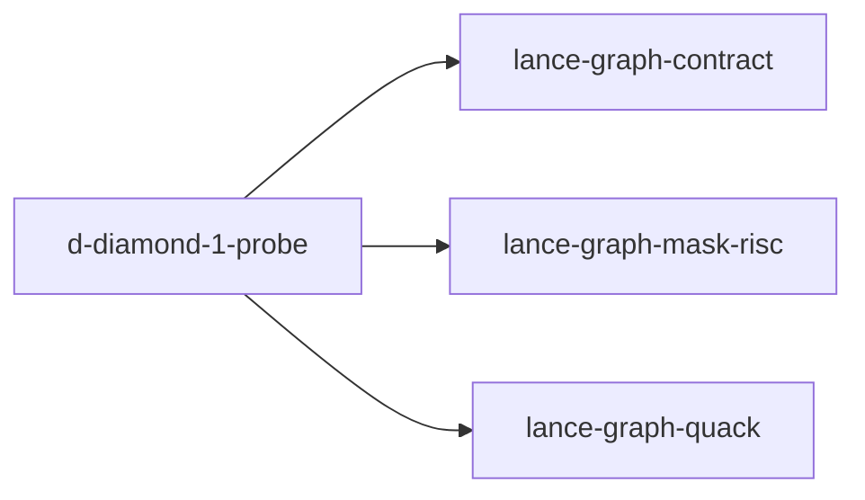

# d-diamond-1-probe

crate: d-diamond-1-probe
path: crates/d-diamond-1-probe
workspace: excluded
digest: 98a7cd6d39e6f983
evidence legend: ../index.md#evidence-legend

Generated; the code is the truth. See ../index.md.

## Depends on

- dep lance-graph-contract normal — crates/d-diamond-1-probe/Cargo.toml:16 CONFIRMED
- dep lance-graph-mask-risc normal — crates/d-diamond-1-probe/Cargo.toml:18 CONFIRMED
- dep lance-graph-quack normal — crates/d-diamond-1-probe/Cargo.toml:17 CONFIRMED
- dep ndarray normal — crates/d-diamond-1-probe/Cargo.toml:19 CONFIRMED

## Depended on by

## Public items

- const SEED [pub] — crates/d-diamond-1-probe/src/lib.rs:18 CONFIRMED
- struct SplitMix64 [pub] — crates/d-diamond-1-probe/src/lib.rs:25 CONFIRMED
- fn SplitMix64::next_u64 [pub] — crates/d-diamond-1-probe/src/lib.rs:28 CONFIRMED
- fn SplitMix64::unit [pub] — crates/d-diamond-1-probe/src/lib.rs:35 CONFIRMED
- fn SplitMix64::skewed [pub] — crates/d-diamond-1-probe/src/lib.rs:41 CONFIRMED
- fn ontology_key [pub] — crates/d-diamond-1-probe/src/lib.rs:50 CONFIRMED
- const TENANT_CANON [pub] — crates/d-diamond-1-probe/src/lib.rs:63 CONFIRMED
- const TENANT_CUSTOM [pub] — crates/d-diamond-1-probe/src/lib.rs:64 CONFIRMED
- fn tenant_key [pub] — crates/d-diamond-1-probe/src/lib.rs:70 CONFIRMED
- struct World [pub] — crates/d-diamond-1-probe/src/lib.rs:99 CONFIRMED
- fn build_world [pub] — crates/d-diamond-1-probe/src/lib.rs:111 CONFIRMED
- fn World::n [pub] — crates/d-diamond-1-probe/src/lib.rs:139 CONFIRMED
- fn oracle_mask [pub] — crates/d-diamond-1-probe/src/lib.rs:148 CONFIRMED
- fn popcount [pub] — crates/d-diamond-1-probe/src/lib.rs:158 CONFIRMED
- fn nontrivial [pub] — crates/d-diamond-1-probe/src/lib.rs:164 CONFIRMED
- fn nontrivial_intersection [pub] — crates/d-diamond-1-probe/src/lib.rs:176 CONFIRMED
- fn time_ns [pub] — crates/d-diamond-1-probe/src/lib.rs:195 CONFIRMED
- fn evict_l2 [pub] — crates/d-diamond-1-probe/src/lib.rs:212 CONFIRMED
- enum PairClass [pub] — crates/d-diamond-1-probe/src/lib.rs:226 CONFIRMED
- const PairClass::ALL [pub] — crates/d-diamond-1-probe/src/lib.rs:236 CONFIRMED
- fn PairClass::label [pub] — crates/d-diamond-1-probe/src/lib.rs:244 CONFIRMED
- fn PairClass::expected_lcp [pub] — crates/d-diamond-1-probe/src/lib.rs:255 CONFIRMED
- fn make_pairs [pub] — crates/d-diamond-1-probe/src/lib.rs:267 CONFIRMED
- fn lcp_tzcnt [pub] — crates/d-diamond-1-probe/src/lib.rs:304 CONFIRMED
- fn lcp_peek [pub] — crates/d-diamond-1-probe/src/lib.rs:311 CONFIRMED
- fn lcp_peek_bytes [pub] — crates/d-diamond-1-probe/src/lib.rs:325 CONFIRMED
- struct P1Row [pub] — crates/d-diamond-1-probe/src/lib.rs:339 CONFIRMED
- fn run_p1 [pub] — crates/d-diamond-1-probe/src/lib.rs:351 CONFIRMED
- fn sweep_mask [pub] — crates/d-diamond-1-probe/src/lib.rs:398 CONFIRMED
- fn bound_mask [pub] — crates/d-diamond-1-probe/src/lib.rs:422 CONFIRMED
- fn touched_write [pub] — crates/d-diamond-1-probe/src/lib.rs:452 CONFIRMED
- struct P2Row [pub] — crates/d-diamond-1-probe/src/lib.rs:462 CONFIRMED
- fn P2Row::bound_fold_total [pub] — crates/d-diamond-1-probe/src/lib.rs:476 CONFIRMED
- fn P2Row::speedup [pub] — crates/d-diamond-1-probe/src/lib.rs:479 CONFIRMED
- fn pick_prefixes [pub] — crates/d-diamond-1-probe/src/lib.rs:485 CONFIRMED
- fn subsample [pub] — crates/d-diamond-1-probe/src/lib.rs:513 CONFIRMED
- fn run_p2 [pub] — crates/d-diamond-1-probe/src/lib.rs:524 CONFIRMED
- const INTERSECTION_FLOOR [pub] — crates/d-diamond-1-probe/src/lib.rs:634 CONFIRMED
- const JOINT_MAX_DEPTH [pub] — crates/d-diamond-1-probe/src/lib.rs:637 CONFIRMED
- fn joint_key [pub] — crates/d-diamond-1-probe/src/lib.rs:646 CONFIRMED
- struct JointIndex [pub] — crates/d-diamond-1-probe/src/lib.rs:693 CONFIRMED
- fn JointIndex::build [pub] — crates/d-diamond-1-probe/src/lib.rs:701 CONFIRMED
- fn JointIndex::bound [pub] — crates/d-diamond-1-probe/src/lib.rs:723 CONFIRMED
- fn JointIndex::materialize_rows [pub] — crates/d-diamond-1-probe/src/lib.rs:734 CONFIRMED
- struct P3Row [pub] — crates/d-diamond-1-probe/src/lib.rs:743 CONFIRMED
- fn run_p3 [pub] — crates/d-diamond-1-probe/src/lib.rs:769 CONFIRMED
- fn tenant_attest_over_ontology_ordinal [pub] — crates/d-diamond-1-probe/src/lib.rs:871 CONFIRMED
- struct WriterStats [pub] — crates/d-diamond-1-probe/src/lib.rs:880 CONFIRMED
- type Published [pub] — crates/d-diamond-1-probe/src/lib.rs:890 CONFIRMED
- fn with_open_writer [pub] — crates/d-diamond-1-probe/src/lib.rs:895 CONFIRMED
- struct Dist [pub] — crates/d-diamond-1-probe/src/lib.rs:951 CONFIRMED
- fn Dist::of [pub] — crates/d-diamond-1-probe/src/lib.rs:959 CONFIRMED
- fn reader_measure [pub] — crates/d-diamond-1-probe/src/lib.rs:979 CONFIRMED

## Imports from in-scope crates

### lance-graph-contract
- use lance_graph_contract::facet::FacetCascade — crates/d-diamond-1-probe/src/lib.rs:10 CONFIRMED
- use lance_graph_contract::facet::SemanticPrefix — crates/d-diamond-1-probe/src/lib.rs:10 CONFIRMED
- use lance_graph_contract::ordered_lane::OrderedLaneWitness — crates/d-diamond-1-probe/src/lib.rs:11 CONFIRMED
- use lance_graph_contract::ordered_lane::SealedFacetLane — crates/d-diamond-1-probe/src/lib.rs:11 CONFIRMED
- use lance_graph_contract::ordered_lane::WitnessError — crates/d-diamond-1-probe/src/lib.rs:11 CONFIRMED
- use lance_graph_contract::facet::SemanticPrefix — crates/d-diamond-1-probe/src/main.rs:5 CONFIRMED
- use lance_graph_contract::ordered_lane::digest_of — crates/d-diamond-1-probe/src/main.rs:6 CONFIRMED
### lance-graph-mask-risc
- use lance_graph_mask_risc::words_for — crates/d-diamond-1-probe/src/lib.rs:12 CONFIRMED
- use lance_graph_mask_risc::words_for — crates/d-diamond-1-probe/src/main.rs:7 CONFIRMED

## Calls

CALL_GRAPH=ARTIFACT_MISSING
- calls ARTIFACT_MISSING — no ruff_charon artifact for this crate UNKNOWN

## Architecture

- none

Generated from Cargo manifests — extracted relationships only.

