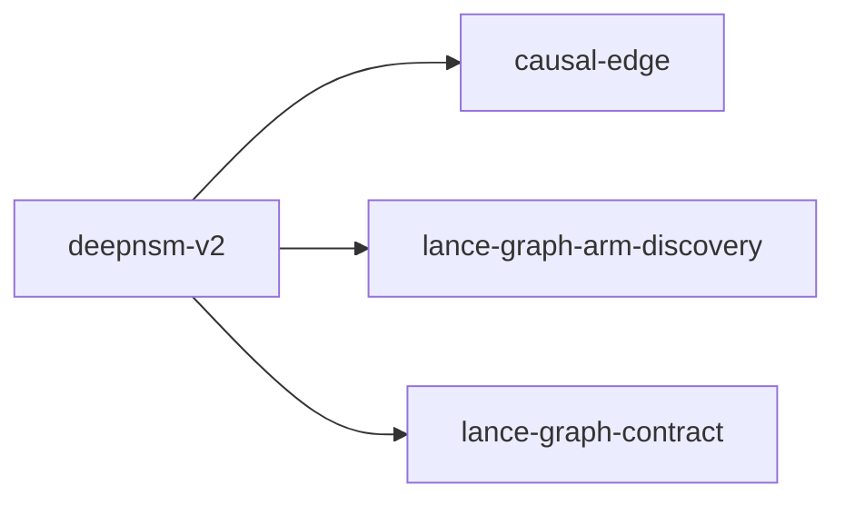

# deepnsm-v2

crate: deepnsm-v2
path: crates/deepnsm-v2
workspace: excluded
digest: 18622ced3a73a5b2
evidence legend: ../index.md#evidence-legend

Generated; the code is the truth. See ../index.md.

## Depends on

- dep causal-edge normal — crates/deepnsm-v2/Cargo.toml:32 CONFIRMED
- dep lance-graph-arm-discovery normal — crates/deepnsm-v2/Cargo.toml:35 CONFIRMED
- dep lance-graph-contract normal — crates/deepnsm-v2/Cargo.toml:29 CONFIRMED
- dep frostem dev — crates/deepnsm-v2/Cargo.toml:50 CONFIRMED
- dep serde_json dev — crates/deepnsm-v2/Cargo.toml:47 CONFIRMED

## Depended on by

- rdep cognitive-shader-driver dev — crates/cognitive-shader-driver/Cargo.toml:301 CONFIRMED
- rdep lance-graph-quack dev — crates/lance-graph-quack/Cargo.toml:30 CONFIRMED

## Public items

- struct FamilyTrie [pub] — crates/deepnsm-v2/src/ancestry.rs:34 CONFIRMED
- fn FamilyTrie::build [pub] — crates/deepnsm-v2/src/ancestry.rs:54 CONFIRMED
- fn FamilyTrie::covered [pub] — crates/deepnsm-v2/src/ancestry.rs:135 CONFIRMED
- fn FamilyTrie::multi_parent_residue [pub] — crates/deepnsm-v2/src/ancestry.rs:141 CONFIRMED
- fn FamilyTrie::cycle_residue [pub] — crates/deepnsm-v2/src/ancestry.rs:147 CONFIRMED
- fn FamilyTrie::dn [pub] — crates/deepnsm-v2/src/ancestry.rs:153 CONFIRMED
- fn FamilyTrie::is_ancestor_of [pub] — crates/deepnsm-v2/src/ancestry.rs:172 CONFIRMED
- fn FamilyTrie::pair_count [pub] — crates/deepnsm-v2/src/ancestry.rs:192 CONFIRMED
- fn FamilyTrie::ancestor_pairs [pub] — crates/deepnsm-v2/src/ancestry.rs:200 CONFIRMED
- fn FamilyTrie::forest_edges [pub] — crates/deepnsm-v2/src/ancestry.rs:218 CONFIRMED
- fn FamilyTrie::max_depth [pub] — crates/deepnsm-v2/src/ancestry.rs:230 CONFIRMED
- fn FamilyTrie::hhtl_packable [pub] — crates/deepnsm-v2/src/ancestry.rs:239 CONFIRMED
- struct BasinCode [pub] — crates/deepnsm-v2/src/basin.rs:42 CONFIRMED
- fn BasinCode::competence [pub] — crates/deepnsm-v2/src/basin.rs:62 CONFIRMED
- fn BasinCode::curiosity [pub] — crates/deepnsm-v2/src/basin.rs:76 CONFIRMED
- fn basin_self_code [pub] — crates/deepnsm-v2/src/basin.rs:123 CONFIRMED
- struct HeldOutGate [pub] — crates/deepnsm-v2/src/basin.rs:153 CONFIRMED
- fn HeldOutGate::passed [pub] — crates/deepnsm-v2/src/basin.rs:168 CONFIRMED
- fn HeldOutGate::killed [pub] — crates/deepnsm-v2/src/basin.rs:173 CONFIRMED
- fn heldout_split_gate [pub] — crates/deepnsm-v2/src/basin.rs:185 CONFIRMED
- fn heldout_constant_n_gate [pub] — crates/deepnsm-v2/src/basin.rs:224 CONFIRMED
- fn heldout_bessel_gate [pub] — crates/deepnsm-v2/src/basin.rs:262 CONFIRMED
- fn spearman [pub(crate)] — crates/deepnsm-v2/src/basin.rs:299 CONFIRMED
- struct Stamp [pub] — crates/deepnsm-v2/src/belief.rs:33 CONFIRMED
- fn Stamp::source [pub] — crates/deepnsm-v2/src/belief.rs:38 CONFIRMED
- fn Stamp::disjoint [pub] — crates/deepnsm-v2/src/belief.rs:43 CONFIRMED
- fn Stamp::union [pub] — crates/deepnsm-v2/src/belief.rs:48 CONFIRMED
- enum Copula [pub] — crates/deepnsm-v2/src/belief.rs:56 CONFIRMED
- fn Copula::transits [pub] — crates/deepnsm-v2/src/belief.rs:71 CONFIRMED
- struct CStmt [pub] — crates/deepnsm-v2/src/belief.rs:80 CONFIRMED
- struct Belief [pub] — crates/deepnsm-v2/src/belief.rs:92 CONFIRMED
- enum ReviseOutcome [pub] — crates/deepnsm-v2/src/belief.rs:111 CONFIRMED
- struct BeliefArena [pub] — crates/deepnsm-v2/src/belief.rs:132 CONFIRMED
- fn BeliefArena::new [pub] — crates/deepnsm-v2/src/belief.rs:144 CONFIRMED
- fn BeliefArena::entries [pub] — crates/deepnsm-v2/src/belief.rs:150 CONFIRMED
- fn BeliefArena::get [pub] — crates/deepnsm-v2/src/belief.rs:156 CONFIRMED
- fn BeliefArena::observe [pub] — crates/deepnsm-v2/src/belief.rs:164 CONFIRMED
- fn BeliefArena::revise_at [pub] — crates/deepnsm-v2/src/belief.rs:187 CONFIRMED
- fn BeliefArena::close_transitive [pub] — crates/deepnsm-v2/src/belief.rs:233 CONFIRMED
- fn fsm_pos [pub] — crates/deepnsm-v2/src/coca.rs:24 CONFIRMED
- fn fsm_pos_tag [pub] — crates/deepnsm-v2/src/coca.rs:38 CONFIRMED
- fn reading_set [pub] — crates/deepnsm-v2/src/coca.rs:50 CONFIRMED
- fn predicate_alternatives [pub] — crates/deepnsm-v2/src/coca.rs:69 CONFIRMED
- enum CodebookError [pub] — crates/deepnsm-v2/src/codebook.rs:24 CONFIRMED
- fn load_cam96_space [pub] — crates/deepnsm-v2/src/codebook.rs:42 CONFIRMED
- fn load_cam96_codes [pub] — crates/deepnsm-v2/src/codebook.rs:90 CONFIRMED
- const GUTENBERG_FOOTER [pub] — crates/deepnsm-v2/src/corpus.rs:13 CONFIRMED
- const KJV_OLD_TESTAMENT_VERSES [pub] — crates/deepnsm-v2/src/corpus.rs:24 CONFIRMED
- fn parse_verse_marker [pub] — crates/deepnsm-v2/src/corpus.rs:35 CONFIRMED
- fn is_verse_marker [pub] — crates/deepnsm-v2/src/corpus.rs:46 CONFIRMED
- fn split_verses [pub] — crates/deepnsm-v2/src/corpus.rs:69 CONFIRMED
- struct CorpusSplit [pub] — crates/deepnsm-v2/src/corpus.rs:84 CONFIRMED
- fn split_verses_detailed [pub] — crates/deepnsm-v2/src/corpus.rs:121 CONFIRMED
- fn crossed_into_new_testament [pub] — crates/deepnsm-v2/src/corpus.rs:216 CONFIRMED
- fn announces_new_testament [pub] — crates/deepnsm-v2/src/corpus.rs:230 CONFIRMED
- type BeliefRecord [pub] — crates/deepnsm-v2/src/evidence.rs:34 CONFIRMED
- type BasinBeliefs [pub] — crates/deepnsm-v2/src/evidence.rs:36 CONFIRMED
- struct EvidenceBasin [pub] — crates/deepnsm-v2/src/evidence.rs:40 CONFIRMED
- fn EvidenceBasin::uncertainty [pub] — crates/deepnsm-v2/src/evidence.rs:58 CONFIRMED
- fn EvidenceBasin::competence [pub] — crates/deepnsm-v2/src/evidence.rs:64 CONFIRMED
- fn EvidenceBasin::curiosity [pub] — crates/deepnsm-v2/src/evidence.rs:70 CONFIRMED
- fn EvidenceBasin::gate [pub] — crates/deepnsm-v2/src/evidence.rs:86 CONFIRMED
- fn EvidenceBasin::advance [pub] — crates/deepnsm-v2/src/evidence.rs:113 CONFIRMED
- fn evidence_basin [pub] — crates/deepnsm-v2/src/evidence.rs:123 CONFIRMED
- fn open_question_yield [pub] — crates/deepnsm-v2/src/evidence.rs:188 CONFIRMED
- fn novelty_rate [pub] — crates/deepnsm-v2/src/evidence.rs:203 CONFIRMED
- fn shuffle_beliefs_null [pub] — crates/deepnsm-v2/src/evidence.rs:234 CONFIRMED
- fn shuffle_rungs_null [pub] — crates/deepnsm-v2/src/evidence.rs:256 CONFIRMED
- fn partial_spearman [pub] — crates/deepnsm-v2/src/evidence.rs:272 CONFIRMED
- struct ForwardGateReport [pub] — crates/deepnsm-v2/src/evidence.rs:343 CONFIRMED
- fn ForwardGateReport::separation [pub] — crates/deepnsm-v2/src/evidence.rs:358 CONFIRMED
- fn ForwardGateReport::passed [pub] — crates/deepnsm-v2/src/evidence.rs:363 CONFIRMED
- fn ForwardGateReport::killed [pub] — crates/deepnsm-v2/src/evidence.rs:368 CONFIRMED
- fn forward_gate [pub] — crates/deepnsm-v2/src/evidence.rs:375 CONFIRMED
- enum Pos [pub] — crates/deepnsm-v2/src/fsm.rs:48 CONFIRMED
- struct Tagged [pub] — crates/deepnsm-v2/src/fsm.rs:81 CONFIRMED
- fn Tagged::new [pub] — crates/deepnsm-v2/src/fsm.rs:91 CONFIRMED
- fn parse_to_spo [pub] — crates/deepnsm-v2/src/fsm.rs:323 CONFIRMED
- fn answered_questions [pub] — crates/deepnsm-v2/src/fsm.rs:347 CONFIRMED
- enum Origin [pub] — crates/deepnsm-v2/src/fsm.rs:380 CONFIRMED
- fn Origin::is_relative [pub] — crates/deepnsm-v2/src/fsm.rs:397 CONFIRMED
- struct Traced [pub] — crates/deepnsm-v2/src/fsm.rs:404 CONFIRMED
- fn parse_to_spo_traced [pub] — crates/deepnsm-v2/src/fsm.rs:418 CONFIRMED
- struct PosSet [pub] — crates/deepnsm-v2/src/fsm.rs:531 CONFIRMED
- const Pos::ALL [pub] — crates/deepnsm-v2/src/fsm.rs:535 CONFIRMED
- const PosSet::EMPTY [pub] — crates/deepnsm-v2/src/fsm.rs:553 CONFIRMED
- fn PosSet::single [pub] — crates/deepnsm-v2/src/fsm.rs:557 CONFIRMED
- fn PosSet::with [pub] — crates/deepnsm-v2/src/fsm.rs:563 CONFIRMED
- fn PosSet::contains [pub] — crates/deepnsm-v2/src/fsm.rs:569 CONFIRMED
- fn PosSet::union [pub] — crates/deepnsm-v2/src/fsm.rs:575 CONFIRMED
- fn PosSet::without [pub] — crates/deepnsm-v2/src/fsm.rs:581 CONFIRMED
- fn PosSet::len [pub] — crates/deepnsm-v2/src/fsm.rs:587 CONFIRMED
- fn PosSet::is_empty [pub] — crates/deepnsm-v2/src/fsm.rs:593 CONFIRMED
- fn PosSet::iter [pub] — crates/deepnsm-v2/src/fsm.rs:598 CONFIRMED
- struct Reading [pub] — crates/deepnsm-v2/src/fsm.rs:611 CONFIRMED
- fn Reading::new [pub] — crates/deepnsm-v2/src/fsm.rs:621 CONFIRMED
- fn Reading::stop [pub] — crates/deepnsm-v2/src/fsm.rs:627 CONFIRMED
- struct Survivor [pub] — crates/deepnsm-v2/src/fsm.rs:643 CONFIRMED
- struct ReadingParse [pub] — crates/deepnsm-v2/src/fsm.rs:655 CONFIRMED
- const MAX_CONFIGS [pub] — crates/deepnsm-v2/src/fsm.rs:687 CONFIRMED
- enum AdjectiveOrder [pub] — crates/deepnsm-v2/src/fsm.rs:701 CONFIRMED
- struct Typology [pub] — crates/deepnsm-v2/src/fsm.rs:715 CONFIRMED
- const Typology::ENGLISH [pub] — crates/deepnsm-v2/src/fsm.rs:737 CONFIRMED
- enum AttributeRule [pub] — crates/deepnsm-v2/src/fsm.rs:772 CONFIRMED
- const AttributeRule::ALL [pub] — crates/deepnsm-v2/src/fsm.rs:788 CONFIRMED
- fn AttributeRule::keeps [pub] — crates/deepnsm-v2/src/fsm.rs:797 CONFIRMED
- fn attribute_rule [pub] — crates/deepnsm-v2/src/fsm.rs:812 CONFIRMED
- fn attribute_readings [pub] — crates/deepnsm-v2/src/fsm.rs:845 CONFIRMED
- fn parse_readings [pub] — crates/deepnsm-v2/src/fsm.rs:904 CONFIRMED
- fn parse_readings_with [pub] — crates/deepnsm-v2/src/fsm.rs:910 CONFIRMED
- enum DativeFunction [pub] — crates/deepnsm-v2/src/haspelmath.rs:27 CONFIRMED
- const DativeFunction::ALL [pub] — crates/deepnsm-v2/src/haspelmath.rs:40 CONFIRMED
- fn DativeFunction::bit [pub] — crates/deepnsm-v2/src/haspelmath.rs:52 CONFIRMED
- enum MapVerdict [pub] — crates/deepnsm-v2/src/haspelmath.rs:73 CONFIRMED
- fn continuity [pub] — crates/deepnsm-v2/src/haspelmath.rs:80 CONFIRMED
- struct FormAttestation [pub] — crates/deepnsm-v2/src/haspelmath.rs:111 CONFIRMED
- enum HarnessError [pub] — crates/deepnsm-v2/src/haspelmath.rs:119 CONFIRMED
- fn bind_tokens [pub] — crates/deepnsm-v2/src/haspelmath.rs:135 CONFIRMED
- struct FrozenOperandAbi [pub] — crates/deepnsm-v2/src/haspelmath.rs:160 CONFIRMED
- fn FrozenOperandAbi::new [pub] — crates/deepnsm-v2/src/haspelmath.rs:167 CONFIRMED
- struct AddressedSyntax [pub] — crates/deepnsm-v2/src/haspelmath.rs:203 CONFIRMED
- struct HarnessOutput [pub] — crates/deepnsm-v2/src/haspelmath.rs:210 CONFIRMED
- fn HarnessOutput::decode [pub] — crates/deepnsm-v2/src/haspelmath.rs:224 CONFIRMED
- fn run_harness [pub] — crates/deepnsm-v2/src/haspelmath.rs:266 CONFIRMED
- struct AddressedTriple [pub] — crates/deepnsm-v2/src/hydrate.rs:52 CONFIRMED
- struct Hydration [pub] — crates/deepnsm-v2/src/hydrate.rs:63 CONFIRMED
- fn Hydration::verse_nodes [pub] — crates/deepnsm-v2/src/hydrate.rs:79 CONFIRMED
- fn Hydration::chain [pub] — crates/deepnsm-v2/src/hydrate.rs:89 CONFIRMED
- fn Hydration::scanpath [pub] — crates/deepnsm-v2/src/hydrate.rs:101 CONFIRMED
- fn Hydration::cross_verse_links [pub] — crates/deepnsm-v2/src/hydrate.rs:114 CONFIRMED
- fn hydrate [pub] — crates/deepnsm-v2/src/hydrate.rs:133 CONFIRMED
- struct ProvenanceReport [pub] — crates/deepnsm-v2/src/introspect.rs:25 CONFIRMED
- fn ProvenanceReport::passed [pub] — crates/deepnsm-v2/src/introspect.rs:37 CONFIRMED
- fn provenance_check [pub] — crates/deepnsm-v2/src/introspect.rs:50 CONFIRMED
- struct ConfidenceAnswer [pub] — crates/deepnsm-v2/src/introspect.rs:80 CONFIRMED
- fn nars_confidence [pub] — crates/deepnsm-v2/src/introspect.rs:95 CONFIRMED
- fn confidence_delta_self [pub] — crates/deepnsm-v2/src/introspect.rs:115 CONFIRMED
- fn confidence_delta_recount [pub] — crates/deepnsm-v2/src/introspect.rs:140 CONFIRMED
- fn most_frequent_belief [pub] — crates/deepnsm-v2/src/introspect.rs:164 CONFIRMED
- struct PosCode [pub] — crates/deepnsm-v2/src/lexical.rs:68 CONFIRMED
- fn PosCode::from_tag [pub] — crates/deepnsm-v2/src/lexical.rs:74 CONFIRMED
- fn PosCode::as_char [pub] — crates/deepnsm-v2/src/lexical.rs:83 CONFIRMED
- type LemmaRef [pub] — crates/deepnsm-v2/src/lexical.rs:89 CONFIRMED
- struct LemmaEntry [pub] — crates/deepnsm-v2/src/lexical.rs:96 CONFIRMED
- struct LexicalReading [pub] — crates/deepnsm-v2/src/lexical.rs:111 CONFIRMED
- enum EvidenceError [pub] — crates/deepnsm-v2/src/lexical.rs:123 CONFIRMED
- struct LexicalEvidenceBuilder [pub] — crates/deepnsm-v2/src/lexical.rs:178 CONFIRMED
- fn LexicalEvidenceBuilder::new [pub] — crates/deepnsm-v2/src/lexical.rs:189 CONFIRMED
- fn LexicalEvidenceBuilder::lemma_entry [pub] — crates/deepnsm-v2/src/lexical.rs:203 CONFIRMED
- fn LexicalEvidenceBuilder::add_reading [pub] — crates/deepnsm-v2/src/lexical.rs:230 CONFIRMED
- fn LexicalEvidenceBuilder::finish [pub] — crates/deepnsm-v2/src/lexical.rs:274 CONFIRMED
- struct LexicalEvidence [pub] — crates/deepnsm-v2/src/lexical.rs:332 CONFIRMED
- fn LexicalEvidence::readings [pub] — crates/deepnsm-v2/src/lexical.rs:373 CONFIRMED
- fn LexicalEvidence::coverage [pub] — crates/deepnsm-v2/src/lexical.rs:385 CONFIRMED
- fn LexicalEvidence::lemma [pub] — crates/deepnsm-v2/src/lexical.rs:391 CONFIRMED
- fn LexicalEvidence::lemma_entries [pub] — crates/deepnsm-v2/src/lexical.rs:396 CONFIRMED
- fn LexicalEvidence::surface_count [pub] — crates/deepnsm-v2/src/lexical.rs:406 CONFIRMED
- fn LexicalEvidence::surface_pos_count [pub] — crates/deepnsm-v2/src/lexical.rs:412 CONFIRMED
- fn LexicalEvidence::lemma_pos_count [pub] — crates/deepnsm-v2/src/lexical.rs:427 CONFIRMED
- fn LexicalEvidence::lemma_count [pub] — crates/deepnsm-v2/src/lexical.rs:436 CONFIRMED
- fn LexicalEvidence::reading_count [pub] — crates/deepnsm-v2/src/lexical.rs:442 CONFIRMED
- fn LexicalEvidence::lemma_entry_count [pub] — crates/deepnsm-v2/src/lexical.rs:448 CONFIRMED
- struct WordFormsReport [pub] — crates/deepnsm-v2/src/lexical.rs:456 CONFIRMED
- const WORD_FORMS_HEADER [pub] — crates/deepnsm-v2/src/lexical.rs:468 CONFIRMED
- fn load_word_forms_csv [pub] — crates/deepnsm-v2/src/lexical.rs:490 CONFIRMED
- fn coca_pos [pub] — crates/deepnsm-v2/src/lexicon.rs:45 CONFIRMED
- const ARCHAIC_PRONOUNS [pub] — crates/deepnsm-v2/src/lexicon.rs:53 CONFIRMED
- fn archaic_pos [pub] — crates/deepnsm-v2/src/lexicon.rs:61 CONFIRMED
- struct Lexicon [pub] — crates/deepnsm-v2/src/lexicon.rs:82 CONFIRMED
- fn Lexicon::from_coca [pub] — crates/deepnsm-v2/src/lexicon.rs:102 CONFIRMED
- fn Lexicon::from_academic_20k [pub] — crates/deepnsm-v2/src/lexicon.rs:112 CONFIRMED
- fn Lexicon::from_columns [pub] — crates/deepnsm-v2/src/lexicon.rs:120 CONFIRMED
- fn Lexicon::with_forms [pub] — crates/deepnsm-v2/src/lexicon.rs:150 CONFIRMED
- fn Lexicon::pos [pub] — crates/deepnsm-v2/src/lexicon.rs:170 CONFIRMED
- fn Lexicon::lemma_knows [pub] — crates/deepnsm-v2/src/lexicon.rs:182 CONFIRMED
- fn Lexicon::is_pronoun [pub] — crates/deepnsm-v2/src/lexicon.rs:190 CONFIRMED
- fn Lexicon::pronoun_count [pub] — crates/deepnsm-v2/src/lexicon.rs:196 CONFIRMED
- fn Lexicon::sizes [pub] — crates/deepnsm-v2/src/lexicon.rs:202 CONFIRMED
- fn normalise [pub] — crates/deepnsm-v2/src/lexicon.rs:210 CONFIRMED
- mod ancestry [pub] — crates/deepnsm-v2/src/lib.rs:37 CONFIRMED
- mod basin [pub] — crates/deepnsm-v2/src/lib.rs:38 CONFIRMED
- mod belief [pub] — crates/deepnsm-v2/src/lib.rs:39 CONFIRMED
- mod coca [pub] — crates/deepnsm-v2/src/lib.rs:40 CONFIRMED
- mod codebook [pub] — crates/deepnsm-v2/src/lib.rs:41 CONFIRMED
- mod corpus [pub] — crates/deepnsm-v2/src/lib.rs:42 CONFIRMED
- mod evidence [pub] — crates/deepnsm-v2/src/lib.rs:43 CONFIRMED
- mod fsm [pub] — crates/deepnsm-v2/src/lib.rs:44 CONFIRMED
- mod haspelmath [pub] — crates/deepnsm-v2/src/lib.rs:45 CONFIRMED
- mod hydrate [pub] — crates/deepnsm-v2/src/lib.rs:46 CONFIRMED
- mod introspect [pub] — crates/deepnsm-v2/src/lib.rs:47 CONFIRMED
- mod lexical [pub] — crates/deepnsm-v2/src/lib.rs:48 CONFIRMED
- mod lexicon [pub] — crates/deepnsm-v2/src/lib.rs:49 CONFIRMED
- mod loci [pub] — crates/deepnsm-v2/src/lib.rs:50 CONFIRMED
- mod promote [pub] — crates/deepnsm-v2/src/lib.rs:51 CONFIRMED
- mod reason [pub] — crates/deepnsm-v2/src/lib.rs:52 CONFIRMED
- mod shape [pub] — crates/deepnsm-v2/src/lib.rs:53 CONFIRMED
- mod space [pub] — crates/deepnsm-v2/src/lib.rs:54 CONFIRMED
- mod spo [pub] — crates/deepnsm-v2/src/lib.rs:55 CONFIRMED
- mod tekamolo [pub] — crates/deepnsm-v2/src/lib.rs:56 CONFIRMED
- mod toc [pub] — crates/deepnsm-v2/src/lib.rs:57 CONFIRMED
- truncated (350 total), see symbols.tsv

## Imports from in-scope crates

### causal-edge
- use causal_edge::pearl::CausalMask — crates/deepnsm-v2/src/fsm.rs:44 CONFIRMED
- use causal_edge::CausalEdge64 — crates/deepnsm-v2/src/haspelmath.rs:19 CONFIRMED
- pub-use causal_edge::pearl::CausalMask — crates/deepnsm-v2/src/lib.rs:70 CONFIRMED
- use causal_edge::CausalEdge64 — crates/deepnsm-v2/src/wire.rs:115 CONFIRMED
- use causal_edge::CausalMask — crates/deepnsm-v2/src/wire.rs:115 CONFIRMED
- use causal_edge::Orientation — crates/deepnsm-v2/src/wire.rs:115 CONFIRMED
### lance-graph-arm-discovery
- use lance_graph_arm_discovery::CandidateRule — crates/deepnsm-v2/src/wire.rs:116 CONFIRMED
- use lance_graph_arm_discovery::Item — crates/deepnsm-v2/src/wire.rs:116 CONFIRMED
- use lance_graph_arm_discovery::arm_to_truth_u8 — crates/deepnsm-v2/src/wire.rs:116 CONFIRMED
### lance-graph-contract
- use lance_graph_contract::exploration::NarsTruth — crates/deepnsm-v2/src/belief.rs:25 CONFIRMED
- use lance_graph_contract::kanban::KanbanColumn — crates/deepnsm-v2/src/evidence.rs:30 CONFIRMED
- use lance_graph_contract::mul::FlowState — crates/deepnsm-v2/src/evidence.rs:31 CONFIRMED
- use lance_graph_contract::mul::GateDecision — crates/deepnsm-v2/src/evidence.rs:31 CONFIRMED
- use lance_graph_contract::mul::TrustTexture — crates/deepnsm-v2/src/evidence.rs:31 CONFIRMED
- use lance_graph_contract::hhtl::NiblePath — crates/deepnsm-v2/src/haspelmath.rs:20 CONFIRMED
- use lance_graph_contract::hhtl::NiblePath — crates/deepnsm-v2/src/hydrate.rs:47 CONFIRMED
- use lance_graph_contract::temporal_pov::TemporalPov — crates/deepnsm-v2/src/lib.rs:62 CONFIRMED
- use lance_graph_contract::temporal_pov::VersionRange — crates/deepnsm-v2/src/lib.rs:62 CONFIRMED
- use lance_graph_contract::causal_witness::CausalWitnessFacet — crates/deepnsm-v2/src/loci.rs:52 CONFIRMED
- use lance_graph_contract::causal_witness::Locus — crates/deepnsm-v2/src/loci.rs:52 CONFIRMED
- use lance_graph_contract::canonical_node::EdgeBlock — crates/deepnsm-v2/src/promote.rs:44 CONFIRMED
- use lance_graph_contract::canonical_node::NodeGuid — crates/deepnsm-v2/src/promote.rs:44 CONFIRMED
- use lance_graph_contract::canonical_node::NodeRow — crates/deepnsm-v2/src/promote.rs:44 CONFIRMED
- use lance_graph_contract::canonical_node::TailVariant — crates/deepnsm-v2/src/promote.rs:44 CONFIRMED
- use lance_graph_contract::canonical_node::ValueTenant — crates/deepnsm-v2/src/promote.rs:44 CONFIRMED
- use lance_graph_contract::canonical_node::classid_read_mode — crates/deepnsm-v2/src/promote.rs:44 CONFIRMED
- use lance_graph_contract::episodic_basin::BASIN_ROW_BYTES — crates/deepnsm-v2/src/promote.rs:46 CONFIRMED
- use lance_graph_contract::episodic_basin::BasinRow — crates/deepnsm-v2/src/promote.rs:46 CONFIRMED
- use lance_graph_contract::facet::FacetCascade — crates/deepnsm-v2/src/promote.rs:47 CONFIRMED
- use lance_graph_contract::hhtl::MAX_DEPTH — crates/deepnsm-v2/src/promote.rs:48 CONFIRMED
- use lance_graph_contract::hhtl::NiblePath — crates/deepnsm-v2/src/promote.rs:48 CONFIRMED
- use lance_graph_contract::tekamolo_facet::TekamoloFacet — crates/deepnsm-v2/src/promote.rs:49 CONFIRMED
- use lance_graph_contract::cam::AdcMetric — crates/deepnsm-v2/src/space.rs:34 CONFIRMED
- use lance_graph_contract::cam::DistanceTableProvider — crates/deepnsm-v2/src/space.rs:34 CONFIRMED
- use lance_graph_contract::cam::ScalarAdc — crates/deepnsm-v2/src/space.rs:34 CONFIRMED
- use lance_graph_contract::recipe_substrate::PairPalette — crates/deepnsm-v2/src/space.rs:35 CONFIRMED
- use lance_graph_contract::mul::DkPosition — crates/deepnsm-v2/src/tekamolo.rs:86 CONFIRMED
- use lance_graph_contract::mul::FlowState — crates/deepnsm-v2/src/tekamolo.rs:86 CONFIRMED
- use lance_graph_contract::mul::MulAssessment — crates/deepnsm-v2/src/tekamolo.rs:86 CONFIRMED
- use lance_graph_contract::tekamolo_facet::TekamoloRole — crates/deepnsm-v2/src/tekamolo.rs:87 CONFIRMED
- use lance_graph_contract::thinking::FieldModulation — crates/deepnsm-v2/src/tekamolo.rs:89 CONFIRMED
- use lance_graph_contract::thinking::ScanParams — crates/deepnsm-v2/src/tekamolo.rs:89 CONFIRMED
- use lance_graph_contract::thinking::SparseVec — crates/deepnsm-v2/src/tekamolo.rs:89 CONFIRMED
- use lance_graph_contract::thinking::StyleCluster — crates/deepnsm-v2/src/tekamolo.rs:89 CONFIRMED
- use lance_graph_contract::thinking::ThinkingStyle — crates/deepnsm-v2/src/tekamolo.rs:89 CONFIRMED
- use lance_graph_contract::thinking::ThinkingStyleProvider — crates/deepnsm-v2/src/tekamolo.rs:89 CONFIRMED
- use lance_graph_contract::hhtl::FAN_OUT — crates/deepnsm-v2/src/toc.rs:43 CONFIRMED
- use lance_graph_contract::hhtl::MAX_DEPTH — crates/deepnsm-v2/src/toc.rs:43 CONFIRMED
- use lance_graph_contract::hhtl::NiblePath — crates/deepnsm-v2/src/toc.rs:43 CONFIRMED
- use lance_graph_contract::causal_witness::CausalWitnessFacet — crates/deepnsm-v2/src/wave.rs:85 CONFIRMED
- use lance_graph_contract::causal_witness::Locus — crates/deepnsm-v2/src/wave.rs:85 CONFIRMED
- use lance_graph_contract::temporal_pov::TemporalPov — crates/deepnsm-v2/src/wave.rs:86 CONFIRMED
- use lance_graph_contract::temporal_pov::VersionRange — crates/deepnsm-v2/src/wave.rs:86 CONFIRMED
- use lance_graph_contract::witness_fabric::ChainResolution — crates/deepnsm-v2/src/wave.rs:88 CONFIRMED
- use lance_graph_contract::witness_fabric::WaveGrounding — crates/deepnsm-v2/src/wave.rs:88 CONFIRMED
- use lance_graph_contract::witness_fabric::resolve_chain — crates/deepnsm-v2/src/wave.rs:88 CONFIRMED
- use lance_graph_contract::witness_fabric::standing_wave_grounded — crates/deepnsm-v2/src/wave.rs:88 CONFIRMED
- use lance_graph_contract::causal_witness::CausalWitnessFacet — crates/deepnsm-v2/src/wire.rs:117 CONFIRMED
- use lance_graph_contract::causal_witness::Locus — crates/deepnsm-v2/src/wire.rs:117 CONFIRMED
- use lance_graph_contract::epistemic_state5::Certification3 — crates/deepnsm-v2/src/wire.rs:118 CONFIRMED
- use lance_graph_contract::epistemic_state5::Epi5Gen — crates/deepnsm-v2/src/wire.rs:118 CONFIRMED
- use lance_graph_contract::epistemic_state5::EpistemicState5 — crates/deepnsm-v2/src/wire.rs:118 CONFIRMED
- use lance_graph_contract::epistemic_state5::Topology2 — crates/deepnsm-v2/src/wire.rs:118 CONFIRMED
- use lance_graph_contract::exploration::NarsTruth — crates/deepnsm-v2/src/wire.rs:119 CONFIRMED
- use lance_graph_contract::facet::CascadeShape — crates/deepnsm-v2/src/wire.rs:120 CONFIRMED
- use lance_graph_contract::facet::FacetCascade — crates/deepnsm-v2/src/wire.rs:120 CONFIRMED
- use lance_graph_contract::grammar::verb_lexicon::classify_verb — crates/deepnsm-v2/src/wire.rs:121 CONFIRMED
- use lance_graph_contract::grammar::verb_table::morton_cell — crates/deepnsm-v2/src/wire.rs:122 CONFIRMED
- use lance_graph_contract::hhtl::NiblePath — crates/deepnsm-v2/src/wire.rs:123 CONFIRMED
- use lance_graph_contract::revision::BasisView — crates/deepnsm-v2/src/wire.rs:125 CONFIRMED
- use lance_graph_contract::revision::CodebookId — crates/deepnsm-v2/src/wire.rs:125 CONFIRMED
- use lance_graph_contract::revision::EncounterEvidence — crates/deepnsm-v2/src/wire.rs:125 CONFIRMED
- use lance_graph_contract::revision::EvidenceMask — crates/deepnsm-v2/src/wire.rs:125 CONFIRMED
- use lance_graph_contract::revision::EvidentialEffect — crates/deepnsm-v2/src/wire.rs:125 CONFIRMED
- use lance_graph_contract::revision::GadamerRevision — crates/deepnsm-v2/src/wire.rs:125 CONFIRMED
- use lance_graph_contract::revision::GrammarId — crates/deepnsm-v2/src/wire.rs:126 CONFIRMED
- use lance_graph_contract::revision::HorizonId — crates/deepnsm-v2/src/wire.rs:126 CONFIRMED
- use lance_graph_contract::revision::InterpretiveHorizon — crates/deepnsm-v2/src/wire.rs:126 CONFIRMED
- use lance_graph_contract::revision::LanguageId — crates/deepnsm-v2/src/wire.rs:126 CONFIRMED
- use lance_graph_contract::revision::LensId — crates/deepnsm-v2/src/wire.rs:126 CONFIRMED
- use lance_graph_contract::revision::QuestionId — crates/deepnsm-v2/src/wire.rs:126 CONFIRMED
- use lance_graph_contract::revision::RevisionDelta — crates/deepnsm-v2/src/wire.rs:126 CONFIRMED
- use lance_graph_contract::revision::RevisionKind — crates/deepnsm-v2/src/wire.rs:127 CONFIRMED
- use lance_graph_contract::revision::RevisionPolicy — crates/deepnsm-v2/src/wire.rs:127 CONFIRMED
- use lance_graph_contract::witness_table::WitnessEntry — crates/deepnsm-v2/src/wire.rs:129 CONFIRMED
- use lance_graph_contract::witness_table::WitnessTable — crates/deepnsm-v2/src/wire.rs:129 CONFIRMED
- use lance_graph_contract::exploration::NarsTruth cfg=test — crates/deepnsm-v2/src/wire.rs:1084 CONFIRMED

## Calls

CALL_GRAPH=ARTIFACT_MISSING
- calls ARTIFACT_MISSING — no ruff_charon artifact for this crate UNKNOWN

## Architecture

- none

Generated from Cargo manifests — extracted relationships only.

