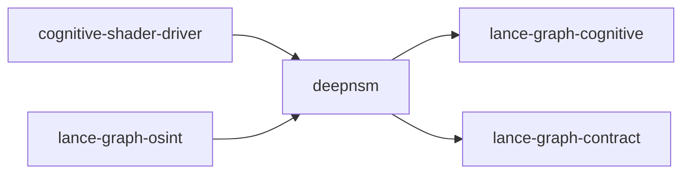

# deepnsm

crate: deepnsm
path: crates/deepnsm
workspace: excluded
digest: f45100c04ced13be
evidence legend: ../index.md#evidence-legend

Generated; the code is the truth. See ../index.md.

## Depends on

- dep lance-graph-cognitive normal optional — crates/deepnsm/Cargo.toml:40 CONFIRMED
- dep lance-graph-contract normal — crates/deepnsm/Cargo.toml:39 CONFIRMED
- dep ndarray normal — crates/deepnsm/Cargo.toml:33 CONFIRMED

## Depended on by

- rdep cognitive-shader-driver normal optional — crates/cognitive-shader-driver/Cargo.toml:262 CONFIRMED
- rdep lance-graph dev — crates/lance-graph/Cargo.toml:162 CONFIRMED
- rdep lance-graph-osint normal — crates/lance-graph-osint/Cargo.toml:17 CONFIRMED

## Public items

- struct BasinArc [pub] — crates/deepnsm/src/arcs.rs:29 CONFIRMED
- struct LiteralArc [pub] — crates/deepnsm/src/arcs.rs:34 CONFIRMED
- fn Trajectory::split_arcs [pub] — crates/deepnsm/src/arcs.rs:46 CONFIRMED
- struct Arcuate [pub] — crates/deepnsm/src/arcuate.rs:48 CONFIRMED
- fn Arcuate::new [pub] — crates/deepnsm/src/arcuate.rs:57 CONFIRMED
- fn Arcuate::feed [pub] — crates/deepnsm/src/arcuate.rs:68 CONFIRMED
- fn Arcuate::chain [pub] — crates/deepnsm/src/arcuate.rs:86 CONFIRMED
- fn Arcuate::disambiguate [pub] — crates/deepnsm/src/arcuate.rs:92 CONFIRMED
- struct Cam64 [pub] — crates/deepnsm/src/cam64.rs:38 CONFIRMED
- fn Cam64::from_lanes [pub] — crates/deepnsm/src/cam64.rs:43 CONFIRMED
- fn Cam64::lane [pub] — crates/deepnsm/src/cam64.rs:53 CONFIRMED
- fn Cam64::with_lane [pub] — crates/deepnsm/src/cam64.rs:60 CONFIRMED
- fn Cam64::raw [pub] — crates/deepnsm/src/cam64.rs:68 CONFIRMED
- fn Cam64::from_raw [pub] — crates/deepnsm/src/cam64.rs:74 CONFIRMED
- fn Cam64::entity_state [pub] — crates/deepnsm/src/cam64.rs:82 CONFIRMED
- fn Cam64::predicate_state [pub] — crates/deepnsm/src/cam64.rs:86 CONFIRMED
- fn Cam64::object_state [pub] — crates/deepnsm/src/cam64.rs:90 CONFIRMED
- fn Cam64::morph_state [pub] — crates/deepnsm/src/cam64.rs:94 CONFIRMED
- fn Cam64::clause_state [pub] — crates/deepnsm/src/cam64.rs:98 CONFIRMED
- fn Cam64::discourse_state [pub] — crates/deepnsm/src/cam64.rs:102 CONFIRMED
- fn Cam64::causal_state [pub] — crates/deepnsm/src/cam64.rs:106 CONFIRMED
- fn Cam64::basin_state [pub] — crates/deepnsm/src/cam64.rs:110 CONFIRMED
- fn Cam64::from_triple [pub] — crates/deepnsm/src/cam64.rs:122 CONFIRMED
- fn Cam64::same_entity_bucket [pub] — crates/deepnsm/src/cam64.rs:179 CONFIRMED
- fn Cam64::has_coreference [pub] — crates/deepnsm/src/cam64.rs:185 CONFIRMED
- fn Cam64::entity_stack_depth [pub] — crates/deepnsm/src/cam64.rs:191 CONFIRMED
- fn Cam64::continues_basin [pub] — crates/deepnsm/src/cam64.rs:208 CONFIRMED
- fn Cam64::basin_continuation_score [pub] — crates/deepnsm/src/cam64.rs:220 CONFIRMED
- const CAM64_CONTINUATION_MIN_SHARED [pub] — crates/deepnsm/src/cam64.rs:228 CONFIRMED
- const CAM64_CONTINUATION_MAX_DIFF [pub] — crates/deepnsm/src/cam64.rs:232 CONFIRMED
- const NUM_SUBSPACES [pub] — crates/deepnsm/src/codebook.rs:13 CONFIRMED
- const SUB_DIM [pub] — crates/deepnsm/src/codebook.rs:15 CONFIRMED
- const NUM_CENTROIDS [pub] — crates/deepnsm/src/codebook.rs:17 CONFIRMED
- const TOTAL_DIM [pub] — crates/deepnsm/src/codebook.rs:19 CONFIRMED
- const CODEBOOK_SIZE [pub] — crates/deepnsm/src/codebook.rs:21 CONFIRMED
- struct Codebook [pub] — crates/deepnsm/src/codebook.rs:24 CONFIRMED
- struct CamCodes [pub] — crates/deepnsm/src/codebook.rs:34 CONFIRMED
- fn Codebook::load_binary [pub] — crates/deepnsm/src/codebook.rs:46 CONFIRMED
- fn Codebook::load_json [pub] — crates/deepnsm/src/codebook.rs:75 CONFIRMED
- fn Codebook::centroids [pub] — crates/deepnsm/src/codebook.rs:94 CONFIRMED
- fn Codebook::centroid [pub] — crates/deepnsm/src/codebook.rs:100 CONFIRMED
- fn Codebook::distance [pub] — crates/deepnsm/src/codebook.rs:107 CONFIRMED
- fn Codebook::distance_sq [pub] — crates/deepnsm/src/codebook.rs:122 CONFIRMED
- fn Codebook::subspace_distance_table [pub] — crates/deepnsm/src/codebook.rs:137 CONFIRMED
- fn Codebook::len [pub] — crates/deepnsm/src/codebook.rs:156 CONFIRMED
- fn Codebook::is_empty [pub] — crates/deepnsm/src/codebook.rs:161 CONFIRMED
- fn CamCodes::load [pub] — crates/deepnsm/src/codebook.rs:170 CONFIRMED
- fn CamCodes::get [pub] — crates/deepnsm/src/codebook.rs:187 CONFIRMED
- fn CamCodes::len [pub] — crates/deepnsm/src/codebook.rs:198 CONFIRMED
- fn CamCodes::is_empty [pub] — crates/deepnsm/src/codebook.rs:203 CONFIRMED
- struct Landing [pub] — crates/deepnsm/src/comprehension.rs:39 CONFIRMED
- fn SentenceStructure::is_temporal [pub] — crates/deepnsm/src/comprehension.rs:52 CONFIRMED
- fn SentenceStructure::triple_landing [pub] — crates/deepnsm/src/comprehension.rs:59 CONFIRMED
- fn SentenceStructure::landings [pub] — crates/deepnsm/src/comprehension.rs:68 CONFIRMED
- const DEFAULT_WINDOW_SIZE [pub] — crates/deepnsm/src/context.rs:17 CONFIRMED
- struct ContextWindow [pub] — crates/deepnsm/src/context.rs:21 CONFIRMED
- fn ContextWindow::new [pub] — crates/deepnsm/src/context.rs:34 CONFIRMED
- fn ContextWindow::default_window [pub] — crates/deepnsm/src/context.rs:45 CONFIRMED
- fn ContextWindow::push [pub] — crates/deepnsm/src/context.rs:51 CONFIRMED
- fn ContextWindow::push_sentence [pub] — crates/deepnsm/src/context.rs:61 CONFIRMED
- fn ContextWindow::context [pub] — crates/deepnsm/src/context.rs:117 CONFIRMED
- fn ContextWindow::disambiguate [pub] — crates/deepnsm/src/context.rs:143 CONFIRMED
- fn ContextWindow::len [pub] — crates/deepnsm/src/context.rs:153 CONFIRMED
- fn ContextWindow::is_empty [pub] — crates/deepnsm/src/context.rs:158 CONFIRMED
- fn ContextWindow::is_full [pub] — crates/deepnsm/src/context.rs:163 CONFIRMED
- fn ContextWindow::capacity [pub] — crates/deepnsm/src/context.rs:168 CONFIRMED
- fn ContextWindow::clear [pub] — crates/deepnsm/src/context.rs:173 CONFIRMED
- fn ContextWindow::byte_size [pub] — crates/deepnsm/src/context.rs:183 CONFIRMED
- enum NeighborhoodMetric [pub] — crates/deepnsm/src/crystal_neighborhood.rs:51 CONFIRMED
- struct Crystal4096Neighbourhood [pub] — crates/deepnsm/src/crystal_neighborhood.rs:73 CONFIRMED
- fn Crystal4096Neighbourhood::iter [pub] — crates/deepnsm/src/crystal_neighborhood.rs:94 CONFIRMED
- fn Crystal4096Neighbourhood::len [pub] — crates/deepnsm/src/crystal_neighborhood.rs:99 CONFIRMED
- fn Crystal4096Neighbourhood::is_empty [pub] — crates/deepnsm/src/crystal_neighborhood.rs:106 CONFIRMED
- fn Crystal4096Neighbourhood::is_singleton [pub] — crates/deepnsm/src/crystal_neighborhood.rs:111 CONFIRMED
- fn neighbors_4096 [pub] — crates/deepnsm/src/crystal_neighborhood.rs:134 CONFIRMED
- fn chebyshev_distance [pub] — crates/deepnsm/src/crystal_neighborhood.rs:206 CONFIRMED
- fn manhattan_distance [pub] — crates/deepnsm/src/crystal_neighborhood.rs:227 CONFIRMED
- fn all_valid_cells [pub] — crates/deepnsm/src/crystal_neighborhood.rs:249 CONFIRMED
- fn disambiguate_with_trajectory [pub] — crates/deepnsm/src/disambiguator_glue.rs:65 CONFIRMED
- fn sign_binarize_to_binary16k [pub] — crates/deepnsm/src/disambiguator_glue.rs:93 CONFIRMED
- const VSA_BITS [pub] — crates/deepnsm/src/encoder.rs:17 CONFIRMED
- const VSA_WORDS [pub] — crates/deepnsm/src/encoder.rs:19 CONFIRMED
- struct VsaVec [pub] — crates/deepnsm/src/encoder.rs:23 CONFIRMED
- const VsaVec::ZERO [pub] — crates/deepnsm/src/encoder.rs:29 CONFIRMED
- fn VsaVec::from_words [pub] — crates/deepnsm/src/encoder.rs:34 CONFIRMED
- fn VsaVec::random [pub] — crates/deepnsm/src/encoder.rs:40 CONFIRMED
- fn VsaVec::from_rank [pub] — crates/deepnsm/src/encoder.rs:52 CONFIRMED
- fn VsaVec::bind [pub] — crates/deepnsm/src/encoder.rs:63 CONFIRMED
- fn VsaVec::hamming [pub] — crates/deepnsm/src/encoder.rs:71 CONFIRMED
- fn VsaVec::similarity [pub] — crates/deepnsm/src/encoder.rs:82 CONFIRMED
- fn VsaVec::popcount [pub] — crates/deepnsm/src/encoder.rs:89 CONFIRMED
- fn VsaVec::complement [pub] — crates/deepnsm/src/encoder.rs:94 CONFIRMED
- fn VsaVec::as_words [pub] — crates/deepnsm/src/encoder.rs:101 CONFIRMED
- struct RoleVectors [pub] — crates/deepnsm/src/encoder.rs:124 CONFIRMED
- fn RoleVectors::new [pub] — crates/deepnsm/src/encoder.rs:136 CONFIRMED
- fn bundle [pub] — crates/deepnsm/src/encoder.rs:165 CONFIRMED
- fn unbind [pub] — crates/deepnsm/src/encoder.rs:204 CONFIRMED
- fn encode_triple [pub] — crates/deepnsm/src/encoder.rs:216 CONFIRMED
- fn encode_triple_negated [pub] — crates/deepnsm/src/encoder.rs:235 CONFIRMED
- fn encode_modifier [pub] — crates/deepnsm/src/encoder.rs:255 CONFIRMED
- enum DependencyRole [pub] — crates/deepnsm/src/episodic_spo.rs:41 CONFIRMED
- enum ClauseRole [pub] — crates/deepnsm/src/episodic_spo.rs:56 CONFIRMED
- enum DiscourseRole [pub] — crates/deepnsm/src/episodic_spo.rs:69 CONFIRMED
- struct EpisodicSpoFrame [pub] — crates/deepnsm/src/episodic_spo.rs:91 CONFIRMED
- fn EpisodicSpoFrame::is_coreference [pub] — crates/deepnsm/src/episodic_spo.rs:153 CONFIRMED
- fn EpisodicSpoFrame::is_intransitive [pub] — crates/deepnsm/src/episodic_spo.rs:159 CONFIRMED
- fn EpisodicSpoFrame::is_negated [pub] — crates/deepnsm/src/episodic_spo.rs:165 CONFIRMED
- fn EpisodicSpoFrame::is_episodic_event [pub] — crates/deepnsm/src/episodic_spo.rs:171 CONFIRMED
- fn EpisodicSpoFrame::basin_classification [pub] — crates/deepnsm/src/episodic_spo.rs:188 CONFIRMED
- enum BasinClassification [pub] — crates/deepnsm/src/episodic_spo.rs:216 CONFIRMED
- const DIM_BITS [pub] — crates/deepnsm/src/fingerprint16k.rs:14 CONFIRMED
- const DIM_BYTES [pub] — crates/deepnsm/src/fingerprint16k.rs:15 CONFIRMED
- const DIM_U64 [pub] — crates/deepnsm/src/fingerprint16k.rs:16 CONFIRMED
- struct Fingerprint16K [pub] — crates/deepnsm/src/fingerprint16k.rs:21 CONFIRMED
- const Fingerprint16K::ZERO [pub] — crates/deepnsm/src/fingerprint16k.rs:27 CONFIRMED
- fn Fingerprint16K::from_centroid [pub] — crates/deepnsm/src/fingerprint16k.rs:33 CONFIRMED
- fn Fingerprint16K::from_centroid_semantic [pub] — crates/deepnsm/src/fingerprint16k.rs:51 CONFIRMED
- fn Fingerprint16K::hamming [pub] — crates/deepnsm/src/fingerprint16k.rs:72 CONFIRMED
- fn Fingerprint16K::similarity [pub] — crates/deepnsm/src/fingerprint16k.rs:82 CONFIRMED
- fn Fingerprint16K::as_bytes [pub] — crates/deepnsm/src/fingerprint16k.rs:87 CONFIRMED
- fn Fingerprint16K::hamming_early_exit [pub] — crates/deepnsm/src/fingerprint16k.rs:94 CONFIRMED
- fn Fingerprint16K::xor [pub] — crates/deepnsm/src/fingerprint16k.rs:112 CONFIRMED
- fn Fingerprint16K::popcount [pub] — crates/deepnsm/src/fingerprint16k.rs:122 CONFIRMED
- fn bundle [pub] — crates/deepnsm/src/fingerprint16k.rs:133 CONFIRMED
- fn bundle_weighted [pub] — crates/deepnsm/src/fingerprint16k.rs:159 CONFIRMED
- mod codebook [pub] — crates/deepnsm/src/lib.rs:54 CONFIRMED
- mod context [pub] — crates/deepnsm/src/lib.rs:55 CONFIRMED
- mod encoder [pub] — crates/deepnsm/src/lib.rs:56 CONFIRMED
- mod parser [pub] — crates/deepnsm/src/lib.rs:57 CONFIRMED
- mod pipeline [pub] — crates/deepnsm/src/lib.rs:58 CONFIRMED
- mod pos [pub] — crates/deepnsm/src/lib.rs:59 CONFIRMED
- mod similarity [pub] — crates/deepnsm/src/lib.rs:60 CONFIRMED
- mod spo [pub] — crates/deepnsm/src/lib.rs:61 CONFIRMED
- mod vocabulary [pub] — crates/deepnsm/src/lib.rs:62 CONFIRMED
- mod markov_bundle [pub] — crates/deepnsm/src/lib.rs:64 CONFIRMED
- mod nsm_primes [pub] — crates/deepnsm/src/lib.rs:65 CONFIRMED
- mod ontology_vocab [pub] — crates/deepnsm/src/lib.rs:66 CONFIRMED
- mod trajectory [pub] — crates/deepnsm/src/lib.rs:67 CONFIRMED
- mod arcs [pub] — crates/deepnsm/src/lib.rs:75 CONFIRMED
- mod comprehension [pub] — crates/deepnsm/src/lib.rs:76 CONFIRMED
- mod arcuate [pub] — crates/deepnsm/src/lib.rs:82 CONFIRMED
- mod disambiguator_glue [pub] — crates/deepnsm/src/lib.rs:89 CONFIRMED
- mod trajectory_audit [pub] — crates/deepnsm/src/lib.rs:94 CONFIRMED
- mod quantum_mode [pub] — crates/deepnsm/src/lib.rs:98 CONFIRMED
- mod ticket_emit [pub] cfg=feature="contract-ticket" — crates/deepnsm/src/lib.rs:101 CONFIRMED
- mod triangle_bridge [pub] — crates/deepnsm/src/lib.rs:106 CONFIRMED
- mod fingerprint16k [pub] — crates/deepnsm/src/lib.rs:117 CONFIRMED
- mod cam64 [pub] — crates/deepnsm/src/lib.rs:122 CONFIRMED
- mod episodic_spo [pub] — crates/deepnsm/src/lib.rs:123 CONFIRMED
- mod morphology [pub] — crates/deepnsm/src/lib.rs:124 CONFIRMED
- mod reader_state [pub] — crates/deepnsm/src/lib.rs:125 CONFIRMED
- mod window [pub] — crates/deepnsm/src/lib.rs:126 CONFIRMED
- mod signed_crystal [pub] — crates/deepnsm/src/lib.rs:130 CONFIRMED
- mod sentence_transformer64 [pub] — crates/deepnsm/src/lib.rs:135 CONFIRMED
- mod crystal_neighborhood [pub] — crates/deepnsm/src/lib.rs:139 CONFIRMED
- enum Kernel [pub] — crates/deepnsm/src/markov_bundle.rs:19 CONFIRMED
- fn Kernel::weight [pub] — crates/deepnsm/src/markov_bundle.rs:27 CONFIRMED
- enum GrammaticalRole [pub] — crates/deepnsm/src/markov_bundle.rs:38 CONFIRMED
- fn GrammaticalRole::slice [pub] — crates/deepnsm/src/markov_bundle.rs:58 CONFIRMED
- struct TokenWithRole [pub] — crates/deepnsm/src/markov_bundle.rs:77 CONFIRMED
- struct WindowedSentence [pub] — crates/deepnsm/src/markov_bundle.rs:83 CONFIRMED
- struct MarkovBundler [pub] — crates/deepnsm/src/markov_bundle.rs:87 CONFIRMED
- fn MarkovBundler::new [pub] — crates/deepnsm/src/markov_bundle.rs:95 CONFIRMED
- fn MarkovBundler::push [pub] — crates/deepnsm/src/markov_bundle.rs:106 CONFIRMED
- struct MorphFlags [pub] — crates/deepnsm/src/morphology.rs:37 CONFIRMED
- const MorphFlags::PAST [pub] — crates/deepnsm/src/morphology.rs:40 CONFIRMED
- const MorphFlags::PRESENT [pub] — crates/deepnsm/src/morphology.rs:41 CONFIRMED
- const MorphFlags::FUTURE [pub] — crates/deepnsm/src/morphology.rs:42 CONFIRMED
- const MorphFlags::SINGULAR [pub] — crates/deepnsm/src/morphology.rs:43 CONFIRMED
- const MorphFlags::PLURAL [pub] — crates/deepnsm/src/morphology.rs:44 CONFIRMED
- const MorphFlags::FIRST_PERSON [pub] — crates/deepnsm/src/morphology.rs:45 CONFIRMED
- const MorphFlags::SECOND_PERSON [pub] — crates/deepnsm/src/morphology.rs:46 CONFIRMED
- const MorphFlags::THIRD_PERSON [pub] — crates/deepnsm/src/morphology.rs:47 CONFIRMED
- const MorphFlags::PASSIVE [pub] — crates/deepnsm/src/morphology.rs:48 CONFIRMED
- const MorphFlags::NEGATED [pub] — crates/deepnsm/src/morphology.rs:49 CONFIRMED
- const MorphFlags::INTERROGATIVE [pub] — crates/deepnsm/src/morphology.rs:50 CONFIRMED
- const MorphFlags::RELATIVE_CLAUSE [pub] — crates/deepnsm/src/morphology.rs:51 CONFIRMED
- const MorphFlags::INFINITIVE [pub] — crates/deepnsm/src/morphology.rs:52 CONFIRMED
- const MorphFlags::SUBORDINATE [pub] — crates/deepnsm/src/morphology.rs:53 CONFIRMED
- fn MorphFlags::new [pub] — crates/deepnsm/src/morphology.rs:55 CONFIRMED
- fn MorphFlags::bits [pub] — crates/deepnsm/src/morphology.rs:59 CONFIRMED
- fn MorphFlags::has [pub] — crates/deepnsm/src/morphology.rs:63 CONFIRMED
- fn MorphFlags::set [pub] — crates/deepnsm/src/morphology.rs:66 CONFIRMED
- fn MorphFlags::clear [pub] — crates/deepnsm/src/morphology.rs:69 CONFIRMED
- fn MorphFlags::is_past [pub] — crates/deepnsm/src/morphology.rs:73 CONFIRMED
- fn MorphFlags::is_present [pub] — crates/deepnsm/src/morphology.rs:76 CONFIRMED
- fn MorphFlags::is_future [pub] — crates/deepnsm/src/morphology.rs:79 CONFIRMED
- fn MorphFlags::is_singular [pub] — crates/deepnsm/src/morphology.rs:82 CONFIRMED
- fn MorphFlags::is_plural [pub] — crates/deepnsm/src/morphology.rs:85 CONFIRMED
- fn MorphFlags::is_first_person [pub] — crates/deepnsm/src/morphology.rs:88 CONFIRMED
- fn MorphFlags::is_second_person [pub] — crates/deepnsm/src/morphology.rs:91 CONFIRMED
- fn MorphFlags::is_third_person [pub] — crates/deepnsm/src/morphology.rs:94 CONFIRMED
- fn MorphFlags::is_passive [pub] — crates/deepnsm/src/morphology.rs:97 CONFIRMED
- fn MorphFlags::is_negated [pub] — crates/deepnsm/src/morphology.rs:100 CONFIRMED
- fn MorphFlags::is_interrogative [pub] — crates/deepnsm/src/morphology.rs:103 CONFIRMED
- fn MorphFlags::is_relative_clause [pub] — crates/deepnsm/src/morphology.rs:106 CONFIRMED
- fn MorphFlags::is_infinitive [pub] — crates/deepnsm/src/morphology.rs:109 CONFIRMED
- fn MorphFlags::is_subordinate [pub] — crates/deepnsm/src/morphology.rs:112 CONFIRMED
- fn MorphFlags::from_sentence_structure [pub] — crates/deepnsm/src/morphology.rs:127 CONFIRMED
- static NSM_PRIME_IDS [pub] — crates/deepnsm/src/nsm_primes.rs:16 CONFIRMED
- truncated (446 total), see symbols.tsv

## Imports from in-scope crates

### lance-graph-cognitive
- use lance_graph_cognitive::grammar::CausalityFlow cfg=feature="grammar-triangle" — crates/deepnsm/src/triangle_bridge.rs:17 CONFIRMED
- use lance_graph_cognitive::grammar::GrammarTriangle cfg=feature="grammar-triangle" — crates/deepnsm/src/triangle_bridge.rs:17 CONFIRMED
- use lance_graph_cognitive::grammar::NSMField cfg=feature="grammar-triangle" — crates/deepnsm/src/triangle_bridge.rs:17 CONFIRMED
- use lance_graph_cognitive::grammar::QualiaField cfg=feature="grammar-triangle" — crates/deepnsm/src/triangle_bridge.rs:17 CONFIRMED
### lance-graph-contract
- use lance_graph_contract::crystal::fingerprint::CrystalFingerprint — crates/deepnsm/src/arcuate.rs:41 CONFIRMED
- use lance_graph_contract::grammar::context_chain::ContextChain — crates/deepnsm/src/arcuate.rs:43 CONFIRMED
- use lance_graph_contract::grammar::context_chain::DisambiguateOpts — crates/deepnsm/src/arcuate.rs:43 CONFIRMED
- use lance_graph_contract::grammar::context_chain::DisambiguationResult — crates/deepnsm/src/arcuate.rs:43 CONFIRMED
- use lance_graph_contract::crystal::fingerprint::CrystalFingerprint — crates/deepnsm/src/disambiguator_glue.rs:37 CONFIRMED
- use lance_graph_contract::grammar::context_chain::ContextChain — crates/deepnsm/src/disambiguator_glue.rs:39 CONFIRMED
- use lance_graph_contract::grammar::context_chain::DisambiguateOpts — crates/deepnsm/src/disambiguator_glue.rs:39 CONFIRMED
- use lance_graph_contract::grammar::context_chain::DisambiguationResult — crates/deepnsm/src/disambiguator_glue.rs:39 CONFIRMED
- use lance_graph_contract::crystal::fingerprint::CrystalFingerprint cfg=test — crates/deepnsm/src/disambiguator_glue.rs:106 CONFIRMED
- use lance_graph_contract::grammar::context_chain::ContextChain cfg=test — crates/deepnsm/src/disambiguator_glue.rs:107 CONFIRMED
- use lance_graph_contract::grammar::role_keys::CONTEXT_SLICE — crates/deepnsm/src/markov_bundle.rs:14 CONFIRMED
- use lance_graph_contract::grammar::role_keys::INSTRUMENT_SLICE — crates/deepnsm/src/markov_bundle.rs:14 CONFIRMED
- use lance_graph_contract::grammar::role_keys::KAUSAL_SLICE — crates/deepnsm/src/markov_bundle.rs:14 CONFIRMED
- use lance_graph_contract::grammar::role_keys::LOKAL_SLICE — crates/deepnsm/src/markov_bundle.rs:14 CONFIRMED
- use lance_graph_contract::grammar::role_keys::MODAL_SLICE — crates/deepnsm/src/markov_bundle.rs:14 CONFIRMED
- use lance_graph_contract::grammar::role_keys::RoleKeySlice — crates/deepnsm/src/markov_bundle.rs:14 CONFIRMED
- use lance_graph_contract::grammar::role_keys::MODIFIER_SLICE — crates/deepnsm/src/markov_bundle.rs:15 CONFIRMED
- use lance_graph_contract::grammar::role_keys::OBJECT_SLICE — crates/deepnsm/src/markov_bundle.rs:15 CONFIRMED
- use lance_graph_contract::grammar::role_keys::PREDICATE_SLICE — crates/deepnsm/src/markov_bundle.rs:15 CONFIRMED
- use lance_graph_contract::grammar::role_keys::SUBJECT_SLICE — crates/deepnsm/src/markov_bundle.rs:15 CONFIRMED
- use lance_graph_contract::grammar::role_keys::TEMPORAL_SLICE — crates/deepnsm/src/markov_bundle.rs:15 CONFIRMED
- use lance_graph_contract::grammar::role_keys::VSA_DIMS — crates/deepnsm/src/markov_bundle.rs:15 CONFIRMED
- use lance_graph_contract::ogar_codebook::ConceptDomain — crates/deepnsm/src/ontology_vocab.rs:56 CONFIRMED
- use lance_graph_contract::ogar_codebook::concepts_in_domain — crates/deepnsm/src/ontology_vocab.rs:56 CONFIRMED
- use lance_graph_contract::grammar::CausalAmbiguity cfg=feature="contract-ticket" — crates/deepnsm/src/ticket_emit.rs:27 CONFIRMED
- use lance_graph_contract::grammar::FailureTicket cfg=feature="contract-ticket" — crates/deepnsm/src/ticket_emit.rs:27 CONFIRMED
- use lance_graph_contract::grammar::NarsInference cfg=feature="contract-ticket" — crates/deepnsm/src/ticket_emit.rs:27 CONFIRMED
- use lance_graph_contract::grammar::PartialParse cfg=feature="contract-ticket" — crates/deepnsm/src/ticket_emit.rs:27 CONFIRMED
- use lance_graph_contract::grammar::TekamoloSlots cfg=feature="contract-ticket" — crates/deepnsm/src/ticket_emit.rs:27 CONFIRMED
- use lance_graph_contract::grammar::WechselAmbiguity cfg=feature="contract-ticket" — crates/deepnsm/src/ticket_emit.rs:27 CONFIRMED
- use lance_graph_contract::grammar::wechsel::WechselRole cfg=all(feature="contract-ticket", all(feature="contract-ticket", test)) — crates/deepnsm/src/ticket_emit.rs:122 CONFIRMED

## Calls

CALL_GRAPH=ARTIFACT_MISSING
- calls ARTIFACT_MISSING — no ruff_charon artifact for this crate UNKNOWN

## Architecture

- none

Generated from Cargo manifests — extracted relationships only.

