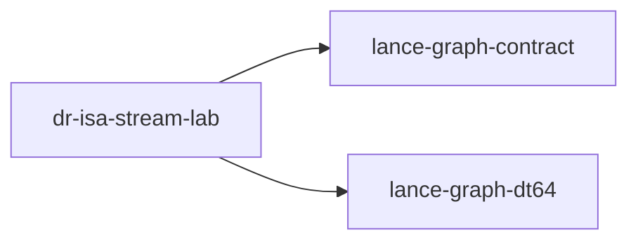

# dr-isa-stream-lab

crate: dr-isa-stream-lab
path: crates/dr-isa-stream-lab
workspace: excluded
digest: d41e659457cb13a5
evidence legend: ../index.md#evidence-legend

Generated; the code is the truth. See ../index.md.

## Depends on

- dep lance-graph-contract normal — crates/dr-isa-stream-lab/Cargo.toml:19 CONFIRMED
- dep lance-graph-dt64 normal — crates/dr-isa-stream-lab/Cargo.toml:18 CONFIRMED
- dep ndarray normal — crates/dr-isa-stream-lab/Cargo.toml:20 CONFIRMED

## Depended on by

## Public items

- const CLASS [pub] — crates/dr-isa-stream-lab/src/bind.rs:12 CONFIRMED
- const VIEW_CLASS [pub] — crates/dr-isa-stream-lab/src/bind.rs:14 CONFIRMED
- const POSITION [pub] — crates/dr-isa-stream-lab/src/bind.rs:16 CONFIRMED
- const READER [pub] — crates/dr-isa-stream-lab/src/bind.rs:18 CONFIRMED
- const SPACE_A [pub] — crates/dr-isa-stream-lab/src/bind.rs:20 CONFIRMED
- const SPACE_OTHER [pub] — crates/dr-isa-stream-lab/src/bind.rs:25 CONFIRMED
- const FIELDS [pub] — crates/dr-isa-stream-lab/src/bind.rs:30 CONFIRMED
- struct View [pub] — crates/dr-isa-stream-lab/src/bind.rs:33 CONFIRMED
- struct World [pub] — crates/dr-isa-stream-lab/src/bind.rs:52 CONFIRMED
- fn World::new [pub] — crates/dr-isa-stream-lab/src/bind.rs:59 CONFIRMED
- fn World::with_fields [pub] — crates/dr-isa-stream-lab/src/bind.rs:65 CONFIRMED
- fn World::with_extent [pub] — crates/dr-isa-stream-lab/src/bind.rs:71 CONFIRMED
- fn World::bind [pub] — crates/dr-isa-stream-lab/src/bind.rs:103 CONFIRMED
- const TILE [pub] — crates/dr-isa-stream-lab/src/cube.rs:15 CONFIRMED
- fn tile [pub] — crates/dr-isa-stream-lab/src/cube.rs:18 CONFIRMED
- fn slot [pub] — crates/dr-isa-stream-lab/src/cube.rs:23 CONFIRMED
- struct WhereMasks [pub] — crates/dr-isa-stream-lab/src/cube.rs:28 CONFIRMED
- fn WhereMasks::from_fixture [pub] — crates/dr-isa-stream-lab/src/cube.rs:36 CONFIRMED
- fn WhereMasks::words [pub] — crates/dr-isa-stream-lab/src/cube.rs:57 CONFIRMED
- fn WhereMasks::counts [pub] — crates/dr-isa-stream-lab/src/cube.rs:62 CONFIRMED
- enum ArmRefusal [pub] — crates/dr-isa-stream-lab/src/cube.rs:73 CONFIRMED
- fn check_masks [pub] — crates/dr-isa-stream-lab/src/cube.rs:90 CONFIRMED
- fn fold [pub] — crates/dr-isa-stream-lab/src/cube.rs:104 CONFIRMED
- const MASKS [pub] — crates/dr-isa-stream-lab/src/fixture.rs:4 CONFIRMED
- const ROWS [pub] — crates/dr-isa-stream-lab/src/fixture.rs:6 CONFIRMED
- const BLOCK [pub] — crates/dr-isa-stream-lab/src/fixture.rs:8 CONFIRMED
- struct Fixture [pub] — crates/dr-isa-stream-lab/src/fixture.rs:12 CONFIRMED
- fn mix [pub(crate)] — crates/dr-isa-stream-lab/src/fixture.rs:18 CONFIRMED
- fn Fixture::value [pub] — crates/dr-isa-stream-lab/src/fixture.rs:28 CONFIRMED
- fn Fixture::selected [pub] — crates/dr-isa-stream-lab/src/fixture.rs:34 CONFIRMED
- fn bf16_exact [pub] — crates/dr-isa-stream-lab/src/fixture.rs:42 CONFIRMED
- fn bf16_round [pub] — crates/dr-isa-stream-lab/src/fixture.rs:55 CONFIRMED
- fn bf16_value [pub] — crates/dr-isa-stream-lab/src/fixture.rs:62 CONFIRMED
- const SPACE_B [pub] — crates/dr-isa-stream-lab/src/g2l.rs:51 CONFIRMED
- fn global_of [pub] — crates/dr-isa-stream-lab/src/g2l.rs:61 CONFIRMED
- fn identity_of [pub] — crates/dr-isa-stream-lab/src/g2l.rs:66 CONFIRMED
- struct OrderedSource [pub] — crates/dr-isa-stream-lab/src/g2l.rs:72 CONFIRMED
- fn OrderedSource::new [pub] — crates/dr-isa-stream-lab/src/g2l.rs:81 CONFIRMED
- fn OrderedSource::reorder [pub] — crates/dr-isa-stream-lab/src/g2l.rs:97 CONFIRMED
- fn OrderedSource::reorder_lanes_only [pub] — crates/dr-isa-stream-lab/src/g2l.rs:106 CONFIRMED
- fn OrderedSource::socket [pub] — crates/dr-isa-stream-lab/src/g2l.rs:142 CONFIRMED
- fn OrderedSource::lookups [pub] — crates/dr-isa-stream-lab/src/g2l.rs:153 CONFIRMED
- fn OrderedSource::coordinates [pub] — crates/dr-isa-stream-lab/src/g2l.rs:163 CONFIRMED
- fn OrderedSource::len [pub] — crates/dr-isa-stream-lab/src/g2l.rs:168 CONFIRMED
- fn OrderedSource::is_empty [pub] — crates/dr-isa-stream-lab/src/g2l.rs:173 CONFIRMED
- enum G2lRefusal [pub] — crates/dr-isa-stream-lab/src/g2l.rs:180 CONFIRMED
- struct Translation [pub] — crates/dr-isa-stream-lab/src/g2l.rs:200 CONFIRMED
- fn Translation::selection [pub] — crates/dr-isa-stream-lab/src/g2l.rs:212 CONFIRMED
- fn Translation::lookups [pub] — crates/dr-isa-stream-lab/src/g2l.rs:217 CONFIRMED
- fn Translation::check [pub] — crates/dr-isa-stream-lab/src/g2l.rs:223 CONFIRMED
- fn translate [pub] — crates/dr-isa-stream-lab/src/g2l.rs:243 CONFIRMED
- struct TranslatedB [pub] — crates/dr-isa-stream-lab/src/g2l.rs:280 CONFIRMED
- fn TranslatedB<'a,T>::new [pub] — crates/dr-isa-stream-lab/src/g2l.rs:294 CONFIRMED
- fn TranslatedB<'a,T>::reads [pub] — crates/dr-isa-stream-lab/src/g2l.rs:317 CONFIRMED
- fn TranslatedB<'a,T>::admission_reads [pub] — crates/dr-isa-stream-lab/src/g2l.rs:324 CONFIRMED
- const ONE [pub(crate)] — crates/dr-isa-stream-lab/src/gemm.rs:26 CONFIRMED
- enum Mode [pub] — crates/dr-isa-stream-lab/src/gemm.rs:30 CONFIRMED
- enum DirectRefusal [pub] — crates/dr-isa-stream-lab/src/gemm.rs:39 CONFIRMED
- enum GemmRefusal [pub] — crates/dr-isa-stream-lab/src/gemm.rs:55 CONFIRMED
- struct Report [pub] — crates/dr-isa-stream-lab/src/gemm.rs:74 CONFIRMED
- struct Geometry [pub(crate)] — crates/dr-isa-stream-lab/src/gemm.rs:91 CONFIRMED
- fn geometry [pub(crate)] — crates/dr-isa-stream-lab/src/gemm.rs:97 CONFIRMED
- fn sums [pub] — crates/dr-isa-stream-lab/src/gemm.rs:149 CONFIRMED
- struct SelectionB [pub] — crates/dr-isa-stream-lab/src/gemm.rs:235 CONFIRMED
- fn SelectionB::stage [pub] — crates/dr-isa-stream-lab/src/gemm.rs:243 CONFIRMED
- fn SelectionB::bytes [pub] — crates/dr-isa-stream-lab/src/gemm.rs:265 CONFIRMED
- fn sums_whole [pub] — crates/dr-isa-stream-lab/src/gemm.rs:274 CONFIRMED
- const K_STEP [pub] — crates/dr-isa-stream-lab/src/int8.rs:39 CONFIRMED
- fn a_u8 [pub] — crates/dr-isa-stream-lab/src/int8.rs:43 CONFIRMED
- fn b_i8 [pub] — crates/dr-isa-stream-lab/src/int8.rs:48 CONFIRMED
- struct U8Lane [pub] — crates/dr-isa-stream-lab/src/int8.rs:54 CONFIRMED
- fn U8Lane<'a>::values [pub] — crates/dr-isa-stream-lab/src/int8.rs:63 CONFIRMED
- struct U8Lanes [pub] — crates/dr-isa-stream-lab/src/int8.rs:71 CONFIRMED
- fn U8Lanes::slab_in_order [pub] — crates/dr-isa-stream-lab/src/int8.rs:80 CONFIRMED
- fn U8Lanes::from_fn [pub] — crates/dr-isa-stream-lab/src/int8.rs:85 CONFIRMED
- fn U8Lanes::frames [pub] — crates/dr-isa-stream-lab/src/int8.rs:106 CONFIRMED
- fn U8Lanes::frames_mut [pub] — crates/dr-isa-stream-lab/src/int8.rs:111 CONFIRMED
- fn U8Lanes::rewrite [pub] — crates/dr-isa-stream-lab/src/int8.rs:117 CONFIRMED
- fn U8Lanes::row [pub] — crates/dr-isa-stream-lab/src/int8.rs:127 CONFIRMED
- struct U8Socket [pub] — crates/dr-isa-stream-lab/src/int8.rs:138 CONFIRMED
- fn U8Socket<'a>::in_order [pub] — crates/dr-isa-stream-lab/src/int8.rs:148 CONFIRMED
- struct U8Lanes64 [pub] — crates/dr-isa-stream-lab/src/int8.rs:197 CONFIRMED
- fn U8Lanes64<'s>::lanes [pub] — crates/dr-isa-stream-lab/src/int8.rs:206 CONFIRMED
- fn resolve [pub] — crates/dr-isa-stream-lab/src/int8.rs:215 CONFIRMED
- struct Int8Report [pub] — crates/dr-isa-stream-lab/src/int8.rs:259 CONFIRMED
- fn stage_a [pub] — crates/dr-isa-stream-lab/src/int8.rs:274 CONFIRMED
- fn stage_a_per_value [pub] — crates/dr-isa-stream-lab/src/int8.rs:297 CONFIRMED
- fn b_operand [pub] — crates/dr-isa-stream-lab/src/int8.rs:317 CONFIRMED
- fn stage_b [pub] — crates/dr-isa-stream-lab/src/int8.rs:335 CONFIRMED
- fn gemm [pub] — crates/dr-isa-stream-lab/src/int8.rs:349 CONFIRMED
- fn staged [pub] — crates/dr-isa-stream-lab/src/int8.rs:358 CONFIRMED
- fn oracle [pub] — crates/dr-isa-stream-lab/src/int8.rs:381 CONFIRMED
- struct PreparedI8B [pub] — crates/dr-isa-stream-lab/src/int8.rs:398 CONFIRMED
- fn PreparedI8B::prepare [pub] — crates/dr-isa-stream-lab/src/int8.rs:406 CONFIRMED
- fn PreparedI8B::bands [pub] — crates/dr-isa-stream-lab/src/int8.rs:427 CONFIRMED
- fn PreparedI8B::bytes [pub] — crates/dr-isa-stream-lab/src/int8.rs:432 CONFIRMED
- fn direct [pub] — crates/dr-isa-stream-lab/src/int8.rs:474 CONFIRMED
- fn staged_prepared [pub] — crates/dr-isa-stream-lab/src/int8.rs:557 CONFIRMED
- mod bind [pub] — crates/dr-isa-stream-lab/src/lib.rs:22 CONFIRMED
- mod cube [pub] — crates/dr-isa-stream-lab/src/lib.rs:23 CONFIRMED
- mod fixture [pub] — crates/dr-isa-stream-lab/src/lib.rs:24 CONFIRMED
- mod g2l [pub] — crates/dr-isa-stream-lab/src/lib.rs:25 CONFIRMED
- mod gemm [pub] — crates/dr-isa-stream-lab/src/lib.rs:26 CONFIRMED
- mod int8 [pub] — crates/dr-isa-stream-lab/src/lib.rs:27 CONFIRMED
- mod oracle [pub] — crates/dr-isa-stream-lab/src/lib.rs:28 CONFIRMED
- mod shape [pub] — crates/dr-isa-stream-lab/src/lib.rs:29 CONFIRMED
- mod source [pub] — crates/dr-isa-stream-lab/src/lib.rs:30 CONFIRMED
- fn sums [pub] — crates/dr-isa-stream-lab/src/oracle.rs:7 CONFIRMED
- const TILE [pub] — crates/dr-isa-stream-lab/src/shape.rs:60 CONFIRMED
- const MAX_ROWS [pub] — crates/dr-isa-stream-lab/src/shape.rs:62 CONFIRMED
- enum Where [pub] — crates/dr-isa-stream-lab/src/shape.rs:66 CONFIRMED
- struct Selection [pub] — crates/dr-isa-stream-lab/src/shape.rs:75 CONFIRMED
- fn Selection::region [pub] — crates/dr-isa-stream-lab/src/shape.rs:82 CONFIRMED
- fn Selection::mask [pub] — crates/dr-isa-stream-lab/src/shape.rs:90 CONFIRMED
- fn Selection::len [pub] — crates/dr-isa-stream-lab/src/shape.rs:102 CONFIRMED
- fn Selection::is_empty [pub] — crates/dr-isa-stream-lab/src/shape.rs:110 CONFIRMED
- fn Selection::last [pub] — crates/dr-isa-stream-lab/src/shape.rs:115 CONFIRMED
- fn Selection::k_pad [pub] — crates/dr-isa-stream-lab/src/shape.rs:128 CONFIRMED
- fn Selection::for_each [pub] — crates/dr-isa-stream-lab/src/shape.rs:133 CONFIRMED
- enum ShapeRefusal [pub] — crates/dr-isa-stream-lab/src/shape.rs:153 CONFIRMED
- struct VirtualObject [pub] — crates/dr-isa-stream-lab/src/shape.rs:206 CONFIRMED
- fn VirtualObject::bind [pub] — crates/dr-isa-stream-lab/src/shape.rs:223 CONFIRMED
- fn VirtualObject::id [pub] — crates/dr-isa-stream-lab/src/shape.rs:252 CONFIRMED
- fn VirtualObject::binding [pub] — crates/dr-isa-stream-lab/src/shape.rs:257 CONFIRMED
- fn VirtualObject::fields [pub] — crates/dr-isa-stream-lab/src/shape.rs:262 CONFIRMED
- fn VirtualObject::cols [pub] — crates/dr-isa-stream-lab/src/shape.rs:267 CONFIRMED
- fn VirtualObject::selection [pub] — crates/dr-isa-stream-lab/src/shape.rs:272 CONFIRMED
- fn VirtualObject::frame [pub] — crates/dr-isa-stream-lab/src/shape.rs:277 CONFIRMED
- fn VirtualObject::tiles [pub] — crates/dr-isa-stream-lab/src/shape.rs:282 CONFIRMED
- fn VirtualObject::c_len [pub] — crates/dr-isa-stream-lab/src/shape.rs:287 CONFIRMED
- fn VirtualObject::resolve [pub] — crates/dr-isa-stream-lab/src/shape.rs:296 CONFIRMED
- fn VirtualObject::admit_lanes [pub] — crates/dr-isa-stream-lab/src/shape.rs:337 CONFIRMED
- fn VirtualObject::resolve_per_field [pub] — crates/dr-isa-stream-lab/src/shape.rs:361 CONFIRMED
- struct Lanes [pub] — crates/dr-isa-stream-lab/src/shape.rs:383 CONFIRMED
- fn Lanes<'s>::lanes [pub] — crates/dr-isa-stream-lab/src/shape.rs:392 CONFIRMED
- struct BOperand [pub] — crates/dr-isa-stream-lab/src/shape.rs:400 CONFIRMED
- fn BOperand::value [pub] — crates/dr-isa-stream-lab/src/shape.rs:407 CONFIRMED
- fn BOperand::bf16 [pub] — crates/dr-isa-stream-lab/src/shape.rs:413 CONFIRMED
- trait BValues [pub] — crates/dr-isa-stream-lab/src/shape.rs:422 CONFIRMED
- fn admit_operand [pub] — crates/dr-isa-stream-lab/src/shape.rs:454 CONFIRMED
- struct OperandId [pub] — crates/dr-isa-stream-lab/src/shape.rs:473 CONFIRMED
- enum OperandSource [pub] — crates/dr-isa-stream-lab/src/shape.rs:482 CONFIRMED
- enum InnerSource [pub] — crates/dr-isa-stream-lab/src/shape.rs:498 CONFIRMED
- struct BTable [pub] — crates/dr-isa-stream-lab/src/shape.rs:520 CONFIRMED
- fn BTable::new [pub] — crates/dr-isa-stream-lab/src/shape.rs:530 CONFIRMED
- enum ReuseRefusal [pub] — crates/dr-isa-stream-lab/src/shape.rs:589 CONFIRMED
- struct PreparedB [pub] — crates/dr-isa-stream-lab/src/shape.rs:604 CONFIRMED
- struct ReuseKey [pub] — crates/dr-isa-stream-lab/src/shape.rs:613 CONFIRMED
- fn ReuseKey::of [pub] — crates/dr-isa-stream-lab/src/shape.rs:626 CONFIRMED
- fn ReuseKey::admit [pub] — crates/dr-isa-stream-lab/src/shape.rs:643 CONFIRMED
- struct PrepReport [pub] — crates/dr-isa-stream-lab/src/shape.rs:665 CONFIRMED
- fn PreparedB::prepare [pub] — crates/dr-isa-stream-lab/src/shape.rs:676 CONFIRMED
- fn PreparedB::panel [pub] — crates/dr-isa-stream-lab/src/shape.rs:710 CONFIRMED
- fn PreparedB::admit [pub] — crates/dr-isa-stream-lab/src/shape.rs:716 CONFIRMED
- struct ArmReport [pub] — crates/dr-isa-stream-lab/src/shape.rs:723 CONFIRMED
- fn direct [pub] — crates/dr-isa-stream-lab/src/shape.rs:746 CONFIRMED
- fn staged [pub] — crates/dr-isa-stream-lab/src/shape.rs:796 CONFIRMED
- fn cblas [pub] — crates/dr-isa-stream-lab/src/shape.rs:838 CONFIRMED
- fn oracle [pub] — crates/dr-isa-stream-lab/src/shape.rs:878 CONFIRMED
- struct SlabLane [pub] — crates/dr-isa-stream-lab/src/source.rs:19 CONFIRMED
- fn SlabLane<'a>::values [pub] — crates/dr-isa-stream-lab/src/source.rs:28 CONFIRMED
- enum IngestRefusal [pub] — crates/dr-isa-stream-lab/src/source.rs:35 CONFIRMED
- struct Bf16Lanes [pub] — crates/dr-isa-stream-lab/src/source.rs:65 CONFIRMED
- fn Bf16Lanes::slab [pub] — crates/dr-isa-stream-lab/src/source.rs:73 CONFIRMED
- fn Bf16Lanes::slab_with_pitch [pub] — crates/dr-isa-stream-lab/src/source.rs:79 CONFIRMED
- fn Bf16Lanes::slab_encoded [pub] — crates/dr-isa-stream-lab/src/source.rs:100 CONFIRMED
- fn Bf16Lanes::slab_in_order [pub] — crates/dr-isa-stream-lab/src/source.rs:116 CONFIRMED
- fn Bf16Lanes::scattered [pub] — crates/dr-isa-stream-lab/src/source.rs:122 CONFIRMED
- fn Bf16Lanes::frames [pub] — crates/dr-isa-stream-lab/src/source.rs:137 CONFIRMED
- fn Bf16Lanes::frames_mut [pub] — crates/dr-isa-stream-lab/src/source.rs:142 CONFIRMED
- fn Bf16Lanes::row_mut [pub] — crates/dr-isa-stream-lab/src/source.rs:147 CONFIRMED
- fn Bf16Lanes::row [pub] — crates/dr-isa-stream-lab/src/source.rs:156 CONFIRMED
- fn Bf16Lanes::resident_bytes [pub] — crates/dr-isa-stream-lab/src/source.rs:176 CONFIRMED
- struct Socket [pub] — crates/dr-isa-stream-lab/src/source.rs:198 CONFIRMED
- fn Socket<'a>::new [pub] — crates/dr-isa-stream-lab/src/source.rs:208 CONFIRMED
- fn Socket<'a>::in_order [pub] — crates/dr-isa-stream-lab/src/source.rs:220 CONFIRMED

## Imports from in-scope crates

### lance-graph-contract
- use lance_graph_contract::class_view::ClassId — crates/dr-isa-stream-lab/src/bind.rs:3 CONFIRMED
- use lance_graph_contract::class_view::ClassView — crates/dr-isa-stream-lab/src/bind.rs:3 CONFIRMED
- use lance_graph_contract::class_view::WideFieldMask — crates/dr-isa-stream-lab/src/bind.rs:3 CONFIRMED
- use lance_graph_contract::ontology::DisplayTemplate — crates/dr-isa-stream-lab/src/bind.rs:4 CONFIRMED
- use lance_graph_contract::ontology::FieldRef — crates/dr-isa-stream-lab/src/bind.rs:4 CONFIRMED
- use lance_graph_contract::ontology::FieldRef — crates/dr-isa-stream-lab/src/int8.rs:24 CONFIRMED
- use lance_graph_contract::ontology::FieldRef — crates/dr-isa-stream-lab/src/source.rs:10 CONFIRMED
### lance-graph-dt64
- use lance_graph_dt64::Extent — crates/dr-isa-stream-lab/src/bin/shape.rs:20 CONFIRMED
- use lance_graph_dt64::dr::Scope — crates/dr-isa-stream-lab/src/bind.rs:5 CONFIRMED
- use lance_graph_dt64::BindStore — crates/dr-isa-stream-lab/src/bind.rs:7 CONFIRMED
- use lance_graph_dt64::ClassSchema — crates/dr-isa-stream-lab/src/bind.rs:7 CONFIRMED
- use lance_graph_dt64::CoordSpace — crates/dr-isa-stream-lab/src/bind.rs:7 CONFIRMED
- use lance_graph_dt64::Extent — crates/dr-isa-stream-lab/src/bind.rs:7 CONFIRMED
- use lance_graph_dt64::LaneBinding — crates/dr-isa-stream-lab/src/bind.rs:7 CONFIRMED
- use lance_graph_dt64::LaneRefusal — crates/dr-isa-stream-lab/src/bind.rs:7 CONFIRMED
- use lance_graph_dt64::LaneRequest — crates/dr-isa-stream-lab/src/bind.rs:7 CONFIRMED
- use lance_graph_dt64::LaneSource — crates/dr-isa-stream-lab/src/bind.rs:7 CONFIRMED
- use lance_graph_dt64::RouteAt — crates/dr-isa-stream-lab/src/bind.rs:8 CONFIRMED
- use lance_graph_dt64::SchemaRev — crates/dr-isa-stream-lab/src/bind.rs:8 CONFIRMED
- use lance_graph_dt64::CoordSpace — crates/dr-isa-stream-lab/src/cube.rs:8 CONFIRMED
- use lance_graph_dt64::LaneBinding — crates/dr-isa-stream-lab/src/cube.rs:8 CONFIRMED
- use lance_graph_dt64::LaneRefusal — crates/dr-isa-stream-lab/src/cube.rs:8 CONFIRMED
- use lance_graph_dt64::dr::Frame — crates/dr-isa-stream-lab/src/g2l.rs:41 CONFIRMED
- use lance_graph_dt64::dr::FrameRevisions — crates/dr-isa-stream-lab/src/g2l.rs:41 CONFIRMED
- use lance_graph_dt64::dr::LocalMap — crates/dr-isa-stream-lab/src/g2l.rs:41 CONFIRMED
- use lance_graph_dt64::dr::LocateRefusal — crates/dr-isa-stream-lab/src/g2l.rs:41 CONFIRMED
- use lance_graph_dt64::dr::MapRead — crates/dr-isa-stream-lab/src/g2l.rs:41 CONFIRMED
- use lance_graph_dt64::dr::MapTable — crates/dr-isa-stream-lab/src/g2l.rs:41 CONFIRMED
- use lance_graph_dt64::dr::TileId — crates/dr-isa-stream-lab/src/g2l.rs:41 CONFIRMED
- use lance_graph_dt64::dr::Width — crates/dr-isa-stream-lab/src/g2l.rs:41 CONFIRMED
- use lance_graph_dt64::CoordSpace — crates/dr-isa-stream-lab/src/g2l.rs:43 CONFIRMED
- use lance_graph_dt64::LaneBinding — crates/dr-isa-stream-lab/src/gemm.rs:14 CONFIRMED
- use lance_graph_dt64::LaneRefusal — crates/dr-isa-stream-lab/src/gemm.rs:14 CONFIRMED
- use lance_graph_dt64::dr::Frame — crates/dr-isa-stream-lab/src/int8.rs:25 CONFIRMED
- use lance_graph_dt64::dr::FrameRevisions — crates/dr-isa-stream-lab/src/int8.rs:25 CONFIRMED
- use lance_graph_dt64::dr::FrameStore — crates/dr-isa-stream-lab/src/int8.rs:25 CONFIRMED
- use lance_graph_dt64::dr::Scope — crates/dr-isa-stream-lab/src/int8.rs:25 CONFIRMED
- use lance_graph_dt64::CoordSpace — crates/dr-isa-stream-lab/src/int8.rs:26 CONFIRMED
- use lance_graph_dt64::LaneAddr — crates/dr-isa-stream-lab/src/int8.rs:26 CONFIRMED
- use lance_graph_dt64::LaneRefusal — crates/dr-isa-stream-lab/src/int8.rs:26 CONFIRMED
- use lance_graph_dt64::LaneSource — crates/dr-isa-stream-lab/src/int8.rs:26 CONFIRMED
- use lance_graph_dt64::SchemaRev — crates/dr-isa-stream-lab/src/int8.rs:26 CONFIRMED
- use lance_graph_dt64::dr::Frame — crates/dr-isa-stream-lab/src/shape.rs:48 CONFIRMED
- use lance_graph_dt64::CoordSpace — crates/dr-isa-stream-lab/src/shape.rs:49 CONFIRMED
- use lance_graph_dt64::LaneBinding — crates/dr-isa-stream-lab/src/shape.rs:49 CONFIRMED
- use lance_graph_dt64::LaneRefusal — crates/dr-isa-stream-lab/src/shape.rs:49 CONFIRMED
- use lance_graph_dt64::LaneSource — crates/dr-isa-stream-lab/src/shape.rs:49 CONFIRMED
- use lance_graph_dt64::dr::Frame — crates/dr-isa-stream-lab/src/source.rs:11 CONFIRMED
- use lance_graph_dt64::dr::FrameRevisions — crates/dr-isa-stream-lab/src/source.rs:11 CONFIRMED
- use lance_graph_dt64::dr::FrameStore — crates/dr-isa-stream-lab/src/source.rs:11 CONFIRMED
- use lance_graph_dt64::dr::Scope — crates/dr-isa-stream-lab/src/source.rs:11 CONFIRMED
- use lance_graph_dt64::CoordSpace — crates/dr-isa-stream-lab/src/source.rs:12 CONFIRMED
- use lance_graph_dt64::LaneAddr — crates/dr-isa-stream-lab/src/source.rs:12 CONFIRMED
- use lance_graph_dt64::LaneSource — crates/dr-isa-stream-lab/src/source.rs:12 CONFIRMED
- use lance_graph_dt64::SchemaRev — crates/dr-isa-stream-lab/src/source.rs:12 CONFIRMED

## Calls

CALL_GRAPH=ARTIFACT_MISSING
- calls ARTIFACT_MISSING — no ruff_charon artifact for this crate UNKNOWN

## Architecture

- none

Generated from Cargo manifests — extracted relationships only.

