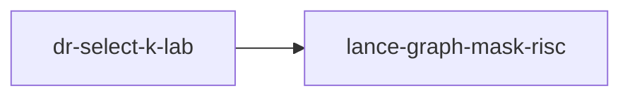

# dr-select-k-lab

crate: dr-select-k-lab
path: crates/dr-select-k-lab
workspace: excluded
digest: 6a4b2c60ea89de06
evidence legend: ../index.md#evidence-legend

Generated; the code is the truth. See ../index.md.

## Depends on

- dep lance-graph-mask-risc normal — crates/dr-select-k-lab/Cargo.toml:11 CONFIRMED

## Depended on by

## Public items

- enum Order [pub] — crates/dr-select-k-lab/src/bind.rs:9 CONFIRMED
- enum BindRefusal [pub] — crates/dr-select-k-lab/src/bind.rs:18 CONFIRMED
- struct Bound [pub] — crates/dr-select-k-lab/src/bind.rs:25 CONFIRMED
- fn Bound::bind [pub] — crates/dr-select-k-lab/src/bind.rs:35 CONFIRMED
- fn Bound::k [pub] — crates/dr-select-k-lab/src/bind.rs:56 CONFIRMED
- fn Bound::version [pub] — crates/dr-select-k-lab/src/bind.rs:60 CONFIRMED
- fn Bound::order [pub] — crates/dr-select-k-lab/src/bind.rs:64 CONFIRMED
- fn Bound::rows [pub] — crates/dr-select-k-lab/src/bind.rs:69 CONFIRMED
- fn Bound::staged [pub] — crates/dr-select-k-lab/src/bind.rs:74 CONFIRMED
- enum Residual [pub] — crates/dr-select-k-lab/src/bind.rs:81 CONFIRMED
- enum View [pub] — crates/dr-select-k-lab/src/bind.rs:92 CONFIRMED
- fn Residual::view [pub] — crates/dr-select-k-lab/src/bind.rs:99 CONFIRMED
- fn Residual::retained_bytes [pub] — crates/dr-select-k-lab/src/bind.rs:108 CONFIRMED
- struct Counters [pub] — crates/dr-select-k-lab/src/counters.rs:8 CONFIRMED
- fn Counters::new [pub] — crates/dr-select-k-lab/src/counters.rs:22 CONFIRMED
- fn Counters::bump [pub(crate)] — crates/dr-select-k-lab/src/counters.rs:26 CONFIRMED
- fn Counters::snapshot [pub] — crates/dr-select-k-lab/src/counters.rs:32 CONFIRMED
- enum Pattern [pub] — crates/dr-select-k-lab/src/fixture.rs:7 CONFIRMED
- fn source [pub] — crates/dr-select-k-lab/src/fixture.rs:32 CONFIRMED
- mod bind [pub] — crates/dr-select-k-lab/src/lib.rs:27 CONFIRMED
- mod counters [pub] — crates/dr-select-k-lab/src/lib.rs:28 CONFIRMED
- mod fixture [pub] — crates/dr-select-k-lab/src/lib.rs:29 CONFIRMED
- mod ops [pub] — crates/dr-select-k-lab/src/lib.rs:30 CONFIRMED
- mod oracle [pub] — crates/dr-select-k-lab/src/lib.rs:31 CONFIRMED
- mod source [pub] — crates/dr-select-k-lab/src/lib.rs:32 CONFIRMED
- enum Op [pub] — crates/dr-select-k-lab/src/ops.rs:76 CONFIRMED
- enum Inadmissible [pub] — crates/dr-select-k-lab/src/ops.rs:87 CONFIRMED
- fn admissible [pub] — crates/dr-select-k-lab/src/ops.rs:97 CONFIRMED
- fn residual_a_ge [pub] — crates/dr-select-k-lab/src/ops.rs:118 CONFIRMED
- struct PreparedFolds [pub] — crates/dr-select-k-lab/src/ops.rs:148 CONFIRMED
- fn PreparedFolds::new [pub] — crates/dr-select-k-lab/src/ops.rs:166 CONFIRMED
- fn PreparedFolds::count_b_gt [pub] — crates/dr-select-k-lab/src/ops.rs:192 CONFIRMED
- fn PreparedFolds::sum_a [pub] — crates/dr-select-k-lab/src/ops.rs:245 CONFIRMED
- fn PreparedFolds::top_by_key [pub] — crates/dr-select-k-lab/src/ops.rs:278 CONFIRMED
- mod baseline [pub] — crates/dr-select-k-lab/src/ops.rs:321 CONFIRMED
- fn count_b_gt [pub] — crates/dr-select-k-lab/src/ops.rs:328 CONFIRMED
- fn sum_a [pub] — crates/dr-select-k-lab/src/ops.rs:346 CONFIRMED
- struct Query [pub] — crates/dr-select-k-lab/src/oracle.rs:10 CONFIRMED
- fn count_b_gt [pub] — crates/dr-select-k-lab/src/oracle.rs:17 CONFIRMED
- fn sum_a [pub] — crates/dr-select-k-lab/src/oracle.rs:29 CONFIRMED
- fn top_by_key [pub] — crates/dr-select-k-lab/src/oracle.rs:42 CONFIRMED
- struct Version [pub] — crates/dr-select-k-lab/src/source.rs:10 CONFIRMED
- struct KeyRange [pub] — crates/dr-select-k-lab/src/source.rs:14 CONFIRMED
- fn KeyRange::has [pub] — crates/dr-select-k-lab/src/source.rs:20 CONFIRMED
- struct Selection [pub] — crates/dr-select-k-lab/src/source.rs:28 CONFIRMED
- struct Staged [pub] — crates/dr-select-k-lab/src/source.rs:36 CONFIRMED
- struct Source [pub] — crates/dr-select-k-lab/src/source.rs:44 CONFIRMED
- fn Source::new [pub] — crates/dr-select-k-lab/src/source.rs:57 CONFIRMED
- fn Source::version [pub] — crates/dr-select-k-lab/src/source.rs:78 CONFIRMED
- fn Source::n_rows [pub] — crates/dr-select-k-lab/src/source.rs:82 CONFIRMED
- fn Source::advance [pub] — crates/dr-select-k-lab/src/source.rs:87 CONFIRMED
- fn Source::select_filter [pub] — crates/dr-select-k-lab/src/source.rs:92 CONFIRMED
- fn Source::select_ordered [pub] — crates/dr-select-k-lab/src/source.rs:107 CONFIRMED
- fn Source::take [pub(crate)] — crates/dr-select-k-lab/src/source.rs:123 CONFIRMED
- fn Source::lanes [pub] — crates/dr-select-k-lab/src/source.rs:141 CONFIRMED

## Imports from in-scope crates

### lance-graph-mask-risc
- use lance_graph_mask_risc::Foreign — crates/dr-select-k-lab/src/ops.rs:9 CONFIRMED
- use lance_graph_mask_risc::LaneRef — crates/dr-select-k-lab/src/ops.rs:9 CONFIRMED
- use lance_graph_mask_risc::MaskOp — crates/dr-select-k-lab/src/ops.rs:9 CONFIRMED
- use lance_graph_mask_risc::Operand — crates/dr-select-k-lab/src/ops.rs:9 CONFIRMED
- use lance_graph_mask_risc::Out — crates/dr-select-k-lab/src/ops.rs:9 CONFIRMED
- use lance_graph_mask_risc::Planes — crates/dr-select-k-lab/src/ops.rs:9 CONFIRMED
- use lance_graph_mask_risc::Pred — crates/dr-select-k-lab/src/ops.rs:9 CONFIRMED
- use lance_graph_mask_risc::Program — crates/dr-select-k-lab/src/ops.rs:9 CONFIRMED
- use lance_graph_mask_risc::execute_into — crates/dr-select-k-lab/src/ops.rs:9 CONFIRMED
- use lance_graph_mask_risc::words_for — crates/dr-select-k-lab/src/ops.rs:9 CONFIRMED
- use lance_graph_mask_risc::Scratch — crates/dr-select-k-lab/src/ops.rs:10 CONFIRMED
- use lance_graph_mask_risc::Terminal — crates/dr-select-k-lab/src/ops.rs:10 CONFIRMED
- use lance_graph_mask_risc::Value — crates/dr-select-k-lab/src/ops.rs:10 CONFIRMED
- use lance_graph_mask_risc::Scratch — crates/dr-select-k-lab/src/ops.rs:324 CONFIRMED
- use lance_graph_mask_risc::Value — crates/dr-select-k-lab/src/ops.rs:324 CONFIRMED

## Calls

CALL_GRAPH=ARTIFACT_MISSING
- calls ARTIFACT_MISSING — no ruff_charon artifact for this crate UNKNOWN

## Architecture

- none

Generated from Cargo manifests — extracted relationships only.

