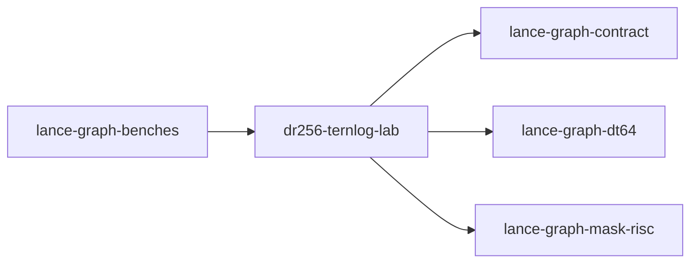

# dr256-ternlog-lab

crate: dr256-ternlog-lab
path: crates/dr256-ternlog-lab
workspace: member
digest: 37c7b22835c32811
evidence legend: ../index.md#evidence-legend

Generated; the code is the truth. See ../index.md.

## Depends on

- dep lance-graph-contract normal — crates/dr256-ternlog-lab/Cargo.toml:9 CONFIRMED
- dep lance-graph-dt64 normal — crates/dr256-ternlog-lab/Cargo.toml:10 CONFIRMED
- dep lance-graph-mask-risc normal — crates/dr256-ternlog-lab/Cargo.toml:11 CONFIRMED

## Depended on by

- rdep lance-graph-benches normal — crates/lance-graph-benches/Cargo.toml:29 CONFIRMED

## Public items

- const SLAB_ROWS [pub] — crates/dr256-ternlog-lab/src/lib.rs:46 CONFIRMED
- const SLAB_WORDS [pub] — crates/dr256-ternlog-lab/src/lib.rs:48 CONFIRMED
- const MAX_SLABS [pub] — crates/dr256-ternlog-lab/src/lib.rs:50 CONFIRMED
- const AND3 [pub] — crates/dr256-ternlog-lab/src/lib.rs:52 CONFIRMED
- const MASK_BITS [pub] — crates/dr256-ternlog-lab/src/lib.rs:54 CONFIRMED
- const MASK_WORDS [pub] — crates/dr256-ternlog-lab/src/lib.rs:56 CONFIRMED
- const SLAB_MASKS [pub] — crates/dr256-ternlog-lab/src/lib.rs:58 CONFIRMED
- const PERSON [pub] — crates/dr256-ternlog-lab/src/lib.rs:63 CONFIRMED
- const FRIEND_OF [pub] — crates/dr256-ternlog-lab/src/lib.rs:65 CONFIRMED
- mod order_store [pub] — crates/dr256-ternlog-lab/src/lib.rs:69 CONFIRMED
- mod person [pub] — crates/dr256-ternlog-lab/src/lib.rs:72 CONFIRMED
- const ID [pub] — crates/dr256-ternlog-lab/src/lib.rs:73 CONFIRMED
- const NAME [pub] — crates/dr256-ternlog-lab/src/lib.rs:74 CONFIRMED
- const AGE [pub] — crates/dr256-ternlog-lab/src/lib.rs:75 CONFIRMED
- mod friend [pub] — crates/dr256-ternlog-lab/src/lib.rs:78 CONFIRMED
- const SRC [pub] — crates/dr256-ternlog-lab/src/lib.rs:79 CONFIRMED
- const DST [pub] — crates/dr256-ternlog-lab/src/lib.rs:80 CONFIRMED
- struct View [pub] — crates/dr256-ternlog-lab/src/lib.rs:84 CONFIRMED
- fn select [pub] — crates/dr256-ternlog-lab/src/lib.rs:129 CONFIRMED
- fn columns [pub] — crates/dr256-ternlog-lab/src/lib.rs:141 CONFIRMED
- fn lane_index [pub] — crates/dr256-ternlog-lab/src/lib.rs:154 CONFIRMED
- struct World [pub] — crates/dr256-ternlog-lab/src/lib.rs:162 CONFIRMED
- fn World::new [pub] — crates/dr256-ternlog-lab/src/lib.rs:176 CONFIRMED
- fn admits_reservation [pub] — crates/dr256-ternlog-lab/src/lib.rs:218 CONFIRMED
- struct Table [pub] — crates/dr256-ternlog-lab/src/lib.rs:241 CONFIRMED
- fn Table<'a>::new [pub] — crates/dr256-ternlog-lab/src/lib.rs:254 CONFIRMED
- fn Table<'a>::n_rows [pub] — crates/dr256-ternlog-lab/src/lib.rs:281 CONFIRMED
- fn Table<'a>::slabs [pub] — crates/dr256-ternlog-lab/src/lib.rs:285 CONFIRMED
- fn Table<'a>::slab_rows [pub] — crates/dr256-ternlog-lab/src/lib.rs:290 CONFIRMED
- fn Table<'a>::space [pub] — crates/dr256-ternlog-lab/src/lib.rs:295 CONFIRMED
- fn Table<'a>::frames [pub] — crates/dr256-ternlog-lab/src/lib.rs:302 CONFIRMED
- fn Table<'a>::advance_source [pub] — crates/dr256-ternlog-lab/src/lib.rs:308 CONFIRMED
- struct SlabSource [pub] — crates/dr256-ternlog-lab/src/lib.rs:320 CONFIRMED
- struct Plane [pub] — crates/dr256-ternlog-lab/src/lib.rs:370 CONFIRMED
- fn Plane::from_fn [pub] — crates/dr256-ternlog-lab/src/lib.rs:377 CONFIRMED
- fn Plane::count [pub] — crates/dr256-ternlog-lab/src/lib.rs:387 CONFIRMED
- fn Plane::masks [pub] — crates/dr256-ternlog-lab/src/lib.rs:393 CONFIRMED
- fn Plane::mask [pub] — crates/dr256-ternlog-lab/src/lib.rs:399 CONFIRMED
- fn Plane::selections [pub] — crates/dr256-ternlog-lab/src/lib.rs:414 CONFIRMED
- struct Selection [pub] — crates/dr256-ternlog-lab/src/lib.rs:427 CONFIRMED
- fn Selection<'p>::space [pub] — crates/dr256-ternlog-lab/src/lib.rs:435 CONFIRMED
- fn Selection<'p>::row [pub] — crates/dr256-ternlog-lab/src/lib.rs:440 CONFIRMED
- fn Selection<'p>::words [pub] — crates/dr256-ternlog-lab/src/lib.rs:445 CONFIRMED
- fn Selection<'p>::has [pub] — crates/dr256-ternlog-lab/src/lib.rs:450 CONFIRMED
- fn Selection<'p>::count [pub] — crates/dr256-ternlog-lab/src/lib.rs:457 CONFIRMED
- fn Selection<'p>::is_empty [pub] — crates/dr256-ternlog-lab/src/lib.rs:461 CONFIRMED
- fn Selection<'p>::same_bits [pub] — crates/dr256-ternlog-lab/src/lib.rs:467 CONFIRMED
- struct RankMap [pub] — crates/dr256-ternlog-lab/src/lib.rs:480 CONFIRMED
- fn RankMap::new [pub] — crates/dr256-ternlog-lab/src/lib.rs:490 CONFIRMED
- fn RankMap::len [pub] — crates/dr256-ternlog-lab/src/lib.rs:514 CONFIRMED
- fn RankMap::is_empty [pub] — crates/dr256-ternlog-lab/src/lib.rs:518 CONFIRMED
- fn RankMap::contains [pub] — crates/dr256-ternlog-lab/src/lib.rs:522 CONFIRMED
- fn RankMap::local [pub] — crates/dr256-ternlog-lab/src/lib.rs:530 CONFIRMED
- fn RankMap::words [pub] — crates/dr256-ternlog-lab/src/lib.rs:541 CONFIRMED
- enum Refused [pub] — crates/dr256-ternlog-lab/src/lib.rs:550 CONFIRMED
- struct Prepared [pub] — crates/dr256-ternlog-lab/src/lib.rs:591 CONFIRMED
- fn Prepared::slabs [pub] — crates/dr256-ternlog-lab/src/lib.rs:600 CONFIRMED
- fn Prepared::plane_bytes [pub] — crates/dr256-ternlog-lab/src/lib.rs:605 CONFIRMED
- fn Prepared::set_plane [pub] — crates/dr256-ternlog-lab/src/lib.rs:614 CONFIRMED
- fn Prepared::plane [pub] — crates/dr256-ternlog-lab/src/lib.rs:618 CONFIRMED
- fn prepare_nodes [pub] — crates/dr256-ternlog-lab/src/lib.rs:656 CONFIRMED
- fn prepare_edges [pub] — crates/dr256-ternlog-lab/src/lib.rs:695 CONFIRMED
- struct Fold [pub] — crates/dr256-ternlog-lab/src/lib.rs:752 CONFIRMED
- fn Fold::count_gt [pub] — crates/dr256-ternlog-lab/src/lib.rs:763 CONFIRMED
- fn Fold::count_and3 [pub] — crates/dr256-ternlog-lab/src/lib.rs:789 CONFIRMED
- fn Fold::count [pub] — crates/dr256-ternlog-lab/src/lib.rs:816 CONFIRMED
- fn display_row [pub] — crates/dr256-ternlog-lab/src/lib.rs:883 CONFIRMED
- struct OrderIndex [pub] — crates/dr256-ternlog-lab/src/lib.rs:916 CONFIRMED
- fn OrderIndex::by_i32 [pub] — crates/dr256-ternlog-lab/src/lib.rs:949 CONFIRMED
- fn OrderIndex::by_key [pub] — crates/dr256-ternlog-lab/src/lib.rs:975 CONFIRMED
- fn OrderIndex::positions [pub] — crates/dr256-ternlog-lab/src/lib.rs:997 CONFIRMED
- fn OrderIndex::len [pub] — crates/dr256-ternlog-lab/src/lib.rs:1005 CONFIRMED
- fn OrderIndex::is_empty [pub] — crates/dr256-ternlog-lab/src/lib.rs:1009 CONFIRMED
- fn OrderIndex::row [pub] — crates/dr256-ternlog-lab/src/lib.rs:1014 CONFIRMED
- fn OrderIndex::gt [pub] — crates/dr256-ternlog-lab/src/lib.rs:1019 CONFIRMED
- fn OrderIndex::between [pub] — crates/dr256-ternlog-lab/src/lib.rs:1024 CONFIRMED
- struct PreparedOrder [pub] — crates/dr256-ternlog-lab/src/lib.rs:1047 CONFIRMED
- fn prepare_order [pub] — crates/dr256-ternlog-lab/src/lib.rs:1056 CONFIRMED
- fn PreparedOrder::plane [pub] — crates/dr256-ternlog-lab/src/lib.rs:1105 CONFIRMED
- fn PreparedOrder::set_plane [pub] — crates/dr256-ternlog-lab/src/lib.rs:1109 CONFIRMED
- fn PreparedOrder::count [pub] — crates/dr256-ternlog-lab/src/lib.rs:1115 CONFIRMED
- const TIE_KEY_THEN_FRAME_POSITION [pub] — crates/dr256-ternlog-lab/src/order_store.rs:44 CONFIRMED
- mod layout [pub] — crates/dr256-ternlog-lab/src/order_store.rs:47 CONFIRMED
- const MAGIC [pub] — crates/dr256-ternlog-lab/src/order_store.rs:48 CONFIRMED
- const VERSION [pub] — crates/dr256-ternlog-lab/src/order_store.rs:49 CONFIRMED
- const OFF_MAGIC [pub] — crates/dr256-ternlog-lab/src/order_store.rs:50 CONFIRMED
- const OFF_VERSION [pub] — crates/dr256-ternlog-lab/src/order_store.rs:51 CONFIRMED
- const OFF_TIE_BREAK [pub] — crates/dr256-ternlog-lab/src/order_store.rs:52 CONFIRMED
- const OFF_CLASS [pub] — crates/dr256-ternlog-lab/src/order_store.rs:53 CONFIRMED
- const OFF_KEY_KIND [pub] — crates/dr256-ternlog-lab/src/order_store.rs:54 CONFIRMED
- const OFF_KEY_ID [pub] — crates/dr256-ternlog-lab/src/order_store.rs:55 CONFIRMED
- const OFF_TABLE_POPULATION [pub] — crates/dr256-ternlog-lab/src/order_store.rs:56 CONFIRMED
- const OFF_INDEX_POPULATION [pub] — crates/dr256-ternlog-lab/src/order_store.rs:57 CONFIRMED
- const OFF_N_ROWS [pub] — crates/dr256-ternlog-lab/src/order_store.rs:58 CONFIRMED
- const OFF_SOURCE [pub] — crates/dr256-ternlog-lab/src/order_store.rs:59 CONFIRMED
- const OFF_RELATION_MAP [pub] — crates/dr256-ternlog-lab/src/order_store.rs:60 CONFIRMED
- const OFF_COORDINATES [pub] — crates/dr256-ternlog-lab/src/order_store.rs:61 CONFIRMED
- const OFF_PRESENCE [pub] — crates/dr256-ternlog-lab/src/order_store.rs:62 CONFIRMED
- const HEADER_BYTES [pub] — crates/dr256-ternlog-lab/src/order_store.rs:63 CONFIRMED
- enum KeyLane [pub] — crates/dr256-ternlog-lab/src/order_store.rs:68 CONFIRMED
- enum StoreRefused [pub] — crates/dr256-ternlog-lab/src/order_store.rs:77 CONFIRMED
- struct SealedOrder [pub] — crates/dr256-ternlog-lab/src/order_store.rs:135 CONFIRMED
- fn SealedOrder::seal [pub] — crates/dr256-ternlog-lab/src/order_store.rs:177 CONFIRMED
- fn SealedOrder::to_bytes [pub] — crates/dr256-ternlog-lab/src/order_store.rs:216 CONFIRMED
- fn SealedOrder::from_bytes [pub] — crates/dr256-ternlog-lab/src/order_store.rs:249 CONFIRMED
- fn SealedOrder::write_to [pub] — crates/dr256-ternlog-lab/src/order_store.rs:346 CONFIRMED
- fn SealedOrder::read_from [pub] — crates/dr256-ternlog-lab/src/order_store.rs:350 CONFIRMED
- fn SealedOrder::attest [pub] — crates/dr256-ternlog-lab/src/order_store.rs:357 CONFIRMED
- fn SealedOrder::into_index [pub] — crates/dr256-ternlog-lab/src/order_store.rs:395 CONFIRMED
- fn SealedOrder::matches_index [pub] — crates/dr256-ternlog-lab/src/order_store.rs:412 CONFIRMED
- fn SealedOrder::rows [pub] — crates/dr256-ternlog-lab/src/order_store.rs:420 CONFIRMED
- fn SealedOrder::keys [pub] — crates/dr256-ternlog-lab/src/order_store.rs:425 CONFIRMED
- fn SealedOrder::len [pub] — crates/dr256-ternlog-lab/src/order_store.rs:429 CONFIRMED
- fn SealedOrder::is_empty [pub] — crates/dr256-ternlog-lab/src/order_store.rs:433 CONFIRMED
- fn SealedOrder::key [pub] — crates/dr256-ternlog-lab/src/order_store.rs:437 CONFIRMED
- fn SealedOrder::presence [pub] — crates/dr256-ternlog-lab/src/order_store.rs:441 CONFIRMED
- fn SealedOrder::source_revision [pub] — crates/dr256-ternlog-lab/src/order_store.rs:445 CONFIRMED

## Imports from in-scope crates

### lance-graph-contract
- use lance_graph_contract::class_view::ClassId — crates/dr256-ternlog-lab/src/lib.rs:33 CONFIRMED
- use lance_graph_contract::class_view::ClassView — crates/dr256-ternlog-lab/src/lib.rs:33 CONFIRMED
- use lance_graph_contract::class_view::WideFieldMask — crates/dr256-ternlog-lab/src/lib.rs:33 CONFIRMED
- use lance_graph_contract::ontology::DisplayTemplate — crates/dr256-ternlog-lab/src/lib.rs:34 CONFIRMED
- use lance_graph_contract::ontology::FieldRef — crates/dr256-ternlog-lab/src/lib.rs:34 CONFIRMED
### lance-graph-dt64
- use lance_graph_dt64::dr::Extent — crates/dr256-ternlog-lab/src/lib.rs:35 CONFIRMED
- use lance_graph_dt64::dr::Frame — crates/dr256-ternlog-lab/src/lib.rs:35 CONFIRMED
- use lance_graph_dt64::dr::FrameRevisions — crates/dr256-ternlog-lab/src/lib.rs:35 CONFIRMED
- use lance_graph_dt64::dr::FrameStore — crates/dr256-ternlog-lab/src/lib.rs:35 CONFIRMED
- use lance_graph_dt64::dr::Scope — crates/dr256-ternlog-lab/src/lib.rs:35 CONFIRMED
- use lance_graph_dt64::BindStore — crates/dr256-ternlog-lab/src/lib.rs:37 CONFIRMED
- use lance_graph_dt64::ClassSchema — crates/dr256-ternlog-lab/src/lib.rs:37 CONFIRMED
- use lance_graph_dt64::CoordSpace — crates/dr256-ternlog-lab/src/lib.rs:37 CONFIRMED
- use lance_graph_dt64::LaneAddr — crates/dr256-ternlog-lab/src/lib.rs:37 CONFIRMED
- use lance_graph_dt64::LaneBinding — crates/dr256-ternlog-lab/src/lib.rs:37 CONFIRMED
- use lance_graph_dt64::LaneRefusal — crates/dr256-ternlog-lab/src/lib.rs:37 CONFIRMED
- use lance_graph_dt64::LaneRequest — crates/dr256-ternlog-lab/src/lib.rs:37 CONFIRMED
- use lance_graph_dt64::LaneSource — crates/dr256-ternlog-lab/src/lib.rs:38 CONFIRMED
- use lance_graph_dt64::Refusal — crates/dr256-ternlog-lab/src/lib.rs:38 CONFIRMED
- use lance_graph_dt64::RouteAt — crates/dr256-ternlog-lab/src/lib.rs:38 CONFIRMED
- use lance_graph_dt64::SchemaRev — crates/dr256-ternlog-lab/src/lib.rs:38 CONFIRMED
- use lance_graph_dt64::dr::FrameRevisions — crates/dr256-ternlog-lab/src/order_store.rs:38 CONFIRMED
### lance-graph-mask-risc
- use lance_graph_mask_risc::ExecError — crates/dr256-ternlog-lab/src/lib.rs:41 CONFIRMED
- use lance_graph_mask_risc::Foreign — crates/dr256-ternlog-lab/src/lib.rs:41 CONFIRMED
- use lance_graph_mask_risc::LaneRef — crates/dr256-ternlog-lab/src/lib.rs:41 CONFIRMED
- use lance_graph_mask_risc::MaskOp — crates/dr256-ternlog-lab/src/lib.rs:41 CONFIRMED
- use lance_graph_mask_risc::Operand — crates/dr256-ternlog-lab/src/lib.rs:41 CONFIRMED
- use lance_graph_mask_risc::Out — crates/dr256-ternlog-lab/src/lib.rs:41 CONFIRMED
- use lance_graph_mask_risc::Planes — crates/dr256-ternlog-lab/src/lib.rs:41 CONFIRMED
- use lance_graph_mask_risc::Pred — crates/dr256-ternlog-lab/src/lib.rs:41 CONFIRMED
- use lance_graph_mask_risc::execute_into — crates/dr256-ternlog-lab/src/lib.rs:41 CONFIRMED
- use lance_graph_mask_risc::words_for — crates/dr256-ternlog-lab/src/lib.rs:41 CONFIRMED
- use lance_graph_mask_risc::Program — crates/dr256-ternlog-lab/src/lib.rs:42 CONFIRMED
- use lance_graph_mask_risc::Scratch — crates/dr256-ternlog-lab/src/lib.rs:42 CONFIRMED
- use lance_graph_mask_risc::Terminal — crates/dr256-ternlog-lab/src/lib.rs:42 CONFIRMED
- use lance_graph_mask_risc::Value — crates/dr256-ternlog-lab/src/lib.rs:42 CONFIRMED
- use lance_graph_mask_risc::LaneRef — crates/dr256-ternlog-lab/src/order_store.rs:39 CONFIRMED

## Calls

CALL_GRAPH=ARTIFACT_MISSING
- calls ARTIFACT_MISSING — no ruff_charon artifact for this crate UNKNOWN

## Architecture

- none

Generated from Cargo manifests — extracted relationships only.

