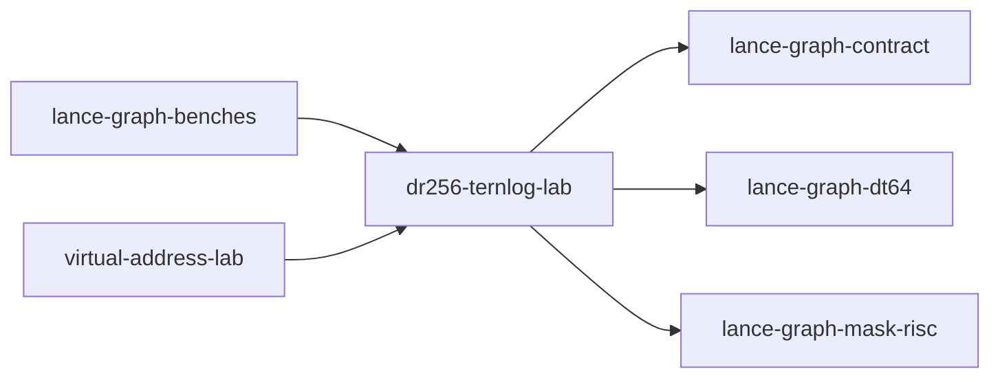

# dr256-ternlog-lab

crate: dr256-ternlog-lab
path: crates/dr256-ternlog-lab
workspace: member
digest: db72658c42b0d148
evidence legend: ../index.md#evidence-legend

Generated; the code is the truth. See ../index.md.

## Depends on

- dep lance-graph-contract normal — crates/dr256-ternlog-lab/Cargo.toml:9 CONFIRMED
- dep lance-graph-dt64 normal — crates/dr256-ternlog-lab/Cargo.toml:10 CONFIRMED
- dep lance-graph-mask-risc normal — crates/dr256-ternlog-lab/Cargo.toml:11 CONFIRMED
- dep weather-poc dev — crates/dr256-ternlog-lab/Cargo.toml:16 CONFIRMED

## Depended on by

- rdep lance-graph-benches normal — crates/lance-graph-benches/Cargo.toml:29 CONFIRMED
- rdep quack-boundary-lab dev — crates/quack-boundary-lab/Cargo.toml:20 CONFIRMED
- rdep virtual-address-lab normal — crates/virtual-address-lab/Cargo.toml:17 CONFIRMED

## Public items

- const BAND_BITS [pub] — crates/dr256-ternlog-lab/src/bit_planes.rs:9 CONFIRMED
- struct BitPlanes [pub] — crates/dr256-ternlog-lab/src/bit_planes.rs:13 CONFIRMED
- fn BitPlanes::of [pub] — crates/dr256-ternlog-lab/src/bit_planes.rs:22 CONFIRMED
- fn BitPlanes::bytes [pub] — crates/dr256-ternlog-lab/src/bit_planes.rs:39 CONFIRMED
- fn plane_op [pub] — crates/dr256-ternlog-lab/src/bit_planes.rs:45 CONFIRMED
- fn gt [pub] — crates/dr256-ternlog-lab/src/bit_planes.rs:51 CONFIRMED
- fn lt [pub] — crates/dr256-ternlog-lab/src/bit_planes.rs:69 CONFIRMED
- fn and [pub] — crates/dr256-ternlog-lab/src/bit_planes.rs:86 CONFIRMED
- fn band_program [pub] — crates/dr256-ternlog-lab/src/bit_planes.rs:94 CONFIRMED
- const SLAB_ROWS [pub] — crates/dr256-ternlog-lab/src/lib.rs:47 CONFIRMED
- const SLAB_WORDS [pub] — crates/dr256-ternlog-lab/src/lib.rs:49 CONFIRMED
- const MAX_SLABS [pub] — crates/dr256-ternlog-lab/src/lib.rs:51 CONFIRMED
- const AND3 [pub] — crates/dr256-ternlog-lab/src/lib.rs:53 CONFIRMED
- const MASK_BITS [pub] — crates/dr256-ternlog-lab/src/lib.rs:55 CONFIRMED
- const MASK_WORDS [pub] — crates/dr256-ternlog-lab/src/lib.rs:57 CONFIRMED
- const SLAB_MASKS [pub] — crates/dr256-ternlog-lab/src/lib.rs:59 CONFIRMED
- const PERSON [pub] — crates/dr256-ternlog-lab/src/lib.rs:64 CONFIRMED
- const FRIEND_OF [pub] — crates/dr256-ternlog-lab/src/lib.rs:66 CONFIRMED
- mod bit_planes [pub] — crates/dr256-ternlog-lab/src/lib.rs:70 CONFIRMED
- mod order_store [pub] — crates/dr256-ternlog-lab/src/lib.rs:71 CONFIRMED
- mod person [pub] — crates/dr256-ternlog-lab/src/lib.rs:74 CONFIRMED
- const ID [pub] — crates/dr256-ternlog-lab/src/lib.rs:75 CONFIRMED
- const NAME [pub] — crates/dr256-ternlog-lab/src/lib.rs:76 CONFIRMED
- const AGE [pub] — crates/dr256-ternlog-lab/src/lib.rs:77 CONFIRMED
- mod friend [pub] — crates/dr256-ternlog-lab/src/lib.rs:80 CONFIRMED
- const SRC [pub] — crates/dr256-ternlog-lab/src/lib.rs:81 CONFIRMED
- const DST [pub] — crates/dr256-ternlog-lab/src/lib.rs:82 CONFIRMED
- struct View [pub] — crates/dr256-ternlog-lab/src/lib.rs:86 CONFIRMED
- fn select [pub] — crates/dr256-ternlog-lab/src/lib.rs:131 CONFIRMED
- fn columns [pub] — crates/dr256-ternlog-lab/src/lib.rs:143 CONFIRMED
- fn lane_index [pub] — crates/dr256-ternlog-lab/src/lib.rs:156 CONFIRMED
- struct World [pub] — crates/dr256-ternlog-lab/src/lib.rs:164 CONFIRMED
- fn World::new [pub] — crates/dr256-ternlog-lab/src/lib.rs:178 CONFIRMED
- fn admits_reservation [pub] — crates/dr256-ternlog-lab/src/lib.rs:220 CONFIRMED
- struct Table [pub] — crates/dr256-ternlog-lab/src/lib.rs:243 CONFIRMED
- fn Table<'a>::new [pub] — crates/dr256-ternlog-lab/src/lib.rs:256 CONFIRMED
- fn Table<'a>::n_rows [pub] — crates/dr256-ternlog-lab/src/lib.rs:283 CONFIRMED
- fn Table<'a>::slabs [pub] — crates/dr256-ternlog-lab/src/lib.rs:287 CONFIRMED
- fn Table<'a>::slab_rows [pub] — crates/dr256-ternlog-lab/src/lib.rs:292 CONFIRMED
- fn Table<'a>::space [pub] — crates/dr256-ternlog-lab/src/lib.rs:297 CONFIRMED
- fn Table<'a>::frames [pub] — crates/dr256-ternlog-lab/src/lib.rs:304 CONFIRMED
- fn Table<'a>::advance_source [pub] — crates/dr256-ternlog-lab/src/lib.rs:310 CONFIRMED
- struct SlabSource [pub] — crates/dr256-ternlog-lab/src/lib.rs:322 CONFIRMED
- struct Plane [pub] — crates/dr256-ternlog-lab/src/lib.rs:372 CONFIRMED
- fn Plane::from_fn [pub] — crates/dr256-ternlog-lab/src/lib.rs:379 CONFIRMED
- fn Plane::count [pub] — crates/dr256-ternlog-lab/src/lib.rs:389 CONFIRMED
- fn Plane::masks [pub] — crates/dr256-ternlog-lab/src/lib.rs:395 CONFIRMED
- fn Plane::mask [pub] — crates/dr256-ternlog-lab/src/lib.rs:401 CONFIRMED
- fn Plane::selections [pub] — crates/dr256-ternlog-lab/src/lib.rs:416 CONFIRMED
- struct Selection [pub] — crates/dr256-ternlog-lab/src/lib.rs:429 CONFIRMED
- fn Selection<'p>::space [pub] — crates/dr256-ternlog-lab/src/lib.rs:437 CONFIRMED
- fn Selection<'p>::row [pub] — crates/dr256-ternlog-lab/src/lib.rs:442 CONFIRMED
- fn Selection<'p>::words [pub] — crates/dr256-ternlog-lab/src/lib.rs:447 CONFIRMED
- fn Selection<'p>::has [pub] — crates/dr256-ternlog-lab/src/lib.rs:452 CONFIRMED
- fn Selection<'p>::count [pub] — crates/dr256-ternlog-lab/src/lib.rs:459 CONFIRMED
- fn Selection<'p>::is_empty [pub] — crates/dr256-ternlog-lab/src/lib.rs:463 CONFIRMED
- fn Selection<'p>::same_bits [pub] — crates/dr256-ternlog-lab/src/lib.rs:469 CONFIRMED
- struct RankMap [pub] — crates/dr256-ternlog-lab/src/lib.rs:482 CONFIRMED
- fn RankMap::new [pub] — crates/dr256-ternlog-lab/src/lib.rs:492 CONFIRMED
- fn RankMap::len [pub] — crates/dr256-ternlog-lab/src/lib.rs:516 CONFIRMED
- fn RankMap::is_empty [pub] — crates/dr256-ternlog-lab/src/lib.rs:520 CONFIRMED
- fn RankMap::contains [pub] — crates/dr256-ternlog-lab/src/lib.rs:524 CONFIRMED
- fn RankMap::local [pub] — crates/dr256-ternlog-lab/src/lib.rs:532 CONFIRMED
- fn RankMap::words [pub] — crates/dr256-ternlog-lab/src/lib.rs:543 CONFIRMED
- enum Refused [pub] — crates/dr256-ternlog-lab/src/lib.rs:552 CONFIRMED
- struct Prepared [pub] — crates/dr256-ternlog-lab/src/lib.rs:597 CONFIRMED
- fn Prepared::slabs [pub] — crates/dr256-ternlog-lab/src/lib.rs:606 CONFIRMED
- fn Prepared::plane_bytes [pub] — crates/dr256-ternlog-lab/src/lib.rs:611 CONFIRMED
- fn Prepared::set_plane [pub] — crates/dr256-ternlog-lab/src/lib.rs:620 CONFIRMED
- fn Prepared::plane [pub] — crates/dr256-ternlog-lab/src/lib.rs:624 CONFIRMED
- fn prepare_nodes [pub] — crates/dr256-ternlog-lab/src/lib.rs:662 CONFIRMED
- fn prepare_edges [pub] — crates/dr256-ternlog-lab/src/lib.rs:701 CONFIRMED
- enum Agg [pub] — crates/dr256-ternlog-lab/src/lib.rs:759 CONFIRMED
- enum Answer [pub] — crates/dr256-ternlog-lab/src/lib.rs:768 CONFIRMED
- struct Fold [pub] — crates/dr256-ternlog-lab/src/lib.rs:778 CONFIRMED
- fn scratch_bytes_of [pub] — crates/dr256-ternlog-lab/src/lib.rs:789 CONFIRMED
- fn Fold::count_gt [pub] — crates/dr256-ternlog-lab/src/lib.rs:819 CONFIRMED
- fn Fold::and3 [pub] — crates/dr256-ternlog-lab/src/lib.rs:846 CONFIRMED
- fn Fold::between [pub] — crates/dr256-ternlog-lab/src/lib.rs:864 CONFIRMED
- fn Fold::count_and3 [pub] — crates/dr256-ternlog-lab/src/lib.rs:899 CONFIRMED
- fn Fold::scratch_bytes [pub] — crates/dr256-ternlog-lab/src/lib.rs:927 CONFIRMED
- fn Fold::count [pub] — crates/dr256-ternlog-lab/src/lib.rs:932 CONFIRMED
- fn Fold::answer [pub] — crates/dr256-ternlog-lab/src/lib.rs:947 CONFIRMED
- fn mean_round_half_up [pub] — crates/dr256-ternlog-lab/src/lib.rs:1029 CONFIRMED
- fn display_row [pub] — crates/dr256-ternlog-lab/src/lib.rs:1038 CONFIRMED
- struct OrderIndex [pub] — crates/dr256-ternlog-lab/src/lib.rs:1071 CONFIRMED
- fn OrderIndex::by_i32 [pub] — crates/dr256-ternlog-lab/src/lib.rs:1104 CONFIRMED
- fn OrderIndex::by_key [pub] — crates/dr256-ternlog-lab/src/lib.rs:1130 CONFIRMED
- fn OrderIndex::positions [pub] — crates/dr256-ternlog-lab/src/lib.rs:1152 CONFIRMED
- fn OrderIndex::len [pub] — crates/dr256-ternlog-lab/src/lib.rs:1160 CONFIRMED
- fn OrderIndex::is_empty [pub] — crates/dr256-ternlog-lab/src/lib.rs:1164 CONFIRMED
- fn OrderIndex::row [pub] — crates/dr256-ternlog-lab/src/lib.rs:1169 CONFIRMED
- fn OrderIndex::gt [pub] — crates/dr256-ternlog-lab/src/lib.rs:1174 CONFIRMED
- fn OrderIndex::between [pub] — crates/dr256-ternlog-lab/src/lib.rs:1179 CONFIRMED
- struct PreparedOrder [pub] — crates/dr256-ternlog-lab/src/lib.rs:1202 CONFIRMED
- fn prepare_order [pub] — crates/dr256-ternlog-lab/src/lib.rs:1211 CONFIRMED
- fn PreparedOrder::plane [pub] — crates/dr256-ternlog-lab/src/lib.rs:1260 CONFIRMED
- fn PreparedOrder::set_plane [pub] — crates/dr256-ternlog-lab/src/lib.rs:1264 CONFIRMED
- fn PreparedOrder::count [pub] — crates/dr256-ternlog-lab/src/lib.rs:1270 CONFIRMED
- const TIE_KEY_THEN_FRAME_POSITION [pub] — crates/dr256-ternlog-lab/src/order_store.rs:44 CONFIRMED
- mod layout [pub] — crates/dr256-ternlog-lab/src/order_store.rs:47 CONFIRMED
- const MAGIC [pub] — crates/dr256-ternlog-lab/src/order_store.rs:48 CONFIRMED
- const VERSION [pub] — crates/dr256-ternlog-lab/src/order_store.rs:49 CONFIRMED
- const OFF_MAGIC [pub] — crates/dr256-ternlog-lab/src/order_store.rs:50 CONFIRMED
- const OFF_VERSION [pub] — crates/dr256-ternlog-lab/src/order_store.rs:51 CONFIRMED
- const OFF_TIE_BREAK [pub] — crates/dr256-ternlog-lab/src/order_store.rs:52 CONFIRMED
- const OFF_CLASS [pub] — crates/dr256-ternlog-lab/src/order_store.rs:53 CONFIRMED
- const OFF_KEY_KIND [pub] — crates/dr256-ternlog-lab/src/order_store.rs:54 CONFIRMED
- const OFF_KEY_ID [pub] — crates/dr256-ternlog-lab/src/order_store.rs:55 CONFIRMED
- const OFF_TABLE_POPULATION [pub] — crates/dr256-ternlog-lab/src/order_store.rs:56 CONFIRMED
- const OFF_INDEX_POPULATION [pub] — crates/dr256-ternlog-lab/src/order_store.rs:57 CONFIRMED
- const OFF_N_ROWS [pub] — crates/dr256-ternlog-lab/src/order_store.rs:58 CONFIRMED
- const OFF_SOURCE [pub] — crates/dr256-ternlog-lab/src/order_store.rs:59 CONFIRMED
- const OFF_RELATION_MAP [pub] — crates/dr256-ternlog-lab/src/order_store.rs:60 CONFIRMED
- const OFF_COORDINATES [pub] — crates/dr256-ternlog-lab/src/order_store.rs:61 CONFIRMED
- const OFF_PRESENCE [pub] — crates/dr256-ternlog-lab/src/order_store.rs:62 CONFIRMED
- const HEADER_BYTES [pub] — crates/dr256-ternlog-lab/src/order_store.rs:63 CONFIRMED
- enum KeyLane [pub] — crates/dr256-ternlog-lab/src/order_store.rs:68 CONFIRMED
- enum StoreRefused [pub] — crates/dr256-ternlog-lab/src/order_store.rs:77 CONFIRMED
- struct SealedOrder [pub] — crates/dr256-ternlog-lab/src/order_store.rs:135 CONFIRMED
- fn SealedOrder::seal [pub] — crates/dr256-ternlog-lab/src/order_store.rs:177 CONFIRMED
- fn SealedOrder::to_bytes [pub] — crates/dr256-ternlog-lab/src/order_store.rs:216 CONFIRMED
- fn SealedOrder::from_bytes [pub] — crates/dr256-ternlog-lab/src/order_store.rs:249 CONFIRMED
- fn SealedOrder::write_to [pub] — crates/dr256-ternlog-lab/src/order_store.rs:346 CONFIRMED
- fn SealedOrder::read_from [pub] — crates/dr256-ternlog-lab/src/order_store.rs:350 CONFIRMED
- fn SealedOrder::attest [pub] — crates/dr256-ternlog-lab/src/order_store.rs:357 CONFIRMED
- fn SealedOrder::into_index [pub] — crates/dr256-ternlog-lab/src/order_store.rs:395 CONFIRMED
- fn SealedOrder::matches_index [pub] — crates/dr256-ternlog-lab/src/order_store.rs:412 CONFIRMED
- fn SealedOrder::rows [pub] — crates/dr256-ternlog-lab/src/order_store.rs:420 CONFIRMED
- fn SealedOrder::keys [pub] — crates/dr256-ternlog-lab/src/order_store.rs:425 CONFIRMED
- fn SealedOrder::len [pub] — crates/dr256-ternlog-lab/src/order_store.rs:429 CONFIRMED
- fn SealedOrder::is_empty [pub] — crates/dr256-ternlog-lab/src/order_store.rs:433 CONFIRMED
- fn SealedOrder::key [pub] — crates/dr256-ternlog-lab/src/order_store.rs:437 CONFIRMED
- fn SealedOrder::presence [pub] — crates/dr256-ternlog-lab/src/order_store.rs:441 CONFIRMED
- fn SealedOrder::source_revision [pub] — crates/dr256-ternlog-lab/src/order_store.rs:445 CONFIRMED

## Imports from in-scope crates

### lance-graph-contract
- use lance_graph_contract::class_view::ClassId — crates/dr256-ternlog-lab/src/lib.rs:33 CONFIRMED
- use lance_graph_contract::class_view::ClassView — crates/dr256-ternlog-lab/src/lib.rs:33 CONFIRMED
- use lance_graph_contract::class_view::WideFieldMask — crates/dr256-ternlog-lab/src/lib.rs:33 CONFIRMED
- use lance_graph_contract::ontology::DisplayTemplate — crates/dr256-ternlog-lab/src/lib.rs:34 CONFIRMED
- use lance_graph_contract::ontology::FieldRef — crates/dr256-ternlog-lab/src/lib.rs:34 CONFIRMED
### lance-graph-dt64
- use lance_graph_dt64::dr::Extent — crates/dr256-ternlog-lab/src/lib.rs:35 CONFIRMED
- use lance_graph_dt64::dr::Frame — crates/dr256-ternlog-lab/src/lib.rs:35 CONFIRMED
- use lance_graph_dt64::dr::FrameRevisions — crates/dr256-ternlog-lab/src/lib.rs:35 CONFIRMED
- use lance_graph_dt64::dr::FrameStore — crates/dr256-ternlog-lab/src/lib.rs:35 CONFIRMED
- use lance_graph_dt64::dr::Scope — crates/dr256-ternlog-lab/src/lib.rs:35 CONFIRMED
- use lance_graph_dt64::BindStore — crates/dr256-ternlog-lab/src/lib.rs:37 CONFIRMED
- use lance_graph_dt64::ClassSchema — crates/dr256-ternlog-lab/src/lib.rs:37 CONFIRMED
- use lance_graph_dt64::CoordSpace — crates/dr256-ternlog-lab/src/lib.rs:37 CONFIRMED
- use lance_graph_dt64::LaneAddr — crates/dr256-ternlog-lab/src/lib.rs:37 CONFIRMED
- use lance_graph_dt64::LaneBinding — crates/dr256-ternlog-lab/src/lib.rs:37 CONFIRMED
- use lance_graph_dt64::LaneRefusal — crates/dr256-ternlog-lab/src/lib.rs:37 CONFIRMED
- use lance_graph_dt64::LaneRequest — crates/dr256-ternlog-lab/src/lib.rs:37 CONFIRMED
- use lance_graph_dt64::LaneSource — crates/dr256-ternlog-lab/src/lib.rs:38 CONFIRMED
- use lance_graph_dt64::Refusal — crates/dr256-ternlog-lab/src/lib.rs:38 CONFIRMED
- use lance_graph_dt64::RouteAt — crates/dr256-ternlog-lab/src/lib.rs:38 CONFIRMED
- use lance_graph_dt64::SchemaRev — crates/dr256-ternlog-lab/src/lib.rs:38 CONFIRMED
- use lance_graph_dt64::dr::FrameRevisions — crates/dr256-ternlog-lab/src/order_store.rs:38 CONFIRMED
### lance-graph-mask-risc
- use lance_graph_mask_risc::BoolExpr — crates/dr256-ternlog-lab/src/bit_planes.rs:6 CONFIRMED
- use lance_graph_mask_risc::MaskOp — crates/dr256-ternlog-lab/src/bit_planes.rs:6 CONFIRMED
- use lance_graph_mask_risc::Operand — crates/dr256-ternlog-lab/src/bit_planes.rs:6 CONFIRMED
- use lance_graph_mask_risc::Program — crates/dr256-ternlog-lab/src/bit_planes.rs:6 CONFIRMED
- use lance_graph_mask_risc::Terminal — crates/dr256-ternlog-lab/src/bit_planes.rs:6 CONFIRMED
- use lance_graph_mask_risc::exec::scratch_words_for — crates/dr256-ternlog-lab/src/lib.rs:40 CONFIRMED
- use lance_graph_mask_risc::exec::tile_words_for — crates/dr256-ternlog-lab/src/lib.rs:40 CONFIRMED
- use lance_graph_mask_risc::ExecError — crates/dr256-ternlog-lab/src/lib.rs:42 CONFIRMED
- use lance_graph_mask_risc::Foreign — crates/dr256-ternlog-lab/src/lib.rs:42 CONFIRMED
- use lance_graph_mask_risc::LaneRef — crates/dr256-ternlog-lab/src/lib.rs:42 CONFIRMED
- use lance_graph_mask_risc::MaskOp — crates/dr256-ternlog-lab/src/lib.rs:42 CONFIRMED
- use lance_graph_mask_risc::Operand — crates/dr256-ternlog-lab/src/lib.rs:42 CONFIRMED
- use lance_graph_mask_risc::Out — crates/dr256-ternlog-lab/src/lib.rs:42 CONFIRMED
- use lance_graph_mask_risc::Planes — crates/dr256-ternlog-lab/src/lib.rs:42 CONFIRMED
- use lance_graph_mask_risc::Pred — crates/dr256-ternlog-lab/src/lib.rs:42 CONFIRMED
- use lance_graph_mask_risc::execute_into — crates/dr256-ternlog-lab/src/lib.rs:42 CONFIRMED
- use lance_graph_mask_risc::words_for — crates/dr256-ternlog-lab/src/lib.rs:42 CONFIRMED
- use lance_graph_mask_risc::Program — crates/dr256-ternlog-lab/src/lib.rs:43 CONFIRMED
- use lance_graph_mask_risc::Scratch — crates/dr256-ternlog-lab/src/lib.rs:43 CONFIRMED
- use lance_graph_mask_risc::Terminal — crates/dr256-ternlog-lab/src/lib.rs:43 CONFIRMED
- use lance_graph_mask_risc::Value — crates/dr256-ternlog-lab/src/lib.rs:43 CONFIRMED
- use lance_graph_mask_risc::LaneRef — crates/dr256-ternlog-lab/src/order_store.rs:39 CONFIRMED

## Calls

CALL_GRAPH=ARTIFACT_MISSING
- calls ARTIFACT_MISSING — no ruff_charon artifact for this crate UNKNOWN

## Architecture

- none

Generated from Cargo manifests — extracted relationships only.

