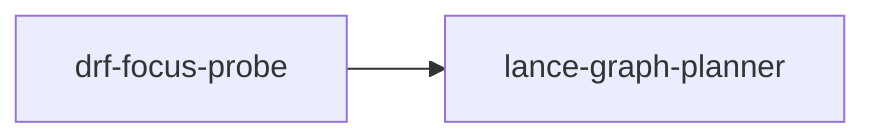

# drf-focus-probe

crate: drf-focus-probe
path: crates/drf-focus-probe
workspace: excluded
digest: bc1dcb22072bc2dd
evidence legend: ../index.md#evidence-legend

Generated; the code is the truth. See ../index.md.

## Depends on

- dep lance-graph-contract dev — crates/drf-focus-probe/Cargo.toml:27 CONFIRMED
- dep lance-graph-mask-risc dev — crates/drf-focus-probe/Cargo.toml:32 CONFIRMED
- dep lance-graph-planner dev — crates/drf-focus-probe/Cargo.toml:26 CONFIRMED
- dep lance-graph-planner normal optional — crates/drf-focus-probe/Cargo.toml:19 CONFIRMED
- dep lance-graph-quack dev — crates/drf-focus-probe/Cargo.toml:31 CONFIRMED
- dep lance-graph-relalg dev — crates/drf-focus-probe/Cargo.toml:33 CONFIRMED
- dep lance-graph-supervisor dev — crates/drf-focus-probe/Cargo.toml:25 CONFIRMED
- dep ndarray normal — crates/drf-focus-probe/Cargo.toml:17 CONFIRMED
- dep tokio dev — crates/drf-focus-probe/Cargo.toml:28 CONFIRMED

## Depended on by

## Public items

- fn RowImage::into_slot [pub] cfg=feature="handoff" — crates/drf-focus-probe/src/handoff.rs:22 CONFIRMED
- fn into_slots [pub] cfg=feature="handoff" — crates/drf-focus-probe/src/handoff.rs:39 CONFIRMED
- mod handoff [pub] cfg=feature="handoff" — crates/drf-focus-probe/src/lib.rs:12 CONFIRMED
- mod membership [pub] — crates/drf-focus-probe/src/lib.rs:13 CONFIRMED
- const ROW [pub] — crates/drf-focus-probe/src/lib.rs:16 CONFIRMED
- type Row [pub] — crates/drf-focus-probe/src/lib.rs:18 CONFIRMED
- const SLOTS [pub] — crates/drf-focus-probe/src/lib.rs:20 CONFIRMED
- const TILE_WORDS [pub] — crates/drf-focus-probe/src/lib.rs:22 CONFIRMED
- struct SourceId [pub] — crates/drf-focus-probe/src/lib.rs:26 CONFIRMED
- struct Soa [pub] — crates/drf-focus-probe/src/lib.rs:35 CONFIRMED
- struct MapId [pub] — crates/drf-focus-probe/src/lib.rs:41 CONFIRMED
- struct Scope [pub] — crates/drf-focus-probe/src/lib.rs:45 CONFIRMED
- struct SealedMap [pub] — crates/drf-focus-probe/src/lib.rs:48 CONFIRMED
- fn SealedMap::new [pub] — crates/drf-focus-probe/src/lib.rs:55 CONFIRMED
- struct FocusKey [pub] — crates/drf-focus-probe/src/lib.rs:62 CONFIRMED
- struct Facet [pub] — crates/drf-focus-probe/src/lib.rs:73 CONFIRMED
- const Facet::WIDTH [pub] — crates/drf-focus-probe/src/lib.rs:78 CONFIRMED
- fn Facet::new [pub] — crates/drf-focus-probe/src/lib.rs:79 CONFIRMED
- fn Facet::offset [pub] — crates/drf-focus-probe/src/lib.rs:85 CONFIRMED
- enum Refusal [pub] — crates/drf-focus-probe/src/lib.rs:91 CONFIRMED
- struct Focus [pub] — crates/drf-focus-probe/src/lib.rs:143 CONFIRMED
- fn Focus::key [pub] — crates/drf-focus-probe/src/lib.rs:177 CONFIRMED
- fn Focus::map [pub] — crates/drf-focus-probe/src/lib.rs:180 CONFIRMED
- fn Focus::column [pub] — crates/drf-focus-probe/src/lib.rs:183 CONFIRMED
- fn Focus::sum_where [pub] — crates/drf-focus-probe/src/lib.rs:188 CONFIRMED
- const FOCUS_BYTES [pub] — crates/drf-focus-probe/src/lib.rs:197 CONFIRMED
- struct BudgetReport [pub] — crates/drf-focus-probe/src/lib.rs:201 CONFIRMED
- enum Evict [pub] — crates/drf-focus-probe/src/lib.rs:214 CONFIRMED
- struct FocusManager [pub] — crates/drf-focus-probe/src/lib.rs:229 CONFIRMED
- fn FocusManager::new [pub] — crates/drf-focus-probe/src/lib.rs:236 CONFIRMED
- fn FocusManager::load [pub] — crates/drf-focus-probe/src/lib.rs:241 CONFIRMED
- fn FocusManager::retire [pub] — crates/drf-focus-probe/src/lib.rs:281 CONFIRMED
- fn FocusManager::evict_unused [pub] — crates/drf-focus-probe/src/lib.rs:289 CONFIRMED
- fn FocusManager::resident_bytes [pub] — crates/drf-focus-probe/src/lib.rs:300 CONFIRMED
- fn FocusManager::evict_to_budget [pub] — crates/drf-focus-probe/src/lib.rs:313 CONFIRMED
- fn FocusManager::evict_to_budget_by [pub] — crates/drf-focus-probe/src/lib.rs:319 CONFIRMED
- fn FocusManager::len [pub] — crates/drf-focus-probe/src/lib.rs:359 CONFIRMED
- fn FocusManager::is_empty [pub] — crates/drf-focus-probe/src/lib.rs:362 CONFIRMED
- fn FocusManager::builds [pub] — crates/drf-focus-probe/src/lib.rs:365 CONFIRMED
- fn direct_sum_where [pub] — crates/drf-focus-probe/src/lib.rs:373 CONFIRMED
- struct RowImage [pub] — crates/drf-focus-probe/src/lib.rs:424 CONFIRMED
- struct Writeback [pub] — crates/drf-focus-probe/src/lib.rs:431 CONFIRMED
- fn Focus::writeback [pub] — crates/drf-focus-probe/src/lib.rs:437 CONFIRMED
- fn Writeback<'_>::stage [pub] — crates/drf-focus-probe/src/lib.rs:448 CONFIRMED
- fn Writeback<'_>::stage_at [pub] — crates/drf-focus-probe/src/lib.rs:455 CONFIRMED
- fn Writeback<'_>::dirty_rows [pub] — crates/drf-focus-probe/src/lib.rs:488 CONFIRMED
- fn Writeback<'_>::flush [pub] — crates/drf-focus-probe/src/lib.rs:500 CONFIRMED
- type SlotMask [pub] — crates/drf-focus-probe/src/membership.rs:25 CONFIRMED
- struct BoundMap [pub] — crates/drf-focus-probe/src/membership.rs:28 CONFIRMED
- fn BoundMap::bind [pub] — crates/drf-focus-probe/src/membership.rs:38 CONFIRMED
- fn BoundMap::source [pub] — crates/drf-focus-probe/src/membership.rs:61 CONFIRMED
- struct RowSet [pub] — crates/drf-focus-probe/src/membership.rs:67 CONFIRMED
- fn RowSet::new [pub] — crates/drf-focus-probe/src/membership.rs:76 CONFIRMED
- fn membership [pub] — crates/drf-focus-probe/src/membership.rs:103 CONFIRMED

## Imports from in-scope crates

### lance-graph-planner
- use lance_graph_planner::persist_sink::CycleId cfg=feature="handoff" — crates/drf-focus-probe/src/handoff.rs:16 CONFIRMED
- use lance_graph_planner::persist_sink::MailboxId cfg=feature="handoff" — crates/drf-focus-probe/src/handoff.rs:16 CONFIRMED
- use lance_graph_planner::persist_sink::SweepSlot cfg=feature="handoff" — crates/drf-focus-probe/src/handoff.rs:16 CONFIRMED

## Calls

CALL_GRAPH=ARTIFACT_MISSING
- calls ARTIFACT_MISSING — no ruff_charon artifact for this crate UNKNOWN

## Architecture

- none

Generated from Cargo manifests — extracted relationships only.

