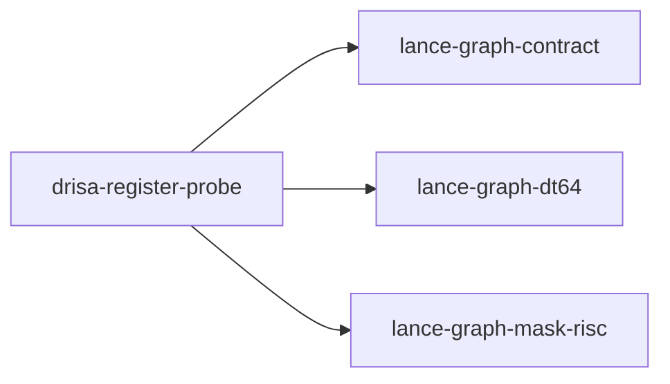

# drisa-register-probe

crate: drisa-register-probe
path: crates/drisa-register-probe
workspace: excluded
digest: 768c284303f15cf2
evidence legend: ../index.md#evidence-legend

Generated; the code is the truth. See ../index.md.

## Depends on

- dep lance-graph-contract normal — crates/drisa-register-probe/Cargo.toml:21 CONFIRMED
- dep lance-graph-dt64 normal — crates/drisa-register-probe/Cargo.toml:19 CONFIRMED
- dep lance-graph-mask-risc normal — crates/drisa-register-probe/Cargo.toml:20 CONFIRMED
- dep ndarray normal — crates/drisa-register-probe/Cargo.toml:24 CONFIRMED

## Depended on by

## Public items

- const MAX_PLANES [pub] — crates/drisa-register-probe/src/alu.rs:27 CONFIRMED
- fn kofn [pub] — crates/drisa-register-probe/src/alu.rs:90 CONFIRMED
- fn kofn_kleene [pub] — crates/drisa-register-probe/src/alu.rs:104 CONFIRMED
- fn bag_at_least [pub] — crates/drisa-register-probe/src/alu.rs:134 CONFIRMED
- fn kofn_bytes [pub] — crates/drisa-register-probe/src/alu.rs:158 CONFIRMED
- fn three_of_five_sop [pub] — crates/drisa-register-probe/src/alu.rs:180 CONFIRMED
- mod alu [pub] — crates/drisa-register-probe/src/lib.rs:31 CONFIRMED
- enum Refusal [pub] — crates/drisa-register-probe/src/lib.rs:48 CONFIRMED
- struct ValueWitness [pub] — crates/drisa-register-probe/src/lib.rs:95 CONFIRMED
- struct Soa [pub] — crates/drisa-register-probe/src/lib.rs:106 CONFIRMED
- fn Soa::n_rows [pub] — crates/drisa-register-probe/src/lib.rs:118 CONFIRMED
- fn Soa::revision [pub] — crates/drisa-register-probe/src/lib.rs:122 CONFIRMED
- fn Soa::witness [pub] — crates/drisa-register-probe/src/lib.rs:127 CONFIRMED
- fn Soa::field_count [pub] — crates/drisa-register-probe/src/lib.rs:134 CONFIRMED
- fn Soa::field_ptr [pub] — crates/drisa-register-probe/src/lib.rs:140 CONFIRMED
- fn Soa::presence_ptr [pub] — crates/drisa-register-probe/src/lib.rs:144 CONFIRMED
- fn Soa::write [pub] — crates/drisa-register-probe/src/lib.rs:149 CONFIRMED
- fn Soa::row_of [pub] — crates/drisa-register-probe/src/lib.rs:156 CONFIRMED
- struct Fixture [pub] — crates/drisa-register-probe/src/lib.rs:172 CONFIRMED
- fn Fixture::new [pub] — crates/drisa-register-probe/src/lib.rs:188 CONFIRMED
- fn Fixture::count [pub] — crates/drisa-register-probe/src/lib.rs:209 CONFIRMED
- fn Fixture::where_gt [pub] — crates/drisa-register-probe/src/lib.rs:224 CONFIRMED
- fn Fixture::set [pub] — crates/drisa-register-probe/src/lib.rs:246 CONFIRMED
- fn Fixture::ids [pub] — crates/drisa-register-probe/src/lib.rs:252 CONFIRMED
- fn Fixture::present [pub] — crates/drisa-register-probe/src/lib.rs:257 CONFIRMED
- fn build_table [pub] — crates/drisa-register-probe/src/lib.rs:264 CONFIRMED
- fn build_soa [pub] — crates/drisa-register-probe/src/lib.rs:295 CONFIRMED
- fn lookups [pub] — crates/drisa-register-probe/src/lib.rs:334 CONFIRMED
- struct Checks [pub] — crates/drisa-register-probe/src/lib.rs:346 CONFIRMED
- const Checks::ALL [pub] — crates/drisa-register-probe/src/lib.rs:355 CONFIRMED
- struct RegisterFile [pub] — crates/drisa-register-probe/src/lib.rs:366 CONFIRMED
- enum MethodOp [pub] — crates/drisa-register-probe/src/lib.rs:388 CONFIRMED
- fn MethodOp::demand [pub] — crates/drisa-register-probe/src/lib.rs:404 CONFIRMED
- struct Compiled [pub] — crates/drisa-register-probe/src/lib.rs:417 CONFIRMED
- fn RegisterFile::bind [pub] — crates/drisa-register-probe/src/lib.rs:434 CONFIRMED
- fn RegisterFile::rebind_values [pub] — crates/drisa-register-probe/src/lib.rs:506 CONFIRMED
- fn RegisterFile::compile [pub] — crates/drisa-register-probe/src/lib.rs:539 CONFIRMED
- fn RegisterFile::scratch [pub] — crates/drisa-register-probe/src/lib.rs:623 CONFIRMED
- fn RegisterFile::with_planes [pub] — crates/drisa-register-probe/src/lib.rs:629 CONFIRMED
- fn RegisterFile::run [pub] — crates/drisa-register-probe/src/lib.rs:673 CONFIRMED
- fn RegisterFile::derive_gt [pub] — crates/drisa-register-probe/src/lib.rs:702 CONFIRMED
- fn RegisterFile::owned_bytes [pub] — crates/drisa-register-probe/src/lib.rs:736 CONFIRMED
- fn run_direct [pub] — crates/drisa-register-probe/src/lib.rs:755 CONFIRMED
- fn Compiled::program [pub] — crates/drisa-register-probe/src/lib.rs:777 CONFIRMED
- fn RegisterFile::selection [pub] — crates/drisa-register-probe/src/lib.rs:784 CONFIRMED

## Imports from in-scope crates

### lance-graph-contract
- use lance_graph_contract::class_view::WideFieldMask — crates/drisa-register-probe/src/lib.rs:35 CONFIRMED
### lance-graph-dt64
- use lance_graph_dt64::dr::Frame — crates/drisa-register-probe/src/lib.rs:37 CONFIRMED
- use lance_graph_dt64::dr::FrameRevisions — crates/drisa-register-probe/src/lib.rs:37 CONFIRMED
- use lance_graph_dt64::dr::LocalMap — crates/drisa-register-probe/src/lib.rs:37 CONFIRMED
- use lance_graph_dt64::dr::MapRead — crates/drisa-register-probe/src/lib.rs:37 CONFIRMED
- use lance_graph_dt64::dr::MapTable — crates/drisa-register-probe/src/lib.rs:37 CONFIRMED
- use lance_graph_dt64::dr::Scope — crates/drisa-register-probe/src/lib.rs:37 CONFIRMED
- use lance_graph_dt64::dr::TileId — crates/drisa-register-probe/src/lib.rs:37 CONFIRMED
- use lance_graph_dt64::dr::Width — crates/drisa-register-probe/src/lib.rs:37 CONFIRMED
- use lance_graph_dt64::ValueDemand — crates/drisa-register-probe/src/lib.rs:39 CONFIRMED
### lance-graph-mask-risc
- use lance_graph_mask_risc::ExecError — crates/drisa-register-probe/src/lib.rs:41 CONFIRMED
- use lance_graph_mask_risc::Foreign — crates/drisa-register-probe/src/lib.rs:41 CONFIRMED
- use lance_graph_mask_risc::LaneRef — crates/drisa-register-probe/src/lib.rs:41 CONFIRMED
- use lance_graph_mask_risc::MaskOp — crates/drisa-register-probe/src/lib.rs:41 CONFIRMED
- use lance_graph_mask_risc::Operand — crates/drisa-register-probe/src/lib.rs:41 CONFIRMED
- use lance_graph_mask_risc::Out — crates/drisa-register-probe/src/lib.rs:41 CONFIRMED
- use lance_graph_mask_risc::Planes — crates/drisa-register-probe/src/lib.rs:41 CONFIRMED
- use lance_graph_mask_risc::Pred — crates/drisa-register-probe/src/lib.rs:41 CONFIRMED
- use lance_graph_mask_risc::execute — crates/drisa-register-probe/src/lib.rs:41 CONFIRMED
- use lance_graph_mask_risc::execute_into — crates/drisa-register-probe/src/lib.rs:41 CONFIRMED
- use lance_graph_mask_risc::Program — crates/drisa-register-probe/src/lib.rs:42 CONFIRMED
- use lance_graph_mask_risc::Scratch — crates/drisa-register-probe/src/lib.rs:42 CONFIRMED
- use lance_graph_mask_risc::Terminal — crates/drisa-register-probe/src/lib.rs:42 CONFIRMED
- use lance_graph_mask_risc::Value — crates/drisa-register-probe/src/lib.rs:42 CONFIRMED

## Calls

CALL_GRAPH=ARTIFACT_MISSING
- calls ARTIFACT_MISSING — no ruff_charon artifact for this crate UNKNOWN

## Architecture

- none

Generated from Cargo manifests — extracted relationships only.

