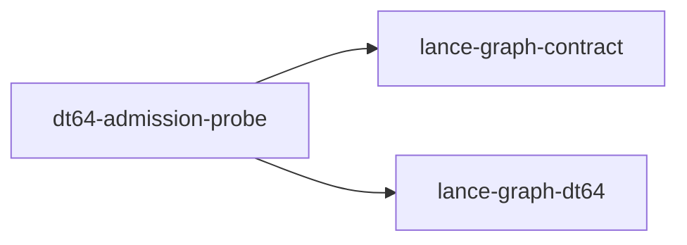

# dt64-admission-probe

crate: dt64-admission-probe
path: crates/dt64-admission-probe
workspace: excluded
digest: 87cddaa68532925e
evidence legend: ../index.md#evidence-legend

Generated; the code is the truth. See ../index.md.

## Depends on

- dep lance-graph-contract normal — crates/dt64-admission-probe/Cargo.toml:19 CONFIRMED
- dep lance-graph-dt64 normal — crates/dt64-admission-probe/Cargo.toml:18 CONFIRMED

## Depended on by

## Public items

- enum Relation [pub] — crates/dt64-admission-probe/src/evidence.rs:22 CONFIRMED
- fn Relation::parse [pub] — crates/dt64-admission-probe/src/evidence.rs:34 CONFIRMED
- fn Relation::evidence [pub] — crates/dt64-admission-probe/src/evidence.rs:49 CONFIRMED
- enum Evidence [pub] — crates/dt64-admission-probe/src/evidence.rs:64 CONFIRMED
- fn Evidence::parse [pub] — crates/dt64-admission-probe/src/evidence.rs:74 CONFIRMED
- struct Row [pub] — crates/dt64-admission-probe/src/evidence.rs:86 CONFIRMED
- enum RowError [pub] — crates/dt64-admission-probe/src/evidence.rs:96 CONFIRMED
- const HEADER [pub] — crates/dt64-admission-probe/src/evidence.rs:120 CONFIRMED
- fn parse_rows [pub] — crates/dt64-admission-probe/src/evidence.rs:123 CONFIRMED
- const SPAN_JOINED_ROWS [pub] — crates/dt64-admission-probe/src/fixture.rs:50 CONFIRMED
- const PATH_JOINED_ROWS [pub] — crates/dt64-admission-probe/src/fixture.rs:89 CONFIRMED
- const CLASS [pub] — crates/dt64-admission-probe/src/fixture.rs:97 CONFIRMED
- const LENS [pub] — crates/dt64-admission-probe/src/fixture.rs:99 CONFIRMED
- const POPCOUNT [pub] — crates/dt64-admission-probe/src/fixture.rs:102 CONFIRMED
- const FIELD_X [pub] — crates/dt64-admission-probe/src/fixture.rs:108 CONFIRMED
- const FIELD_COUNT [pub] — crates/dt64-admission-probe/src/fixture.rs:109 CONFIRMED
- const COUNT_BELOW [pub] — crates/dt64-admission-probe/src/fixture.rs:111 CONFIRMED
- const COUNT_WITH_TALLY [pub] — crates/dt64-admission-probe/src/fixture.rs:112 CONFIRMED
- const COUNT_DIV [pub] — crates/dt64-admission-probe/src/fixture.rs:113 CONFIRMED
- const COUNT_GENERIC [pub] — crates/dt64-admission-probe/src/fixture.rs:114 CONFIRMED
- const COUNT_DYN [pub] — crates/dt64-admission-probe/src/fixture.rs:115 CONFIRMED
- const MASK_BELOW [pub] — crates/dt64-admission-probe/src/fixture.rs:116 CONFIRMED
- const BELOW_TEST [pub] — crates/dt64-admission-probe/src/fixture.rs:117 CONFIRMED
- const UNATTACHED [pub] — crates/dt64-admission-probe/src/fixture.rs:119 CONFIRMED
- const SUBJECTS [pub] — crates/dt64-admission-probe/src/fixture.rs:122 CONFIRMED
- fn binding [pub] — crates/dt64-admission-probe/src/fixture.rs:135 CONFIRMED
- fn store [pub] — crates/dt64-admission-probe/src/fixture.rs:162 CONFIRMED
- fn method_ref [pub] — crates/dt64-admission-probe/src/fixture.rs:221 CONFIRMED
- fn rows [pub] — crates/dt64-admission-probe/src/fixture.rs:244 CONFIRMED
- fn span_joined [pub] — crates/dt64-admission-probe/src/fixture.rs:249 CONFIRMED
- fn path_joined [pub] — crates/dt64-admission-probe/src/fixture.rs:257 CONFIRMED
- mod evidence [pub] — crates/dt64-admission-probe/src/lib.rs:48 CONFIRMED
- mod fixture [pub] — crates/dt64-admission-probe/src/lib.rs:49 CONFIRMED
- struct Attachment [pub] — crates/dt64-admission-probe/src/lib.rs:59 CONFIRMED
- struct EvidenceSet [pub] — crates/dt64-admission-probe/src/lib.rs:71 CONFIRMED
- struct DoGrant [pub] — crates/dt64-admission-probe/src/lib.rs:80 CONFIRMED
- enum Request [pub] — crates/dt64-admission-probe/src/lib.rs:88 CONFIRMED
- enum Admitted [pub] — crates/dt64-admission-probe/src/lib.rs:97 CONFIRMED
- enum UnknownCause [pub] — crates/dt64-admission-probe/src/lib.rs:113 CONFIRMED
- enum ExecRefusal [pub] — crates/dt64-admission-probe/src/lib.rs:134 CONFIRMED
- enum EvidenceClass [pub] — crates/dt64-admission-probe/src/lib.rs:154 CONFIRMED
- struct ExecutionPolicy [pub] — crates/dt64-admission-probe/src/lib.rs:163 CONFIRMED
- const UNNAMED_IMPL [pub] — crates/dt64-admission-probe/src/lib.rs:171 CONFIRMED
- fn ExecutionPolicy::decide [pub] — crates/dt64-admission-probe/src/lib.rs:175 CONFIRMED
- fn ExecutionPolicy::classify [pub] — crates/dt64-admission-probe/src/lib.rs:217 CONFIRMED

## Imports from in-scope crates

### lance-graph-contract
- use lance_graph_contract::class_view::ClassId — crates/dt64-admission-probe/src/fixture.rs:37 CONFIRMED
- use lance_graph_contract::class_view::ClassView — crates/dt64-admission-probe/src/fixture.rs:37 CONFIRMED
- use lance_graph_contract::class_view::WideFieldMask — crates/dt64-admission-probe/src/fixture.rs:37 CONFIRMED
- use lance_graph_contract::ontology::DisplayTemplate — crates/dt64-admission-probe/src/fixture.rs:38 CONFIRMED
- use lance_graph_contract::ontology::FieldRef — crates/dt64-admission-probe/src/fixture.rs:38 CONFIRMED
- use lance_graph_contract::set_algebra::Cmp — crates/dt64-admission-probe/src/fixture.rs:39 CONFIRMED
- use lance_graph_contract::set_algebra::Logic — crates/dt64-admission-probe/src/fixture.rs:39 CONFIRMED
- use lance_graph_contract::set_algebra::SetExpr — crates/dt64-admission-probe/src/fixture.rs:39 CONFIRMED
- use lance_graph_contract::set_rules::Population — crates/dt64-admission-probe/src/fixture.rs:40 CONFIRMED
- use lance_graph_contract::set_rules::Truth — crates/dt64-admission-probe/src/fixture.rs:40 CONFIRMED
### lance-graph-dt64
- use lance_graph_dt64::AlgebraRef — crates/dt64-admission-probe/src/fixture.rs:42 CONFIRMED
- use lance_graph_dt64::Arg — crates/dt64-admission-probe/src/fixture.rs:42 CONFIRMED
- use lance_graph_dt64::BindStore — crates/dt64-admission-probe/src/fixture.rs:42 CONFIRMED
- use lance_graph_dt64::ClassSchema — crates/dt64-admission-probe/src/fixture.rs:42 CONFIRMED
- use lance_graph_dt64::Effect — crates/dt64-admission-probe/src/fixture.rs:42 CONFIRMED
- use lance_graph_dt64::Extent — crates/dt64-admission-probe/src/fixture.rs:42 CONFIRMED
- use lance_graph_dt64::Guard — crates/dt64-admission-probe/src/fixture.rs:42 CONFIRMED
- use lance_graph_dt64::MethodBinding — crates/dt64-admission-probe/src/fixture.rs:42 CONFIRMED
- use lance_graph_dt64::MethodId — crates/dt64-admission-probe/src/fixture.rs:42 CONFIRMED
- use lance_graph_dt64::MethodRef — crates/dt64-admission-probe/src/fixture.rs:43 CONFIRMED
- use lance_graph_dt64::SchemaRev — crates/dt64-admission-probe/src/fixture.rs:43 CONFIRMED
- use lance_graph_dt64::SigRev — crates/dt64-admission-probe/src/fixture.rs:43 CONFIRMED
- use lance_graph_dt64::ValueDemand — crates/dt64-admission-probe/src/fixture.rs:43 CONFIRMED
- use lance_graph_dt64::BindStore — crates/dt64-admission-probe/src/lib.rs:54 CONFIRMED
- use lance_graph_dt64::MethodBinding — crates/dt64-admission-probe/src/lib.rs:54 CONFIRMED
- use lance_graph_dt64::MethodId — crates/dt64-admission-probe/src/lib.rs:54 CONFIRMED
- use lance_graph_dt64::MethodRef — crates/dt64-admission-probe/src/lib.rs:54 CONFIRMED
- use lance_graph_dt64::Refusal — crates/dt64-admission-probe/src/lib.rs:54 CONFIRMED
- use lance_graph_dt64::SigRev — crates/dt64-admission-probe/src/lib.rs:54 CONFIRMED

## Calls

CALL_GRAPH=ARTIFACT_MISSING
- calls ARTIFACT_MISSING — no ruff_charon artifact for this crate UNKNOWN

## Architecture

- arch RBAC applied-to DT64 binding [GAP] validation=EXTERNAL — #1997 GAP

Generated from Cargo manifests — extracted relationships only.

