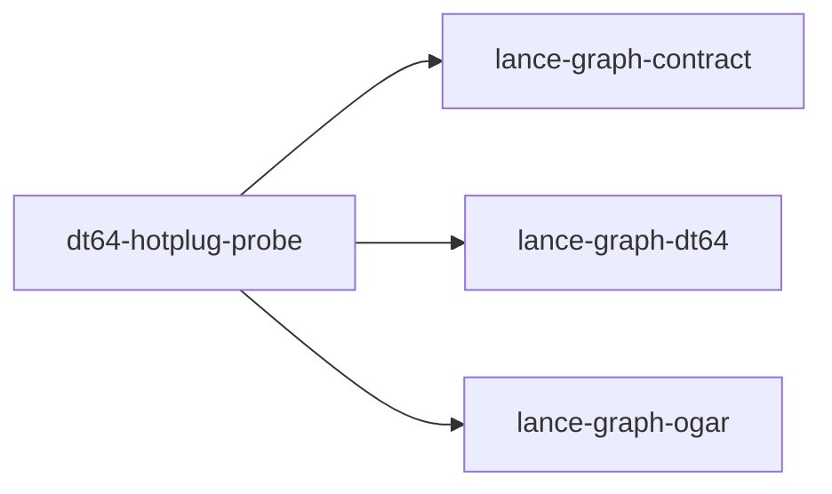

# dt64-hotplug-probe

crate: dt64-hotplug-probe
path: crates/dt64-hotplug-probe
workspace: excluded
digest: c43e2257308e1dea
evidence legend: ../index.md#evidence-legend

Generated; the code is the truth. See ../index.md.

## Depends on

- dep lance-graph-contract normal — crates/dt64-hotplug-probe/Cargo.toml:18 CONFIRMED
- dep lance-graph-dt64 normal — crates/dt64-hotplug-probe/Cargo.toml:19 CONFIRMED
- dep lance-graph-ogar normal — crates/dt64-hotplug-probe/Cargo.toml:22 CONFIRMED

## Depended on by

## Public items

- enum Unbound [pub] — crates/dt64-hotplug-probe/src/lib.rs:46 CONFIRMED
- fn register_activated [pub] — crates/dt64-hotplug-probe/src/lib.rs:58 CONFIRMED

## Imports from in-scope crates

### lance-graph-contract
- use lance_graph_contract::canonical_node::ReadMode — crates/dt64-hotplug-probe/src/lib.rs:35 CONFIRMED
- use lance_graph_contract::class_view::ClassView — crates/dt64-hotplug-probe/src/lib.rs:36 CONFIRMED
- use lance_graph_contract::hotplug::Activation — crates/dt64-hotplug-probe/src/lib.rs:37 CONFIRMED
- use lance_graph_contract::hotplug::ActivationDrift — crates/dt64-hotplug-probe/src/lib.rs:37 CONFIRMED
- use lance_graph_contract::ogar_codebook::classid_concept — crates/dt64-hotplug-probe/src/lib.rs:38 CONFIRMED
- use lance_graph_contract::hotplug::CapabilityAuthority cfg=doc — crates/dt64-hotplug-probe/src/lib.rs:42 CONFIRMED
- use lance_graph_contract::hotplug::HotPlug cfg=doc — crates/dt64-hotplug-probe/src/lib.rs:42 CONFIRMED
### lance-graph-dt64
- use lance_graph_dt64::BindStore — crates/dt64-hotplug-probe/src/lib.rs:39 CONFIRMED
- use lance_graph_dt64::ClassSchema — crates/dt64-hotplug-probe/src/lib.rs:39 CONFIRMED
- use lance_graph_dt64::MethodBinding — crates/dt64-hotplug-probe/src/lib.rs:39 CONFIRMED
- use lance_graph_dt64::Refusal — crates/dt64-hotplug-probe/src/lib.rs:39 CONFIRMED

## Calls

CALL_GRAPH=ARTIFACT_MISSING
- calls ARTIFACT_MISSING — no ruff_charon artifact for this crate UNKNOWN

## Architecture

- none

Generated from Cargo manifests — extracted relationships only.

