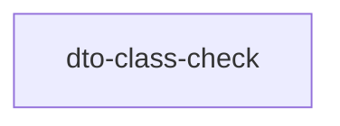

# dto-class-check

crate: dto-class-check
path: tools/dto-class-check
workspace: member
digest: 2767f7b327d59326
evidence legend: ../index.md#evidence-legend

Generated; the code is the truth. See ../index.md.

## Depends on

- dep syn normal — tools/dto-class-check/Cargo.toml:13 CONFIRMED
- dep walkdir normal — tools/dto-class-check/Cargo.toml:14 CONFIRMED

## Depended on by

## Public items

## Imports from in-scope crates

- none

## Calls

CALL_GRAPH=ARTIFACT_MISSING
- calls ARTIFACT_MISSING — no ruff_charon artifact for this crate UNKNOWN

## Architecture

- none

Generated from Cargo manifests — extracted relationships only.

