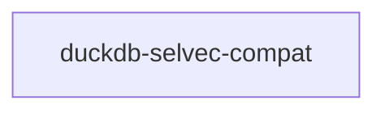

# duckdb-selvec-compat

crate: duckdb-selvec-compat
path: crates/duckdb-selvec-compat
workspace: excluded
digest: 1aeaec508586352f
evidence legend: ../index.md#evidence-legend

Generated; the code is the truth. See ../index.md.

## Depends on

- dep lance-graph-mask-risc dev — crates/duckdb-selvec-compat/Cargo.toml:19 CONFIRMED

## Depended on by

## Public items

- type IdxT [pub] — crates/duckdb-selvec-compat/src/lib.rs:55 CONFIRMED
- type SelT [pub] — crates/duckdb-selvec-compat/src/lib.rs:57 CONFIRMED
- struct DuckdbSelectionVectorOpaque [pub] — crates/duckdb-selvec-compat/src/lib.rs:62 CONFIRMED
- type DuckdbSelectionVector [pub] — crates/duckdb-selvec-compat/src/lib.rs:67 CONFIRMED
- fn create_selection_vector [pub] — crates/duckdb-selvec-compat/src/lib.rs:85 CONFIRMED
- fn destroy_selection_vector [pub] — crates/duckdb-selvec-compat/src/lib.rs:108 CONFIRMED
- fn selection_vector_get_data_ptr [pub] — crates/duckdb-selvec-compat/src/lib.rs:128 CONFIRMED
- struct CopyReceipt [pub] — crates/duckdb-selvec-compat/src/lib.rs:138 CONFIRMED
- fn selection_from_positions [pub] — crates/duckdb-selvec-compat/src/lib.rs:151 CONFIRMED
- fn capacity [pub] — crates/duckdb-selvec-compat/src/lib.rs:171 CONFIRMED
- fn positions [pub] — crates/duckdb-selvec-compat/src/lib.rs:186 CONFIRMED

## Imports from in-scope crates

- none

## Calls

CALL_GRAPH=ARTIFACT_MISSING
- calls ARTIFACT_MISSING — no ruff_charon artifact for this crate UNKNOWN

## Architecture

- none

Generated from Cargo manifests — extracted relationships only.

