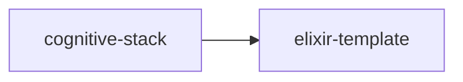

# elixir-template

crate: elixir-template
path: crates/elixir-template
workspace: excluded
digest: 0258102e8c8830eb
evidence legend: ../index.md#evidence-legend

Generated; the code is the truth. See ../index.md.

## Depends on

## Depended on by

- rdep cognitive-stack normal — crates/cognitive-stack/Cargo.toml:38 CONFIRMED

## Public items

- enum OgarAction [pub] — crates/elixir-template/src/lib.rs:30 CONFIRMED
- fn OgarAction::from_atom [pub] — crates/elixir-template/src/lib.rs:44 CONFIRMED
- fn OgarAction::ogar_name [pub] — crates/elixir-template/src/lib.rs:58 CONFIRMED
- struct Step [pub] — crates/elixir-template/src/lib.rs:89 CONFIRMED
- struct OsintGuardrail [pub] — crates/elixir-template/src/lib.rs:97 CONFIRMED
- struct ElixirTemplate [pub] — crates/elixir-template/src/lib.rs:106 CONFIRMED
- enum ParseError [pub] — crates/elixir-template/src/lib.rs:116 CONFIRMED
- fn ElixirTemplate::parse [pub] — crates/elixir-template/src/lib.rs:137 CONFIRMED
- fn ElixirTemplate::builder [pub] — crates/elixir-template/src/lib.rs:158 CONFIRMED
- fn ElixirTemplate::ogar_action_names [pub] — crates/elixir-template/src/lib.rs:163 CONFIRMED
- fn ElixirTemplate::to_source [pub] — crates/elixir-template/src/lib.rs:171 CONFIRMED
- struct Builder [pub] — crates/elixir-template/src/lib.rs:190 CONFIRMED
- fn Builder::version [pub] — crates/elixir-template/src/lib.rs:198 CONFIRMED
- fn Builder::step [pub] — crates/elixir-template/src/lib.rs:203 CONFIRMED
- fn Builder::osint [pub] — crates/elixir-template/src/lib.rs:208 CONFIRMED
- fn Builder::build [pub] — crates/elixir-template/src/lib.rs:212 CONFIRMED
- fn source_ranking_v1 [pub] — crates/elixir-template/src/lib.rs:312 CONFIRMED

## Imports from in-scope crates

- none

## Calls

CALL_GRAPH=ARTIFACT_MISSING
- calls ARTIFACT_MISSING — no ruff_charon artifact for this crate UNKNOWN

## Architecture

- none

Generated from Cargo manifests — extracted relationships only.

