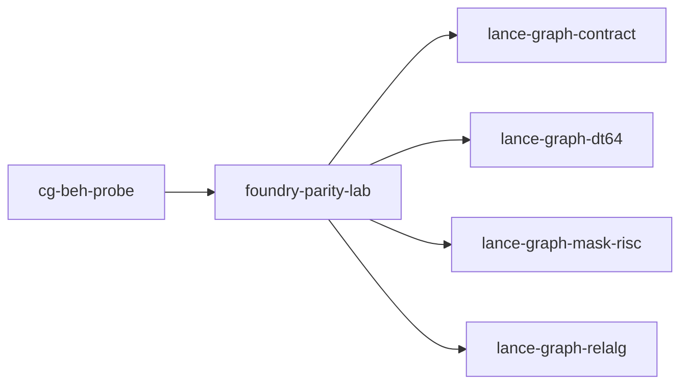

# foundry-parity-lab

crate: foundry-parity-lab
path: crates/foundry-parity-lab
workspace: excluded
digest: ab250d1e8e47f4fa
evidence legend: ../index.md#evidence-legend

Generated; the code is the truth. See ../index.md.

## Depends on

- dep lance-graph-contract normal — crates/foundry-parity-lab/Cargo.toml:24 CONFIRMED
- dep lance-graph-dt64 normal — crates/foundry-parity-lab/Cargo.toml:22 CONFIRMED
- dep lance-graph-mask-risc normal — crates/foundry-parity-lab/Cargo.toml:23 CONFIRMED
- dep lance-graph-relalg normal — crates/foundry-parity-lab/Cargo.toml:26 CONFIRMED
- dep ndarray normal — crates/foundry-parity-lab/Cargo.toml:29 CONFIRMED

## Depended on by

- rdep cg-beh-probe normal — crates/cg-beh-probe/Cargo.toml:29 CONFIRMED

## Public items

- struct StoreObject [pub] — crates/foundry-parity-lab/src/arm_a.rs:13 CONFIRMED
- struct Objects [pub] — crates/foundry-parity-lab/src/arm_a.rs:26 CONFIRMED
- fn Objects::build [pub] — crates/foundry-parity-lab/src/arm_a.rs:32 CONFIRMED
- fn Objects::bytes [pub] — crates/foundry-parity-lab/src/arm_a.rs:51 CONFIRMED
- fn Objects::can_cook [pub] — crates/foundry-parity-lab/src/arm_a.rs:66 CONFIRMED
- fn Objects::store_cost [pub] — crates/foundry-parity-lab/src/arm_a.rs:104 CONFIRMED
- fn Objects::store_costs [pub] — crates/foundry-parity-lab/src/arm_a.rs:119 CONFIRMED
- fn Objects::network_capacity [pub] — crates/foundry-parity-lab/src/arm_a.rs:139 CONFIRMED
- const Q_MAX [pub] — crates/foundry-parity-lab/src/arm_b.rs:32 CONFIRMED
- fn demanded_fields [pub] — crates/foundry-parity-lab/src/arm_b.rs:35 CONFIRMED
- struct Guards [pub] — crates/foundry-parity-lab/src/arm_b.rs:61 CONFIRMED
- const Guards::ALL [pub] — crates/foundry-parity-lab/src/arm_b.rs:69 CONFIRMED
- enum Answer [pub] — crates/foundry-parity-lab/src/arm_b.rs:77 CONFIRMED
- enum ArmRefusal [pub] — crates/foundry-parity-lab/src/arm_b.rs:85 CONFIRMED
- struct ItemQuery [pub] — crates/foundry-parity-lab/src/arm_b.rs:128 CONFIRMED
- fn ItemQuery<'s>::open [pub] — crates/foundry-parity-lab/src/arm_b.rs:140 CONFIRMED
- fn ItemQuery<'s>::cook_mask [pub] — crates/foundry-parity-lab/src/arm_b.rs:291 CONFIRMED
- fn ItemQuery<'s>::denied_mask [pub] — crates/foundry-parity-lab/src/arm_b.rs:296 CONFIRMED
- fn ItemQuery<'s>::unknown_mask [pub] — crates/foundry-parity-lab/src/arm_b.rs:302 CONFIRMED
- fn ItemQuery<'s>::store_at [pub] — crates/foundry-parity-lab/src/arm_b.rs:326 CONFIRMED
- fn ItemQuery<'s>::max_quantities [pub] — crates/foundry-parity-lab/src/arm_b.rs:333 CONFIRMED
- fn ItemQuery<'s>::answers [pub] — crates/foundry-parity-lab/src/arm_b.rs:356 CONFIRMED
- fn ItemQuery<'s>::network_capacity [pub] — crates/foundry-parity-lab/src/arm_b.rs:384 CONFIRMED
- fn ItemQuery<'s>::network_cost [pub] — crates/foundry-parity-lab/src/arm_b.rs:403 CONFIRMED
- fn ItemQuery<'s>::fulfill_mask [pub] — crates/foundry-parity-lab/src/arm_b.rs:422 CONFIRMED
- fn demanded_categories [pub] — crates/foundry-parity-lab/src/arm_c.rs:45 CONFIRMED
- fn cost_fields [pub] — crates/foundry-parity-lab/src/arm_c.rs:55 CONFIRMED
- enum CostRefusal [pub] — crates/foundry-parity-lab/src/arm_c.rs:66 CONFIRMED
- struct PreparedDemand [pub] — crates/foundry-parity-lab/src/arm_c.rs:109 CONFIRMED
- fn PreparedDemand::prepare [pub] — crates/foundry-parity-lab/src/arm_c.rs:116 CONFIRMED
- fn PreparedDemand::admit [pub] — crates/foundry-parity-lab/src/arm_c.rs:130 CONFIRMED
- struct CostQuery [pub] — crates/foundry-parity-lab/src/arm_c.rs:143 CONFIRMED
- fn CostQuery<'s>::open [pub] — crates/foundry-parity-lab/src/arm_c.rs:153 CONFIRMED
- fn CostQuery<'s>::staged_bytes [pub] — crates/foundry-parity-lab/src/arm_c.rs:219 CONFIRMED
- fn CostQuery<'s>::tier [pub] — crates/foundry-parity-lab/src/arm_c.rs:224 CONFIRMED
- fn CostQuery<'s>::per_store [pub] — crates/foundry-parity-lab/src/arm_c.rs:231 CONFIRMED
- const CLASS [pub] — crates/foundry-parity-lab/src/bind.rs:16 CONFIRMED
- const VIEW_CLASS [pub] — crates/foundry-parity-lab/src/bind.rs:18 CONFIRMED
- const POSITION [pub] — crates/foundry-parity-lab/src/bind.rs:20 CONFIRMED
- const READER [pub] — crates/foundry-parity-lab/src/bind.rs:23 CONFIRMED
- const SPACE_A [pub] — crates/foundry-parity-lab/src/bind.rs:25 CONFIRMED
- const SPACE_REVERSED [pub] — crates/foundry-parity-lab/src/bind.rs:30 CONFIRMED
- const STOCK0 [pub] — crates/foundry-parity-lab/src/bind.rs:35 CONFIRMED
- const KNOWN0 [pub] — crates/foundry-parity-lab/src/bind.rs:36 CONFIRMED
- const COST0 [pub] — crates/foundry-parity-lab/src/bind.rs:37 CONFIRMED
- const STAFF0 [pub] — crates/foundry-parity-lab/src/bind.rs:38 CONFIRMED
- const EQUIP0 [pub] — crates/foundry-parity-lab/src/bind.rs:39 CONFIRMED
- const OFFERED0 [pub] — crates/foundry-parity-lab/src/bind.rs:40 CONFIRMED
- const SLOTS [pub] — crates/foundry-parity-lab/src/bind.rs:41 CONFIRMED
- const MINUTES [pub] — crates/foundry-parity-lab/src/bind.rs:42 CONFIRMED
- const STORE_ID [pub] — crates/foundry-parity-lab/src/bind.rs:43 CONFIRMED
- const FIELD_COUNT [pub] — crates/foundry-parity-lab/src/bind.rs:45 CONFIRMED
- enum Kind [pub] — crates/foundry-parity-lab/src/bind.rs:49 CONFIRMED
- fn field [pub] — crates/foundry-parity-lab/src/bind.rs:62 CONFIRMED
- struct View [pub] — crates/foundry-parity-lab/src/bind.rs:92 CONFIRMED
- struct World [pub] — crates/foundry-parity-lab/src/bind.rs:111 CONFIRMED
- fn World::new [pub] — crates/foundry-parity-lab/src/bind.rs:125 CONFIRMED
- fn World::with_methods [pub] — crates/foundry-parity-lab/src/bind.rs:130 CONFIRMED
- fn World::bind [pub] — crates/foundry-parity-lab/src/bind.rs:162 CONFIRMED
- const STORES [pub] — crates/foundry-parity-lab/src/fixture.rs:10 CONFIRMED
- const CATEGORIES [pub] — crates/foundry-parity-lab/src/fixture.rs:14 CONFIRMED
- const EQUIPMENT [pub] — crates/foundry-parity-lab/src/fixture.rs:16 CONFIRMED
- const SKILLS [pub] — crates/foundry-parity-lab/src/fixture.rs:18 CONFIRMED
- const ITEMS [pub] — crates/foundry-parity-lab/src/fixture.rs:20 CONFIRMED
- const MENU_REV [pub] — crates/foundry-parity-lab/src/fixture.rs:23 CONFIRMED
- const STORE_ID_BASE [pub] — crates/foundry-parity-lab/src/fixture.rs:25 CONFIRMED
- mod case [pub] — crates/foundry-parity-lab/src/fixture.rs:28 CONFIRMED
- const ALL_GOOD [pub] — crates/foundry-parity-lab/src/fixture.rs:30 CONFIRMED
- const NO_CHEESE [pub] — crates/foundry-parity-lab/src/fixture.rs:32 CONFIRMED
- const NO_COOK [pub] — crates/foundry-parity-lab/src/fixture.rs:34 CONFIRMED
- const NO_OVEN [pub] — crates/foundry-parity-lab/src/fixture.rs:36 CONFIRMED
- const EXACTLY_ONE [pub] — crates/foundry-parity-lab/src/fixture.rs:38 CONFIRMED
- const RESTOCKED [pub] — crates/foundry-parity-lab/src/fixture.rs:40 CONFIRMED
- const HIDDEN [pub] — crates/foundry-parity-lab/src/fixture.rs:42 CONFIRMED
- const REORDERED [pub] — crates/foundry-parity-lab/src/fixture.rs:44 CONFIRMED
- const UNKNOWN_CHEESE [pub] — crates/foundry-parity-lab/src/fixture.rs:46 CONFIRMED
- const FLOUR [pub] — crates/foundry-parity-lab/src/fixture.rs:50 CONFIRMED
- const CHEESE [pub] — crates/foundry-parity-lab/src/fixture.rs:51 CONFIRMED
- const SAUCE [pub] — crates/foundry-parity-lab/src/fixture.rs:52 CONFIRMED
- const STALE [pub] — crates/foundry-parity-lab/src/fixture.rs:54 CONFIRMED
- struct Recipe [pub] — crates/foundry-parity-lab/src/fixture.rs:58 CONFIRMED
- fn mix [pub(crate)] — crates/foundry-parity-lab/src/fixture.rs:68 CONFIRMED
- fn recipe [pub] — crates/foundry-parity-lab/src/fixture.rs:81 CONFIRMED
- fn stock [pub] — crates/foundry-parity-lab/src/fixture.rs:116 CONFIRMED
- fn known [pub] — crates/foundry-parity-lab/src/fixture.rs:137 CONFIRMED
- fn unit_cost [pub] — crates/foundry-parity-lab/src/fixture.rs:145 CONFIRMED
- fn equipment [pub] — crates/foundry-parity-lab/src/fixture.rs:150 CONFIRMED
- fn staff [pub] — crates/foundry-parity-lab/src/fixture.rs:158 CONFIRMED
- fn offered [pub] — crates/foundry-parity-lab/src/fixture.rs:166 CONFIRMED
- fn delivery_slots [pub] — crates/foundry-parity-lab/src/fixture.rs:174 CONFIRMED
- fn delivery_minutes [pub] — crates/foundry-parity-lab/src/fixture.rs:182 CONFIRMED
- fn store_id [pub] — crates/foundry-parity-lab/src/fixture.rs:190 CONFIRMED
- const DENIED_STORE [pub] — crates/foundry-parity-lab/src/fixture.rs:195 CONFIRMED
- mod arm_a [pub] — crates/foundry-parity-lab/src/lib.rs:24 CONFIRMED
- mod arm_b [pub] — crates/foundry-parity-lab/src/lib.rs:25 CONFIRMED
- mod arm_c [pub] — crates/foundry-parity-lab/src/lib.rs:26 CONFIRMED
- mod bind [pub] — crates/foundry-parity-lab/src/lib.rs:27 CONFIRMED
- mod fixture [pub] — crates/foundry-parity-lab/src/lib.rs:28 CONFIRMED
- mod method [pub] — crates/foundry-parity-lab/src/lib.rs:29 CONFIRMED
- mod oracle [pub] — crates/foundry-parity-lab/src/lib.rs:30 CONFIRMED
- mod source [pub] — crates/foundry-parity-lab/src/lib.rs:31 CONFIRMED
- const QS [pub] — crates/foundry-parity-lab/src/method.rs:39 CONFIRMED
- fn method_id [pub] — crates/foundry-parity-lab/src/method.rs:42 CONFIRMED
- fn can_cook_guard [pub] — crates/foundry-parity-lab/src/method.rs:47 CONFIRMED
- fn can_cook_method [pub] — crates/foundry-parity-lab/src/method.rs:77 CONFIRMED
- fn methods [pub] — crates/foundry-parity-lab/src/method.rs:97 CONFIRMED
- enum MethodRefusal [pub] — crates/foundry-parity-lab/src/method.rs:105 CONFIRMED
- struct Executed [pub] — crates/foundry-parity-lab/src/method.rs:146 CONFIRMED
- struct PreparedMethod [pub] — crates/foundry-parity-lab/src/method.rs:200 CONFIRMED
- fn PreparedMethod<'s>::prepare [pub] — crates/foundry-parity-lab/src/method.rs:211 CONFIRMED
- fn PreparedMethod<'s>::run [pub] — crates/foundry-parity-lab/src/method.rs:295 CONFIRMED
- fn execute_can_cook [pub] — crates/foundry-parity-lab/src/method.rs:324 CONFIRMED
- enum Limit [pub] — crates/foundry-parity-lab/src/oracle.rs:8 CONFIRMED
- enum Cook [pub] — crates/foundry-parity-lab/src/oracle.rs:17 CONFIRMED
- struct Oracle [pub] — crates/foundry-parity-lab/src/oracle.rs:32 CONFIRMED
- const Oracle::BASELINE [pub] — crates/foundry-parity-lab/src/oracle.rs:39 CONFIRMED
- fn Oracle::can_cook [pub] — crates/foundry-parity-lab/src/oracle.rs:45 CONFIRMED
- fn Oracle::can_fulfill [pub] — crates/foundry-parity-lab/src/oracle.rs:81 CONFIRMED
- fn Oracle::network_capacity [pub] — crates/foundry-parity-lab/src/oracle.rs:93 CONFIRMED
- fn Oracle::store_cost [pub] — crates/foundry-parity-lab/src/oracle.rs:104 CONFIRMED
- fn Oracle::network_cost [pub] — crates/foundry-parity-lab/src/oracle.rs:118 CONFIRMED
- enum Plane [pub] — crates/foundry-parity-lab/src/source.rs:16 CONFIRMED
- enum Order [pub] — crates/foundry-parity-lab/src/source.rs:41 CONFIRMED
- fn Order::space [pub] — crates/foundry-parity-lab/src/source.rs:57 CONFIRMED
- struct Network [pub] — crates/foundry-parity-lab/src/source.rs:67 CONFIRMED
- fn Network::ingest [pub] — crates/foundry-parity-lab/src/source.rs:96 CONFIRMED
- fn Network::restock [pub] — crates/foundry-parity-lab/src/source.rs:134 CONFIRMED
- fn Network::set_unit_cost [pub] — crates/foundry-parity-lab/src/source.rs:153 CONFIRMED
- fn Network::order [pub] — crates/foundry-parity-lab/src/source.rs:168 CONFIRMED
- fn Network::resident_bytes [pub] — crates/foundry-parity-lab/src/source.rs:173 CONFIRMED

## Imports from in-scope crates

### lance-graph-contract
- use lance_graph_contract::class_view::ClassView — crates/foundry-parity-lab/src/arm_b.rs:19 CONFIRMED
- use lance_graph_contract::class_view::ClassView — crates/foundry-parity-lab/src/arm_c.rs:26 CONFIRMED
- use lance_graph_contract::class_view::ClassId — crates/foundry-parity-lab/src/bind.rs:4 CONFIRMED
- use lance_graph_contract::class_view::ClassView — crates/foundry-parity-lab/src/bind.rs:4 CONFIRMED
- use lance_graph_contract::class_view::WideFieldMask — crates/foundry-parity-lab/src/bind.rs:4 CONFIRMED
- use lance_graph_contract::ontology::DisplayTemplate — crates/foundry-parity-lab/src/bind.rs:5 CONFIRMED
- use lance_graph_contract::ontology::FieldRef — crates/foundry-parity-lab/src/bind.rs:5 CONFIRMED
- use lance_graph_contract::class_view::WideFieldMask — crates/foundry-parity-lab/src/method.rs:22 CONFIRMED
- use lance_graph_contract::set_algebra::Cmp — crates/foundry-parity-lab/src/method.rs:23 CONFIRMED
- use lance_graph_contract::set_algebra::Logic — crates/foundry-parity-lab/src/method.rs:23 CONFIRMED
- use lance_graph_contract::set_algebra::Res — crates/foundry-parity-lab/src/method.rs:23 CONFIRMED
- use lance_graph_contract::set_algebra::SetExpr — crates/foundry-parity-lab/src/method.rs:23 CONFIRMED
- use lance_graph_contract::set_rules::Population — crates/foundry-parity-lab/src/method.rs:24 CONFIRMED
- use lance_graph_contract::set_rules::Truth — crates/foundry-parity-lab/src/method.rs:24 CONFIRMED
- use lance_graph_contract::ontology::FieldRef — crates/foundry-parity-lab/src/source.rs:7 CONFIRMED
### lance-graph-dt64
- use lance_graph_dt64::dr::FrameStore — crates/foundry-parity-lab/src/arm_b.rs:20 CONFIRMED
- use lance_graph_dt64::BindStore — crates/foundry-parity-lab/src/arm_b.rs:21 CONFIRMED
- use lance_graph_dt64::LaneBinding — crates/foundry-parity-lab/src/arm_b.rs:21 CONFIRMED
- use lance_graph_dt64::LaneRefusal — crates/foundry-parity-lab/src/arm_b.rs:21 CONFIRMED
- use lance_graph_dt64::dr::FrameStore — crates/foundry-parity-lab/src/arm_c.rs:27 CONFIRMED
- use lance_graph_dt64::BindStore — crates/foundry-parity-lab/src/arm_c.rs:28 CONFIRMED
- use lance_graph_dt64::LaneBinding — crates/foundry-parity-lab/src/arm_c.rs:28 CONFIRMED
- use lance_graph_dt64::LaneRefusal — crates/foundry-parity-lab/src/arm_c.rs:28 CONFIRMED
- use lance_graph_dt64::LaneSource — crates/foundry-parity-lab/src/bin/bench.rs:15 CONFIRMED
- use lance_graph_dt64::dr::Extent — crates/foundry-parity-lab/src/bind.rs:6 CONFIRMED
- use lance_graph_dt64::dr::Scope — crates/foundry-parity-lab/src/bind.rs:6 CONFIRMED
- use lance_graph_dt64::BindStore — crates/foundry-parity-lab/src/bind.rs:8 CONFIRMED
- use lance_graph_dt64::ClassSchema — crates/foundry-parity-lab/src/bind.rs:8 CONFIRMED
- use lance_graph_dt64::CoordSpace — crates/foundry-parity-lab/src/bind.rs:8 CONFIRMED
- use lance_graph_dt64::LaneBinding — crates/foundry-parity-lab/src/bind.rs:8 CONFIRMED
- use lance_graph_dt64::LaneRefusal — crates/foundry-parity-lab/src/bind.rs:8 CONFIRMED
- use lance_graph_dt64::LaneRequest — crates/foundry-parity-lab/src/bind.rs:8 CONFIRMED
- use lance_graph_dt64::LaneSource — crates/foundry-parity-lab/src/bind.rs:8 CONFIRMED
- use lance_graph_dt64::RouteAt — crates/foundry-parity-lab/src/bind.rs:8 CONFIRMED
- use lance_graph_dt64::SchemaRev — crates/foundry-parity-lab/src/bind.rs:9 CONFIRMED
- use lance_graph_dt64::Guard — crates/foundry-parity-lab/src/method.rs:26 CONFIRMED
- use lance_graph_dt64::LaneRefusal — crates/foundry-parity-lab/src/method.rs:26 CONFIRMED
- use lance_graph_dt64::MethodBinding — crates/foundry-parity-lab/src/method.rs:26 CONFIRMED
- use lance_graph_dt64::MethodId — crates/foundry-parity-lab/src/method.rs:26 CONFIRMED
- use lance_graph_dt64::MethodRef — crates/foundry-parity-lab/src/method.rs:26 CONFIRMED
- use lance_graph_dt64::Refusal — crates/foundry-parity-lab/src/method.rs:26 CONFIRMED
- use lance_graph_dt64::SigRev — crates/foundry-parity-lab/src/method.rs:26 CONFIRMED
- use lance_graph_dt64::ValueDemand — crates/foundry-parity-lab/src/method.rs:26 CONFIRMED
- use lance_graph_dt64::LaneSource — crates/foundry-parity-lab/src/method.rs:36 CONFIRMED
- use lance_graph_dt64::dr::Frame — crates/foundry-parity-lab/src/source.rs:8 CONFIRMED
- use lance_graph_dt64::dr::FrameRevisions — crates/foundry-parity-lab/src/source.rs:8 CONFIRMED
- use lance_graph_dt64::dr::FrameStore — crates/foundry-parity-lab/src/source.rs:8 CONFIRMED
- use lance_graph_dt64::dr::Scope — crates/foundry-parity-lab/src/source.rs:8 CONFIRMED
- use lance_graph_dt64::CoordSpace — crates/foundry-parity-lab/src/source.rs:9 CONFIRMED
- use lance_graph_dt64::LaneAddr — crates/foundry-parity-lab/src/source.rs:9 CONFIRMED
- use lance_graph_dt64::LaneSource — crates/foundry-parity-lab/src/source.rs:9 CONFIRMED
- use lance_graph_dt64::SchemaRev — crates/foundry-parity-lab/src/source.rs:9 CONFIRMED
### lance-graph-mask-risc
- use lance_graph_mask_risc::ExecError — crates/foundry-parity-lab/src/arm_b.rs:23 CONFIRMED
- use lance_graph_mask_risc::LaneRef — crates/foundry-parity-lab/src/arm_b.rs:23 CONFIRMED
- use lance_graph_mask_risc::MaskOp — crates/foundry-parity-lab/src/arm_b.rs:23 CONFIRMED
- use lance_graph_mask_risc::Operand — crates/foundry-parity-lab/src/arm_b.rs:23 CONFIRMED
- use lance_graph_mask_risc::Planes — crates/foundry-parity-lab/src/arm_b.rs:23 CONFIRMED
- use lance_graph_mask_risc::Pred — crates/foundry-parity-lab/src/arm_b.rs:23 CONFIRMED
- use lance_graph_mask_risc::Program — crates/foundry-parity-lab/src/arm_b.rs:23 CONFIRMED
- use lance_graph_mask_risc::Scratch — crates/foundry-parity-lab/src/arm_b.rs:23 CONFIRMED
- use lance_graph_mask_risc::execute — crates/foundry-parity-lab/src/arm_b.rs:23 CONFIRMED
- use lance_graph_mask_risc::tile_words_for — crates/foundry-parity-lab/src/arm_b.rs:23 CONFIRMED
- use lance_graph_mask_risc::Terminal — crates/foundry-parity-lab/src/arm_b.rs:24 CONFIRMED
- use lance_graph_mask_risc::Value — crates/foundry-parity-lab/src/arm_b.rs:24 CONFIRMED
- use lance_graph_mask_risc::ExecError — crates/foundry-parity-lab/src/arm_c.rs:30 CONFIRMED
- use lance_graph_mask_risc::LaneRef — crates/foundry-parity-lab/src/arm_c.rs:30 CONFIRMED
- use lance_graph_mask_risc::MaskOp — crates/foundry-parity-lab/src/arm_c.rs:30 CONFIRMED
- use lance_graph_mask_risc::Operand — crates/foundry-parity-lab/src/arm_c.rs:30 CONFIRMED
- use lance_graph_mask_risc::Planes — crates/foundry-parity-lab/src/arm_c.rs:30 CONFIRMED
- use lance_graph_mask_risc::Pred — crates/foundry-parity-lab/src/arm_c.rs:30 CONFIRMED
- use lance_graph_mask_risc::Program — crates/foundry-parity-lab/src/arm_c.rs:30 CONFIRMED
- use lance_graph_mask_risc::Scratch — crates/foundry-parity-lab/src/arm_c.rs:30 CONFIRMED
- use lance_graph_mask_risc::execute — crates/foundry-parity-lab/src/arm_c.rs:30 CONFIRMED
- use lance_graph_mask_risc::tile_words_for — crates/foundry-parity-lab/src/arm_c.rs:30 CONFIRMED
- use lance_graph_mask_risc::Terminal — crates/foundry-parity-lab/src/arm_c.rs:31 CONFIRMED
- use lance_graph_mask_risc::Value — crates/foundry-parity-lab/src/arm_c.rs:31 CONFIRMED
- use lance_graph_mask_risc::ExecError — crates/foundry-parity-lab/src/method.rs:29 CONFIRMED
- use lance_graph_mask_risc::Foreign — crates/foundry-parity-lab/src/method.rs:29 CONFIRMED
- use lance_graph_mask_risc::LaneRef — crates/foundry-parity-lab/src/method.rs:29 CONFIRMED
- use lance_graph_mask_risc::Out — crates/foundry-parity-lab/src/method.rs:29 CONFIRMED
- use lance_graph_mask_risc::Planes — crates/foundry-parity-lab/src/method.rs:29 CONFIRMED
- use lance_graph_mask_risc::Program — crates/foundry-parity-lab/src/method.rs:29 CONFIRMED
- use lance_graph_mask_risc::Scratch — crates/foundry-parity-lab/src/method.rs:29 CONFIRMED
- use lance_graph_mask_risc::execute_into — crates/foundry-parity-lab/src/method.rs:29 CONFIRMED
- use lance_graph_mask_risc::tile_words_for — crates/foundry-parity-lab/src/method.rs:29 CONFIRMED
### lance-graph-relalg
- use lance_graph_relalg::Measure — crates/foundry-parity-lab/src/method.rs:31 CONFIRMED
- use lance_graph_relalg::Query — crates/foundry-parity-lab/src/method.rs:31 CONFIRMED
- use lance_graph_relalg::RelError — crates/foundry-parity-lab/src/method.rs:31 CONFIRMED
- use lance_graph_relalg::rel_from_set — crates/foundry-parity-lab/src/method.rs:31 CONFIRMED
- use lance_graph_relalg::run_with_program — crates/foundry-parity-lab/src/method.rs:31 CONFIRMED

## Calls

CALL_GRAPH=ARTIFACT_MISSING
- calls ARTIFACT_MISSING — no ruff_charon artifact for this crate UNKNOWN

## Architecture

- none

Generated from Cargo manifests — extracted relationships only.

