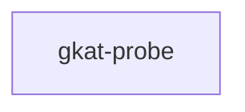

# gkat-probe

crate: gkat-probe
path: crates/gkat-probe
workspace: excluded
digest: 7d4a094d66265f2b
evidence legend: ../index.md#evidence-legend

Generated; the code is the truth. See ../index.md.

## Depends on

## Depended on by

## Public items

- enum Out [pub] — crates/gkat-probe/src/automaton.rs:22 CONFIRMED
- struct Automaton [pub] — crates/gkat-probe/src/automaton.rs:32 CONFIRMED
- fn thompson [pub] — crates/gkat-probe/src/automaton.rs:38 CONFIRMED
- fn Automaton::live [pub] — crates/gkat-probe/src/automaton.rs:129 CONFIRMED
- fn Automaton::normalize [pub] — crates/gkat-probe/src/automaton.rs:150 CONFIRMED
- fn Automaton::reachable [pub] — crates/gkat-probe/src/automaton.rs:167 CONFIRMED
- type Witness [pub] — crates/gkat-probe/src/automaton.rs:189 CONFIRMED
- enum Equivalence [pub] — crates/gkat-probe/src/automaton.rs:193 CONFIRMED
- fn Equivalence::holds [pub] — crates/gkat-probe/src/automaton.rs:208 CONFIRMED
- fn equivalent [pub] — crates/gkat-probe/src/automaton.rs:232 CONFIRMED
- enum Safety [pub] — crates/gkat-probe/src/automaton.rs:287 CONFIRMED
- fn Safety::holds [pub] — crates/gkat-probe/src/automaton.rs:298 CONFIRMED
- fn commit_safe [pub] — crates/gkat-probe/src/automaton.rs:312 CONFIRMED
- const MAX_TESTS [pub] — crates/gkat-probe/src/expr.rs:26 CONFIRMED
- struct Action [pub] — crates/gkat-probe/src/expr.rs:30 CONFIRMED
- struct Atom [pub] — crates/gkat-probe/src/expr.rs:40 CONFIRMED
- fn Atom::holds [pub] — crates/gkat-probe/src/expr.rs:43 CONFIRMED
- enum BExp [pub] — crates/gkat-probe/src/expr.rs:50 CONFIRMED
- fn BExp::eval [pub] — crates/gkat-probe/src/expr.rs:60 CONFIRMED
- fn BExp::negated [pub] — crates/gkat-probe/src/expr.rs:71 CONFIRMED
- fn BExp::and [pub] — crates/gkat-probe/src/expr.rs:75 CONFIRMED
- fn BExp::or [pub] — crates/gkat-probe/src/expr.rs:79 CONFIRMED
- enum Exp [pub] — crates/gkat-probe/src/expr.rs:95 CONFIRMED
- fn Exp::seq [pub] — crates/gkat-probe/src/expr.rs:113 CONFIRMED
- fn Exp::if_ [pub] — crates/gkat-probe/src/expr.rs:117 CONFIRMED
- fn Exp::while_ [pub] — crates/gkat-probe/src/expr.rs:121 CONFIRMED
- fn Exp::actions [pub] — crates/gkat-probe/src/expr.rs:126 CONFIRMED
- enum Refusal [pub] — crates/gkat-probe/src/expr.rs:159 CONFIRMED
- struct Atoms [pub] — crates/gkat-probe/src/expr.rs:186 CONFIRMED
- fn Atoms::new [pub] — crates/gkat-probe/src/expr.rs:194 CONFIRMED
- fn Atoms::tests [pub] — crates/gkat-probe/src/expr.rs:222 CONFIRMED
- fn Atoms::len [pub] — crates/gkat-probe/src/expr.rs:226 CONFIRMED
- fn Atoms::is_empty [pub] — crates/gkat-probe/src/expr.rs:230 CONFIRMED
- fn Atoms::iter [pub] — crates/gkat-probe/src/expr.rs:234 CONFIRMED
- fn Atoms::get [pub] — crates/gkat-probe/src/expr.rs:238 CONFIRMED
- fn Atoms::admit [pub] — crates/gkat-probe/src/expr.rs:243 CONFIRMED
- enum Kind [pub] — crates/gkat-probe/src/flow.rs:58 CONFIRMED
- enum Cond [pub] — crates/gkat-probe/src/flow.rs:65 CONFIRMED
- fn Cond::negated [pub] — crates/gkat-probe/src/flow.rs:78 CONFIRMED
- fn Cond::and [pub] — crates/gkat-probe/src/flow.rs:81 CONFIRMED
- fn Cond::or [pub] — crates/gkat-probe/src/flow.rs:84 CONFIRMED
- enum Step [pub] — crates/gkat-probe/src/flow.rs:91 CONFIRMED
- fn Step::if_ [pub] — crates/gkat-probe/src/flow.rs:116 CONFIRMED
- fn Step::while_ [pub] — crates/gkat-probe/src/flow.rs:119 CONFIRMED
- struct Signature [pub] — crates/gkat-probe/src/flow.rs:127 CONFIRMED
- fn Signature::test_count [pub] — crates/gkat-probe/src/flow.rs:150 CONFIRMED
- fn Signature::atoms [pub] — crates/gkat-probe/src/flow.rs:162 CONFIRMED
- fn Signature::guard [pub] — crates/gkat-probe/src/flow.rs:176 CONFIRMED
- fn Signature::lower [pub] — crates/gkat-probe/src/flow.rs:212 CONFIRMED
- struct Flow [pub] — crates/gkat-probe/src/flow.rs:247 CONFIRMED
- fn Flow::lower [pub] — crates/gkat-probe/src/flow.rs:254 CONFIRMED
- fn flows_equivalent [pub] — crates/gkat-probe/src/flow.rs:265 CONFIRMED
- mod automaton [pub] — crates/gkat-probe/src/lib.rs:42 CONFIRMED
- mod expr [pub] — crates/gkat-probe/src/lib.rs:43 CONFIRMED
- mod flow [pub] — crates/gkat-probe/src/lib.rs:44 CONFIRMED
- mod oracle [pub] — crates/gkat-probe/src/lib.rs:45 CONFIRMED
- mod rubicon [pub] — crates/gkat-probe/src/lib.rs:46 CONFIRMED
- type GuardedString [pub] — crates/gkat-probe/src/oracle.rs:34 CONFIRMED
- struct Exploration [pub] — crates/gkat-probe/src/oracle.rs:38 CONFIRMED
- fn explore [pub] — crates/gkat-probe/src/oracle.rs:52 CONFIRMED
- fn same_up_to [pub] — crates/gkat-probe/src/oracle.rs:141 CONFIRMED
- fn unsafe_within [pub] — crates/gkat-probe/src/oracle.rs:147 CONFIRMED
- fn deterministic [pub] — crates/gkat-probe/src/oracle.rs:163 CONFIRMED
- const DELIBERATE [pub] — crates/gkat-probe/src/rubicon.rs:26 CONFIRMED
- const SUSPEND [pub] — crates/gkat-probe/src/rubicon.rs:27 CONFIRMED
- const REQUEST_COMMIT [pub] — crates/gkat-probe/src/rubicon.rs:28 CONFIRMED
- const HOLD [pub] — crates/gkat-probe/src/rubicon.rs:29 CONFIRMED
- const PLAN [pub] — crates/gkat-probe/src/rubicon.rs:30 CONFIRMED
- const PRUNE [pub] — crates/gkat-probe/src/rubicon.rs:31 CONFIRMED
- const REV [pub] — crates/gkat-probe/src/rubicon.rs:34 CONFIRMED
- const MUL [pub] — crates/gkat-probe/src/rubicon.rs:36 CONFIRMED
- const DELIBERATE_NEEDED [pub] — crates/gkat-probe/src/rubicon.rs:38 CONFIRMED
- const INPUT_READY [pub] — crates/gkat-probe/src/rubicon.rs:40 CONFIRMED
- fn signature [pub] — crates/gkat-probe/src/rubicon.rs:43 CONFIRMED
- fn authorized [pub] — crates/gkat-probe/src/rubicon.rs:58 CONFIRMED
- fn decide_reference [pub] — crates/gkat-probe/src/rubicon.rs:74 CONFIRMED
- fn reference [pub] — crates/gkat-probe/src/rubicon.rs:92 CONFIRMED
- fn decide_optimized [pub] — crates/gkat-probe/src/rubicon.rs:105 CONFIRMED
- fn mul_branch [pub] — crates/gkat-probe/src/rubicon.rs:114 CONFIRMED
- fn optimized [pub] — crates/gkat-probe/src/rubicon.rs:124 CONFIRMED
- fn mutant_reversed_polarity [pub] — crates/gkat-probe/src/rubicon.rs:140 CONFIRMED
- fn mutant_commit_before_guard [pub] — crates/gkat-probe/src/rubicon.rs:149 CONFIRMED
- fn mutant_stale_authorization [pub] — crates/gkat-probe/src/rubicon.rs:163 CONFIRMED
- fn mutant_unguarded_choice [pub] — crates/gkat-probe/src/rubicon.rs:178 CONFIRMED
- fn reference_with_check_auth [pub] — crates/gkat-probe/src/rubicon.rs:187 CONFIRMED
- fn optimized_with_check_auth [pub] — crates/gkat-probe/src/rubicon.rs:203 CONFIRMED
- fn mutant_goto [pub] — crates/gkat-probe/src/rubicon.rs:218 CONFIRMED
- fn mutant_goback [pub] — crates/gkat-probe/src/rubicon.rs:227 CONFIRMED

## Imports from in-scope crates

- none

## Calls

CALL_GRAPH=ARTIFACT_MISSING
- calls ARTIFACT_MISSING — no ruff_charon artifact for this crate UNKNOWN

## Architecture

- none

Generated from Cargo manifests — extracted relationships only.

