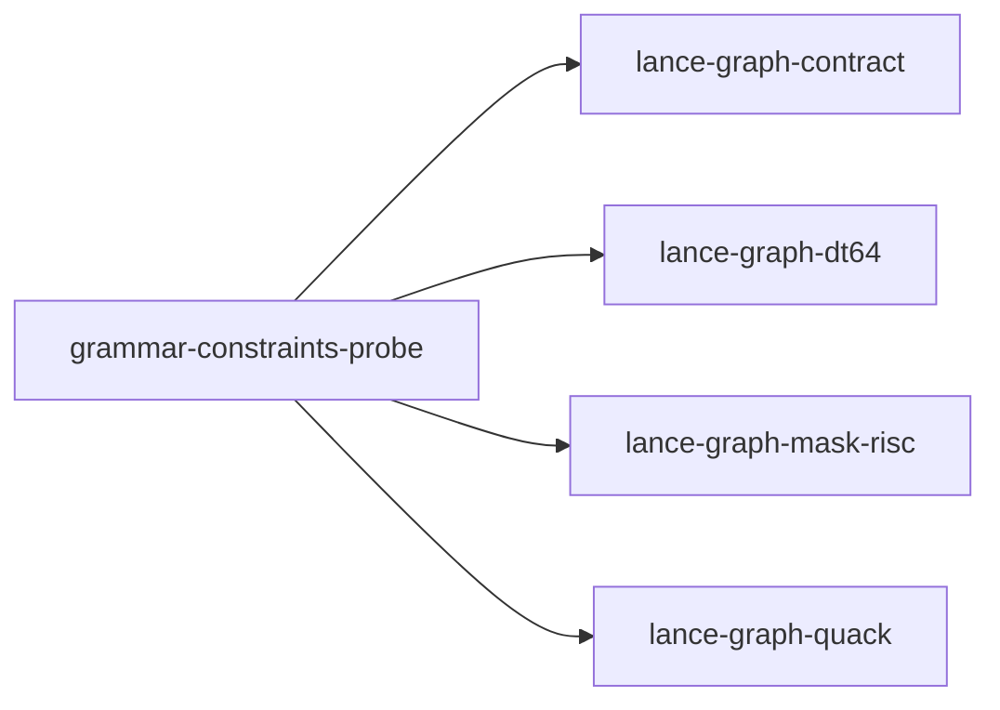

# grammar-constraints-probe

crate: grammar-constraints-probe
path: crates/grammar-constraints-probe
workspace: excluded
digest: 7a824d6be6586f60
evidence legend: ../index.md#evidence-legend

Generated; the code is the truth. See ../index.md.

## Depends on

- dep lance-graph-contract normal — crates/grammar-constraints-probe/Cargo.toml:18 CONFIRMED
- dep lance-graph-dt64 normal — crates/grammar-constraints-probe/Cargo.toml:14 CONFIRMED
- dep lance-graph-mask-risc normal — crates/grammar-constraints-probe/Cargo.toml:16 CONFIRMED
- dep lance-graph-quack normal — crates/grammar-constraints-probe/Cargo.toml:20 CONFIRMED

## Depended on by

## Public items

- const A [pub] — crates/grammar-constraints-probe/src/fixtures.rs:35 CONFIRMED
- const B [pub] — crates/grammar-constraints-probe/src/fixtures.rs:47 CONFIRMED
- const C [pub] — crates/grammar-constraints-probe/src/fixtures.rs:60 CONFIRMED
- const D [pub] — crates/grammar-constraints-probe/src/fixtures.rs:71 CONFIRMED
- const E [pub] — crates/grammar-constraints-probe/src/fixtures.rs:86 CONFIRMED
- enum Gold [pub] — crates/grammar-constraints-probe/src/fixtures.rs:97 CONFIRMED
- const GOLD [pub] — crates/grammar-constraints-probe/src/fixtures.rs:108 CONFIRMED
- fn corpus [pub] — crates/grammar-constraints-probe/src/fixtures.rs:118 CONFIRMED
- fn gids [pub] — crates/grammar-constraints-probe/src/fixtures.rs:126 CONFIRMED
- mod fixtures [pub] — crates/grammar-constraints-probe/src/lib.rs:44 CONFIRMED
- mod when [pub] — crates/grammar-constraints-probe/src/lib.rs:45 CONFIRMED
- const TILE [pub] — crates/grammar-constraints-probe/src/lib.rs:55 CONFIRMED
- const WIDTH [pub] — crates/grammar-constraints-probe/src/lib.rs:56 CONFIRMED
- const ROOT [pub] — crates/grammar-constraints-probe/src/lib.rs:59 CONFIRMED
- const FRAMES_VERSION [pub] — crates/grammar-constraints-probe/src/lib.rs:62 CONFIRMED
- struct Vocab [pub] — crates/grammar-constraints-probe/src/lib.rs:69 CONFIRMED
- fn Vocab::new [pub] — crates/grammar-constraints-probe/src/lib.rs:74 CONFIRMED
- fn Vocab::id [pub] — crates/grammar-constraints-probe/src/lib.rs:81 CONFIRMED
- fn Vocab::get [pub] — crates/grammar-constraints-probe/src/lib.rs:90 CONFIRMED
- struct Tok [pub] — crates/grammar-constraints-probe/src/lib.rs:107 CONFIRMED
- const LEMMA [pub] — crates/grammar-constraints-probe/src/lib.rs:120 CONFIRMED
- const DEPREL [pub] — crates/grammar-constraints-probe/src/lib.rs:121 CONFIRMED
- const CASE [pub] — crates/grammar-constraints-probe/src/lib.rs:122 CONFIRMED
- const HEAD [pub] — crates/grammar-constraints-probe/src/lib.rs:123 CONFIRMED
- const F_LEMMA [pub] — crates/grammar-constraints-probe/src/lib.rs:125 CONFIRMED
- const F_DEPREL [pub] — crates/grammar-constraints-probe/src/lib.rs:126 CONFIRMED
- const F_CASE [pub] — crates/grammar-constraints-probe/src/lib.rs:127 CONFIRMED
- struct Population [pub] — crates/grammar-constraints-probe/src/lib.rs:130 CONFIRMED
- enum Refusal [pub] — crates/grammar-constraints-probe/src/lib.rs:141 CONFIRMED
- fn Population::bind [pub] — crates/grammar-constraints-probe/src/lib.rs:152 CONFIRMED
- fn tile [pub] — crates/grammar-constraints-probe/src/lib.rs:199 CONFIRMED
- struct Ids [pub] — crates/grammar-constraints-probe/src/lib.rs:213 CONFIRMED
- fn Ids::bind [pub] — crates/grammar-constraints-probe/src/lib.rs:227 CONFIRMED
- struct Operands [pub] — crates/grammar-constraints-probe/src/lib.rs:242 CONFIRMED
- const Operands::ALL [pub] — crates/grammar-constraints-probe/src/lib.rs:249 CONFIRMED
- struct Rules [pub] — crates/grammar-constraints-probe/src/lib.rs:489 CONFIRMED
- struct Readout [pub] — crates/grammar-constraints-probe/src/lib.rs:502 CONFIRMED
- fn Rules::prepare [pub] — crates/grammar-constraints-probe/src/lib.rs:511 CONFIRMED
- fn Rules::op_count [pub] — crates/grammar-constraints-probe/src/lib.rs:523 CONFIRMED
- fn Rules::run [pub] — crates/grammar-constraints-probe/src/lib.rs:538 CONFIRMED
- fn has [pub] — crates/grammar-constraints-probe/src/lib.rs:585 CONFIRMED
- const HEAD_FRAME [pub] — crates/grammar-constraints-probe/src/when.rs:52 CONFIRMED
- const FIELDS [pub] — crates/grammar-constraints-probe/src/when.rs:54 CONFIRMED
- const CLASS_VIA [pub] — crates/grammar-constraints-probe/src/when.rs:57 CONFIRMED
- const CLASS_COADDR [pub] — crates/grammar-constraints-probe/src/when.rs:58 CONFIRMED
- const CLASS_FOREIGN [pub] — crates/grammar-constraints-probe/src/when.rs:59 CONFIRMED
- const RECIPIENT [pub] — crates/grammar-constraints-probe/src/when.rs:61 CONFIRMED
- const EXPERIENCER [pub] — crates/grammar-constraints-probe/src/when.rs:62 CONFIRMED
- const FRAME_NONE [pub] — crates/grammar-constraints-probe/src/when.rs:65 CONFIRMED
- const FRAME_GIVE [pub] — crates/grammar-constraints-probe/src/when.rs:66 CONFIRMED
- const FRAME_EXPERIENCE [pub] — crates/grammar-constraints-probe/src/when.rs:67 CONFIRMED
- struct Lexicon [pub] — crates/grammar-constraints-probe/src/when.rs:71 CONFIRMED
- fn Lexicon::v0 [pub] — crates/grammar-constraints-probe/src/when.rs:79 CONFIRMED
- fn Lexicon::swapped [pub] — crates/grammar-constraints-probe/src/when.rs:92 CONFIRMED
- fn Lexicon::frame [pub] — crates/grammar-constraints-probe/src/when.rs:105 CONFIRMED
- fn Lexicon::lemmas [pub] — crates/grammar-constraints-probe/src/when.rs:113 CONFIRMED
- struct FramedPopulation [pub] — crates/grammar-constraints-probe/src/when.rs:127 CONFIRMED
- fn FramedPopulation::produce [pub] — crates/grammar-constraints-probe/src/when.rs:138 CONFIRMED
- enum Physical [pub] — crates/grammar-constraints-probe/src/when.rs:169 CONFIRMED
- struct RuleDesc [pub] — crates/grammar-constraints-probe/src/when.rs:176 CONFIRMED
- fn RuleDesc::recipient [pub] — crates/grammar-constraints-probe/src/when.rs:193 CONFIRMED
- fn RuleDesc::experiencer [pub] — crates/grammar-constraints-probe/src/when.rs:203 CONFIRMED
- fn RuleDesc::frame_digest [pub] — crates/grammar-constraints-probe/src/when.rs:222 CONFIRMED
- fn RuleDesc::guard [pub] — crates/grammar-constraints-probe/src/when.rs:242 CONFIRMED
- fn RuleDesc::filter [pub] — crates/grammar-constraints-probe/src/when.rs:264 CONFIRMED
- fn RuleDesc::binding [pub] — crates/grammar-constraints-probe/src/when.rs:287 CONFIRMED
- fn schema [pub] — crates/grammar-constraints-probe/src/when.rs:303 CONFIRMED
- fn register [pub] — crates/grammar-constraints-probe/src/when.rs:312 CONFIRMED
- struct LabView [pub] — crates/grammar-constraints-probe/src/when.rs:331 CONFIRMED
- fn LabView::new [pub] — crates/grammar-constraints-probe/src/when.rs:336 CONFIRMED
- enum ComposeRefusal [pub] — crates/grammar-constraints-probe/src/when.rs:377 CONFIRMED
- enum RunRefusal [pub] — crates/grammar-constraints-probe/src/when.rs:389 CONFIRMED
- struct Composed [pub] — crates/grammar-constraints-probe/src/when.rs:402 CONFIRMED
- fn compose [pub] — crates/grammar-constraints-probe/src/when.rs:413 CONFIRMED
- fn Composed::ops [pub] — crates/grammar-constraints-probe/src/when.rs:447 CONFIRMED
- fn Composed::run [pub] — crates/grammar-constraints-probe/src/when.rs:452 CONFIRMED

## Imports from in-scope crates

### lance-graph-contract
- use lance_graph_contract::class_view::ClassId — crates/grammar-constraints-probe/src/when.rs:33 CONFIRMED
- use lance_graph_contract::class_view::ClassView — crates/grammar-constraints-probe/src/when.rs:33 CONFIRMED
- use lance_graph_contract::class_view::WideFieldMask — crates/grammar-constraints-probe/src/when.rs:33 CONFIRMED
- use lance_graph_contract::ontology::DisplayTemplate — crates/grammar-constraints-probe/src/when.rs:34 CONFIRMED
- use lance_graph_contract::ontology::FieldRef — crates/grammar-constraints-probe/src/when.rs:34 CONFIRMED
- use lance_graph_contract::set_algebra::Logic — crates/grammar-constraints-probe/src/when.rs:35 CONFIRMED
- use lance_graph_contract::set_algebra::SetExpr — crates/grammar-constraints-probe/src/when.rs:35 CONFIRMED
- use lance_graph_contract::set_rules::Population as Multiplicity — crates/grammar-constraints-probe/src/when.rs:36 CONFIRMED
- use lance_graph_contract::set_rules::Truth — crates/grammar-constraints-probe/src/when.rs:36 CONFIRMED
### lance-graph-dt64
- use lance_graph_dt64::dr::Frame — crates/grammar-constraints-probe/src/lib.rs:49 CONFIRMED
- use lance_graph_dt64::dr::LocalMap — crates/grammar-constraints-probe/src/lib.rs:49 CONFIRMED
- use lance_graph_dt64::dr::MapRead — crates/grammar-constraints-probe/src/lib.rs:49 CONFIRMED
- use lance_graph_dt64::dr::MapRefusal — crates/grammar-constraints-probe/src/lib.rs:49 CONFIRMED
- use lance_graph_dt64::dr::MapTable — crates/grammar-constraints-probe/src/lib.rs:49 CONFIRMED
- use lance_graph_dt64::dr::TileId — crates/grammar-constraints-probe/src/lib.rs:49 CONFIRMED
- use lance_graph_dt64::dr::Width — crates/grammar-constraints-probe/src/lib.rs:49 CONFIRMED
- use lance_graph_dt64::dr::Frame — crates/grammar-constraints-probe/src/when.rs:37 CONFIRMED
- use lance_graph_dt64::dr::MapTable — crates/grammar-constraints-probe/src/when.rs:37 CONFIRMED
- use lance_graph_dt64::BindStore — crates/grammar-constraints-probe/src/when.rs:39 CONFIRMED
- use lance_graph_dt64::ClassSchema — crates/grammar-constraints-probe/src/when.rs:39 CONFIRMED
- use lance_graph_dt64::Extent — crates/grammar-constraints-probe/src/when.rs:39 CONFIRMED
- use lance_graph_dt64::Guard — crates/grammar-constraints-probe/src/when.rs:39 CONFIRMED
- use lance_graph_dt64::MethodBinding — crates/grammar-constraints-probe/src/when.rs:39 CONFIRMED
- use lance_graph_dt64::MethodId — crates/grammar-constraints-probe/src/when.rs:39 CONFIRMED
- use lance_graph_dt64::MethodRef — crates/grammar-constraints-probe/src/when.rs:39 CONFIRMED
- use lance_graph_dt64::Refusal — crates/grammar-constraints-probe/src/when.rs:39 CONFIRMED
- use lance_graph_dt64::SchemaRev — crates/grammar-constraints-probe/src/when.rs:39 CONFIRMED
- use lance_graph_dt64::SigRev — crates/grammar-constraints-probe/src/when.rs:40 CONFIRMED
- use lance_graph_dt64::ValueDemand — crates/grammar-constraints-probe/src/when.rs:40 CONFIRMED
### lance-graph-mask-risc
- use lance_graph_mask_risc::Foreign — crates/grammar-constraints-probe/src/lib.rs:51 CONFIRMED
- use lance_graph_mask_risc::LaneRef — crates/grammar-constraints-probe/src/lib.rs:51 CONFIRMED
- use lance_graph_mask_risc::MaskOp — crates/grammar-constraints-probe/src/lib.rs:51 CONFIRMED
- use lance_graph_mask_risc::Operand — crates/grammar-constraints-probe/src/lib.rs:51 CONFIRMED
- use lance_graph_mask_risc::Out — crates/grammar-constraints-probe/src/lib.rs:51 CONFIRMED
- use lance_graph_mask_risc::Planes — crates/grammar-constraints-probe/src/lib.rs:51 CONFIRMED
- use lance_graph_mask_risc::Pred — crates/grammar-constraints-probe/src/lib.rs:51 CONFIRMED
- use lance_graph_mask_risc::Program — crates/grammar-constraints-probe/src/lib.rs:51 CONFIRMED
- use lance_graph_mask_risc::execute_into — crates/grammar-constraints-probe/src/lib.rs:51 CONFIRMED
- use lance_graph_mask_risc::words_for — crates/grammar-constraints-probe/src/lib.rs:51 CONFIRMED
- use lance_graph_mask_risc::Scratch — crates/grammar-constraints-probe/src/lib.rs:52 CONFIRMED
- use lance_graph_mask_risc::Terminal — crates/grammar-constraints-probe/src/lib.rs:52 CONFIRMED
- use lance_graph_mask_risc::Foreign — crates/grammar-constraints-probe/src/when.rs:43 CONFIRMED
- use lance_graph_mask_risc::LaneRef — crates/grammar-constraints-probe/src/when.rs:43 CONFIRMED
- use lance_graph_mask_risc::Out — crates/grammar-constraints-probe/src/when.rs:43 CONFIRMED
- use lance_graph_mask_risc::Planes — crates/grammar-constraints-probe/src/when.rs:43 CONFIRMED
- use lance_graph_mask_risc::Program — crates/grammar-constraints-probe/src/when.rs:43 CONFIRMED
- use lance_graph_mask_risc::Scratch — crates/grammar-constraints-probe/src/when.rs:43 CONFIRMED
- use lance_graph_mask_risc::execute_into — crates/grammar-constraints-probe/src/when.rs:43 CONFIRMED
- use lance_graph_mask_risc::words_for — crates/grammar-constraints-probe/src/when.rs:43 CONFIRMED
### lance-graph-quack
- use lance_graph_quack::Agg — crates/grammar-constraints-probe/src/when.rs:45 CONFIRMED
- use lance_graph_quack::Cmp — crates/grammar-constraints-probe/src/when.rs:45 CONFIRMED
- use lance_graph_quack::Col — crates/grammar-constraints-probe/src/when.rs:45 CONFIRMED
- use lance_graph_quack::Filter — crates/grammar-constraints-probe/src/when.rs:45 CONFIRMED
- use lance_graph_quack::ForeignLane — crates/grammar-constraints-probe/src/when.rs:45 CONFIRMED
- use lance_graph_quack::LowerError — crates/grammar-constraints-probe/src/when.rs:45 CONFIRMED
- use lance_graph_quack::Mask — crates/grammar-constraints-probe/src/when.rs:45 CONFIRMED
- use lance_graph_quack::Query — crates/grammar-constraints-probe/src/when.rs:45 CONFIRMED
- use lance_graph_quack::lower — crates/grammar-constraints-probe/src/when.rs:45 CONFIRMED

## Calls

CALL_GRAPH=ARTIFACT_MISSING
- calls ARTIFACT_MISSING — no ruff_charon artifact for this crate UNKNOWN

## Architecture

- arch ADMISSION B call-site-classification Semijoin, EqU32Via, Gather [GAP] validation=EXTERNAL — EXO-140 GAP
- arch ADMISSION B ruled-in entries/2026-10-20-six-decisions.md [CONFIRMED] validation=OK — .claude/board/entries/2026-10-20-six-decisions.md:24 CONFIRMED

Generated from Cargo manifests — extracted relationships only.

