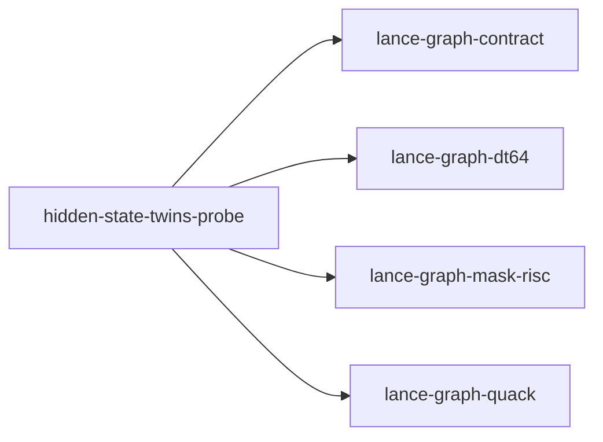

# hidden-state-twins-probe

crate: hidden-state-twins-probe
path: crates/hidden-state-twins-probe
workspace: excluded
digest: 46070eaba28a67ce
evidence legend: ../index.md#evidence-legend

Generated; the code is the truth. See ../index.md.

## Depends on

- dep lance-graph-contract normal — crates/hidden-state-twins-probe/Cargo.toml:18 CONFIRMED
- dep lance-graph-dt64 normal — crates/hidden-state-twins-probe/Cargo.toml:14 CONFIRMED
- dep lance-graph-mask-risc normal — crates/hidden-state-twins-probe/Cargo.toml:16 CONFIRMED
- dep lance-graph-quack normal — crates/hidden-state-twins-probe/Cargo.toml:20 CONFIRMED
- dep shakmaty dev — crates/hidden-state-twins-probe/Cargo.toml:26 CONFIRMED

## Depended on by

- rdep quack-boundary-lab dev — crates/quack-boundary-lab/Cargo.toml:17 CONFIRMED

## Public items

- const MAX_RULES [pub] — crates/hidden-state-twins-probe/src/lib.rs:45 CONFIRMED
- struct Rule [pub] — crates/hidden-state-twins-probe/src/lib.rs:49 CONFIRMED
- struct Family [pub] — crates/hidden-state-twins-probe/src/lib.rs:57 CONFIRMED
- enum TwinRefusal [pub] — crates/hidden-state-twins-probe/src/lib.rs:69 CONFIRMED
- fn Family::guard [pub] — crates/hidden-state-twins-probe/src/lib.rs:88 CONFIRMED
- fn Family::bind [pub] — crates/hidden-state-twins-probe/src/lib.rs:127 CONFIRMED
- struct Bound [pub] — crates/hidden-state-twins-probe/src/lib.rs:152 CONFIRMED
- struct Answers [pub] — crates/hidden-state-twins-probe/src/lib.rs:159 CONFIRMED
- fn Bound::decide [pub] — crates/hidden-state-twins-probe/src/lib.rs:172 CONFIRMED
- fn digest [pub] — crates/hidden-state-twins-probe/src/lib.rs:273 CONFIRMED

## Imports from in-scope crates

### lance-graph-contract
- use lance_graph_contract::class_view::ClassId — crates/hidden-state-twins-probe/src/lib.rs:33 CONFIRMED
- use lance_graph_contract::class_view::ClassView — crates/hidden-state-twins-probe/src/lib.rs:33 CONFIRMED
- use lance_graph_contract::class_view::WideFieldMask — crates/hidden-state-twins-probe/src/lib.rs:33 CONFIRMED
- use lance_graph_contract::ontology::DisplayTemplate — crates/hidden-state-twins-probe/src/lib.rs:34 CONFIRMED
- use lance_graph_contract::ontology::FieldRef — crates/hidden-state-twins-probe/src/lib.rs:34 CONFIRMED
- use lance_graph_contract::set_algebra::Logic — crates/hidden-state-twins-probe/src/lib.rs:35 CONFIRMED
- use lance_graph_contract::set_algebra::SetExpr — crates/hidden-state-twins-probe/src/lib.rs:35 CONFIRMED
- use lance_graph_contract::set_rules::Population as Multiplicity — crates/hidden-state-twins-probe/src/lib.rs:36 CONFIRMED
- use lance_graph_contract::set_rules::Truth — crates/hidden-state-twins-probe/src/lib.rs:36 CONFIRMED
### lance-graph-dt64
- use lance_graph_dt64::BindStore — crates/hidden-state-twins-probe/src/lib.rs:38 CONFIRMED
- use lance_graph_dt64::ClassSchema — crates/hidden-state-twins-probe/src/lib.rs:38 CONFIRMED
- use lance_graph_dt64::Extent — crates/hidden-state-twins-probe/src/lib.rs:38 CONFIRMED
- use lance_graph_dt64::Guard — crates/hidden-state-twins-probe/src/lib.rs:38 CONFIRMED
- use lance_graph_dt64::MethodBinding — crates/hidden-state-twins-probe/src/lib.rs:38 CONFIRMED
- use lance_graph_dt64::MethodId — crates/hidden-state-twins-probe/src/lib.rs:38 CONFIRMED
- use lance_graph_dt64::Refusal — crates/hidden-state-twins-probe/src/lib.rs:38 CONFIRMED
- use lance_graph_dt64::SchemaRev — crates/hidden-state-twins-probe/src/lib.rs:38 CONFIRMED
- use lance_graph_dt64::SigRev — crates/hidden-state-twins-probe/src/lib.rs:38 CONFIRMED
- use lance_graph_dt64::ValueDemand — crates/hidden-state-twins-probe/src/lib.rs:39 CONFIRMED
### lance-graph-mask-risc
- use lance_graph_mask_risc::Foreign — crates/hidden-state-twins-probe/src/lib.rs:41 CONFIRMED
- use lance_graph_mask_risc::LaneRef — crates/hidden-state-twins-probe/src/lib.rs:41 CONFIRMED
- use lance_graph_mask_risc::Out — crates/hidden-state-twins-probe/src/lib.rs:41 CONFIRMED
- use lance_graph_mask_risc::Planes — crates/hidden-state-twins-probe/src/lib.rs:41 CONFIRMED
- use lance_graph_mask_risc::Scratch — crates/hidden-state-twins-probe/src/lib.rs:41 CONFIRMED
- use lance_graph_mask_risc::execute_into — crates/hidden-state-twins-probe/src/lib.rs:41 CONFIRMED
- use lance_graph_mask_risc::words_for — crates/hidden-state-twins-probe/src/lib.rs:41 CONFIRMED
### lance-graph-quack
- use lance_graph_quack::Agg — crates/hidden-state-twins-probe/src/lib.rs:42 CONFIRMED
- use lance_graph_quack::Cmp — crates/hidden-state-twins-probe/src/lib.rs:42 CONFIRMED
- use lance_graph_quack::Col — crates/hidden-state-twins-probe/src/lib.rs:42 CONFIRMED
- use lance_graph_quack::Filter — crates/hidden-state-twins-probe/src/lib.rs:42 CONFIRMED
- use lance_graph_quack::LowerError — crates/hidden-state-twins-probe/src/lib.rs:42 CONFIRMED
- use lance_graph_quack::Query — crates/hidden-state-twins-probe/src/lib.rs:42 CONFIRMED
- use lance_graph_quack::lower — crates/hidden-state-twins-probe/src/lib.rs:42 CONFIRMED

## Calls

CALL_GRAPH=ARTIFACT_MISSING
- calls ARTIFACT_MISSING — no ruff_charon artifact for this crate UNKNOWN

## Architecture

- none

Generated from Cargo manifests — extracted relationships only.

