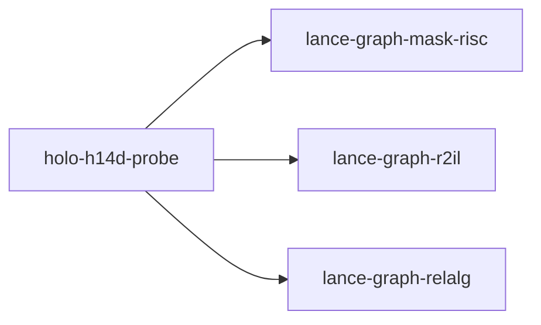

# holo-h14d-probe

crate: holo-h14d-probe
path: crates/holo-h14d-probe
workspace: excluded
digest: d007b7293a906e04
evidence legend: ../index.md#evidence-legend

Generated; the code is the truth. See ../index.md.

## Depends on

- dep lance-graph-mask-risc normal — crates/holo-h14d-probe/Cargo.toml:17 CONFIRMED
- dep lance-graph-r2il normal — crates/holo-h14d-probe/Cargo.toml:18 CONFIRMED
- dep lance-graph-relalg normal — crates/holo-h14d-probe/Cargo.toml:16 CONFIRMED
- dep arrow-array normal — crates/holo-h14d-probe/Cargo.toml:20 CONFIRMED
- dep arrow-schema normal — crates/holo-h14d-probe/Cargo.toml:21 CONFIRMED
- dep futures normal — crates/holo-h14d-probe/Cargo.toml:22 CONFIRMED
- dep lance normal — crates/holo-h14d-probe/Cargo.toml:19 CONFIRMED
- dep tempfile normal — crates/holo-h14d-probe/Cargo.toml:24 CONFIRMED
- dep tokio normal — crates/holo-h14d-probe/Cargo.toml:23 CONFIRMED

## Depended on by

## Public items

## Imports from in-scope crates

### lance-graph-mask-risc
- use lance_graph_mask_risc::ExecError — crates/holo-h14d-probe/src/main.rs:26 CONFIRMED
- use lance_graph_mask_risc::LaneRef — crates/holo-h14d-probe/src/main.rs:26 CONFIRMED
- use lance_graph_mask_risc::Planes — crates/holo-h14d-probe/src/main.rs:26 CONFIRMED
- use lance_graph_mask_risc::words_for — crates/holo-h14d-probe/src/main.rs:26 CONFIRMED
### lance-graph-r2il
- use lance_graph_r2il::FoldError — crates/holo-h14d-probe/src/main.rs:27 CONFIRMED
### lance-graph-relalg
- use lance_graph_relalg::Answer — crates/holo-h14d-probe/src/main.rs:29 CONFIRMED
- use lance_graph_relalg::Measure — crates/holo-h14d-probe/src/main.rs:29 CONFIRMED
- use lance_graph_relalg::Query — crates/holo-h14d-probe/src/main.rs:29 CONFIRMED
- use lance_graph_relalg::Rel — crates/holo-h14d-probe/src/main.rs:29 CONFIRMED
- use lance_graph_relalg::RelError — crates/holo-h14d-probe/src/main.rs:29 CONFIRMED
- use lance_graph_relalg::normalize — crates/holo-h14d-probe/src/main.rs:29 CONFIRMED
- use lance_graph_relalg::run — crates/holo-h14d-probe/src/main.rs:29 CONFIRMED
- use lance_graph_relalg::run_as_written — crates/holo-h14d-probe/src/main.rs:29 CONFIRMED
- use lance_graph_relalg::symbolic — crates/holo-h14d-probe/src/main.rs:29 CONFIRMED

## Calls

CALL_GRAPH=ARTIFACT_MISSING
- calls ARTIFACT_MISSING — no ruff_charon artifact for this crate UNKNOWN

## Architecture

- none

Generated from Cargo manifests — extracted relationships only.

