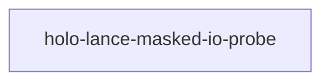

# holo-lance-masked-io-probe

crate: holo-lance-masked-io-probe
path: crates/holo-lance-masked-io-probe
workspace: excluded
digest: c060c0843faab88c
evidence legend: ../index.md#evidence-legend

Generated; the code is the truth. See ../index.md.

## Depends on

- dep arrow-array normal — crates/holo-lance-masked-io-probe/Cargo.toml:15 CONFIRMED
- dep arrow-schema normal — crates/holo-lance-masked-io-probe/Cargo.toml:16 CONFIRMED
- dep futures normal — crates/holo-lance-masked-io-probe/Cargo.toml:17 CONFIRMED
- dep lance normal — crates/holo-lance-masked-io-probe/Cargo.toml:14 CONFIRMED
- dep tempfile normal — crates/holo-lance-masked-io-probe/Cargo.toml:19 CONFIRMED
- dep tokio normal — crates/holo-lance-masked-io-probe/Cargo.toml:18 CONFIRMED

## Depended on by

## Public items

## Imports from in-scope crates

- none

## Calls

CALL_GRAPH=ARTIFACT_MISSING
- calls ARTIFACT_MISSING — no ruff_charon artifact for this crate UNKNOWN

## Architecture

- none

Generated from Cargo manifests — extracted relationships only.

