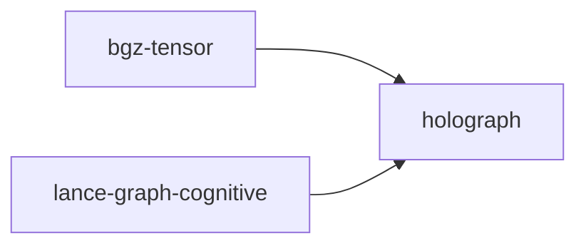

# holograph

crate: holograph
path: crates/holograph
workspace: excluded
digest: 33e6c4d74778729e
evidence legend: ../index.md#evidence-legend

Generated; the code is the truth. See ../index.md.

## Depends on

- dep arrow normal optional — crates/holograph/Cargo.toml:30 CONFIRMED
- dep arrow-array normal — crates/holograph/Cargo.toml:31 CONFIRMED
- dep arrow-buffer normal — crates/holograph/Cargo.toml:33 CONFIRMED
- dep arrow-schema normal — crates/holograph/Cargo.toml:32 CONFIRMED
- dep bincode normal — crates/holograph/Cargo.toml:53 CONFIRMED
- dep criterion dev — crates/holograph/Cargo.toml:59 CONFIRMED
- dep datafusion normal optional — crates/holograph/Cargo.toml:36 CONFIRMED
- dep futures normal — crates/holograph/Cargo.toml:43 CONFIRMED
- dep lance normal optional — crates/holograph/Cargo.toml:39 CONFIRMED
- dep log normal — crates/holograph/Cargo.toml:56 CONFIRMED
- dep rand dev — crates/holograph/Cargo.toml:60 CONFIRMED
- dep rayon normal optional — crates/holograph/Cargo.toml:49 CONFIRMED
- dep serde normal — crates/holograph/Cargo.toml:52 CONFIRMED
- dep tempfile dev — crates/holograph/Cargo.toml:61 CONFIRMED
- dep thiserror normal — crates/holograph/Cargo.toml:46 CONFIRMED
- dep tokio dev — crates/holograph/Cargo.toml:62 CONFIRMED
- dep tokio normal optional — crates/holograph/Cargo.toml:42 CONFIRMED

## Depended on by

- rdep bgz-tensor normal — crates/bgz-tensor/Cargo.toml:26 CONFIRMED
- rdep lance-graph-cognitive normal — crates/lance-graph-cognitive/Cargo.toml:18 CONFIRMED

## Public items

- const VECTOR_BITS [pub] — crates/holograph/src/bitpack.rs:15 CONFIRMED
- const VECTOR_WORDS [pub] — crates/holograph/src/bitpack.rs:18 CONFIRMED
- const VECTOR_BYTES [pub] — crates/holograph/src/bitpack.rs:21 CONFIRMED
- const PADDED_VECTOR_WORDS [pub] — crates/holograph/src/bitpack.rs:24 CONFIRMED
- const PADDED_VECTOR_BYTES [pub] — crates/holograph/src/bitpack.rs:27 CONFIRMED
- struct BitpackedVector [pub] — crates/holograph/src/bitpack.rs:52 CONFIRMED
- fn BitpackedVector::zero [pub] — crates/holograph/src/bitpack.rs:70 CONFIRMED
- fn BitpackedVector::ones [pub] — crates/holograph/src/bitpack.rs:78 CONFIRMED
- fn BitpackedVector::from_words [pub] — crates/holograph/src/bitpack.rs:92 CONFIRMED
- fn BitpackedVector::from_slice [pub] — crates/holograph/src/bitpack.rs:99 CONFIRMED
- fn BitpackedVector::from_bytes [pub] — crates/holograph/src/bitpack.rs:112 CONFIRMED
- fn BitpackedVector::random [pub] — crates/holograph/src/bitpack.rs:129 CONFIRMED
- fn BitpackedVector::from_hash [pub] — crates/holograph/src/bitpack.rs:149 CONFIRMED
- fn BitpackedVector::words [pub] — crates/holograph/src/bitpack.rs:169 CONFIRMED
- fn BitpackedVector::words_mut [pub] — crates/holograph/src/bitpack.rs:175 CONFIRMED
- fn BitpackedVector::to_bytes [pub] — crates/holograph/src/bitpack.rs:180 CONFIRMED
- fn BitpackedVector::get_bit [pub] — crates/holograph/src/bitpack.rs:190 CONFIRMED
- fn BitpackedVector::set_bit [pub] — crates/holograph/src/bitpack.rs:199 CONFIRMED
- fn BitpackedVector::toggle_bit [pub] — crates/holograph/src/bitpack.rs:212 CONFIRMED
- fn BitpackedVector::popcount [pub] — crates/holograph/src/bitpack.rs:225 CONFIRMED
- fn BitpackedVector::stacked_popcount [pub] — crates/holograph/src/bitpack.rs:233 CONFIRMED
- fn BitpackedVector::density [pub] — crates/holograph/src/bitpack.rs:243 CONFIRMED
- fn BitpackedVector::xor [pub] — crates/holograph/src/bitpack.rs:253 CONFIRMED
- fn BitpackedVector::and [pub] — crates/holograph/src/bitpack.rs:263 CONFIRMED
- fn BitpackedVector::or [pub] — crates/holograph/src/bitpack.rs:273 CONFIRMED
- fn BitpackedVector::not [pub] — crates/holograph/src/bitpack.rs:283 CONFIRMED
- fn BitpackedVector::xor_assign [pub] — crates/holograph/src/bitpack.rs:295 CONFIRMED
- fn BitpackedVector::rotate_left [pub] — crates/holograph/src/bitpack.rs:306 CONFIRMED
- fn BitpackedVector::rotate_right [pub] — crates/holograph/src/bitpack.rs:325 CONFIRMED
- fn BitpackedVector::rotate_words [pub] — crates/holograph/src/bitpack.rs:331 CONFIRMED
- fn BitpackedVector::rotate_bits [pub] — crates/holograph/src/bitpack.rs:349 CONFIRMED
- fn BitpackedVector::flip_random_bits [pub] — crates/holograph/src/bitpack.rs:354 CONFIRMED
- fn BitpackedVector::bundle [pub] — crates/holograph/src/bitpack.rs:382 CONFIRMED
- fn BitpackedVector::bundle_weighted [pub] — crates/holograph/src/bitpack.rs:433 CONFIRMED
- trait VectorRef [pub] — crates/holograph/src/bitpack.rs:479 CONFIRMED
- struct VectorSlice [pub] — crates/holograph/src/bitpack.rs:568 CONFIRMED
- fn VectorSlice<'a>::from_words [pub] — crates/holograph/src/bitpack.rs:578 CONFIRMED
- fn VectorSlice<'a>::from_bytes_unchecked [pub] — crates/holograph/src/bitpack.rs:597 CONFIRMED
- fn VectorSlice<'a>::from_bytes_or_copy [pub] — crates/holograph/src/bitpack.rs:612 CONFIRMED
- fn VectorSlice<'a>::as_words [pub] — crates/holograph/src/bitpack.rs:627 CONFIRMED
- fn xor_ref [pub] — crates/holograph/src/bitpack.rs:656 CONFIRMED
- fn BitpackedVector::to_padded_bytes [pub] — crates/holograph/src/bitpack.rs:676 CONFIRMED
- fn BitpackedVector::from_padded_bytes [pub] — crates/holograph/src/bitpack.rs:687 CONFIRMED
- struct Coord5D [pub] — crates/holograph/src/crystal_dejavu.rs:51 CONFIRMED
- const Coord5D::LATTICE_SIZE [pub] — crates/holograph/src/crystal_dejavu.rs:56 CONFIRMED
- const Coord5D::TOTAL_CELLS [pub] — crates/holograph/src/crystal_dejavu.rs:57 CONFIRMED
- fn Coord5D::new [pub] — crates/holograph/src/crystal_dejavu.rs:60 CONFIRMED
- fn Coord5D::from_index [pub] — crates/holograph/src/crystal_dejavu.rs:67 CONFIRMED
- fn Coord5D::to_index [pub] — crates/holograph/src/crystal_dejavu.rs:77 CONFIRMED
- fn Coord5D::distance [pub] — crates/holograph/src/crystal_dejavu.rs:86 CONFIRMED
- fn Coord5D::neighborhood [pub] — crates/holograph/src/crystal_dejavu.rs:95 CONFIRMED
- fn Coord5D::to_fingerprint [pub] — crates/holograph/src/crystal_dejavu.rs:107 CONFIRMED
- struct ProjectionMatrix [pub] — crates/holograph/src/crystal_dejavu.rs:115 CONFIRMED
- fn ProjectionMatrix::new [pub] — crates/holograph/src/crystal_dejavu.rs:126 CONFIRMED
- fn ProjectionMatrix::project [pub] — crates/holograph/src/crystal_dejavu.rs:155 CONFIRMED
- struct CrystalCell [pub] — crates/holograph/src/crystal_dejavu.rs:180 CONFIRMED
- fn CrystalCell::new [pub] — crates/holograph/src/crystal_dejavu.rs:196 CONFIRMED
- fn CrystalCell::add [pub] — crates/holograph/src/crystal_dejavu.rs:208 CONFIRMED
- fn CrystalCell::similarity [pub] — crates/holograph/src/crystal_dejavu.rs:235 CONFIRMED
- struct SentenceCrystal [pub] — crates/holograph/src/crystal_dejavu.rs:246 CONFIRMED
- fn SentenceCrystal::new [pub] — crates/holograph/src/crystal_dejavu.rs:262 CONFIRMED
- fn SentenceCrystal::jina_v3 [pub] — crates/holograph/src/crystal_dejavu.rs:273 CONFIRMED
- fn SentenceCrystal::store [pub] — crates/holograph/src/crystal_dejavu.rs:278 CONFIRMED
- fn SentenceCrystal::store_with_qualia [pub] — crates/holograph/src/crystal_dejavu.rs:311 CONFIRMED
- fn SentenceCrystal::query [pub] — crates/holograph/src/crystal_dejavu.rs:373 CONFIRMED
- fn SentenceCrystal::get_cell [pub] — crates/holograph/src/crystal_dejavu.rs:391 CONFIRMED
- fn SentenceCrystal::num_cells [pub] — crates/holograph/src/crystal_dejavu.rs:396 CONFIRMED
- enum SigmaBand [pub] — crates/holograph/src/crystal_dejavu.rs:407 CONFIRMED
- fn SigmaBand::from_distance [pub] — crates/holograph/src/crystal_dejavu.rs:419 CONFIRMED
- fn SigmaBand::weight [pub] — crates/holograph/src/crystal_dejavu.rs:428 CONFIRMED
- struct DejaVuObservation [pub] — crates/holograph/src/crystal_dejavu.rs:440 CONFIRMED
- fn DejaVuObservation::new [pub] — crates/holograph/src/crystal_dejavu.rs:456 CONFIRMED
- fn DejaVuObservation::observe [pub] — crates/holograph/src/crystal_dejavu.rs:468 CONFIRMED
- fn DejaVuObservation::is_strong_deja_vu [pub] — crates/holograph/src/crystal_dejavu.rs:491 CONFIRMED
- struct DejaVuRL [pub] — crates/holograph/src/crystal_dejavu.rs:502 CONFIRMED
- fn DejaVuRL::new [pub] — crates/holograph/src/crystal_dejavu.rs:521 CONFIRMED
- fn DejaVuRL::begin_pass [pub] — crates/holograph/src/crystal_dejavu.rs:534 CONFIRMED
- fn DejaVuRL::observe [pub] — crates/holograph/src/crystal_dejavu.rs:539 CONFIRMED
- fn DejaVuRL::multipass_search [pub] — crates/holograph/src/crystal_dejavu.rs:550 CONFIRMED
- fn DejaVuRL::strong_deja_vu [pub] — crates/holograph/src/crystal_dejavu.rs:589 CONFIRMED
- fn DejaVuRL::reward [pub] — crates/holograph/src/crystal_dejavu.rs:597 CONFIRMED
- fn DejaVuRL::learned_policy [pub] — crates/holograph/src/crystal_dejavu.rs:621 CONFIRMED
- fn DejaVuRL::stats [pub] — crates/holograph/src/crystal_dejavu.rs:637 CONFIRMED
- struct DejaVuStats [pub] — crates/holograph/src/crystal_dejavu.rs:672 CONFIRMED
- struct TruthMarker [pub] — crates/holograph/src/crystal_dejavu.rs:687 CONFIRMED
- fn TruthMarker::new [pub] — crates/holograph/src/crystal_dejavu.rs:705 CONFIRMED
- fn TruthMarker::add_support [pub] — crates/holograph/src/crystal_dejavu.rs:718 CONFIRMED
- fn TruthMarker::add_counter [pub] — crates/holograph/src/crystal_dejavu.rs:731 CONFIRMED
- fn TruthMarker::is_true [pub] — crates/holograph/src/crystal_dejavu.rs:756 CONFIRMED
- fn TruthMarker::is_false [pub] — crates/holograph/src/crystal_dejavu.rs:761 CONFIRMED
- fn TruthMarker::is_uncertain [pub] — crates/holograph/src/crystal_dejavu.rs:766 CONFIRMED
- struct OrthogonalBasis [pub] — crates/holograph/src/crystal_dejavu.rs:772 CONFIRMED
- fn OrthogonalBasis::new [pub] — crates/holograph/src/crystal_dejavu.rs:781 CONFIRMED
- fn OrthogonalBasis::from_interference [pub] — crates/holograph/src/crystal_dejavu.rs:795 CONFIRMED
- fn OrthogonalBasis::decompose [pub] — crates/holograph/src/crystal_dejavu.rs:803 CONFIRMED
- struct Decomposition [pub] — crates/holograph/src/crystal_dejavu.rs:828 CONFIRMED
- struct SuperpositionCleaner [pub] — crates/holograph/src/crystal_dejavu.rs:836 CONFIRMED
- fn SuperpositionCleaner::new [pub] — crates/holograph/src/crystal_dejavu.rs:846 CONFIRMED
- fn SuperpositionCleaner::register_interference [pub] — crates/holograph/src/crystal_dejavu.rs:858 CONFIRMED
- fn SuperpositionCleaner::register_truth [pub] — crates/holograph/src/crystal_dejavu.rs:867 CONFIRMED
- fn SuperpositionCleaner::clean [pub] — crates/holograph/src/crystal_dejavu.rs:872 CONFIRMED
- fn SuperpositionCleaner::clean_bundle [pub] — crates/holograph/src/crystal_dejavu.rs:910 CONFIRMED
- fn SuperpositionCleaner::validate [pub] — crates/holograph/src/crystal_dejavu.rs:920 CONFIRMED
- struct CleanedSignal [pub] — crates/holograph/src/crystal_dejavu.rs:946 CONFIRMED
- struct ValidationResult [pub] — crates/holograph/src/crystal_dejavu.rs:955 CONFIRMED
- struct CrystalDejaVuTruth [pub] — crates/holograph/src/crystal_dejavu.rs:967 CONFIRMED
- fn CrystalDejaVuTruth::new [pub] — crates/holograph/src/crystal_dejavu.rs:977 CONFIRMED
- fn CrystalDejaVuTruth::process [pub] — crates/holograph/src/crystal_dejavu.rs:986 CONFIRMED
- struct PipelineResult [pub] — crates/holograph/src/crystal_dejavu.rs:1039 CONFIRMED
- struct PackedDn [pub] — crates/holograph/src/dn_sparse.rs:167 CONFIRMED
- const PackedDn::NULL [pub] — crates/holograph/src/dn_sparse.rs:171 CONFIRMED
- const PackedDn::MAX_DEPTH [pub] — crates/holograph/src/dn_sparse.rs:174 CONFIRMED
- fn PackedDn::new [pub] — crates/holograph/src/dn_sparse.rs:181 CONFIRMED
- fn PackedDn::domain [pub] — crates/holograph/src/dn_sparse.rs:195 CONFIRMED
- fn PackedDn::raw [pub] — crates/holograph/src/dn_sparse.rs:201 CONFIRMED
- fn PackedDn::from_raw [pub] — crates/holograph/src/dn_sparse.rs:207 CONFIRMED
- fn PackedDn::depth [pub] — crates/holograph/src/dn_sparse.rs:213 CONFIRMED
- fn PackedDn::component [pub] — crates/holograph/src/dn_sparse.rs:232 CONFIRMED
- fn PackedDn::components [pub] — crates/holograph/src/dn_sparse.rs:245 CONFIRMED
- fn PackedDn::parent [pub] — crates/holograph/src/dn_sparse.rs:262 CONFIRMED
- fn PackedDn::child [pub] — crates/holograph/src/dn_sparse.rs:279 CONFIRMED
- fn PackedDn::sibling [pub] — crates/holograph/src/dn_sparse.rs:291 CONFIRMED
- fn PackedDn::ancestor [pub] — crates/holograph/src/dn_sparse.rs:296 CONFIRMED
- fn PackedDn::ancestors [pub] — crates/holograph/src/dn_sparse.rs:311 CONFIRMED
- fn PackedDn::subtree_range [pub] — crates/holograph/src/dn_sparse.rs:329 CONFIRMED
- fn PackedDn::is_ancestor_of [pub] — crates/holograph/src/dn_sparse.rs:348 CONFIRMED
- fn PackedDn::common_depth [pub] — crates/holograph/src/dn_sparse.rs:364 CONFIRMED
- fn PackedDn::tree_distance [pub] — crates/holograph/src/dn_sparse.rs:380 CONFIRMED
- fn PackedDn::is_null [pub] — crates/holograph/src/dn_sparse.rs:387 CONFIRMED
- fn hierarchical_fingerprint [pub] — crates/holograph/src/dn_sparse.rs:444 CONFIRMED
- fn xor_bind_fingerprint [pub] — crates/holograph/src/dn_sparse.rs:489 CONFIRMED
- struct EdgeDescriptor [pub] — crates/holograph/src/dn_sparse.rs:520 CONFIRMED
- fn EdgeDescriptor::new [pub] — crates/holograph/src/dn_sparse.rs:523 CONFIRMED
- fn EdgeDescriptor::verb [pub] — crates/holograph/src/dn_sparse.rs:532 CONFIRMED
- fn EdgeDescriptor::weight [pub] — crates/holograph/src/dn_sparse.rs:537 CONFIRMED
- fn EdgeDescriptor::properties_offset [pub] — crates/holograph/src/dn_sparse.rs:542 CONFIRMED
- fn EdgeDescriptor::raw [pub] — crates/holograph/src/dn_sparse.rs:547 CONFIRMED
- fn EdgeDescriptor::semantic_fingerprint [pub] — crates/holograph/src/dn_sparse.rs:552 CONFIRMED
- struct NodeSlot [pub] — crates/holograph/src/dn_sparse.rs:570 CONFIRMED
- fn NodeSlot::new [pub] — crates/holograph/src/dn_sparse.rs:589 CONFIRMED
- fn NodeSlot::add_alias [pub] — crates/holograph/src/dn_sparse.rs:600 CONFIRMED
- struct DnNodeStore [pub] — crates/holograph/src/dn_sparse.rs:628 CONFIRMED
- fn DnNodeStore::new [pub] — crates/holograph/src/dn_sparse.rs:650 CONFIRMED
- fn DnNodeStore::with_capacity [pub] — crates/holograph/src/dn_sparse.rs:659 CONFIRMED
- fn DnNodeStore::insert [pub] — crates/holograph/src/dn_sparse.rs:669 CONFIRMED
- fn DnNodeStore::remove [pub] — crates/holograph/src/dn_sparse.rs:681 CONFIRMED
- fn DnNodeStore::get [pub] — crates/holograph/src/dn_sparse.rs:695 CONFIRMED
- fn DnNodeStore::get_mut [pub] — crates/holograph/src/dn_sparse.rs:701 CONFIRMED
- fn DnNodeStore::contains [pub] — crates/holograph/src/dn_sparse.rs:707 CONFIRMED
- fn DnNodeStore::children_of [pub] — crates/holograph/src/dn_sparse.rs:716 CONFIRMED
- fn DnNodeStore::walk_to_root [pub] — crates/holograph/src/dn_sparse.rs:730 CONFIRMED
- fn DnNodeStore::walk_from_root [pub] — crates/holograph/src/dn_sparse.rs:743 CONFIRMED
- fn DnNodeStore::subtree [pub] — crates/holograph/src/dn_sparse.rs:752 CONFIRMED
- fn DnNodeStore::nearest [pub] — crates/holograph/src/dn_sparse.rs:767 CONFIRMED
- fn DnNodeStore::len [pub] — crates/holograph/src/dn_sparse.rs:790 CONFIRMED
- fn DnNodeStore::is_empty [pub] — crates/holograph/src/dn_sparse.rs:795 CONFIRMED
- fn DnNodeStore::iter [pub] — crates/holograph/src/dn_sparse.rs:800 CONFIRMED
- struct DnCsr [pub] — crates/holograph/src/dn_sparse.rs:818 CONFIRMED
- fn DnCsr::new [pub] — crates/holograph/src/dn_sparse.rs:839 CONFIRMED
- fn DnCsr::from_edges [pub] — crates/holograph/src/dn_sparse.rs:849 CONFIRMED
- fn DnCsr::outgoing [pub] — crates/holograph/src/dn_sparse.rs:889 CONFIRMED
- fn DnCsr::outgoing_iter [pub] — crates/holograph/src/dn_sparse.rs:904 CONFIRMED
- fn DnCsr::has_edge [pub] — crates/holograph/src/dn_sparse.rs:919 CONFIRMED
- fn DnCsr::get_edge [pub] — crates/holograph/src/dn_sparse.rs:930 CONFIRMED
- fn DnCsr::subtree_edges [pub] — crates/holograph/src/dn_sparse.rs:946 CONFIRMED
- fn DnCsr::nnz [pub] — crates/holograph/src/dn_sparse.rs:969 CONFIRMED
- fn DnCsr::num_sources [pub] — crates/holograph/src/dn_sparse.rs:974 CONFIRMED
- fn DnCsr::degree [pub] — crates/holograph/src/dn_sparse.rs:979 CONFIRMED
- fn DnCsr::to_triples [pub] — crates/holograph/src/dn_sparse.rs:988 CONFIRMED
- trait DnSemiring [pub] — crates/holograph/src/dn_sparse.rs:1022 CONFIRMED
- struct BooleanBfs [pub] — crates/holograph/src/dn_sparse.rs:1057 CONFIRMED
- struct HdrPathBind [pub] — crates/holograph/src/dn_sparse.rs:1089 CONFIRMED
- struct HammingMinPlus [pub] — crates/holograph/src/dn_sparse.rs:1128 CONFIRMED
- struct PageRankSemiring [pub] — crates/holograph/src/dn_sparse.rs:1168 CONFIRMED
- struct ResonanceMax [pub] — crates/holograph/src/dn_sparse.rs:1206 CONFIRMED
- struct CascadedHammingMinPlus [pub] — crates/holograph/src/dn_sparse.rs:1290 CONFIRMED
- fn CascadedHammingMinPlus::two_sigma [pub] — crates/holograph/src/dn_sparse.rs:1310 CONFIRMED
- fn CascadedHammingMinPlus::three_sigma [pub] — crates/holograph/src/dn_sparse.rs:1319 CONFIRMED
- fn CascadedHammingMinPlus::with_sigma [pub] — crates/holograph/src/dn_sparse.rs:1328 CONFIRMED
- fn CascadedHammingMinPlus::with_radius [pub] — crates/holograph/src/dn_sparse.rs:1339 CONFIRMED
- fn CascadedHammingMinPlus::passthrough [pub] — crates/holograph/src/dn_sparse.rs:1351 CONFIRMED
- struct CascadedResonanceMax [pub] — crates/holograph/src/dn_sparse.rs:1439 CONFIRMED
- fn CascadedResonanceMax::tight [pub] — crates/holograph/src/dn_sparse.rs:1458 CONFIRMED
- fn CascadedResonanceMax::broad [pub] — crates/holograph/src/dn_sparse.rs:1468 CONFIRMED
- fn CascadedResonanceMax::with_radius [pub] — crates/holograph/src/dn_sparse.rs:1479 CONFIRMED
- fn DnCsr::mxv [pub] — crates/holograph/src/dn_sparse.rs:1561 CONFIRMED
- fn DnCsr::subtree_mxv [pub] — crates/holograph/src/dn_sparse.rs:1607 CONFIRMED
- struct DeltaDnMatrix [pub] — crates/holograph/src/dn_sparse.rs:1681 CONFIRMED
- fn DeltaDnMatrix::new [pub] — crates/holograph/src/dn_sparse.rs:1702 CONFIRMED
- fn DeltaDnMatrix::add_edge [pub] — crates/holograph/src/dn_sparse.rs:1712 CONFIRMED
- fn DeltaDnMatrix::remove_edge [pub] — crates/holograph/src/dn_sparse.rs:1721 CONFIRMED
- fn DeltaDnMatrix::has_edge [pub] — crates/holograph/src/dn_sparse.rs:1735 CONFIRMED
- fn DeltaDnMatrix::get_edge [pub] — crates/holograph/src/dn_sparse.rs:1751 CONFIRMED
- fn DeltaDnMatrix::outgoing [pub] — crates/holograph/src/dn_sparse.rs:1764 CONFIRMED
- fn DeltaDnMatrix::flush [pub] — crates/holograph/src/dn_sparse.rs:1787 CONFIRMED
- fn DeltaDnMatrix::nnz_approx [pub] — crates/holograph/src/dn_sparse.rs:1817 CONFIRMED
- fn DeltaDnMatrix::is_dirty [pub] — crates/holograph/src/dn_sparse.rs:1823 CONFIRMED
- fn DeltaDnMatrix::subtree_edges_main [pub] — crates/holograph/src/dn_sparse.rs:1828 CONFIRMED
- struct DnGraph [pub] — crates/holograph/src/dn_sparse.rs:1851 CONFIRMED
- fn DnGraph::new [pub] — crates/holograph/src/dn_sparse.rs:1878 CONFIRMED
- truncated (1803 total), see symbols.tsv

## Imports from in-scope crates

- none

## Calls

CALL_GRAPH=ARTIFACT_MISSING
- calls ARTIFACT_MISSING — no ruff_charon artifact for this crate UNKNOWN

## Architecture

- none

Generated from Cargo manifests — extracted relationships only.

