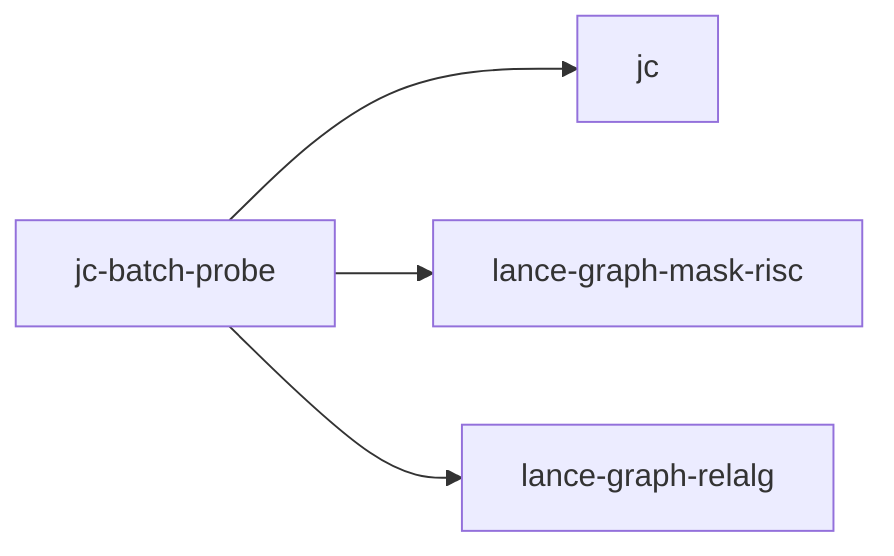

# jc-batch-probe

crate: jc-batch-probe
path: crates/jc-batch-probe
workspace: excluded
digest: 0b005a4e6fa2b7c4
evidence legend: ../index.md#evidence-legend

Generated; the code is the truth. See ../index.md.

## Depends on

- dep jc normal — crates/jc-batch-probe/Cargo.toml:18 CONFIRMED
- dep lance-graph-mask-risc normal — crates/jc-batch-probe/Cargo.toml:16 CONFIRMED
- dep lance-graph-relalg normal — crates/jc-batch-probe/Cargo.toml:14 CONFIRMED
- dep ndarray normal — crates/jc-batch-probe/Cargo.toml:21 CONFIRMED

## Depended on by

## Public items

- enum Stat [pub] — crates/jc-batch-probe/src/lib.rs:58 CONFIRMED
- struct Request [pub] — crates/jc-batch-probe/src/lib.rs:95 CONFIRMED
- enum Answer [pub] — crates/jc-batch-probe/src/lib.rs:107 CONFIRMED
- struct Table [pub] — crates/jc-batch-probe/src/lib.rs:118 CONFIRMED
- enum BatchError [pub] — crates/jc-batch-probe/src/lib.rs:136 CONFIRMED
- struct Cost [pub] — crates/jc-batch-probe/src/lib.rs:172 CONFIRMED
- fn mean [pub] — crates/jc-batch-probe/src/lib.rs:391 CONFIRMED
- fn variance [pub] — crates/jc-batch-probe/src/lib.rs:400 CONFIRMED
- fn answer_separately [pub] — crates/jc-batch-probe/src/lib.rs:432 CONFIRMED
- struct Reduction [pub] — crates/jc-batch-probe/src/lib.rs:462 CONFIRMED
- fn answer_batched [pub] — crates/jc-batch-probe/src/lib.rs:475 CONFIRMED

## Imports from in-scope crates

### jc
- use jc::stats::anova_from_power_sums — crates/jc-batch-probe/src/lib.rs:45 CONFIRMED
- use jc::stats::pearson_from_cross_power_sums — crates/jc-batch-probe/src/lib.rs:45 CONFIRMED
- use jc::stats::r_squared_from_cross_power_sums — crates/jc-batch-probe/src/lib.rs:45 CONFIRMED
- use jc::stats::Anova — crates/jc-batch-probe/src/lib.rs:46 CONFIRMED
- use jc::stats::sample_covariance_from_cross_power_sums — crates/jc-batch-probe/src/lib.rs:46 CONFIRMED
- use jc::stats::simple_regression_from_cross_power_sums — crates/jc-batch-probe/src/lib.rs:46 CONFIRMED
- use jc::stats::SimpleRegression — crates/jc-batch-probe/src/lib.rs:47 CONFIRMED
### lance-graph-mask-risc
- use lance_graph_mask_risc::ExecError — crates/jc-batch-probe/src/lib.rs:50 CONFIRMED
- use lance_graph_mask_risc::Foreign — crates/jc-batch-probe/src/lib.rs:50 CONFIRMED
- use lance_graph_mask_risc::GroupKey — crates/jc-batch-probe/src/lib.rs:50 CONFIRMED
- use lance_graph_mask_risc::LaneRef — crates/jc-batch-probe/src/lib.rs:50 CONFIRMED
- use lance_graph_mask_risc::Operand — crates/jc-batch-probe/src/lib.rs:50 CONFIRMED
- use lance_graph_mask_risc::execute_into — crates/jc-batch-probe/src/lib.rs:50 CONFIRMED
- use lance_graph_mask_risc::scratch_words_for — crates/jc-batch-probe/src/lib.rs:50 CONFIRMED
- use lance_graph_mask_risc::words_for — crates/jc-batch-probe/src/lib.rs:50 CONFIRMED
- use lance_graph_mask_risc::Out — crates/jc-batch-probe/src/lib.rs:51 CONFIRMED
- use lance_graph_mask_risc::Planes — crates/jc-batch-probe/src/lib.rs:51 CONFIRMED
- use lance_graph_mask_risc::Program — crates/jc-batch-probe/src/lib.rs:51 CONFIRMED
- use lance_graph_mask_risc::Scratch — crates/jc-batch-probe/src/lib.rs:51 CONFIRMED
- use lance_graph_mask_risc::Terminal — crates/jc-batch-probe/src/lib.rs:51 CONFIRMED
- use lance_graph_mask_risc::Value — crates/jc-batch-probe/src/lib.rs:51 CONFIRMED
### lance-graph-relalg
- use lance_graph_relalg::Atom — crates/jc-batch-probe/src/lib.rs:53 CONFIRMED
- use lance_graph_relalg::Measure — crates/jc-batch-probe/src/lib.rs:53 CONFIRMED
- use lance_graph_relalg::Query — crates/jc-batch-probe/src/lib.rs:53 CONFIRMED
- use lance_graph_relalg::Rel — crates/jc-batch-probe/src/lib.rs:53 CONFIRMED
- use lance_graph_relalg::RelError — crates/jc-batch-probe/src/lib.rs:53 CONFIRMED
- use lance_graph_relalg::normalize — crates/jc-batch-probe/src/lib.rs:53 CONFIRMED
- use lance_graph_relalg::run — crates/jc-batch-probe/src/lib.rs:53 CONFIRMED

## Calls

CALL_GRAPH=ARTIFACT_MISSING
- calls ARTIFACT_MISSING — no ruff_charon artifact for this crate UNKNOWN

## Architecture

- none

Generated from Cargo manifests — extracted relationships only.

