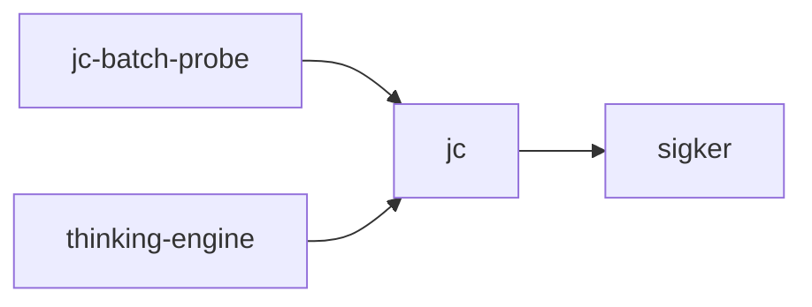

# jc

crate: jc
path: crates/jc
workspace: excluded
digest: ce5dd130a37bd11c
evidence legend: ../index.md#evidence-legend

Generated; the code is the truth. See ../index.md.

## Depends on

- dep lance-graph-contract dev — crates/jc/Cargo.toml:34 CONFIRMED
- dep lance-graph-mask-risc dev — crates/jc/Cargo.toml:44 CONFIRMED
- dep lance-graph-quack dev — crates/jc/Cargo.toml:43 CONFIRMED
- dep neural-debug dev — crates/jc/Cargo.toml:39 CONFIRMED
- dep sigker normal optional — crates/jc/Cargo.toml:22 CONFIRMED
- dep ndarray normal — crates/jc/Cargo.toml:21 CONFIRMED
- dep p64 dev — crates/jc/Cargo.toml:38 CONFIRMED

## Depended on by

- rdep jc-batch-probe normal — crates/jc-batch-probe/Cargo.toml:18 CONFIRMED
- rdep lance-graph-planner dev — crates/lance-graph-planner/Cargo.toml:96 CONFIRMED
- rdep lance-graph-supervisor dev — crates/lance-graph-supervisor/Cargo.toml:65 CONFIRMED
- rdep thinking-engine normal — crates/thinking-engine/Cargo.toml:23 CONFIRMED
- rdep weather-poc dev — crates/weather-poc/Cargo.toml:34 CONFIRMED

## Public items

- fn prove [pub] — crates/jc/src/cartan.rs:15 CONFIRMED
- const CONVERGENCE_EPS [pub] — crates/jc/src/drift.rs:42 CONFIRMED
- struct ReencodeDrift [pub] — crates/jc/src/drift.rs:46 CONFIRMED
- fn reencode_drift [pub] — crates/jc/src/drift.rs:96 CONFIRMED
- struct DriftBatch [pub] — crates/jc/src/drift.rs:133 CONFIRMED
- fn reencode_batch [pub] — crates/jc/src/drift.rs:147 CONFIRMED
- struct DeltaSummary [pub] — crates/jc/src/drift.rs:175 CONFIRMED
- fn DeltaSummary::empty [pub] — crates/jc/src/drift.rs:201 CONFIRMED
- fn delta_summary [pub] — crates/jc/src/drift.rs:228 CONFIRMED
- fn prove [pub] — crates/jc/src/dueker_zoubouloglou.rs:181 CONFIRMED
- fn prove [pub] — crates/jc/src/ewa_sandwich.rs:271 CONFIRMED
- fn prove [pub] — crates/jc/src/ewa_sandwich_3d.rs:471 CONFIRMED
- const LONGEST_PATH_POINTS [pub] cfg=feature="hambly-lyons" — crates/jc/src/hambly_lyons.rs:211 CONFIRMED
- fn prove [pub] cfg=feature="hambly-lyons" — crates/jc/src/hambly_lyons.rs:575 CONFIRMED
- fn prove [pub] cfg=feature="hambly-lyons" — crates/jc/src/hambly_lyons.rs:733 CONFIRMED
- fn prove [pub] cfg=not(feature="hambly-lyons") — crates/jc/src/hambly_lyons.rs:738 CONFIRMED
- fn prove [pub] — crates/jc/src/jirak.rs:127 CONFIRMED
- fn prove [pub] — crates/jc/src/koestenberger.rs:248 CONFIRMED
- mod cartan [pub] — crates/jc/src/lib.rs:33 CONFIRMED
- mod dueker_zoubouloglou [pub] — crates/jc/src/lib.rs:34 CONFIRMED
- mod ewa_sandwich [pub] — crates/jc/src/lib.rs:35 CONFIRMED
- mod ewa_sandwich_3d [pub] — crates/jc/src/lib.rs:36 CONFIRMED
- mod hambly_lyons [pub] — crates/jc/src/lib.rs:37 CONFIRMED
- mod jirak [pub] — crates/jc/src/lib.rs:38 CONFIRMED
- mod koestenberger [pub] — crates/jc/src/lib.rs:39 CONFIRMED
- mod pearl [pub] — crates/jc/src/lib.rs:40 CONFIRMED
- mod pflug [pub] — crates/jc/src/lib.rs:41 CONFIRMED
- mod precond [pub] — crates/jc/src/lib.rs:42 CONFIRMED
- mod solver_order [pub] — crates/jc/src/lib.rs:45 CONFIRMED
- mod substrate [pub] — crates/jc/src/lib.rs:46 CONFIRMED
- mod weyl [pub] — crates/jc/src/lib.rs:47 CONFIRMED
- mod reliability [pub] — crates/jc/src/lib.rs:53 CONFIRMED
- mod stats [pub] — crates/jc/src/lib.rs:63 CONFIRMED
- mod drift [pub] — crates/jc/src/lib.rs:69 CONFIRMED
- mod quorum [pub] — crates/jc/src/lib.rs:74 CONFIRMED
- mod sig_checksum [pub] cfg=feature="hambly-lyons" — crates/jc/src/lib.rs:82 CONFIRMED
- mod sigma_codebook_probe [pub] — crates/jc/src/lib.rs:86 CONFIRMED
- mod probe_p1_gamma_phase [pub] — crates/jc/src/lib.rs:91 CONFIRMED
- struct PillarResult [pub] — crates/jc/src/lib.rs:96 CONFIRMED
- fn PillarResult::deferred [pub] — crates/jc/src/lib.rs:106 CONFIRMED
- fn PillarResult::report [pub] — crates/jc/src/lib.rs:117 CONFIRMED
- fn run_all_pillars [pub] — crates/jc/src/lib.rs:136 CONFIRMED
- fn prove [pub] — crates/jc/src/pearl.rs:117 CONFIRMED
- fn prove [pub] — crates/jc/src/pflug.rs:290 CONFIRMED
- fn prove [pub] — crates/jc/src/precond.rs:141 CONFIRMED
- fn prove [pub] — crates/jc/src/probe_p1_gamma_phase.rs:173 CONFIRMED
- fn max_u8_variance [pub] — crates/jc/src/quorum.rs:44 CONFIRMED
- fn pairwise_agreement_u8 [pub] — crates/jc/src/quorum.rs:70 CONFIRMED
- enum QuorumLevel [pub] — crates/jc/src/quorum.rs:105 CONFIRMED
- const QuorumLevel::HIGH_FLOOR [pub] — crates/jc/src/quorum.rs:121 CONFIRMED
- const QuorumLevel::MEDIUM_FLOOR [pub] — crates/jc/src/quorum.rs:123 CONFIRMED
- const QuorumLevel::LOW_FLOOR [pub] — crates/jc/src/quorum.rs:125 CONFIRMED
- fn QuorumLevel::from_score [pub] — crates/jc/src/quorum.rs:128 CONFIRMED
- fn QuorumLevel::needs_leaf_validation [pub] — crates/jc/src/quorum.rs:141 CONFIRMED
- struct CronbachReport [pub] — crates/jc/src/quorum.rs:149 CONFIRMED
- fn cronbach_report [pub] — crates/jc/src/quorum.rs:169 CONFIRMED
- fn mean [pub(crate)] — crates/jc/src/reliability.rs:62 CONFIRMED
- fn all_finite [pub(crate)] — crates/jc/src/reliability.rs:79 CONFIRMED
- fn pearson [pub] — crates/jc/src/reliability.rs:94 CONFIRMED
- fn pearson_from_centered [pub(crate)] — crates/jc/src/reliability.rs:120 CONFIRMED
- fn spearman [pub] — crates/jc/src/reliability.rs:180 CONFIRMED
- fn cronbach_alpha [pub] — crates/jc/src/reliability.rs:225 CONFIRMED
- enum IccForm [pub] — crates/jc/src/reliability.rs:268 CONFIRMED
- fn icc [pub] — crates/jc/src/reliability.rs:292 CONFIRMED
- fn prove [pub] — crates/jc/src/sigma_codebook_probe.rs:272 CONFIRMED
- const LONGEST_PATH_POINTS [pub] cfg=feature="hambly-lyons" — crates/jc/src/solver_order.rs:54 CONFIRMED
- fn prove [pub] cfg=feature="hambly-lyons" — crates/jc/src/solver_order.rs:226 CONFIRMED
- fn probe_tables [pub] cfg=feature="hambly-lyons" — crates/jc/src/solver_order.rs:271 CONFIRMED
- fn prove [pub] cfg=feature="hambly-lyons" — crates/jc/src/solver_order.rs:288 CONFIRMED
- fn probe_tables [pub] cfg=feature="hambly-lyons" — crates/jc/src/solver_order.rs:294 CONFIRMED
- fn prove [pub] cfg=not(feature="hambly-lyons") — crates/jc/src/solver_order.rs:299 CONFIRMED
- fn cohen_kappa [pub] — crates/jc/src/stats.rs:286 CONFIRMED
- fn omega_total [pub] — crates/jc/src/stats.rs:404 CONFIRMED
- fn phi [pub] — crates/jc/src/stats.rs:603 CONFIRMED
- struct BinaryAssociation [pub] — crates/jc/src/stats.rs:620 CONFIRMED
- fn binary_association [pub] — crates/jc/src/stats.rs:660 CONFIRMED
- fn kr20 [pub] — crates/jc/src/stats.rs:724 CONFIRMED
- fn multiple_r_squared [pub] — crates/jc/src/stats.rs:809 CONFIRMED
- fn multiple_r [pub] — crates/jc/src/stats.rs:906 CONFIRMED
- fn eta_squared [pub] — crates/jc/src/stats.rs:960 CONFIRMED
- struct TTest [pub] — crates/jc/src/stats.rs:980 CONFIRMED
- struct Anova [pub] — crates/jc/src/stats.rs:992 CONFIRMED
- fn t_test_one_sample [pub] — crates/jc/src/stats.rs:1017 CONFIRMED
- fn t_test_paired [pub] — crates/jc/src/stats.rs:1045 CONFIRMED
- fn t_test_welch [pub] — crates/jc/src/stats.rs:1075 CONFIRMED
- fn t_test_student [pub] — crates/jc/src/stats.rs:1115 CONFIRMED
- fn anova_one_way [pub] — crates/jc/src/stats.rs:1153 CONFIRMED
- fn anova_from_power_sums [pub] — crates/jc/src/stats.rs:1282 CONFIRMED
- fn eta_squared_from_power_sums [pub] — crates/jc/src/stats.rs:1291 CONFIRMED
- fn pearson_from_cross_power_sums [pub] — crates/jc/src/stats.rs:1342 CONFIRMED
- fn sample_covariance_from_cross_power_sums [pub] — crates/jc/src/stats.rs:1352 CONFIRMED
- struct SimpleRegression [pub] — crates/jc/src/stats.rs:1361 CONFIRMED
- fn simple_regression_from_cross_power_sums [pub] — crates/jc/src/stats.rs:1380 CONFIRMED
- fn r_squared_from_cross_power_sums [pub] — crates/jc/src/stats.rs:1398 CONFIRMED
- const FISHER_CLAMP_EPS [pub] — crates/jc/src/stats.rs:1424 CONFIRMED
- fn fisher_2z [pub] — crates/jc/src/stats.rs:1434 CONFIRMED
- fn fisher_2z_inv [pub] — crates/jc/src/stats.rs:1443 CONFIRMED
- fn prove [pub] — crates/jc/src/substrate.rs:50 CONFIRMED
- fn prove [pub] — crates/jc/src/weyl.rs:35 CONFIRMED

## Imports from in-scope crates

### sigker
- use sigker::signature::Signature cfg=feature="hambly-lyons" — crates/jc/src/hambly_lyons.rs:189 CONFIRMED
- use sigker::signature_kernel_pde cfg=feature="hambly-lyons" — crates/jc/src/hambly_lyons.rs:190 CONFIRMED
- use sigker::signature_truncated cfg=feature="hambly-lyons" — crates/jc/src/hambly_lyons.rs:191 CONFIRMED
- use sigker::signature::Signature cfg=feature="hambly-lyons" — crates/jc/src/sig_checksum.rs:75 CONFIRMED
- use sigker::signature_truncated cfg=feature="hambly-lyons" — crates/jc/src/sig_checksum.rs:76 CONFIRMED
- use sigker::signature_kernel_pde cfg=feature="hambly-lyons" — crates/jc/src/solver_order.rs:46 CONFIRMED

## Calls

CALL_GRAPH=ARTIFACT_MISSING
- calls ARTIFACT_MISSING — no ruff_charon artifact for this crate UNKNOWN

## Architecture

- none

Generated from Cargo manifests — extracted relationships only.

