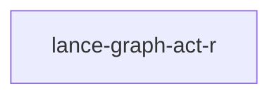

# lance-graph-act-r

crate: lance-graph-act-r
path: crates/lance-graph-act-r
workspace: excluded
digest: 0c2f32f659748109
evidence legend: ../index.md#evidence-legend

Generated; the code is the truth. See ../index.md.

## Depends on

## Depended on by

## Public items

- struct Snapshot [pub] — crates/lance-graph-act-r/src/lib.rs:17 CONFIRMED
- struct Candidate [pub] — crates/lance-graph-act-r/src/lib.rs:24 CONFIRMED
- struct Decision [pub] — crates/lance-graph-act-r/src/lib.rs:38 CONFIRMED
- enum Refusal [pub] — crates/lance-graph-act-r/src/lib.rs:46 CONFIRMED
- fn arbitrate [pub] — crates/lance-graph-act-r/src/lib.rs:66 CONFIRMED
- fn witness_matches [pub] — crates/lance-graph-act-r/src/lib.rs:103 CONFIRMED

## Imports from in-scope crates

- none

## Calls

CALL_GRAPH=ARTIFACT_MISSING
- calls ARTIFACT_MISSING — no ruff_charon artifact for this crate UNKNOWN

## Architecture

- none

Generated from Cargo manifests — extracted relationships only.

