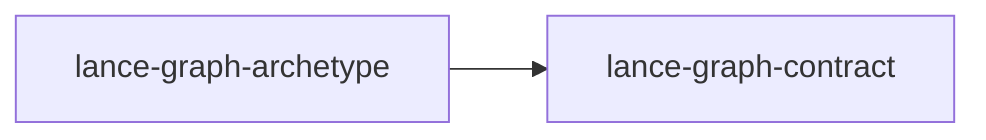

# lance-graph-archetype

crate: lance-graph-archetype
path: crates/lance-graph-archetype
workspace: member
digest: f21fb8dd5714c444
evidence legend: ../index.md#evidence-legend

Generated; the code is the truth. See ../index.md.

## Depends on

- dep lance-graph-contract normal — crates/lance-graph-archetype/Cargo.toml:10 CONFIRMED
- dep arrow normal — crates/lance-graph-archetype/Cargo.toml:15 CONFIRMED
- dep thiserror normal — crates/lance-graph-archetype/Cargo.toml:16 CONFIRMED

## Depended on by

## Public items

- enum Command [pub] — crates/lance-graph-archetype/src/command_broker.rs:18 CONFIRMED
- struct CommandBroker [pub] — crates/lance-graph-archetype/src/command_broker.rs:40 CONFIRMED
- fn CommandBroker::new [pub] — crates/lance-graph-archetype/src/command_broker.rs:47 CONFIRMED
- fn CommandBroker::submit [pub] — crates/lance-graph-archetype/src/command_broker.rs:52 CONFIRMED
- fn CommandBroker::drain [pub] — crates/lance-graph-archetype/src/command_broker.rs:58 CONFIRMED
- fn CommandBroker::len [pub] — crates/lance-graph-archetype/src/command_broker.rs:63 CONFIRMED
- fn CommandBroker::is_empty [pub] — crates/lance-graph-archetype/src/command_broker.rs:68 CONFIRMED
- trait Component [pub] — crates/lance-graph-archetype/src/component.rs:26 CONFIRMED
- enum ArchetypeError [pub] — crates/lance-graph-archetype/src/error.rs:18 CONFIRMED
- mod command_broker [pub] — crates/lance-graph-archetype/src/lib.rs:32 CONFIRMED
- mod component [pub] — crates/lance-graph-archetype/src/lib.rs:33 CONFIRMED
- mod error [pub] — crates/lance-graph-archetype/src/lib.rs:34 CONFIRMED
- mod processor [pub] — crates/lance-graph-archetype/src/lib.rs:35 CONFIRMED
- mod world [pub] — crates/lance-graph-archetype/src/lib.rs:36 CONFIRMED
- trait Processor [pub] — crates/lance-graph-archetype/src/processor.rs:23 CONFIRMED
- struct World [pub] — crates/lance-graph-archetype/src/world.rs:25 CONFIRMED
- fn World::new [pub] — crates/lance-graph-archetype/src/world.rs:41 CONFIRMED
- fn World::tick [pub] — crates/lance-graph-archetype/src/world.rs:51 CONFIRMED
- fn World::current_tick [pub] — crates/lance-graph-archetype/src/world.rs:57 CONFIRMED
- fn World::dataset_uri [pub] — crates/lance-graph-archetype/src/world.rs:62 CONFIRMED
- fn World::fork [pub] — crates/lance-graph-archetype/src/world.rs:82 CONFIRMED
- fn World::at_tick [pub] — crates/lance-graph-archetype/src/world.rs:108 CONFIRMED

## Imports from in-scope crates

- none

## Calls

CALL_GRAPH=ARTIFACT_MISSING
- calls ARTIFACT_MISSING — no ruff_charon artifact for this crate UNKNOWN

## Architecture

- none

Generated from Cargo manifests — extracted relationships only.

