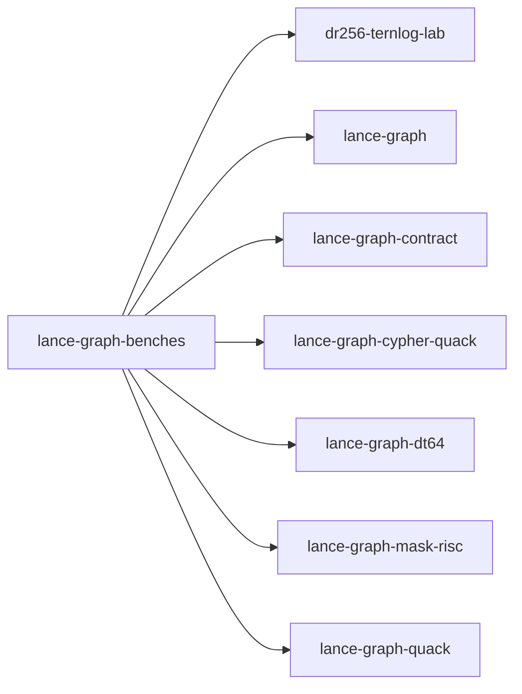

# lance-graph-benches

crate: lance-graph-benches
path: crates/lance-graph-benches
workspace: member
digest: 1e77d94cef3e6121
evidence legend: ../index.md#evidence-legend

Generated; the code is the truth. See ../index.md.

## Depends on

- dep dr256-ternlog-lab normal — crates/lance-graph-benches/Cargo.toml:29 CONFIRMED
- dep lance-graph normal — crates/lance-graph-benches/Cargo.toml:9 CONFIRMED
- dep lance-graph-contract normal — crates/lance-graph-benches/Cargo.toml:31 CONFIRMED
- dep lance-graph-cypher-quack normal — crates/lance-graph-benches/Cargo.toml:27 CONFIRMED
- dep lance-graph-dt64 normal — crates/lance-graph-benches/Cargo.toml:30 CONFIRMED
- dep lance-graph-mask-risc normal — crates/lance-graph-benches/Cargo.toml:32 CONFIRMED
- dep lance-graph-quack normal — crates/lance-graph-benches/Cargo.toml:25 CONFIRMED
- dep arrow normal — crates/lance-graph-benches/Cargo.toml:13 CONFIRMED
- dep arrow-array normal — crates/lance-graph-benches/Cargo.toml:14 CONFIRMED
- dep arrow-schema normal — crates/lance-graph-benches/Cargo.toml:15 CONFIRMED
- dep criterion normal — crates/lance-graph-benches/Cargo.toml:16 CONFIRMED
- dep datafusion normal — crates/lance-graph-benches/Cargo.toml:23 CONFIRMED
- dep futures normal — crates/lance-graph-benches/Cargo.toml:17 CONFIRMED
- dep lance normal — crates/lance-graph-benches/Cargo.toml:10 CONFIRMED
- dep lance-index normal — crates/lance-graph-benches/Cargo.toml:12 CONFIRMED
- dep ndarray normal — crates/lance-graph-benches/Cargo.toml:36 CONFIRMED
- dep serde_json normal — crates/lance-graph-benches/Cargo.toml:24 CONFIRMED
- dep tempfile normal — crates/lance-graph-benches/Cargo.toml:18 CONFIRMED
- dep tokio normal — crates/lance-graph-benches/Cargo.toml:19 CONFIRMED

## Depended on by

## Public items

## Imports from in-scope crates

- none

## Calls

CALL_GRAPH=ARTIFACT_MISSING
- calls ARTIFACT_MISSING — no ruff_charon artifact for this crate UNKNOWN

## Architecture

- none

Generated from Cargo manifests — extracted relationships only.

