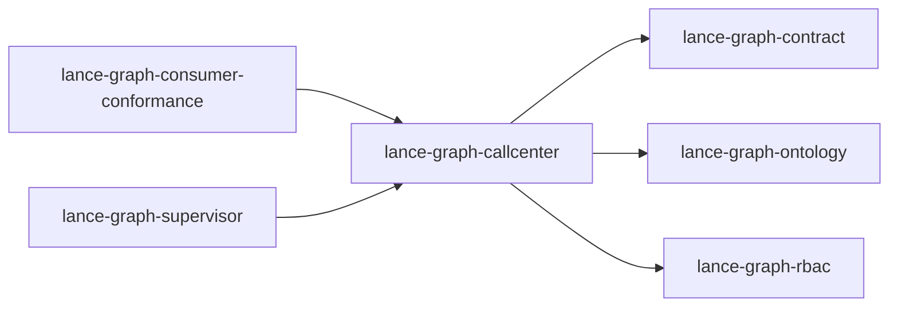

# lance-graph-callcenter

crate: lance-graph-callcenter
path: crates/lance-graph-callcenter
workspace: member
digest: 41a65d38ac70bc87
evidence legend: ../index.md#evidence-legend

Generated; the code is the truth. See ../index.md.

## Depends on

- dep lance-graph-contract normal — crates/lance-graph-callcenter/Cargo.toml:12 CONFIRMED
- dep lance-graph-ontology normal — crates/lance-graph-callcenter/Cargo.toml:18 CONFIRMED
- dep lance-graph-rbac normal — crates/lance-graph-callcenter/Cargo.toml:21 CONFIRMED
- dep arrow normal optional — crates/lance-graph-callcenter/Cargo.toml:27 CONFIRMED
- dep arrow-array normal optional — crates/lance-graph-callcenter/Cargo.toml:50 CONFIRMED
- dep arrow-schema normal optional — crates/lance-graph-callcenter/Cargo.toml:51 CONFIRMED
- dep async-trait normal — crates/lance-graph-callcenter/Cargo.toml:66 CONFIRMED
- dep axum normal optional — crates/lance-graph-callcenter/Cargo.toml:60 CONFIRMED
- dep chrono normal optional — crates/lance-graph-callcenter/Cargo.toml:45 CONFIRMED
- dep clap normal optional — crates/lance-graph-callcenter/Cargo.toml:54 CONFIRMED
- dep datafusion normal optional — crates/lance-graph-callcenter/Cargo.toml:35 CONFIRMED
- dep flate2 normal optional — crates/lance-graph-callcenter/Cargo.toml:46 CONFIRMED
- dep futures normal optional — crates/lance-graph-callcenter/Cargo.toml:57 CONFIRMED
- dep lance normal optional — crates/lance-graph-callcenter/Cargo.toml:28 CONFIRMED
- dep log normal — crates/lance-graph-callcenter/Cargo.toml:14 CONFIRMED
- dep serde normal optional — crates/lance-graph-callcenter/Cargo.toml:40 CONFIRMED
- dep serde_json normal optional — crates/lance-graph-callcenter/Cargo.toml:41 CONFIRMED
- dep syn build — crates/lance-graph-callcenter/Cargo.toml:127 CONFIRMED
- dep thiserror normal — crates/lance-graph-callcenter/Cargo.toml:22 CONFIRMED
- dep tokio dev — crates/lance-graph-callcenter/Cargo.toml:130 CONFIRMED
- dep tokio normal optional — crates/lance-graph-callcenter/Cargo.toml:38 CONFIRMED
- dep tokio-tungstenite normal optional — crates/lance-graph-callcenter/Cargo.toml:39 CONFIRMED
- dep tower-http normal optional — crates/lance-graph-callcenter/Cargo.toml:61 CONFIRMED

## Depended on by

- rdep lance-graph-consumer-conformance normal — crates/lance-graph-consumer-conformance/Cargo.toml:14 CONFIRMED
- rdep lance-graph-supervisor normal — crates/lance-graph-supervisor/Cargo.toml:13 CONFIRMED

## Public items

- struct AuditEntry [pub] cfg=feature="audit-log" — crates/lance-graph-callcenter/src/audit.rs:18 CONFIRMED
- fn AuditEntry::with_plan [pub] cfg=feature="audit-log" — crates/lance-graph-callcenter/src/audit.rs:37 CONFIRMED
- enum StatementKind [pub] cfg=feature="audit-log" — crates/lance-graph-callcenter/src/audit.rs:60 CONFIRMED
- trait AuditSink [pub] cfg=feature="audit-log" — crates/lance-graph-callcenter/src/audit.rs:70 CONFIRMED
- struct InMemoryAuditSink [pub] cfg=feature="audit-log" — crates/lance-graph-callcenter/src/audit.rs:81 CONFIRMED
- fn InMemoryAuditSink::with_capacity [pub] cfg=feature="audit-log" — crates/lance-graph-callcenter/src/audit.rs:95 CONFIRMED
- struct LanceAuditSink [pub] cfg=feature="audit-log" — crates/lance-graph-callcenter/src/audit.rs:159 CONFIRMED
- fn LanceAuditSink::new [pub] cfg=feature="audit-log" — crates/lance-graph-callcenter/src/audit.rs:170 CONFIRMED
- fn LanceAuditSink::flush [pub] cfg=feature="audit-log" — crates/lance-graph-callcenter/src/audit.rs:182 CONFIRMED
- fn LanceAuditSink::scan_back [pub] cfg=feature="audit-log" — crates/lance-graph-callcenter/src/audit.rs:270 CONFIRMED
- fn hash_statement [pub] cfg=feature="audit-log" — crates/lance-graph-callcenter/src/audit.rs:424 CONFIRMED
- fn now_unix_ms [pub] cfg=feature="audit-log" — crates/lance-graph-callcenter/src/audit.rs:430 CONFIRMED
- fn audit_from_plan [pub] cfg=all(feature="audit-log", feature="datafusion-plan") — crates/lance-graph-callcenter/src/audit.rs:440 CONFIRMED
- enum FanoutMode [pub] — crates/lance-graph-callcenter/src/audit_sink/composite.rs:17 CONFIRMED
- struct CompositeSink [pub] — crates/lance-graph-callcenter/src/audit_sink/composite.rs:27 CONFIRMED
- fn CompositeSink::new [pub] — crates/lance-graph-callcenter/src/audit_sink/composite.rs:34 CONFIRMED
- const JSONL_BUFFER_CAPACITY [pub] cfg=feature="jsonl" — crates/lance-graph-callcenter/src/audit_sink/jsonl_sink.rs:31 CONFIRMED
- struct JsonlAuditSink [pub] cfg=feature="jsonl" — crates/lance-graph-callcenter/src/audit_sink/jsonl_sink.rs:34 CONFIRMED
- fn JsonlAuditSink::new [pub] cfg=feature="jsonl" — crates/lance-graph-callcenter/src/audit_sink/jsonl_sink.rs:44 CONFIRMED
- fn serialize_event [pub] cfg=feature="jsonl" — crates/lance-graph-callcenter/src/audit_sink/jsonl_sink.rs:160 CONFIRMED
- const LANCE_BUFFER_CAPACITY [pub] cfg=feature="lance-sink" — crates/lance-graph-callcenter/src/audit_sink/lance_sink.rs:29 CONFIRMED
- const LANCE_FLUSH_THRESHOLD [pub] cfg=feature="lance-sink" — crates/lance-graph-callcenter/src/audit_sink/lance_sink.rs:32 CONFIRMED
- fn audit_event_schema [pub] cfg=feature="lance-sink" — crates/lance-graph-callcenter/src/audit_sink/lance_sink.rs:35 CONFIRMED
- struct LanceAuditSink [pub] cfg=feature="lance-sink" — crates/lance-graph-callcenter/src/audit_sink/lance_sink.rs:54 CONFIRMED
- fn LanceAuditSink::new [pub] cfg=feature="lance-sink" — crates/lance-graph-callcenter/src/audit_sink/lance_sink.rs:66 CONFIRMED
- type MerkleRoot [pub] — crates/lance-graph-callcenter/src/audit_sink/mod.rs:16 CONFIRMED
- enum AuditError [pub] — crates/lance-graph-callcenter/src/audit_sink/mod.rs:20 CONFIRMED
- trait AuditSink [pub] — crates/lance-graph-callcenter/src/audit_sink/mod.rs:46 CONFIRMED
- struct NoopAuditSink [pub] — crates/lance-graph-callcenter/src/audit_sink/mod.rs:64 CONFIRMED
- mod composite [pub] — crates/lance-graph-callcenter/src/audit_sink/mod.rs:78 CONFIRMED
- mod jsonl_sink [pub] cfg=feature="jsonl" — crates/lance-graph-callcenter/src/audit_sink/mod.rs:81 CONFIRMED
- mod lance_sink [pub] cfg=feature="lance-sink" — crates/lance-graph-callcenter/src/audit_sink/mod.rs:84 CONFIRMED
- struct JwtMiddleware [pub] cfg=any(feature="auth-jwt", feature="auth", feature="full") — crates/lance-graph-callcenter/src/auth.rs:43 CONFIRMED
- fn JwtMiddleware::extract_actor [pub] cfg=any(feature="auth-jwt", feature="auth", feature="full") — crates/lance-graph-callcenter/src/auth.rs:77 CONFIRMED
- fn JwtMiddleware::extract_from_header [pub] cfg=any(feature="auth-jwt", feature="auth", feature="full") — crates/lance-graph-callcenter/src/auth.rs:105 CONFIRMED
- struct UnifiedBridgeGate [pub] — crates/lance-graph-callcenter/src/cognitive_bridge_gate.rs:82 CONFIRMED
- fn UnifiedBridgeGate<B>::new [pub] — crates/lance-graph-callcenter/src/cognitive_bridge_gate.rs:91 CONFIRMED
- fn UnifiedBridgeGate<B>::chinese_wall_deny_count [pub] — crates/lance-graph-callcenter/src/cognitive_bridge_gate.rs:99 CONFIRMED
- struct DnPath [pub] — crates/lance-graph-callcenter/src/dn_path.rs:19 CONFIRMED
- fn DnPath::parse [pub] — crates/lance-graph-callcenter/src/dn_path.rs:33 CONFIRMED
- fn DnPath::scent_u64 [pub] — crates/lance-graph-callcenter/src/dn_path.rs:64 CONFIRMED
- fn DnPath::scent [pub] — crates/lance-graph-callcenter/src/dn_path.rs:94 CONFIRMED
- fn DnPath::scent_stub [pub] — crates/lance-graph-callcenter/src/dn_path.rs:106 CONFIRMED
- struct DrainTask [pub] cfg=feature="realtime" — crates/lance-graph-callcenter/src/drain.rs:61 CONFIRMED
- fn DrainTask::drained [pub] cfg=feature="realtime" — crates/lance-graph-callcenter/src/drain.rs:72 CONFIRMED
- fn drain_channel [pub] cfg=feature="realtime" — crates/lance-graph-callcenter/src/drain.rs:93 CONFIRMED
- struct DrainTask [pub] cfg=not(feature="realtime") — crates/lance-graph-callcenter/src/drain.rs:147 CONFIRMED
- fn DrainTask::new [pub] cfg=not(feature="realtime") — crates/lance-graph-callcenter/src/drain.rs:153 CONFIRMED
- fn DrainTask::drained [pub] cfg=not(feature="realtime") — crates/lance-graph-callcenter/src/drain.rs:157 CONFIRMED
- struct ExternalIntent [pub] — crates/lance-graph-callcenter/src/external_intent.rs:34 CONFIRMED
- fn ExternalIntent::seed [pub] — crates/lance-graph-callcenter/src/external_intent.rs:48 CONFIRMED
- fn ExternalIntent::context [pub] — crates/lance-graph-callcenter/src/external_intent.rs:58 CONFIRMED
- struct CognitiveEventRow [pub] — crates/lance-graph-callcenter/src/external_intent.rs:113 CONFIRMED
- struct OwlCharacteristics [pub] — crates/lance-graph-callcenter/src/family_table.rs:63 CONFIRMED
- const OwlCharacteristics::FUNCTIONAL [pub] — crates/lance-graph-callcenter/src/family_table.rs:66 CONFIRMED
- const OwlCharacteristics::INVERSE_FUNCTIONAL [pub] — crates/lance-graph-callcenter/src/family_table.rs:67 CONFIRMED
- const OwlCharacteristics::TRANSITIVE [pub] — crates/lance-graph-callcenter/src/family_table.rs:68 CONFIRMED
- const OwlCharacteristics::SYMMETRIC [pub] — crates/lance-graph-callcenter/src/family_table.rs:69 CONFIRMED
- const OwlCharacteristics::ASYMMETRIC [pub] — crates/lance-graph-callcenter/src/family_table.rs:70 CONFIRMED
- const OwlCharacteristics::REFLEXIVE [pub] — crates/lance-graph-callcenter/src/family_table.rs:71 CONFIRMED
- const OwlCharacteristics::IRREFLEXIVE [pub] — crates/lance-graph-callcenter/src/family_table.rs:72 CONFIRMED
- const OwlCharacteristics::RESERVED [pub] — crates/lance-graph-callcenter/src/family_table.rs:74 CONFIRMED
- const OwlCharacteristics::EMPTY [pub] — crates/lance-graph-callcenter/src/family_table.rs:76 CONFIRMED
- fn OwlCharacteristics::from_bits [pub] — crates/lance-graph-callcenter/src/family_table.rs:79 CONFIRMED
- fn OwlCharacteristics::bits [pub] — crates/lance-graph-callcenter/src/family_table.rs:84 CONFIRMED
- fn OwlCharacteristics::is_functional [pub] — crates/lance-graph-callcenter/src/family_table.rs:89 CONFIRMED
- fn OwlCharacteristics::is_inverse_functional [pub] — crates/lance-graph-callcenter/src/family_table.rs:94 CONFIRMED
- fn OwlCharacteristics::is_transitive [pub] — crates/lance-graph-callcenter/src/family_table.rs:99 CONFIRMED
- fn OwlCharacteristics::is_symmetric [pub] — crates/lance-graph-callcenter/src/family_table.rs:104 CONFIRMED
- fn OwlCharacteristics::is_asymmetric [pub] — crates/lance-graph-callcenter/src/family_table.rs:109 CONFIRMED
- fn OwlCharacteristics::is_reflexive [pub] — crates/lance-graph-callcenter/src/family_table.rs:114 CONFIRMED
- fn OwlCharacteristics::is_irreflexive [pub] — crates/lance-graph-callcenter/src/family_table.rs:119 CONFIRMED
- struct FamilyEntry [pub] — crates/lance-graph-callcenter/src/family_table.rs:133 CONFIRMED
- fn FamilyEntry::plain_entity [pub] — crates/lance-graph-callcenter/src/family_table.rs:160 CONFIRMED
- struct PerFamilyCodebook [pub] — crates/lance-graph-callcenter/src/family_table.rs:182 CONFIRMED
- struct OgitFamilyTable [pub] — crates/lance-graph-callcenter/src/family_table.rs:197 CONFIRMED
- fn OgitFamilyTable::empty [pub] — crates/lance-graph-callcenter/src/family_table.rs:206 CONFIRMED
- fn OgitFamilyTable::lookup [pub] — crates/lance-graph-callcenter/src/family_table.rs:220 CONFIRMED
- fn OgitFamilyTable::label [pub] — crates/lance-graph-callcenter/src/family_table.rs:234 CONFIRMED
- fn OgitFamilyTable::kind [pub] — crates/lance-graph-callcenter/src/family_table.rs:240 CONFIRMED
- fn OgitFamilyTable::is_functional [pub] — crates/lance-graph-callcenter/src/family_table.rs:247 CONFIRMED
- fn OgitFamilyTable::is_transitive [pub] — crates/lance-graph-callcenter/src/family_table.rs:255 CONFIRMED
- fn OgitFamilyTable::set [pub] — crates/lance-graph-callcenter/src/family_table.rs:262 CONFIRMED
- fn OgitFamilyTable::clear [pub] — crates/lance-graph-callcenter/src/family_table.rs:267 CONFIRMED
- fn OgitFamilyTable::len [pub] — crates/lance-graph-callcenter/src/family_table.rs:272 CONFIRMED
- fn OgitFamilyTable::is_empty [pub] — crates/lance-graph-callcenter/src/family_table.rs:277 CONFIRMED
- mod columns [pub] cfg=feature="query" — crates/lance-graph-callcenter/src/filter_expr.rs:16 CONFIRMED
- const GATE_F [pub] cfg=feature="query" — crates/lance-graph-callcenter/src/filter_expr.rs:17 CONFIRMED
- const THINKING [pub] cfg=feature="query" — crates/lance-graph-callcenter/src/filter_expr.rs:18 CONFIRMED
- const GATE_COMMIT [pub] cfg=feature="query" — crates/lance-graph-callcenter/src/filter_expr.rs:19 CONFIRMED
- fn commit_filter_to_expr [pub] cfg=feature="query" — crates/lance-graph-callcenter/src/filter_expr.rs:34 CONFIRMED
- struct GraphTraversalSource [pub] — crates/lance-graph-callcenter/src/graph_gremlin.rs:24 CONFIRMED
- fn g [pub] — crates/lance-graph-callcenter/src/graph_gremlin.rs:29 CONFIRMED
- fn GraphTraversalSource<'a>::v [pub] — crates/lance-graph-callcenter/src/graph_gremlin.rs:36 CONFIRMED
- struct Traversal [pub] — crates/lance-graph-callcenter/src/graph_gremlin.rs:51 CONFIRMED
- fn Traversal<'a>::out [pub] — crates/lance-graph-callcenter/src/graph_gremlin.rs:59 CONFIRMED
- fn Traversal<'a>::out_e [pub] — crates/lance-graph-callcenter/src/graph_gremlin.rs:66 CONFIRMED
- fn Traversal<'a>::in_ [pub] — crates/lance-graph-callcenter/src/graph_gremlin.rs:73 CONFIRMED
- fn Traversal<'a>::in_e [pub] — crates/lance-graph-callcenter/src/graph_gremlin.rs:80 CONFIRMED
- fn Traversal<'a>::dedup [pub] — crates/lance-graph-callcenter/src/graph_gremlin.rs:115 CONFIRMED
- fn Traversal<'a>::values_kind [pub] — crates/lance-graph-callcenter/src/graph_gremlin.rs:124 CONFIRMED
- fn Traversal<'a>::to_vec [pub] — crates/lance-graph-callcenter/src/graph_gremlin.rs:139 CONFIRMED
- fn Traversal<'a>::count [pub] — crates/lance-graph-callcenter/src/graph_gremlin.rs:145 CONFIRMED
- fn nodes_schema [pub] cfg=feature="query-lite" — crates/lance-graph-callcenter/src/graph_table.rs:29 CONFIRMED
- fn edges_schema [pub] cfg=feature="query-lite" — crates/lance-graph-callcenter/src/graph_table.rs:39 CONFIRMED
- fn nodes_batch [pub] cfg=feature="query-lite" — crates/lance-graph-callcenter/src/graph_table.rs:50 CONFIRMED
- fn edges_batch [pub] cfg=feature="query-lite" — crates/lance-graph-callcenter/src/graph_table.rs:67 CONFIRMED
- fn nodes_table [pub] cfg=feature="query-lite" — crates/lance-graph-callcenter/src/graph_table.rs:86 CONFIRMED
- fn edges_table [pub] cfg=feature="query-lite" — crates/lance-graph-callcenter/src/graph_table.rs:91 CONFIRMED
- fn graph_tables [pub] cfg=feature="query-lite" — crates/lance-graph-callcenter/src/graph_table.rs:96 CONFIRMED
- fn register_graph [pub] cfg=all(feature="query-lite", feature="query") — crates/lance-graph-callcenter/src/graph_table.rs:106 CONFIRMED
- const SEED_TTL [pub] — crates/lance-graph-callcenter/src/hydration.rs:35 CONFIRMED
- enum HydrationError [pub] — crates/lance-graph-callcenter/src/hydration.rs:43 CONFIRMED
- enum HydrationPolicy [pub] — crates/lance-graph-callcenter/src/hydration.rs:69 CONFIRMED
- struct HydrationSourceSet [pub] — crates/lance-graph-callcenter/src/hydration.rs:86 CONFIRMED
- struct FamilyTableInner [pub] — crates/lance-graph-callcenter/src/hydration.rs:99 CONFIRMED
- static FAMILY_TABLE [pub] — crates/lance-graph-callcenter/src/hydration.rs:135 CONFIRMED
- fn load_seed [pub] — crates/lance-graph-callcenter/src/hydration.rs:143 CONFIRMED
- fn load_overlay [pub] — crates/lance-graph-callcenter/src/hydration.rs:164 CONFIRMED
- fn sanity_gate [pub] — crates/lance-graph-callcenter/src/hydration.rs:224 CONFIRMED
- fn commit [pub] — crates/lance-graph-callcenter/src/hydration.rs:245 CONFIRMED
- fn try_resolve [pub] — crates/lance-graph-callcenter/src/hydration.rs:267 CONFIRMED
- fn current_generation [pub] — crates/lance-graph-callcenter/src/hydration.rs:277 CONFIRMED
- trait Plugin [pub] — crates/lance-graph-callcenter/src/lance_membrane.rs:95 CONFIRMED
- struct MembraneRegistry [pub] — crates/lance-graph-callcenter/src/lance_membrane.rs:134 CONFIRMED
- fn MembraneRegistry::new [pub] — crates/lance-graph-callcenter/src/lance_membrane.rs:152 CONFIRMED
- fn MembraneRegistry::with_rls [pub] cfg=all(feature="membrane-plugins-rls", any(feature="auth-rls-lite", feature="auth-rls", feature="auth", feature="full")) — crates/lance-graph-callcenter/src/lance_membrane.rs:169 CONFIRMED
- fn MembraneRegistry::with_audit [pub] cfg=all(feature="membrane-plugins-audit", feature="audit-log") — crates/lance-graph-callcenter/src/lance_membrane.rs:177 CONFIRMED
- fn MembraneRegistry::rls [pub] cfg=all(feature="membrane-plugins-rls", any(feature="auth-rls-lite", feature="auth-rls", feature="auth", feature="full")) — crates/lance-graph-callcenter/src/lance_membrane.rs:192 CONFIRMED
- fn MembraneRegistry::audit [pub] cfg=all(feature="membrane-plugins-audit", feature="audit-log") — crates/lance-graph-callcenter/src/lance_membrane.rs:198 CONFIRMED
- fn MembraneRegistry::seal [pub] — crates/lance-graph-callcenter/src/lance_membrane.rs:204 CONFIRMED
- struct LanceMembrane [pub] — crates/lance-graph-callcenter/src/lance_membrane.rs:219 CONFIRMED
- fn LanceMembrane::new [pub] — crates/lance-graph-callcenter/src/lance_membrane.rs:238 CONFIRMED
- fn LanceMembrane::with_registry [pub] — crates/lance-graph-callcenter/src/lance_membrane.rs:261 CONFIRMED
- fn LanceMembrane::registry [pub] — crates/lance-graph-callcenter/src/lance_membrane.rs:267 CONFIRMED
- fn LanceMembrane::set_server_filter [pub] — crates/lance-graph-callcenter/src/lance_membrane.rs:274 CONFIRMED
- fn LanceMembrane::set_gate [pub] — crates/lance-graph-callcenter/src/lance_membrane.rs:280 CONFIRMED
- fn LanceMembrane::clear_gate [pub] — crates/lance-graph-callcenter/src/lance_membrane.rs:285 CONFIRMED
- fn LanceMembrane::version [pub] — crates/lance-graph-callcenter/src/lance_membrane.rs:291 CONFIRMED
- fn LanceMembrane::commit_event [pub] — crates/lance-graph-callcenter/src/lance_membrane.rs:315 CONFIRMED
- fn LanceMembrane::set_faculty_context [pub] — crates/lance-graph-callcenter/src/lance_membrane.rs:332 CONFIRMED
- mod ontology_dto [pub] — crates/lance-graph-callcenter/src/lib.rs:50 CONFIRMED
- mod dn_path [pub] — crates/lance-graph-callcenter/src/lib.rs:56 CONFIRMED
- mod external_intent [pub] — crates/lance-graph-callcenter/src/lib.rs:57 CONFIRMED
- mod lance_membrane [pub] — crates/lance-graph-callcenter/src/lib.rs:58 CONFIRMED
- mod vsa_udfs [pub] cfg=feature="query" — crates/lance-graph-callcenter/src/lib.rs:66 CONFIRMED
- mod filter_expr [pub] cfg=feature="query" — crates/lance-graph-callcenter/src/lib.rs:73 CONFIRMED
- mod version_watcher [pub] cfg=feature="realtime" — crates/lance-graph-callcenter/src/lib.rs:77 CONFIRMED
- mod drain [pub] — crates/lance-graph-callcenter/src/lib.rs:84 CONFIRMED
- mod auth [pub] cfg=any(feature="auth-jwt", feature="auth", feature="full") — crates/lance-graph-callcenter/src/lib.rs:91 CONFIRMED
- mod rls [pub] cfg=any(feature="auth-rls-lite", feature="auth-rls", feature="auth", feature="full") — crates/lance-graph-callcenter/src/lib.rs:101 CONFIRMED
- mod postgrest [pub] cfg=feature="postgrest" — crates/lance-graph-callcenter/src/lib.rs:107 CONFIRMED
- mod audit [pub] cfg=feature="audit-log" — crates/lance-graph-callcenter/src/lib.rs:112 CONFIRMED
- mod policy [pub] cfg=any(feature="auth-rls-lite", feature="auth-rls", feature="auth", feature="full") — crates/lance-graph-callcenter/src/lib.rs:124 CONFIRMED
- mod transcode [pub] — crates/lance-graph-callcenter/src/lib.rs:131 CONFIRMED
- mod graph_gremlin [pub] — crates/lance-graph-callcenter/src/lib.rs:138 CONFIRMED
- mod graph_table [pub] cfg=feature="query-lite" — crates/lance-graph-callcenter/src/lib.rs:140 CONFIRMED
- mod hydration [pub] — crates/lance-graph-callcenter/src/lib.rs:145 CONFIRMED
- mod unified_bridge [pub] — crates/lance-graph-callcenter/src/lib.rs:157 CONFIRMED
- mod super_domain [pub] — crates/lance-graph-callcenter/src/lib.rs:175 CONFIRMED
- mod family_table [pub] — crates/lance-graph-callcenter/src/lib.rs:188 CONFIRMED
- mod odoo_alignment [pub] — crates/lance-graph-callcenter/src/lib.rs:198 CONFIRMED
- mod savant_reasoners [pub] — crates/lance-graph-callcenter/src/lib.rs:208 CONFIRMED
- mod cognitive_bridge_gate [pub] — crates/lance-graph-callcenter/src/lib.rs:218 CONFIRMED
- mod unified_audit [pub] — crates/lance-graph-callcenter/src/lib.rs:227 CONFIRMED
- mod audit_sink [pub] — crates/lance-graph-callcenter/src/lib.rs:237 CONFIRMED
- const FAMILY_BILLING_CORE [pub] — crates/lance-graph-callcenter/src/odoo_alignment.rs:39 CONFIRMED
- const FAMILY_SMB_ACCOUNTING [pub] — crates/lance-graph-callcenter/src/odoo_alignment.rs:42 CONFIRMED
- const FAMILY_SMB_FOUNDRY_CUSTOMER [pub] — crates/lance-graph-callcenter/src/odoo_alignment.rs:44 CONFIRMED
- const FAMILY_SMB_FOUNDRY_INVOICE [pub] — crates/lance-graph-callcenter/src/odoo_alignment.rs:46 CONFIRMED
- const FAMILY_PRODUCT_CATALOG [pub] — crates/lance-graph-callcenter/src/odoo_alignment.rs:54 CONFIRMED
- const FAMILY_HR_FOUNDATION [pub] — crates/lance-graph-callcenter/src/odoo_alignment.rs:57 CONFIRMED
- struct OwlPivot [pub] — crates/lance-graph-callcenter/src/odoo_alignment.rs:66 CONFIRMED
- fn OwlPivot::identity [pub] — crates/lance-graph-callcenter/src/odoo_alignment.rs:81 CONFIRMED
- fn dolce_odoo [pub] — crates/lance-graph-callcenter/src/odoo_alignment.rs:102 CONFIRMED
- fn family_default_style [pub] — crates/lance-graph-callcenter/src/odoo_alignment.rs:152 CONFIRMED
- fn resolve_odoo_style [pub] — crates/lance-graph-callcenter/src/odoo_alignment.rs:168 CONFIRMED
- fn resolve_odoo [pub] — crates/lance-graph-callcenter/src/odoo_alignment.rs:372 CONFIRMED
- fn resolve_odoo_to_family [pub] — crates/lance-graph-callcenter/src/odoo_alignment.rs:400 CONFIRMED
- fn resolve_odoo_entry [pub] — crates/lance-graph-callcenter/src/odoo_alignment.rs:414 CONFIRMED
- fn seed_family_table [pub] — crates/lance-graph-callcenter/src/odoo_alignment.rs:425 CONFIRMED
- struct OntologyDto [pub] — crates/lance-graph-callcenter/src/ontology_dto.rs:30 CONFIRMED
- struct EntityTypeDto [pub] — crates/lance-graph-callcenter/src/ontology_dto.rs:40 CONFIRMED
- struct PropertyDto [pub] — crates/lance-graph-callcenter/src/ontology_dto.rs:49 CONFIRMED
- struct LinkTypeDto [pub] — crates/lance-graph-callcenter/src/ontology_dto.rs:57 CONFIRMED
- struct ActionTypeDto [pub] — crates/lance-graph-callcenter/src/ontology_dto.rs:65 CONFIRMED
- fn OntologyDto::project [pub] — crates/lance-graph-callcenter/src/ontology_dto.rs:82 CONFIRMED
- fn OntologyDto::from_ontology [pub] — crates/lance-graph-callcenter/src/ontology_dto.rs:116 CONFIRMED
- fn OntologyDto::entity_type [pub] — crates/lance-graph-callcenter/src/ontology_dto.rs:171 CONFIRMED
- fn OntologyDto::links_from [pub] — crates/lance-graph-callcenter/src/ontology_dto.rs:175 CONFIRMED
- fn OntologyDto::actions_for [pub] — crates/lance-graph-callcenter/src/ontology_dto.rs:182 CONFIRMED
- fn smb_ontology [pub] — crates/lance-graph-callcenter/src/ontology_dto.rs:305 CONFIRMED
- fn medcare_ontology [pub] — crates/lance-graph-callcenter/src/ontology_dto.rs:317 CONFIRMED
- enum PolicyKind [pub] cfg=any(feature="auth-rls-lite", feature="auth-rls", feature="auth", feature="full") — crates/lance-graph-callcenter/src/policy.rs:40 CONFIRMED
- trait PolicyRewriter [pub] cfg=all(any(feature="auth-rls-lite", feature="auth-rls", feature="auth", feature="full"), feature="auth-rls-lite") — crates/lance-graph-callcenter/src/policy.rs:56 CONFIRMED
- enum RedactionMode [pub] cfg=any(feature="auth-rls-lite", feature="auth-rls", feature="auth", feature="full") — crates/lance-graph-callcenter/src/policy.rs:71 CONFIRMED
- struct ColumnMaskPolicy [pub] cfg=any(feature="auth-rls-lite", feature="auth-rls", feature="auth", feature="full") — crates/lance-graph-callcenter/src/policy.rs:85 CONFIRMED
- struct ColumnMaskRegistry [pub] cfg=any(feature="auth-rls-lite", feature="auth-rls", feature="auth", feature="full") — crates/lance-graph-callcenter/src/policy.rs:93 CONFIRMED
- fn ColumnMaskRegistry::new [pub] cfg=any(feature="auth-rls-lite", feature="auth-rls", feature="auth", feature="full") — crates/lance-graph-callcenter/src/policy.rs:98 CONFIRMED
- fn ColumnMaskRegistry::register [pub] cfg=any(feature="auth-rls-lite", feature="auth-rls", feature="auth", feature="full") — crates/lance-graph-callcenter/src/policy.rs:101 CONFIRMED
- truncated (400 total), see symbols.tsv

## Imports from in-scope crates

### lance-graph-contract
- use lance_graph_contract::auth::ActorContext cfg=any(feature="auth-jwt", feature="auth", feature="full") — crates/lance-graph-callcenter/src/auth.rs:33 CONFIRMED
- use lance_graph_contract::auth::AuthError cfg=any(feature="auth-jwt", feature="auth", feature="full") — crates/lance-graph-callcenter/src/auth.rs:33 CONFIRMED
- use lance_graph_contract::property::PrefetchDepth — crates/lance-graph-callcenter/src/cognitive_bridge_gate.rs:42 CONFIRMED
- use lance_graph_contract::bridge_gate::CognitiveAuthResult — crates/lance-graph-callcenter/src/cognitive_bridge_gate.rs:47 CONFIRMED
- use lance_graph_contract::bridge_gate::CognitiveBridgeGate — crates/lance-graph-callcenter/src/cognitive_bridge_gate.rs:47 CONFIRMED
- use lance_graph_contract::bridge_gate::CognitiveOpKind — crates/lance-graph-callcenter/src/cognitive_bridge_gate.rs:47 CONFIRMED
- use lance_graph_contract::bridge_gate::CognitiveAuthResult cfg=test — crates/lance-graph-callcenter/src/cognitive_bridge_gate.rs:201 CONFIRMED
- use lance_graph_contract::bridge_gate::CognitiveBridgeGate cfg=test — crates/lance-graph-callcenter/src/cognitive_bridge_gate.rs:201 CONFIRMED
- use lance_graph_contract::bridge_gate::CognitiveOpKind cfg=test — crates/lance-graph-callcenter/src/cognitive_bridge_gate.rs:201 CONFIRMED
- use lance_graph_contract::external_membrane::ExternalMembrane cfg=feature="realtime" — crates/lance-graph-callcenter/src/drain.rs:34 CONFIRMED
- use lance_graph_contract::orchestration::OrchestrationBridge cfg=feature="realtime" — crates/lance-graph-callcenter/src/drain.rs:36 CONFIRMED
- use lance_graph_contract::external_membrane::ExternalRole cfg=all(test, feature="realtime") — crates/lance-graph-callcenter/src/drain.rs:179 CONFIRMED
- use lance_graph_contract::nars::InferenceType cfg=all(test, feature="realtime") — crates/lance-graph-callcenter/src/drain.rs:180 CONFIRMED
- use lance_graph_contract::orchestration::OrchestrationError cfg=all(test, feature="realtime") — crates/lance-graph-callcenter/src/drain.rs:181 CONFIRMED
- use lance_graph_contract::orchestration::StepDomain cfg=all(test, feature="realtime") — crates/lance-graph-callcenter/src/drain.rs:181 CONFIRMED
- use lance_graph_contract::orchestration::UnifiedStep cfg=all(test, feature="realtime") — crates/lance-graph-callcenter/src/drain.rs:181 CONFIRMED
- use lance_graph_contract::plan::ThinkingContext cfg=all(test, feature="realtime") — crates/lance-graph-callcenter/src/drain.rs:182 CONFIRMED
- use lance_graph_contract::thinking::ThinkingStyle cfg=all(test, feature="realtime") — crates/lance-graph-callcenter/src/drain.rs:183 CONFIRMED
- use lance_graph_contract::external_membrane::ExternalEventKind — crates/lance-graph-callcenter/src/external_intent.rs:13 CONFIRMED
- use lance_graph_contract::external_membrane::ExternalRole — crates/lance-graph-callcenter/src/external_intent.rs:13 CONFIRMED
- use lance_graph_contract::persona::RoutingHint — crates/lance-graph-callcenter/src/external_intent.rs:14 CONFIRMED
- use lance_graph_contract::external_membrane::CommitFilter cfg=feature="query" — crates/lance-graph-callcenter/src/filter_expr.rs:13 CONFIRMED
- use lance_graph_contract::graph_render::GraphSnapshot — crates/lance-graph-callcenter/src/graph_gremlin.rs:20 CONFIRMED
- use lance_graph_contract::graph_render::RenderEdge cfg=test — crates/lance-graph-callcenter/src/graph_gremlin.rs:153 CONFIRMED
- use lance_graph_contract::graph_render::RenderNode cfg=test — crates/lance-graph-callcenter/src/graph_gremlin.rs:153 CONFIRMED
- use lance_graph_contract::graph_render::GraphSnapshot cfg=feature="query-lite" — crates/lance-graph-callcenter/src/graph_table.rs:26 CONFIRMED
- use lance_graph_contract::canonical_node::EdgeBlock cfg=all(feature="query-lite", test) — crates/lance-graph-callcenter/src/graph_table.rs:118 CONFIRMED
- use lance_graph_contract::canonical_node::NodeRow cfg=all(feature="query-lite", test) — crates/lance-graph-callcenter/src/graph_table.rs:118 CONFIRMED
- use lance_graph_contract::canonical_node::classid_read_mode cfg=all(feature="query-lite", test) — crates/lance-graph-callcenter/src/graph_table.rs:118 CONFIRMED
- use lance_graph_contract::soa_graph::OSINT_GOTHAM cfg=all(feature="query-lite", test) — crates/lance-graph-callcenter/src/graph_table.rs:119 CONFIRMED
- use lance_graph_contract::soa_graph::project_snapshot cfg=all(feature="query-lite", test) — crates/lance-graph-callcenter/src/graph_table.rs:119 CONFIRMED
- use lance_graph_contract::NodeGuid cfg=all(feature="query-lite", test) — crates/lance-graph-callcenter/src/graph_table.rs:120 CONFIRMED
- use lance_graph_contract::a2a_blackboard::ExpertId — crates/lance-graph-callcenter/src/lance_membrane.rs:77 CONFIRMED
- use lance_graph_contract::cognitive_shader::MetaWord — crates/lance-graph-callcenter/src/lance_membrane.rs:78 CONFIRMED
- use lance_graph_contract::cognitive_shader::ShaderBus — crates/lance-graph-callcenter/src/lance_membrane.rs:78 CONFIRMED
- use lance_graph_contract::external_membrane::CommitFilter — crates/lance-graph-callcenter/src/lance_membrane.rs:79 CONFIRMED
- use lance_graph_contract::external_membrane::ExternalEventKind — crates/lance-graph-callcenter/src/lance_membrane.rs:79 CONFIRMED
- use lance_graph_contract::external_membrane::ExternalMembrane — crates/lance-graph-callcenter/src/lance_membrane.rs:79 CONFIRMED
- use lance_graph_contract::external_membrane::MembraneGate — crates/lance-graph-callcenter/src/lance_membrane.rs:79 CONFIRMED
- use lance_graph_contract::faculty::FacultyRole — crates/lance-graph-callcenter/src/lance_membrane.rs:80 CONFIRMED
- use lance_graph_contract::orchestration::StepStatus — crates/lance-graph-callcenter/src/lance_membrane.rs:81 CONFIRMED
- use lance_graph_contract::orchestration::UnifiedStep — crates/lance-graph-callcenter/src/lance_membrane.rs:81 CONFIRMED
- use lance_graph_contract::cognitive_shader::ShaderBus cfg=test — crates/lance-graph-callcenter/src/lance_membrane.rs:525 CONFIRMED
- use lance_graph_contract::external_membrane::ExternalRole cfg=test — crates/lance-graph-callcenter/src/lance_membrane.rs:525 CONFIRMED
- pub-use lance_graph_contract::external_membrane::CommitFilter — crates/lance-graph-callcenter/src/lib.rs:46 CONFIRMED
- pub-use lance_graph_contract::external_membrane::ExternalMembrane — crates/lance-graph-callcenter/src/lib.rs:46 CONFIRMED
- pub-use lance_graph_contract::ontology::Label — crates/lance-graph-callcenter/src/lib.rs:47 CONFIRMED
- pub-use lance_graph_contract::ontology::Locale — crates/lance-graph-callcenter/src/lib.rs:47 CONFIRMED
- pub-use lance_graph_contract::thinking::StyleCluster — crates/lance-graph-callcenter/src/odoo_alignment.rs:137 CONFIRMED
- use lance_graph_contract::ontology::EntityTypeId — crates/lance-graph-callcenter/src/ontology_dto.rs:20 CONFIRMED
- use lance_graph_contract::ontology::Label — crates/lance-graph-callcenter/src/ontology_dto.rs:20 CONFIRMED
- use lance_graph_contract::ontology::Locale — crates/lance-graph-callcenter/src/ontology_dto.rs:20 CONFIRMED
- use lance_graph_contract::ontology::Ontology — crates/lance-graph-callcenter/src/ontology_dto.rs:20 CONFIRMED
- use lance_graph_contract::property::ActionTrigger — crates/lance-graph-callcenter/src/ontology_dto.rs:22 CONFIRMED
- use lance_graph_contract::property::Cardinality — crates/lance-graph-callcenter/src/ontology_dto.rs:22 CONFIRMED
- use lance_graph_contract::property::Marking — crates/lance-graph-callcenter/src/ontology_dto.rs:22 CONFIRMED
- use lance_graph_contract::property::PropertyKind — crates/lance-graph-callcenter/src/ontology_dto.rs:22 CONFIRMED
- use lance_graph_contract::property::SemanticType — crates/lance-graph-callcenter/src/ontology_dto.rs:22 CONFIRMED
- use lance_graph_contract::property::Schema cfg=test — crates/lance-graph-callcenter/src/ontology_dto.rs:330 CONFIRMED
- use lance_graph_contract::exploration::NarsTruth — crates/lance-graph-callcenter/src/savant_reasoners.rs:25 CONFIRMED
- use lance_graph_contract::nars::QueryStrategy — crates/lance-graph-callcenter/src/savant_reasoners.rs:26 CONFIRMED
- use lance_graph_contract::reasoning::Reasoner — crates/lance-graph-callcenter/src/savant_reasoners.rs:27 CONFIRMED
- use lance_graph_contract::reasoning::ReasoningContext — crates/lance-graph-callcenter/src/savant_reasoners.rs:27 CONFIRMED
- use lance_graph_contract::reasoning::ReasoningKind — crates/lance-graph-callcenter/src/savant_reasoners.rs:27 CONFIRMED
- use lance_graph_contract::savants::SAVANTS — crates/lance-graph-callcenter/src/savant_reasoners.rs:28 CONFIRMED
- use lance_graph_contract::savants::Savant — crates/lance-graph-callcenter/src/savant_reasoners.rs:28 CONFIRMED
- use lance_graph_contract::savants::savant_by_name cfg=test — crates/lance-graph-callcenter/src/savant_reasoners.rs:342 CONFIRMED
- use lance_graph_contract::nars::QueryStrategy cfg=test — crates/lance-graph-callcenter/src/savant_reasoners.rs:347 CONFIRMED
- use lance_graph_contract::reasoning::Budget cfg=test — crates/lance-graph-callcenter/src/savant_reasoners.rs:348 CONFIRMED
- use lance_graph_contract::reasoning::EvidenceRef cfg=test — crates/lance-graph-callcenter/src/savant_reasoners.rs:348 CONFIRMED
- use lance_graph_contract::savants::other_kind cfg=test — crates/lance-graph-callcenter/src/savant_reasoners.rs:349 CONFIRMED
- use lance_graph_contract::cam::CodecRoute — crates/lance-graph-callcenter/src/transcode/cam_pq_decode.rs:16 CONFIRMED
- use lance_graph_contract::ontology::Ontology cfg=test — crates/lance-graph-callcenter/src/transcode/cam_pq_decode.rs:107 CONFIRMED
- use lance_graph_contract::property::Schema cfg=test — crates/lance-graph-callcenter/src/transcode/cam_pq_decode.rs:108 CONFIRMED
- pub-use lance_graph_contract::ontology::EntityTypeId — crates/lance-graph-callcenter/src/transcode/mod.rs:78 CONFIRMED
- pub-use lance_graph_contract::ontology::ExpandedTriple — crates/lance-graph-callcenter/src/transcode/mod.rs:78 CONFIRMED
- pub-use lance_graph_contract::ontology::Label — crates/lance-graph-callcenter/src/transcode/mod.rs:78 CONFIRMED
- pub-use lance_graph_contract::ontology::Locale — crates/lance-graph-callcenter/src/transcode/mod.rs:78 CONFIRMED
- pub-use lance_graph_contract::ontology::Ontology — crates/lance-graph-callcenter/src/transcode/mod.rs:78 CONFIRMED
- pub-use lance_graph_contract::ontology::SchemaExpander — crates/lance-graph-callcenter/src/transcode/mod.rs:78 CONFIRMED
- use lance_graph_contract::property::Schema cfg=test — crates/lance-graph-callcenter/src/transcode/mod.rs:154 CONFIRMED
- use lance_graph_contract::ontology::Ontology cfg=feature="query-lite" — crates/lance-graph-callcenter/src/transcode/ontology_table.rs:25 CONFIRMED
- use lance_graph_contract::property::Schema cfg=all(feature="query-lite", test) — crates/lance-graph-callcenter/src/transcode/ontology_table.rs:236 CONFIRMED
- use lance_graph_contract::hash::fnv1a — crates/lance-graph-callcenter/src/transcode/spo_filter.rs:13 CONFIRMED
- use lance_graph_contract::ontology::EntityTypeId — crates/lance-graph-callcenter/src/transcode/spo_filter.rs:14 CONFIRMED
- use lance_graph_contract::ontology::Ontology — crates/lance-graph-callcenter/src/transcode/spo_filter.rs:14 CONFIRMED
- use lance_graph_contract::ontology::entity_type_id — crates/lance-graph-callcenter/src/transcode/spo_filter.rs:14 CONFIRMED
- use lance_graph_contract::property::Schema cfg=test — crates/lance-graph-callcenter/src/transcode/spo_filter.rs:109 CONFIRMED
- use lance_graph_contract::ontology::EntityTypeId — crates/lance-graph-callcenter/src/transcode/zerocopy.rs:43 CONFIRMED
- use lance_graph_contract::ontology::Ontology — crates/lance-graph-callcenter/src/transcode/zerocopy.rs:43 CONFIRMED
- use lance_graph_contract::ontology::entity_type_id — crates/lance-graph-callcenter/src/transcode/zerocopy.rs:43 CONFIRMED
- use lance_graph_contract::property::Marking — crates/lance-graph-callcenter/src/transcode/zerocopy.rs:44 CONFIRMED
- use lance_graph_contract::property::PropertyKind — crates/lance-graph-callcenter/src/transcode/zerocopy.rs:44 CONFIRMED
- use lance_graph_contract::property::Schema — crates/lance-graph-callcenter/src/transcode/zerocopy.rs:44 CONFIRMED
- use lance_graph_contract::property::SemanticType — crates/lance-graph-callcenter/src/transcode/zerocopy.rs:44 CONFIRMED
- use lance_graph_contract::property::Schema cfg=test — crates/lance-graph-callcenter/src/transcode/zerocopy.rs:912 CONFIRMED
- use lance_graph_contract::ontology::SchemaExpander cfg=all(test, any(feature="persist", feature="query-lite")) — crates/lance-graph-callcenter/src/transcode/zerocopy.rs:1017 CONFIRMED
- use lance_graph_contract::cam::CodecRoute cfg=all(test, any(feature="persist", feature="query-lite")) — crates/lance-graph-callcenter/src/transcode/zerocopy.rs:1163 CONFIRMED
- use lance_graph_contract::ontology::Ontology cfg=all(test, any(feature="persist", feature="query-lite")) — crates/lance-graph-callcenter/src/transcode/zerocopy.rs:1164 CONFIRMED
- use lance_graph_contract::ontology::SchemaExpander cfg=all(test, any(feature="persist", feature="query-lite")) — crates/lance-graph-callcenter/src/transcode/zerocopy.rs:1164 CONFIRMED
### lance-graph-ontology
### lance-graph-rbac
- truncated at 100, see imports.tsv

## Calls

CALL_GRAPH=ARTIFACT_MISSING
- calls ARTIFACT_MISSING — no ruff_charon artifact for this crate UNKNOWN

## Architecture

- arch Quack filter-needs-admission Filter::Semijoin [CONFIRMED] validation=OK — crates/lance-graph-quack/src/lib.rs:388 CONFIRMED

Generated from Cargo manifests — extracted relationships only.

