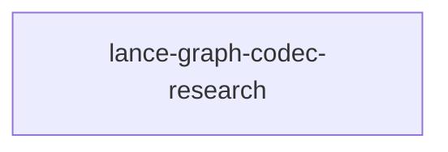

# lance-graph-codec-research

crate: lance-graph-codec-research
path: crates/lance-graph-codec-research
workspace: excluded
digest: 8b8afbd9a6d0f359
evidence legend: ../index.md#evidence-legend

Generated; the code is the truth. See ../index.md.

## Depends on

- dep rustfft normal — crates/lance-graph-codec-research/Cargo.toml:10 CONFIRMED
- dep tempfile dev — crates/lance-graph-codec-research/Cargo.toml:13 CONFIRMED

## Depended on by

## Public items

- fn SpectralAccumulator::new [pub] — crates/lance-graph-codec-research/src/accumulator.rs:28 CONFIRMED
- fn SpectralAccumulator::accumulate_frame [pub] — crates/lance-graph-codec-research/src/accumulator.rs:44 CONFIRMED
- fn SpectralAccumulator::accumulate_pcm [pub] — crates/lance-graph-codec-research/src/accumulator.rs:64 CONFIRMED
- fn SpectralAccumulator::crystallize [pub] — crates/lance-graph-codec-research/src/accumulator.rs:94 CONFIRMED
- fn SpectralAccumulator::alpha_density [pub] — crates/lance-graph-codec-research/src/accumulator.rs:134 CONFIRMED
- fn SpectralAccumulator::noise_floor [pub] — crates/lance-graph-codec-research/src/accumulator.rs:142 CONFIRMED
- fn SpectralAccumulator::noise_mask_correlation [pub] — crates/lance-graph-codec-research/src/accumulator.rs:151 CONFIRMED
- fn SpectralAccumulator::reset [pub] — crates/lance-graph-codec-research/src/accumulator.rs:176 CONFIRMED
- fn SpectralAccumulator::unbind [pub] — crates/lance-graph-codec-research/src/accumulator.rs:184 CONFIRMED
- fn pearson_correlation [pub] — crates/lance-graph-codec-research/src/accumulator.rs:223 CONFIRMED
- fn decode_crystallized [pub] — crates/lance-graph-codec-research/src/accumulator.rs:248 CONFIRMED
- fn f32_to_bf16 [pub] — crates/lance-graph-codec-research/src/bands.rs:14 CONFIRMED
- fn bf16_to_f32 [pub] — crates/lance-graph-codec-research/src/bands.rs:20 CONFIRMED
- fn pack_bands [pub] — crates/lance-graph-codec-research/src/bands.rs:25 CONFIRMED
- fn unpack_bands [pub] — crates/lance-graph-codec-research/src/bands.rs:34 CONFIRMED
- fn bf16_band_distance [pub] — crates/lance-graph-codec-research/src/bands.rs:50 CONFIRMED
- fn bf16_band_hamming_raw [pub] — crates/lance-graph-codec-research/src/bands.rs:65 CONFIRMED
- fn extract_gain [pub] — crates/lance-graph-codec-research/src/bands.rs:76 CONFIRMED
- fn extract_shape [pub] — crates/lance-graph-codec-research/src/bands.rs:86 CONFIRMED
- const FRAME_BYTES [pub] — crates/lance-graph-codec-research/src/bands.rs:95 CONFIRMED
- struct DiamondAudioSession [pub] — crates/lance-graph-codec-research/src/diamond.rs:16 CONFIRMED
- fn DiamondAudioSession::new [pub] — crates/lance-graph-codec-research/src/diamond.rs:40 CONFIRMED
- fn DiamondAudioSession::feed_frame [pub] — crates/lance-graph-codec-research/src/diamond.rs:55 CONFIRMED
- fn DiamondAudioSession::flush [pub] — crates/lance-graph-codec-research/src/diamond.rs:103 CONFIRMED
- fn DiamondAudioSession::verify_invariant [pub] — crates/lance-graph-codec-research/src/diamond.rs:126 CONFIRMED
- fn DiamondAudioSession::component_bitrate [pub] — crates/lance-graph-codec-research/src/diamond.rs:170 CONFIRMED
- struct InvariantCheck [pub] — crates/lance-graph-codec-research/src/diamond.rs:178 CONFIRMED
- struct HybridEncoding [pub] — crates/lance-graph-codec-research/src/hybrid.rs:17 CONFIRMED
- fn encode_hybrid [pub] — crates/lance-graph-codec-research/src/hybrid.rs:33 CONFIRMED
- fn decode_hybrid [pub] — crates/lance-graph-codec-research/src/hybrid.rs:122 CONFIRMED
- fn decode_hybrid_scent_only [pub] — crates/lance-graph-codec-research/src/hybrid.rs:130 CONFIRMED
- fn bitrate_breakdown [pub] — crates/lance-graph-codec-research/src/hybrid.rs:137 CONFIRMED
- struct HybridBitrateBreakdown [pub] — crates/lance-graph-codec-research/src/hybrid.rs:155 CONFIRMED
- mod transform [pub] — crates/lance-graph-codec-research/src/lib.rs:13 CONFIRMED
- mod bands [pub] — crates/lance-graph-codec-research/src/lib.rs:14 CONFIRMED
- mod perframe [pub] — crates/lance-graph-codec-research/src/lib.rs:15 CONFIRMED
- mod accumulator [pub] — crates/lance-graph-codec-research/src/lib.rs:16 CONFIRMED
- mod hybrid [pub] — crates/lance-graph-codec-research/src/lib.rs:17 CONFIRMED
- mod diamond [pub] — crates/lance-graph-codec-research/src/lib.rs:18 CONFIRMED
- mod metrics [pub] — crates/lance-graph-codec-research/src/lib.rs:19 CONFIRMED
- mod universal_perception [pub] — crates/lance-graph-codec-research/src/lib.rs:20 CONFIRMED
- mod zeckbf17 [pub] — crates/lance-graph-codec-research/src/lib.rs:21 CONFIRMED
- const SAMPLE_RATE [pub] — crates/lance-graph-codec-research/src/lib.rs:24 CONFIRMED
- const SAMPLES_PER_FRAME [pub] — crates/lance-graph-codec-research/src/lib.rs:28 CONFIRMED
- const FRAME_RATE [pub] — crates/lance-graph-codec-research/src/lib.rs:31 CONFIRMED
- const BARK_BANDS [pub] — crates/lance-graph-codec-research/src/lib.rs:34 CONFIRMED
- struct AudioFrame [pub] — crates/lance-graph-codec-research/src/lib.rs:38 CONFIRMED
- struct CrystallizedComponent [pub] — crates/lance-graph-codec-research/src/lib.rs:53 CONFIRMED
- struct SpectralAccumulator [pub] — crates/lance-graph-codec-research/src/lib.rs:70 CONFIRMED
- enum AudioQualia [pub] — crates/lance-graph-codec-research/src/lib.rs:81 CONFIRMED
- struct ComparisonResult [pub] — crates/lance-graph-codec-research/src/lib.rs:94 CONFIRMED
- fn compare_all_strategies [pub] — crates/lance-graph-codec-research/src/metrics.rs:12 CONFIRMED
- fn spectral_distortion [pub] — crates/lance-graph-codec-research/src/metrics.rs:121 CONFIRMED
- fn band_energy_correlation [pub] — crates/lance-graph-codec-research/src/metrics.rs:145 CONFIRMED
- fn print_comparison [pub] — crates/lance-graph-codec-research/src/metrics.rs:237 CONFIRMED
- fn encode_perframe [pub] — crates/lance-graph-codec-research/src/perframe.rs:13 CONFIRMED
- fn decode_perframe [pub] — crates/lance-graph-codec-research/src/perframe.rs:73 CONFIRMED
- fn bitrate_perframe [pub] — crates/lance-graph-codec-research/src/perframe.rs:98 CONFIRMED
- fn bark_band_edges [pub] — crates/lance-graph-codec-research/src/transform.rs:16 CONFIRMED
- fn freq_to_bin [pub] — crates/lance-graph-codec-research/src/transform.rs:27 CONFIRMED
- fn sine_window [pub] — crates/lance-graph-codec-research/src/transform.rs:32 CONFIRMED
- fn mdct [pub] — crates/lance-graph-codec-research/src/transform.rs:42 CONFIRMED
- fn imdct [pub] — crates/lance-graph-codec-research/src/transform.rs:85 CONFIRMED
- fn coeffs_to_band_energies [pub] — crates/lance-graph-codec-research/src/transform.rs:122 CONFIRMED
- fn band_energies_to_coeffs [pub] — crates/lance-graph-codec-research/src/transform.rs:145 CONFIRMED
- fn psychoacoustic_mask [pub] — crates/lance-graph-codec-research/src/transform.rs:167 CONFIRMED
- struct UniversalAccumulator [pub] — crates/lance-graph-codec-research/src/universal_perception.rs:26 CONFIRMED
- fn UniversalAccumulator::new [pub] — crates/lance-graph-codec-research/src/universal_perception.rs:38 CONFIRMED
- fn UniversalAccumulator::accumulate [pub] — crates/lance-graph-codec-research/src/universal_perception.rs:49 CONFIRMED
- fn UniversalAccumulator::alpha_density [pub] — crates/lance-graph-codec-research/src/universal_perception.rs:64 CONFIRMED
- fn UniversalAccumulator::noise_floor_per_band [pub] — crates/lance-graph-codec-research/src/universal_perception.rs:71 CONFIRMED
- fn UniversalAccumulator::noise_mask_correlation [pub] — crates/lance-graph-codec-research/src/universal_perception.rs:86 CONFIRMED
- fn experiment_audio [pub] — crates/lance-graph-codec-research/src/universal_perception.rs:144 CONFIRMED
- fn experiment_text [pub] — crates/lance-graph-codec-research/src/universal_perception.rs:236 CONFIRMED
- fn experiment_video [pub] — crates/lance-graph-codec-research/src/universal_perception.rs:317 CONFIRMED
- struct ExperimentResult [pub] — crates/lance-graph-codec-research/src/universal_perception.rs:347 CONFIRMED
- fn universal_perception_experiment [pub] — crates/lance-graph-codec-research/src/universal_perception.rs:359 CONFIRMED
- struct UniversalVerdict [pub] — crates/lance-graph-codec-research/src/universal_perception.rs:388 CONFIRMED
- const BASE_DIM [pub] — crates/lance-graph-codec-research/src/zeckbf17.rs:44 CONFIRMED
- const FULL_DIM [pub] — crates/lance-graph-codec-research/src/zeckbf17.rs:47 CONFIRMED
- const N_OCTAVES [pub] — crates/lance-graph-codec-research/src/zeckbf17.rs:50 CONFIRMED
- const INDEPENDENT_OCTAVES [pub] — crates/lance-graph-codec-research/src/zeckbf17.rs:53 CONFIRMED
- const FP_SCALE [pub] — crates/lance-graph-codec-research/src/zeckbf17.rs:56 CONFIRMED
- const GOLDEN_STEP [pub] — crates/lance-graph-codec-research/src/zeckbf17.rs:59 CONFIRMED
- fn verify_golden_coverage [pub] — crates/lance-graph-codec-research/src/zeckbf17.rs:80 CONFIRMED
- struct BasePattern [pub] — crates/lance-graph-codec-research/src/zeckbf17.rs:95 CONFIRMED
- struct OctaveEnvelope [pub] — crates/lance-graph-codec-research/src/zeckbf17.rs:101 CONFIRMED
- struct ZeckBF17Plane [pub] — crates/lance-graph-codec-research/src/zeckbf17.rs:107 CONFIRMED
- struct ZeckBF17Edge [pub] — crates/lance-graph-codec-research/src/zeckbf17.rs:115 CONFIRMED
- const ZeckBF17Plane::ENCODED_SIZE [pub] — crates/lance-graph-codec-research/src/zeckbf17.rs:127 CONFIRMED
- fn ZeckBF17Plane::encode [pub] — crates/lance-graph-codec-research/src/zeckbf17.rs:134 CONFIRMED
- fn ZeckBF17Plane::decode [pub] — crates/lance-graph-codec-research/src/zeckbf17.rs:197 CONFIRMED
- fn ZeckBF17Plane::to_bytes [pub] — crates/lance-graph-codec-research/src/zeckbf17.rs:218 CONFIRMED
- fn ZeckBF17Plane::from_bytes [pub] — crates/lance-graph-codec-research/src/zeckbf17.rs:232 CONFIRMED
- const ZeckBF17Edge::ENCODED_SIZE [pub] — crates/lance-graph-codec-research/src/zeckbf17.rs:250 CONFIRMED
- fn ZeckBF17Edge::encode [pub] — crates/lance-graph-codec-research/src/zeckbf17.rs:253 CONFIRMED
- fn ZeckBF17Edge::decode [pub] — crates/lance-graph-codec-research/src/zeckbf17.rs:276 CONFIRMED
- const MAX_PALETTE [pub] — crates/lance-graph-codec-research/src/zeckbf17.rs:289 CONFIRMED
- struct BasePalette [pub] — crates/lance-graph-codec-research/src/zeckbf17.rs:294 CONFIRMED
- struct PaletteEdge [pub] — crates/lance-graph-codec-research/src/zeckbf17.rs:300 CONFIRMED
- const PaletteEdge::ENCODED_SIZE [pub] — crates/lance-graph-codec-research/src/zeckbf17.rs:307 CONFIRMED
- fn BasePalette::build [pub] — crates/lance-graph-codec-research/src/zeckbf17.rs:314 CONFIRMED
- fn BasePalette::nearest [pub] — crates/lance-graph-codec-research/src/zeckbf17.rs:392 CONFIRMED
- fn BasePalette::compress [pub] — crates/lance-graph-codec-research/src/zeckbf17.rs:406 CONFIRMED
- fn BasePalette::lookup [pub] — crates/lance-graph-codec-research/src/zeckbf17.rs:415 CONFIRMED
- fn BasePalette::edge_distance [pub] — crates/lance-graph-codec-research/src/zeckbf17.rs:420 CONFIRMED
- fn BasePalette::total_bytes [pub] — crates/lance-graph-codec-research/src/zeckbf17.rs:427 CONFIRMED
- fn BasePalette::distance_matrix [pub] — crates/lance-graph-codec-research/src/zeckbf17.rs:436 CONFIRMED
- fn base_l1 [pub] — crates/lance-graph-codec-research/src/zeckbf17.rs:459 CONFIRMED
- fn base_sign_agreement [pub] — crates/lance-graph-codec-research/src/zeckbf17.rs:468 CONFIRMED
- fn scent_from_base [pub] — crates/lance-graph-codec-research/src/zeckbf17.rs:480 CONFIRMED
- fn zeckf64_from_base [pub] — crates/lance-graph-codec-research/src/zeckbf17.rs:501 CONFIRMED
- fn sign_bit_hamming [pub] — crates/lance-graph-codec-research/src/zeckbf17.rs:538 CONFIRMED
- fn sign_bit_fidelity [pub] — crates/lance-graph-codec-research/src/zeckbf17.rs:546 CONFIRMED
- struct FidelityReport [pub] — crates/lance-graph-codec-research/src/zeckbf17.rs:576 CONFIRMED
- struct ExperimentConfig [pub] — crates/lance-graph-codec-research/src/zeckbf17.rs:590 CONFIRMED
- fn fidelity_experiment [pub] — crates/lance-graph-codec-research/src/zeckbf17.rs:637 CONFIRMED
- fn fidelity_experiment_cfg [pub] — crates/lance-graph-codec-research/src/zeckbf17.rs:645 CONFIRMED

## Imports from in-scope crates

- none

## Calls

CALL_GRAPH=ARTIFACT_MISSING
- calls ARTIFACT_MISSING — no ruff_charon artifact for this crate UNKNOWN

## Architecture

- none

Generated from Cargo manifests — extracted relationships only.

