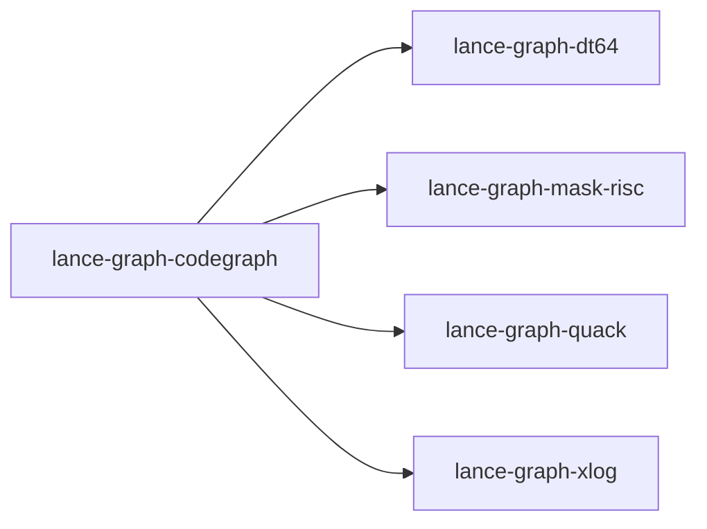

# lance-graph-codegraph

crate: lance-graph-codegraph
path: crates/lance-graph-codegraph
workspace: excluded
digest: be1efc44d1d322ae
evidence legend: ../index.md#evidence-legend

Generated; the code is the truth. See ../index.md.

## Depends on

- dep lance-graph-contract dev — crates/lance-graph-codegraph/Cargo.toml:23 CONFIRMED
- dep lance-graph-dt64 normal — crates/lance-graph-codegraph/Cargo.toml:13 CONFIRMED
- dep lance-graph-mask-risc normal — crates/lance-graph-codegraph/Cargo.toml:15 CONFIRMED
- dep lance-graph-planner dev — crates/lance-graph-codegraph/Cargo.toml:22 CONFIRMED
- dep lance-graph-quack normal — crates/lance-graph-codegraph/Cargo.toml:14 CONFIRMED
- dep lance-graph-xlog normal — crates/lance-graph-codegraph/Cargo.toml:12 CONFIRMED
- dep ndarray normal — crates/lance-graph-codegraph/Cargo.toml:16 CONFIRMED
- dep tokio dev — crates/lance-graph-codegraph/Cargo.toml:24 CONFIRMED

## Depended on by

## Public items

- const ROWS_VERSION [pub] — crates/lance-graph-codegraph/src/artifact.rs:23 CONFIRMED
- const NO_SPAN [pub] — crates/lance-graph-codegraph/src/artifact.rs:37 CONFIRMED
- const NO_ID [pub] — crates/lance-graph-codegraph/src/artifact.rs:40 CONFIRMED
- const P_DEFINES [pub] — crates/lance-graph-codegraph/src/artifact.rs:43 CONFIRMED
- const P_CALLS [pub] — crates/lance-graph-codegraph/src/artifact.rs:45 CONFIRMED
- const P_MAY [pub] — crates/lance-graph-codegraph/src/artifact.rs:47 CONFIRMED
- const P_UNRESOLVED [pub] — crates/lance-graph-codegraph/src/artifact.rs:49 CONFIRMED
- const P_PUBLIC [pub] — crates/lance-graph-codegraph/src/artifact.rs:51 CONFIRMED
- const P_IMPLEMENTS [pub] — crates/lance-graph-codegraph/src/artifact.rs:53 CONFIRMED
- const P_SYNTHETIC [pub] — crates/lance-graph-codegraph/src/artifact.rs:55 CONFIRMED
- const P_REFERENCES [pub] — crates/lance-graph-codegraph/src/artifact.rs:57 CONFIRMED
- const P_CRATE [pub] — crates/lance-graph-codegraph/src/artifact.rs:59 CONFIRMED
- const P_OTHER [pub] — crates/lance-graph-codegraph/src/artifact.rs:62 CONFIRMED
- fn pred_code [pub] — crates/lance-graph-codegraph/src/artifact.rs:78 CONFIRMED
- fn digest [pub] — crates/lance-graph-codegraph/src/artifact.rs:98 CONFIRMED
- fn fnv64_hex [pub] — crates/lance-graph-codegraph/src/artifact.rs:110 CONFIRMED
- struct FastHasher [pub] — crates/lance-graph-codegraph/src/artifact.rs:122 CONFIRMED
- type FastBuild [pub] — crates/lance-graph-codegraph/src/artifact.rs:153 CONFIRMED
- struct Symbols [pub] — crates/lance-graph-codegraph/src/artifact.rs:158 CONFIRMED
- fn Symbols::intern [pub] — crates/lance-graph-codegraph/src/artifact.rs:165 CONFIRMED
- fn Symbols::get [pub] — crates/lance-graph-codegraph/src/artifact.rs:176 CONFIRMED
- fn Symbols::name [pub] — crates/lance-graph-codegraph/src/artifact.rs:181 CONFIRMED
- fn Symbols::len [pub] — crates/lance-graph-codegraph/src/artifact.rs:186 CONFIRMED
- fn Symbols::is_empty [pub] — crates/lance-graph-codegraph/src/artifact.rs:191 CONFIRMED
- fn Symbols::absorb [pub] — crates/lance-graph-codegraph/src/artifact.rs:198 CONFIRMED
- trait Interner [pub] — crates/lance-graph-codegraph/src/artifact.rs:214 CONFIRMED
- struct SymbolStage [pub] — crates/lance-graph-codegraph/src/artifact.rs:248 CONFIRMED
- struct StagedNames [pub] — crates/lance-graph-codegraph/src/artifact.rs:255 CONFIRMED
- fn SymbolStage<'a>::new [pub] — crates/lance-graph-codegraph/src/artifact.rs:262 CONFIRMED
- fn SymbolStage<'a>::added [pub] — crates/lance-graph-codegraph/src/artifact.rs:271 CONFIRMED
- fn SymbolStage<'a>::into_names [pub] — crates/lance-graph-codegraph/src/artifact.rs:276 CONFIRMED
- struct Lanes [pub] — crates/lance-graph-codegraph/src/artifact.rs:313 CONFIRMED
- fn Lanes::len [pub] — crates/lance-graph-codegraph/src/artifact.rs:345 CONFIRMED
- fn Lanes::is_empty [pub] — crates/lance-graph-codegraph/src/artifact.rs:350 CONFIRMED
- fn Lanes::predicate_name [pub] — crates/lance-graph-codegraph/src/artifact.rs:355 CONFIRMED
- fn Lanes::digest_of [pub] — crates/lance-graph-codegraph/src/artifact.rs:367 CONFIRMED
- fn Lanes::residuals_of [pub] — crates/lance-graph-codegraph/src/artifact.rs:380 CONFIRMED
- fn Lanes::set_residuals [pub] — crates/lance-graph-codegraph/src/artifact.rs:385 CONFIRMED
- fn Lanes::crates [pub] — crates/lance-graph-codegraph/src/artifact.rs:393 CONFIRMED
- fn Lanes::drop_crate [pub] — crates/lance-graph-codegraph/src/artifact.rs:399 CONFIRMED
- fn Lanes::append [pub] — crates/lance-graph-codegraph/src/artifact.rs:444 CONFIRMED
- enum ResidualKind [pub] — crates/lance-graph-codegraph/src/artifact.rs:470 CONFIRMED
- const ResidualKind::ALL [pub] — crates/lance-graph-codegraph/src/artifact.rs:487 CONFIRMED
- fn ResidualKind::name [pub] — crates/lance-graph-codegraph/src/artifact.rs:496 CONFIRMED
- struct ResidualCounts [pub] — crates/lance-graph-codegraph/src/artifact.rs:518 CONFIRMED
- fn ResidualCounts::of [pub] — crates/lance-graph-codegraph/src/artifact.rs:522 CONFIRMED
- fn ResidualCounts::total [pub] — crates/lance-graph-codegraph/src/artifact.rs:527 CONFIRMED
- fn ResidualCounts::add [pub] — crates/lance-graph-codegraph/src/artifact.rs:532 CONFIRMED
- enum ResidualRefusal [pub] — crates/lance-graph-codegraph/src/artifact.rs:541 CONFIRMED
- fn refuse_placeholders [pub] — crates/lance-graph-codegraph/src/artifact.rs:573 CONFIRMED
- const RESIDUAL_SUFFIX [pub] — crates/lance-graph-codegraph/src/artifact.rs:601 CONFIRMED
- fn read_residuals [pub] — crates/lance-graph-codegraph/src/artifact.rs:605 CONFIRMED
- const BIN_SUFFIX [pub] — crates/lance-graph-codegraph/src/artifact.rs:650 CONFIRMED
- enum CrateSource [pub] — crates/lance-graph-codegraph/src/artifact.rs:654 CONFIRMED
- fn crate_source [pub] — crates/lance-graph-codegraph/src/artifact.rs:663 CONFIRMED
- fn read_crate_text [pub] — crates/lance-graph-codegraph/src/artifact.rs:673 CONFIRMED
- fn read_crate [pub] — crates/lance-graph-codegraph/src/artifact.rs:678 CONFIRMED
- fn read_dir [pub] — crates/lance-graph-codegraph/src/artifact.rs:688 CONFIRMED
- fn read_bin_as [pub] — crates/lance-graph-codegraph/src/artifact.rs:737 CONFIRMED
- fn dispatch_target [pub] — crates/lance-graph-codegraph/src/artifact.rs:829 CONFIRMED
- fn read_text [pub] — crates/lance-graph-codegraph/src/artifact.rs:867 CONFIRMED
- fn read_text_as [pub] — crates/lance-graph-codegraph/src/artifact.rs:877 CONFIRMED
- const HEADER_LEN [pub] — crates/lance-graph-codegraph/src/artifact_bin.rs:32 CONFIRMED
- const NO_ID [pub] — crates/lance-graph-codegraph/src/artifact_bin.rs:34 CONFIRMED
- mod tag [pub] — crates/lance-graph-codegraph/src/artifact_bin.rs:51 CONFIRMED
- const PRED_MAG [pub] — crates/lance-graph-codegraph/src/artifact_bin.rs:53 CONFIRMED
- const PRED_PRES [pub] — crates/lance-graph-codegraph/src/artifact_bin.rs:55 CONFIRMED
- const PRED_CB [pub] — crates/lance-graph-codegraph/src/artifact_bin.rs:57 CONFIRMED
- const GRADE_MAG [pub] — crates/lance-graph-codegraph/src/artifact_bin.rs:59 CONFIRMED
- const GRADE_PRES [pub] — crates/lance-graph-codegraph/src/artifact_bin.rs:61 CONFIRMED
- const GRADE_CB [pub] — crates/lance-graph-codegraph/src/artifact_bin.rs:63 CONFIRMED
- const FILE [pub] — crates/lance-graph-codegraph/src/artifact_bin.rs:65 CONFIRMED
- const FILE_PRES [pub] — crates/lance-graph-codegraph/src/artifact_bin.rs:67 CONFIRMED
- const FILE_CB [pub] — crates/lance-graph-codegraph/src/artifact_bin.rs:69 CONFIRMED
- const SUBJ [pub] — crates/lance-graph-codegraph/src/artifact_bin.rs:71 CONFIRMED
- const OBJ [pub] — crates/lance-graph-codegraph/src/artifact_bin.rs:73 CONFIRMED
- const MAYT [pub] — crates/lance-graph-codegraph/src/artifact_bin.rs:75 CONFIRMED
- const START [pub] — crates/lance-graph-codegraph/src/artifact_bin.rs:77 CONFIRMED
- const END [pub] — crates/lance-graph-codegraph/src/artifact_bin.rs:79 CONFIRMED
- const SYM_OFF [pub] — crates/lance-graph-codegraph/src/artifact_bin.rs:81 CONFIRMED
- const SYM_BLOB [pub] — crates/lance-graph-codegraph/src/artifact_bin.rs:83 CONFIRMED
- const SYM_HASH [pub] — crates/lance-graph-codegraph/src/artifact_bin.rs:85 CONFIRMED
- const SYM_OWNER [pub] — crates/lance-graph-codegraph/src/artifact_bin.rs:87 CONFIRMED
- const FUNDECL [pub] — crates/lance-graph-codegraph/src/artifact_bin.rs:89 CONFIRMED
- const OBJ_KIND_MAG [pub] — crates/lance-graph-codegraph/src/artifact_bin.rs:91 CONFIRMED
- const OBJ_KIND_PRES [pub] — crates/lance-graph-codegraph/src/artifact_bin.rs:93 CONFIRMED
- const PROV [pub] — crates/lance-graph-codegraph/src/artifact_bin.rs:95 CONFIRMED
- const ALL [pub] — crates/lance-graph-codegraph/src/artifact_bin.rs:97 CONFIRMED
- enum BinRefusal [pub] — crates/lance-graph-codegraph/src/artifact_bin.rs:125 CONFIRMED
- struct Header [pub] — crates/lance-graph-codegraph/src/artifact_bin.rs:226 CONFIRMED
- fn Header::parse [pub] — crates/lance-graph-codegraph/src/artifact_bin.rs:271 CONFIRMED
- fn Header::read [pub] — crates/lance-graph-codegraph/src/artifact_bin.rs:303 CONFIRMED
- fn Header::partial [pub] — crates/lance-graph-codegraph/src/artifact_bin.rs:310 CONFIRMED
- struct Prov [pub] — crates/lance-graph-codegraph/src/artifact_bin.rs:322 CONFIRMED
- struct CrateFile [pub] — crates/lance-graph-codegraph/src/artifact_bin.rs:808 CONFIRMED
- fn CrateFile::parse [pub] — crates/lance-graph-codegraph/src/artifact_bin.rs:822 CONFIRMED
- fn CrateFile::header [pub] — crates/lance-graph-codegraph/src/artifact_bin.rs:848 CONFIRMED
- fn CrateFile::n_rows [pub] — crates/lance-graph-codegraph/src/artifact_bin.rs:853 CONFIRMED
- fn CrateFile::n_symbols [pub] — crates/lance-graph-codegraph/src/artifact_bin.rs:858 CONFIRMED
- fn CrateFile::symbol [pub] — crates/lance-graph-codegraph/src/artifact_bin.rs:876 CONFIRMED
- fn CrateFile::sym_hash [pub] — crates/lance-graph-codegraph/src/artifact_bin.rs:885 CONFIRMED
- fn CrateFile::sym_owner [pub] — crates/lance-graph-codegraph/src/artifact_bin.rs:891 CONFIRMED
- fn CrateFile::subject [pub] — crates/lance-graph-codegraph/src/artifact_bin.rs:899 CONFIRMED
- fn CrateFile::object [pub] — crates/lance-graph-codegraph/src/artifact_bin.rs:904 CONFIRMED
- fn CrateFile::may_target [pub] — crates/lance-graph-codegraph/src/artifact_bin.rs:909 CONFIRMED
- fn CrateFile::predicate_id [pub] — crates/lance-graph-codegraph/src/artifact_bin.rs:917 CONFIRMED
- fn CrateFile::predicate [pub] — crates/lance-graph-codegraph/src/artifact_bin.rs:922 CONFIRMED
- fn CrateFile::grade [pub] — crates/lance-graph-codegraph/src/artifact_bin.rs:928 CONFIRMED
- fn CrateFile::file [pub] — crates/lance-graph-codegraph/src/artifact_bin.rs:934 CONFIRMED
- fn CrateFile::span [pub] — crates/lance-graph-codegraph/src/artifact_bin.rs:946 CONFIRMED
- fn CrateFile::fundecl [pub] — crates/lance-graph-codegraph/src/artifact_bin.rs:952 CONFIRMED
- fn CrateFile::obj_kind [pub] — crates/lance-graph-codegraph/src/artifact_bin.rs:960 CONFIRMED
- fn CrateFile::prov [pub] — crates/lance-graph-codegraph/src/artifact_bin.rs:965 CONFIRMED
- struct Coverage [pub] — crates/lance-graph-codegraph/src/diag.rs:20 CONFIRMED
- fn Coverage::no_known_gap [pub] — crates/lance-graph-codegraph/src/diag.rs:35 CONFIRMED
- enum Kind [pub] — crates/lance-graph-codegraph/src/diag.rs:42 CONFIRMED
- enum Grade [pub] — crates/lance-graph-codegraph/src/diag.rs:55 CONFIRMED
- enum Qualifier [pub] — crates/lance-graph-codegraph/src/diag.rs:62 CONFIRMED
- enum FindingStatus [pub] — crates/lance-graph-codegraph/src/diag.rs:69 CONFIRMED
- enum Run [pub] — crates/lance-graph-codegraph/src/diag.rs:79 CONFIRMED
- enum CrateKind [pub] — crates/lance-graph-codegraph/src/diag.rs:98 CONFIRMED
- struct Finding [pub] — crates/lance-graph-codegraph/src/diag.rs:107 CONFIRMED
- fn Codegraph::coverage [pub] — crates/lance-graph-codegraph/src/diag.rs:137 CONFIRMED
- fn Codegraph::diagnostics [pub] — crates/lance-graph-codegraph/src/diag.rs:164 CONFIRMED
- type Pos [pub] — crates/lance-graph-codegraph/src/graph.rs:20 CONFIRMED
- enum IntakeRefusal [pub] — crates/lance-graph-codegraph/src/graph.rs:24 CONFIRMED
- enum RunStatus [pub] — crates/lance-graph-codegraph/src/graph.rs:63 CONFIRMED
- const CALLS [pub] — crates/lance-graph-codegraph/src/graph.rs:71 CONFIRMED
- const NODE [pub] — crates/lance-graph-codegraph/src/graph.rs:73 CONFIRMED
- const MAY [pub] — crates/lance-graph-codegraph/src/graph.rs:75 CONFIRMED
- const IMPL [pub] — crates/lance-graph-codegraph/src/graph.rs:77 CONFIRMED
- const RCONF [pub] — crates/lance-graph-codegraph/src/graph.rs:79 CONFIRMED
- const RPOSS [pub] — crates/lance-graph-codegraph/src/graph.rs:81 CONFIRMED
- struct Codegraph [pub] — crates/lance-graph-codegraph/src/graph.rs:248 CONFIRMED
- struct RefreshStats [pub] — crates/lance-graph-codegraph/src/graph.rs:489 CONFIRMED
- enum RefreshRefusal [pub] — crates/lance-graph-codegraph/src/graph.rs:502 CONFIRMED
- struct PreparedRefresh [pub(crate)] — crates/lance-graph-codegraph/src/graph.rs:527 CONFIRMED
- fn Codegraph::open [pub] — crates/lance-graph-codegraph/src/graph.rs:542 CONFIRMED
- fn Codegraph::refresh_crate [pub] — crates/lance-graph-codegraph/src/graph.rs:664 CONFIRMED
- fn Codegraph::prepare_refresh [pub(crate)] — crates/lance-graph-codegraph/src/graph.rs:679 CONFIRMED
- fn Codegraph::commit_refresh [pub(crate)] — crates/lance-graph-codegraph/src/graph.rs:866 CONFIRMED
- fn Codegraph::refold [pub] — crates/lance-graph-codegraph/src/graph.rs:964 CONFIRMED
- fn Codegraph::pos [pub] — crates/lance-graph-codegraph/src/graph.rs:976 CONFIRMED
- fn Codegraph::symbol [pub] — crates/lance-graph-codegraph/src/graph.rs:981 CONFIRMED
- fn Codegraph::id_of [pub(crate)] — crates/lance-graph-codegraph/src/graph.rs:986 CONFIRMED
- fn Codegraph::pos_of_id [pub(crate)] — crates/lance-graph-codegraph/src/graph.rs:991 CONFIRMED
- fn Codegraph::lanes [pub(crate)] — crates/lance-graph-codegraph/src/graph.rs:996 CONFIRMED
- fn Codegraph::partial_crates [pub(crate)] — crates/lance-graph-codegraph/src/graph.rs:1001 CONFIRMED
- fn Codegraph::stored_crates [pub(crate)] — crates/lance-graph-codegraph/src/graph.rs:1010 CONFIRMED
- fn Codegraph::residuals_of_crate [pub(crate)] — crates/lance-graph-codegraph/src/graph.rs:1020 CONFIRMED
- fn Codegraph::any_partial [pub(crate)] — crates/lance-graph-codegraph/src/graph.rs:1032 CONFIRMED
- fn Codegraph::words [pub] — crates/lance-graph-codegraph/src/graph.rs:1037 CONFIRMED
- fn Codegraph::mask_of [pub] — crates/lance-graph-codegraph/src/graph.rs:1042 CONFIRMED
- fn Codegraph::crate_status [pub] — crates/lance-graph-codegraph/src/graph.rs:1053 CONFIRMED
- fn Codegraph::rows [pub] — crates/lance-graph-codegraph/src/graph.rs:1059 CONFIRMED
- fn Codegraph::row_predicate [pub] — crates/lance-graph-codegraph/src/graph.rs:1064 CONFIRMED
- fn Codegraph::row_subject [pub] — crates/lance-graph-codegraph/src/graph.rs:1069 CONFIRMED
- fn Codegraph::row_object [pub] — crates/lance-graph-codegraph/src/graph.rs:1074 CONFIRMED
- fn Codegraph::site [pub] — crates/lance-graph-codegraph/src/graph.rs:1079 CONFIRMED
- fn Codegraph::cube [pub] — crates/lance-graph-codegraph/src/graph.rs:1093 CONFIRMED
- fn Codegraph::cube_mut [pub] — crates/lance-graph-codegraph/src/graph.rs:1098 CONFIRMED
- fn Codegraph::cube_and_table_mut [pub(crate)] — crates/lance-graph-codegraph/src/graph.rs:1104 CONFIRMED
- fn Codegraph::table [pub] — crates/lance-graph-codegraph/src/graph.rs:1109 CONFIRMED
- fn Codegraph::fns [pub] — crates/lance-graph-codegraph/src/graph.rs:1114 CONFIRMED
- fn Codegraph::public [pub] — crates/lance-graph-codegraph/src/graph.rs:1118 CONFIRMED
- fn Codegraph::impl_subjects [pub] — crates/lance-graph-codegraph/src/graph.rs:1122 CONFIRMED
- fn Codegraph::synthetic [pub] — crates/lance-graph-codegraph/src/graph.rs:1126 CONFIRMED
- fn Codegraph::referenced [pub] — crates/lance-graph-codegraph/src/graph.rs:1130 CONFIRMED
- fn Codegraph::called [pub] — crates/lance-graph-codegraph/src/graph.rs:1134 CONFIRMED
- fn Codegraph::may_targets [pub] — crates/lance-graph-codegraph/src/graph.rs:1138 CONFIRMED
- fn Codegraph::dynamic_callers [pub] — crates/lance-graph-codegraph/src/graph.rs:1142 CONFIRMED
- fn Codegraph::stored_owner [pub] — crates/lance-graph-codegraph/src/graph.rs:1146 CONFIRMED
- fn Codegraph::closure [pub] — crates/lance-graph-codegraph/src/graph.rs:1152 CONFIRMED
- struct Targets [pub] — crates/lance-graph-codegraph/src/impact_report.rs:26 CONFIRMED
- const Targets::LIB_ONLY [pub] — crates/lance-graph-codegraph/src/impact_report.rs:39 CONFIRMED
- const Targets::ALL [pub] — crates/lance-graph-codegraph/src/impact_report.rs:47 CONFIRMED
- struct Scope [pub] — crates/lance-graph-codegraph/src/impact_report.rs:70 CONFIRMED
- enum SymbolState [pub] — crates/lance-graph-codegraph/src/impact_report.rs:93 CONFIRMED
- enum Gap [pub] — crates/lance-graph-codegraph/src/impact_report.rs:108 CONFIRMED
- struct ImpactReport [pub] — crates/lance-graph-codegraph/src/impact_report.rs:185 CONFIRMED
- fn ImpactReport::closed_in_scope [pub] — crates/lance-graph-codegraph/src/impact_report.rs:198 CONFIRMED
- fn Codegraph::impact_report [pub] — crates/lance-graph-codegraph/src/impact_report.rs:337 CONFIRMED
- enum Fault [pub(crate)] cfg=test — crates/lance-graph-codegraph/src/lab_wal.rs:19 CONFIRMED
- struct LabWal [pub(crate)] cfg=test — crates/lance-graph-codegraph/src/lab_wal.rs:35 CONFIRMED
- fn LabWal::new [pub(crate)] cfg=test — crates/lance-graph-codegraph/src/lab_wal.rs:44 CONFIRMED
- fn LabWal::head [pub(crate)] cfg=test — crates/lance-graph-codegraph/src/lab_wal.rs:53 CONFIRMED
- fn LabWal::inject [pub(crate)] cfg=test — crates/lance-graph-codegraph/src/lab_wal.rs:58 CONFIRMED
- fn LabWal::reverse_physical_order [pub(crate)] cfg=test — crates/lance-graph-codegraph/src/lab_wal.rs:64 CONFIRMED
- fn LabWal::image [pub(crate)] cfg=test — crates/lance-graph-codegraph/src/lab_wal.rs:70 CONFIRMED
- mod artifact [pub] — crates/lance-graph-codegraph/src/lib.rs:6 CONFIRMED
- mod artifact_bin [pub] — crates/lance-graph-codegraph/src/lib.rs:7 CONFIRMED
- mod diag [pub] — crates/lance-graph-codegraph/src/lib.rs:8 CONFIRMED
- mod graph [pub] — crates/lance-graph-codegraph/src/lib.rs:9 CONFIRMED
- mod impact_report [pub] — crates/lance-graph-codegraph/src/lib.rs:10 CONFIRMED
- mod query [pub] — crates/lance-graph-codegraph/src/lib.rs:13 CONFIRMED
- struct Graded [pub] — crates/lance-graph-codegraph/src/query.rs:21 CONFIRMED
- struct Calls [pub] — crates/lance-graph-codegraph/src/query.rs:32 CONFIRMED
- struct Sites [pub] — crates/lance-graph-codegraph/src/query.rs:41 CONFIRMED
- enum QueryRefusal [pub] — crates/lance-graph-codegraph/src/query.rs:52 CONFIRMED
- fn Codegraph::callers [pub] — crates/lance-graph-codegraph/src/query.rs:125 CONFIRMED
- truncated (203 total), see symbols.tsv

## Imports from in-scope crates

### lance-graph-contract
- use lance_graph_contract::class_view::ClassId cfg=test — crates/lance-graph-codegraph/src/graph/publication.rs:13 CONFIRMED
- use lance_graph_contract::class_view::ClassView cfg=test — crates/lance-graph-codegraph/src/graph/publication.rs:13 CONFIRMED
- use lance_graph_contract::ontology::DisplayTemplate cfg=test — crates/lance-graph-codegraph/src/graph/publication.rs:14 CONFIRMED
- use lance_graph_contract::ontology::FieldRef cfg=test — crates/lance-graph-codegraph/src/graph/publication.rs:14 CONFIRMED
- use lance_graph_contract::scheduler::DatasetVersion cfg=test — crates/lance-graph-codegraph/src/graph/publication.rs:15 CONFIRMED
- use lance_graph_contract::scheduler::DatasetVersion cfg=test — crates/lance-graph-codegraph/src/lab_wal.rs:11 CONFIRMED
### lance-graph-dt64
- use lance_graph_dt64::dr::Axis — crates/lance-graph-codegraph/src/graph.rs:9 CONFIRMED
- use lance_graph_dt64::dr::LocalMap — crates/lance-graph-codegraph/src/graph.rs:9 CONFIRMED
- use lance_graph_dt64::dr::MapRefusal — crates/lance-graph-codegraph/src/graph.rs:9 CONFIRMED
- use lance_graph_dt64::dr::MapTable — crates/lance-graph-codegraph/src/graph.rs:9 CONFIRMED
- use lance_graph_dt64::dr::TileId — crates/lance-graph-codegraph/src/graph.rs:9 CONFIRMED
- use lance_graph_dt64::dr::Width — crates/lance-graph-codegraph/src/graph.rs:9 CONFIRMED
- use lance_graph_dt64::BindStore cfg=test — crates/lance-graph-codegraph/src/graph/publication.rs:16 CONFIRMED
- use lance_graph_dt64::ClassSchema cfg=test — crates/lance-graph-codegraph/src/graph/publication.rs:16 CONFIRMED
- use lance_graph_dt64::Extent cfg=test — crates/lance-graph-codegraph/src/graph/publication.rs:16 CONFIRMED
- use lance_graph_dt64::RouteVersion cfg=test — crates/lance-graph-codegraph/src/graph/publication.rs:16 CONFIRMED
- use lance_graph_dt64::SchemaRev cfg=test — crates/lance-graph-codegraph/src/graph/publication.rs:16 CONFIRMED
### lance-graph-planner
- use lance_graph_planner::persist_sink::CommitError cfg=test — crates/lance-graph-codegraph/src/graph/publication.rs:18 CONFIRMED
- use lance_graph_planner::persist_sink::CommitOutcome cfg=test — crates/lance-graph-codegraph/src/graph/publication.rs:18 CONFIRMED
- use lance_graph_planner::persist_sink::CycleFrame cfg=test — crates/lance-graph-codegraph/src/graph/publication.rs:18 CONFIRMED
- use lance_graph_planner::persist_sink::CycleId cfg=test — crates/lance-graph-codegraph/src/graph/publication.rs:18 CONFIRMED
- use lance_graph_planner::persist_sink::DetachedCycleBatch cfg=test — crates/lance-graph-codegraph/src/graph/publication.rs:18 CONFIRMED
- use lance_graph_planner::persist_sink::SweepSlot cfg=test — crates/lance-graph-codegraph/src/graph/publication.rs:18 CONFIRMED
- use lance_graph_planner::persist_sink::WalSink cfg=test — crates/lance-graph-codegraph/src/graph/publication.rs:18 CONFIRMED
- use lance_graph_planner::persist_sink::CommitError cfg=test — crates/lance-graph-codegraph/src/lab_wal.rs:13 CONFIRMED
- use lance_graph_planner::persist_sink::CommitOutcome cfg=test — crates/lance-graph-codegraph/src/lab_wal.rs:13 CONFIRMED
- use lance_graph_planner::persist_sink::CycleId cfg=test — crates/lance-graph-codegraph/src/lab_wal.rs:13 CONFIRMED
- use lance_graph_planner::persist_sink::DetachedCycleBatch cfg=test — crates/lance-graph-codegraph/src/lab_wal.rs:13 CONFIRMED
- use lance_graph_planner::persist_sink::FrameMeta cfg=test — crates/lance-graph-codegraph/src/lab_wal.rs:13 CONFIRMED
- use lance_graph_planner::persist_sink::LandedSlot cfg=test — crates/lance-graph-codegraph/src/lab_wal.rs:13 CONFIRMED
- use lance_graph_planner::persist_sink::SweepSlot cfg=test — crates/lance-graph-codegraph/src/lab_wal.rs:13 CONFIRMED
- use lance_graph_planner::persist_sink::WalSink cfg=test — crates/lance-graph-codegraph/src/lab_wal.rs:14 CONFIRMED
- use lance_graph_planner::persist_sink::WriteFailed cfg=test — crates/lance-graph-codegraph/src/lab_wal.rs:14 CONFIRMED
- use lance_graph_planner::persist_sink::CycleFrame cfg=test — crates/lance-graph-codegraph/src/lab_wal.rs:171 CONFIRMED
### lance-graph-xlog
- use lance_graph_xlog::cube::Cube — crates/lance-graph-codegraph/src/graph.rs:10 CONFIRMED
- use lance_graph_xlog::cube::CubeRefusal — crates/lance-graph-codegraph/src/graph.rs:10 CONFIRMED
- use lance_graph_xlog::cube::EdgeOp — crates/lance-graph-codegraph/src/graph.rs:10 CONFIRMED
- use lance_graph_xlog::cube::RelId — crates/lance-graph-codegraph/src/graph.rs:10 CONFIRMED
- use lance_graph_xlog::cube::StagedEdges — crates/lance-graph-codegraph/src/graph.rs:10 CONFIRMED
- use lance_graph_xlog::wide::WideRows — crates/lance-graph-codegraph/src/graph.rs:11 CONFIRMED
- use lance_graph_xlog::wide::WideStats — crates/lance-graph-codegraph/src/graph.rs:11 CONFIRMED
- use lance_graph_xlog::cube::CubeRefusal — crates/lance-graph-codegraph/src/query.rs:10 CONFIRMED
- use lance_graph_xlog::cube::RelId — crates/lance-graph-codegraph/src/query.rs:10 CONFIRMED
- use lance_graph_xlog::wide::WideRows — crates/lance-graph-codegraph/src/query.rs:11 CONFIRMED

## Calls

CALL_GRAPH=ARTIFACT_MISSING
- calls ARTIFACT_MISSING — no ruff_charon artifact for this crate UNKNOWN

## Architecture

- none

Generated from Cargo manifests — extracted relationships only.

