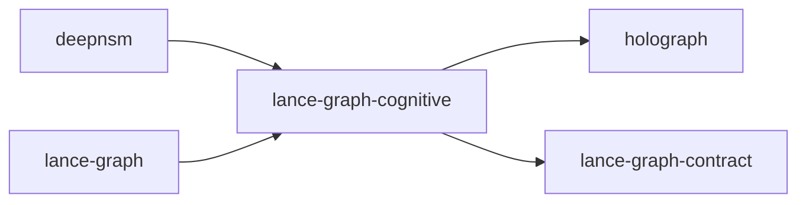

# lance-graph-cognitive

crate: lance-graph-cognitive
path: crates/lance-graph-cognitive
workspace: excluded
digest: 93f956ac0d69ca66
evidence legend: ../index.md#evidence-legend

Generated; the code is the truth. See ../index.md.

## Depends on

- dep holograph normal — crates/lance-graph-cognitive/Cargo.toml:18 CONFIRMED
- dep lance-graph-contract normal — crates/lance-graph-cognitive/Cargo.toml:19 CONFIRMED
- dep ndarray normal — crates/lance-graph-cognitive/Cargo.toml:17 CONFIRMED
- dep serde normal optional — crates/lance-graph-cognitive/Cargo.toml:22 CONFIRMED

## Depended on by

- rdep deepnsm normal optional — crates/deepnsm/Cargo.toml:40 CONFIRMED
- rdep lance-graph normal optional — crates/lance-graph/Cargo.toml:98 CONFIRMED

## Public items

- struct PackedDn [pub] — crates/lance-graph-cognitive/src/container_bs/adjacency.rs:34 CONFIRMED
- const PackedDn::MAX_DEPTH [pub] — crates/lance-graph-cognitive/src/container_bs/adjacency.rs:38 CONFIRMED
- fn PackedDn::new [pub] — crates/lance-graph-cognitive/src/container_bs/adjacency.rs:41 CONFIRMED
- const PackedDn::ROOT [pub] — crates/lance-graph-cognitive/src/container_bs/adjacency.rs:51 CONFIRMED
- fn PackedDn::depth [pub] — crates/lance-graph-cognitive/src/container_bs/adjacency.rs:54 CONFIRMED
- fn PackedDn::component [pub] — crates/lance-graph-cognitive/src/container_bs/adjacency.rs:64 CONFIRMED
- fn PackedDn::parent [pub] — crates/lance-graph-cognitive/src/container_bs/adjacency.rs:77 CONFIRMED
- fn PackedDn::child [pub] — crates/lance-graph-cognitive/src/container_bs/adjacency.rs:88 CONFIRMED
- fn PackedDn::ancestors [pub] — crates/lance-graph-cognitive/src/container_bs/adjacency.rs:98 CONFIRMED
- fn PackedDn::subtree_range [pub] — crates/lance-graph-cognitive/src/container_bs/adjacency.rs:112 CONFIRMED
- fn PackedDn::is_ancestor_of [pub] — crates/lance-graph-cognitive/src/container_bs/adjacency.rs:126 CONFIRMED
- fn PackedDn::common_depth [pub] — crates/lance-graph-cognitive/src/container_bs/adjacency.rs:142 CONFIRMED
- fn PackedDn::hex [pub] — crates/lance-graph-cognitive/src/container_bs/adjacency.rs:155 CONFIRMED
- fn PackedDn::from_hex [pub] — crates/lance-graph-cognitive/src/container_bs/adjacency.rs:160 CONFIRMED
- fn PackedDn::raw [pub] — crates/lance-graph-cognitive/src/container_bs/adjacency.rs:166 CONFIRMED
- fn PackedDn::from_path [pub] — crates/lance-graph-cognitive/src/container_bs/adjacency.rs:177 CONFIRMED
- struct InlineEdge [pub] — crates/lance-graph-cognitive/src/container_bs/adjacency.rs:233 CONFIRMED
- const InlineEdge::EMPTY [pub] — crates/lance-graph-cognitive/src/container_bs/adjacency.rs:242 CONFIRMED
- fn InlineEdge::pack [pub] — crates/lance-graph-cognitive/src/container_bs/adjacency.rs:249 CONFIRMED
- fn InlineEdge::unpack [pub] — crates/lance-graph-cognitive/src/container_bs/adjacency.rs:255 CONFIRMED
- fn InlineEdge::is_empty [pub] — crates/lance-graph-cognitive/src/container_bs/adjacency.rs:264 CONFIRMED
- struct EdgeDescriptor [pub] — crates/lance-graph-cognitive/src/container_bs/adjacency.rs:283 CONFIRMED
- fn EdgeDescriptor::new [pub] — crates/lance-graph-cognitive/src/container_bs/adjacency.rs:287 CONFIRMED
- fn EdgeDescriptor::verb_id [pub] — crates/lance-graph-cognitive/src/container_bs/adjacency.rs:295 CONFIRMED
- fn EdgeDescriptor::weight [pub] — crates/lance-graph-cognitive/src/container_bs/adjacency.rs:301 CONFIRMED
- fn EdgeDescriptor::weight_raw [pub] — crates/lance-graph-cognitive/src/container_bs/adjacency.rs:307 CONFIRMED
- fn EdgeDescriptor::target_dn_low [pub] — crates/lance-graph-cognitive/src/container_bs/adjacency.rs:313 CONFIRMED
- fn EdgeDescriptor::raw [pub] — crates/lance-graph-cognitive/src/container_bs/adjacency.rs:319 CONFIRMED
- const EdgeDescriptor::EMPTY [pub] — crates/lance-graph-cognitive/src/container_bs/adjacency.rs:324 CONFIRMED
- fn EdgeDescriptor::is_empty [pub] — crates/lance-graph-cognitive/src/container_bs/adjacency.rs:326 CONFIRMED
- struct InlineEdgeView [pub] — crates/lance-graph-cognitive/src/container_bs/adjacency.rs:336 CONFIRMED
- fn InlineEdgeView<'a>::new [pub] — crates/lance-graph-cognitive/src/container_bs/adjacency.rs:342 CONFIRMED
- fn InlineEdgeView<'a>::get [pub] — crates/lance-graph-cognitive/src/container_bs/adjacency.rs:348 CONFIRMED
- fn InlineEdgeView<'a>::count [pub] — crates/lance-graph-cognitive/src/container_bs/adjacency.rs:357 CONFIRMED
- fn InlineEdgeView<'a>::iter [pub] — crates/lance-graph-cognitive/src/container_bs/adjacency.rs:368 CONFIRMED
- fn InlineEdgeView<'a>::first_empty [pub] — crates/lance-graph-cognitive/src/container_bs/adjacency.rs:376 CONFIRMED
- fn InlineEdgeView<'a>::find [pub] — crates/lance-graph-cognitive/src/container_bs/adjacency.rs:386 CONFIRMED
- struct InlineEdgeIter [pub] — crates/lance-graph-cognitive/src/container_bs/adjacency.rs:398 CONFIRMED
- struct InlineEdgeViewMut [pub] — crates/lance-graph-cognitive/src/container_bs/adjacency.rs:424 CONFIRMED
- fn InlineEdgeViewMut<'a>::new [pub] — crates/lance-graph-cognitive/src/container_bs/adjacency.rs:430 CONFIRMED
- fn InlineEdgeViewMut<'a>::get [pub] — crates/lance-graph-cognitive/src/container_bs/adjacency.rs:436 CONFIRMED
- fn InlineEdgeViewMut<'a>::set [pub] — crates/lance-graph-cognitive/src/container_bs/adjacency.rs:446 CONFIRMED
- fn InlineEdgeViewMut<'a>::add [pub] — crates/lance-graph-cognitive/src/container_bs/adjacency.rs:455 CONFIRMED
- fn InlineEdgeViewMut<'a>::remove [pub] — crates/lance-graph-cognitive/src/container_bs/adjacency.rs:466 CONFIRMED
- fn InlineEdgeViewMut<'a>::clear [pub] — crates/lance-graph-cognitive/src/container_bs/adjacency.rs:478 CONFIRMED
- fn InlineEdgeViewMut<'a>::count [pub] — crates/lance-graph-cognitive/src/container_bs/adjacency.rs:485 CONFIRMED
- const MAX_CSR_EDGES [pub] — crates/lance-graph-cognitive/src/container_bs/adjacency.rs:513 CONFIRMED
- struct CsrOverflowView [pub] — crates/lance-graph-cognitive/src/container_bs/adjacency.rs:516 CONFIRMED
- fn CsrOverflowView<'a>::new [pub] — crates/lance-graph-cognitive/src/container_bs/adjacency.rs:521 CONFIRMED
- fn CsrOverflowView<'a>::edge_count [pub] — crates/lance-graph-cognitive/src/container_bs/adjacency.rs:527 CONFIRMED
- fn CsrOverflowView<'a>::row_count [pub] — crates/lance-graph-cognitive/src/container_bs/adjacency.rs:533 CONFIRMED
- fn CsrOverflowView<'a>::edge [pub] — crates/lance-graph-cognitive/src/container_bs/adjacency.rs:539 CONFIRMED
- fn CsrOverflowView<'a>::edges [pub] — crates/lance-graph-cognitive/src/container_bs/adjacency.rs:545 CONFIRMED
- struct CsrOverflowViewMut [pub] — crates/lance-graph-cognitive/src/container_bs/adjacency.rs:555 CONFIRMED
- fn CsrOverflowViewMut<'a>::new [pub] — crates/lance-graph-cognitive/src/container_bs/adjacency.rs:560 CONFIRMED
- fn CsrOverflowViewMut<'a>::set_edge_count [pub] — crates/lance-graph-cognitive/src/container_bs/adjacency.rs:565 CONFIRMED
- fn CsrOverflowViewMut<'a>::set_row_count [pub] — crates/lance-graph-cognitive/src/container_bs/adjacency.rs:570 CONFIRMED
- fn CsrOverflowViewMut<'a>::set_edge [pub] — crates/lance-graph-cognitive/src/container_bs/adjacency.rs:576 CONFIRMED
- fn CsrOverflowViewMut<'a>::push_edge [pub] — crates/lance-graph-cognitive/src/container_bs/adjacency.rs:582 CONFIRMED
- fn CsrOverflowViewMut<'a>::clear [pub] — crates/lance-graph-cognitive/src/container_bs/adjacency.rs:593 CONFIRMED
- struct AdjacencyView [pub] — crates/lance-graph-cognitive/src/container_bs/adjacency.rs:606 CONFIRMED
- fn AdjacencyView<'a>::new [pub] — crates/lance-graph-cognitive/src/container_bs/adjacency.rs:611 CONFIRMED
- fn AdjacencyView<'a>::total_edges [pub] — crates/lance-graph-cognitive/src/container_bs/adjacency.rs:616 CONFIRMED
- fn AdjacencyView<'a>::inline [pub] — crates/lance-graph-cognitive/src/container_bs/adjacency.rs:623 CONFIRMED
- fn AdjacencyView<'a>::overflow [pub] — crates/lance-graph-cognitive/src/container_bs/adjacency.rs:628 CONFIRMED
- enum CacheError [pub] — crates/lance-graph-cognitive/src/container_bs/cache.rs:11 CONFIRMED
- struct ContainerCache [pub] — crates/lance-graph-cognitive/src/container_bs/cache.rs:37 CONFIRMED
- fn ContainerCache::new [pub] — crates/lance-graph-cognitive/src/container_bs/cache.rs:53 CONFIRMED
- fn ContainerCache::len [pub] — crates/lance-graph-cognitive/src/container_bs/cache.rs:65 CONFIRMED
- fn ContainerCache::is_empty [pub] — crates/lance-graph-cognitive/src/container_bs/cache.rs:71 CONFIRMED
- fn ContainerCache::write [pub] — crates/lance-graph-cognitive/src/container_bs/cache.rs:76 CONFIRMED
- fn ContainerCache::read [pub] — crates/lance-graph-cognitive/src/container_bs/cache.rs:98 CONFIRMED
- fn ContainerCache::generation [pub] — crates/lance-graph-cognitive/src/container_bs/cache.rs:104 CONFIRMED
- fn ContainerCache::slot_popcount [pub] — crates/lance-graph-cognitive/src/container_bs/cache.rs:110 CONFIRMED
- fn ContainerCache::recompute_spine [pub] — crates/lance-graph-cognitive/src/container_bs/cache.rs:115 CONFIRMED
- fn ContainerCache::dirty_indices [pub] — crates/lance-graph-cognitive/src/container_bs/cache.rs:147 CONFIRMED
- fn ContainerCache::validate [pub] — crates/lance-graph-cognitive/src/container_bs/cache.rs:168 CONFIRMED
- fn ContainerCache::mark_dirty [pub] — crates/lance-graph-cognitive/src/container_bs/cache.rs:181 CONFIRMED
- fn ContainerCache::is_dirty [pub] — crates/lance-graph-cognitive/src/container_bs/cache.rs:198 CONFIRMED
- fn ContainerCache::clear_all_dirty [pub] — crates/lance-graph-cognitive/src/container_bs/cache.rs:209 CONFIRMED
- fn ContainerCache::push [pub] — crates/lance-graph-cognitive/src/container_bs/cache.rs:217 CONFIRMED
- fn ContainerCache::push_spine_slot [pub] — crates/lance-graph-cognitive/src/container_bs/cache.rs:241 CONFIRMED
- fn xor_parity [pub] — crates/lance-graph-cognitive/src/container_bs/delta.rs:10 CONFIRMED
- fn recover [pub] — crates/lance-graph-cognitive/src/container_bs/delta.rs:22 CONFIRMED
- fn delta_encode [pub] — crates/lance-graph-cognitive/src/container_bs/delta.rs:32 CONFIRMED
- fn delta_decode [pub] — crates/lance-graph-cognitive/src/container_bs/delta.rs:39 CONFIRMED
- fn chain_encode [pub] — crates/lance-graph-cognitive/src/container_bs/delta.rs:46 CONFIRMED
- fn chain_decode [pub] — crates/lance-graph-cognitive/src/container_bs/delta.rs:61 CONFIRMED
- const DN_PREFIX [pub] — crates/lance-graph-cognitive/src/container_bs/dn_redis.rs:26 CONFIRMED
- const SPINE_PREFIX [pub] — crates/lance-graph-cognitive/src/container_bs/dn_redis.rs:29 CONFIRMED
- fn dn_key [pub] — crates/lance-graph-cognitive/src/container_bs/dn_redis.rs:37 CONFIRMED
- fn spine_key [pub] — crates/lance-graph-cognitive/src/container_bs/dn_redis.rs:43 CONFIRMED
- fn walk_to_root_keys [pub] — crates/lance-graph-cognitive/src/container_bs/dn_redis.rs:48 CONFIRMED
- fn children_pattern [pub] — crates/lance-graph-cognitive/src/container_bs/dn_redis.rs:54 CONFIRMED
- fn subtree_pattern [pub] — crates/lance-graph-cognitive/src/container_bs/dn_redis.rs:65 CONFIRMED
- struct RedisPipeline [pub] — crates/lance-graph-cognitive/src/container_bs/dn_redis.rs:79 CONFIRMED
- enum RedisCommand [pub] — crates/lance-graph-cognitive/src/container_bs/dn_redis.rs:86 CONFIRMED
- fn RedisPipeline::new [pub] — crates/lance-graph-cognitive/src/container_bs/dn_redis.rs:100 CONFIRMED
- fn RedisPipeline::get_dn [pub] — crates/lance-graph-cognitive/src/container_bs/dn_redis.rs:107 CONFIRMED
- fn RedisPipeline::set_dn [pub] — crates/lance-graph-cognitive/src/container_bs/dn_redis.rs:113 CONFIRMED
- fn RedisPipeline::mget_dns [pub] — crates/lance-graph-cognitive/src/container_bs/dn_redis.rs:120 CONFIRMED
- fn RedisPipeline::walk_to_root [pub] — crates/lance-graph-cognitive/src/container_bs/dn_redis.rs:127 CONFIRMED
- fn RedisPipeline::propagate_dirty [pub] — crates/lance-graph-cognitive/src/container_bs/dn_redis.rs:137 CONFIRMED
- fn RedisPipeline::len [pub] — crates/lance-graph-cognitive/src/container_bs/dn_redis.rs:150 CONFIRMED
- fn RedisPipeline::is_empty [pub] — crates/lance-graph-cognitive/src/container_bs/dn_redis.rs:155 CONFIRMED
- fn cog_record_to_bytes [pub] — crates/lance-graph-cognitive/src/container_bs/dn_redis.rs:165 CONFIRMED
- fn cog_record_from_bytes [pub] — crates/lance-graph-cognitive/src/container_bs/dn_redis.rs:183 CONFIRMED
- trait CogRecordSerde [pub] — crates/lance-graph-cognitive/src/container_bs/dn_redis.rs:198 CONFIRMED
- fn build_record [pub] — crates/lance-graph-cognitive/src/container_bs/dn_redis.rs:236 CONFIRMED
- struct ContainerGraph [pub] — crates/lance-graph-cognitive/src/container_bs/graph.rs:35 CONFIRMED
- fn ContainerGraph::new [pub] — crates/lance-graph-cognitive/src/container_bs/graph.rs:45 CONFIRMED
- fn ContainerGraph::node_count [pub] — crates/lance-graph-cognitive/src/container_bs/graph.rs:54 CONFIRMED
- fn ContainerGraph::insert [pub] — crates/lance-graph-cognitive/src/container_bs/graph.rs:59 CONFIRMED
- fn ContainerGraph::get [pub] — crates/lance-graph-cognitive/src/container_bs/graph.rs:76 CONFIRMED
- fn ContainerGraph::get_mut [pub] — crates/lance-graph-cognitive/src/container_bs/graph.rs:82 CONFIRMED
- fn ContainerGraph::contains [pub] — crates/lance-graph-cognitive/src/container_bs/graph.rs:88 CONFIRMED
- fn ContainerGraph::dns [pub] — crates/lance-graph-cognitive/src/container_bs/graph.rs:93 CONFIRMED
- fn ContainerGraph::iter [pub] — crates/lance-graph-cognitive/src/container_bs/graph.rs:98 CONFIRMED
- fn ContainerGraph::children_of [pub] — crates/lance-graph-cognitive/src/container_bs/graph.rs:103 CONFIRMED
- fn ContainerGraph::walk_to_root [pub] — crates/lance-graph-cognitive/src/container_bs/graph.rs:108 CONFIRMED
- fn ContainerGraph::adjacency [pub] — crates/lance-graph-cognitive/src/container_bs/graph.rs:125 CONFIRMED
- fn ContainerGraph::inline_edges [pub] — crates/lance-graph-cognitive/src/container_bs/graph.rs:132 CONFIRMED
- fn ContainerGraph::overflow_edges [pub] — crates/lance-graph-cognitive/src/container_bs/graph.rs:139 CONFIRMED
- fn ContainerGraph::add_edge [pub] — crates/lance-graph-cognitive/src/container_bs/graph.rs:147 CONFIRMED
- fn ContainerGraph::remove_edge [pub] — crates/lance-graph-cognitive/src/container_bs/graph.rs:161 CONFIRMED
- fn ContainerGraph::add_overflow_edge [pub] — crates/lance-graph-cognitive/src/container_bs/graph.rs:179 CONFIRMED
- fn ContainerGraph::fingerprint [pub] — crates/lance-graph-cognitive/src/container_bs/graph.rs:190 CONFIRMED
- fn ContainerGraph::hamming [pub] — crates/lance-graph-cognitive/src/container_bs/graph.rs:195 CONFIRMED
- fn ContainerGraph::quick_distance [pub] — crates/lance-graph-cognitive/src/container_bs/graph.rs:202 CONFIRMED
- fn ContainerGraph::outgoing [pub] — crates/lance-graph-cognitive/src/container_bs/graph.rs:214 CONFIRMED
- fn ContainerGraph::degree [pub] — crates/lance-graph-cognitive/src/container_bs/graph.rs:222 CONFIRMED
- fn ContainerGraph::nearest_k [pub] — crates/lance-graph-cognitive/src/container_bs/graph.rs:231 CONFIRMED
- fn ContainerGraph::mget [pub] — crates/lance-graph-cognitive/src/container_bs/graph.rs:244 CONFIRMED
- fn ContainerGraph::subtree [pub] — crates/lance-graph-cognitive/src/container_bs/graph.rs:249 CONFIRMED
- const SPLIT_THRESHOLD [pub] — crates/lance-graph-cognitive/src/container_bs/insert.rs:30 CONFIRMED
- const RESONANCE_THRESHOLD [pub] — crates/lance-graph-cognitive/src/container_bs/insert.rs:37 CONFIRMED
- enum InsertResult [pub] — crates/lance-graph-cognitive/src/container_bs/insert.rs:41 CONFIRMED
- fn InsertResult::leaf_idx [pub] — crates/lance-graph-cognitive/src/container_bs/insert.rs:75 CONFIRMED
- fn InsertResult::containers_written [pub] — crates/lance-graph-cognitive/src/container_bs/insert.rs:84 CONFIRMED
- fn InsertResult::spines_dirtied [pub] — crates/lance-graph-cognitive/src/container_bs/insert.rs:93 CONFIRMED
- fn insert_leaf [pub] — crates/lance-graph-cognitive/src/container_bs/insert.rs:118 CONFIRMED
- const W_DN_ADDR [pub] — crates/lance-graph-cognitive/src/container_bs/meta.rs:36 CONFIRMED
- const W_TYPE [pub] — crates/lance-graph-cognitive/src/container_bs/meta.rs:41 CONFIRMED
- const W_TIME [pub] — crates/lance-graph-cognitive/src/container_bs/meta.rs:44 CONFIRMED
- const W_LABEL [pub] — crates/lance-graph-cognitive/src/container_bs/meta.rs:47 CONFIRMED
- const W_NARS_BASE [pub] — crates/lance-graph-cognitive/src/container_bs/meta.rs:50 CONFIRMED
- const W_DN_RUNG [pub] — crates/lance-graph-cognitive/src/container_bs/meta.rs:53 CONFIRMED
- const W_LAYER_BASE [pub] — crates/lance-graph-cognitive/src/container_bs/meta.rs:56 CONFIRMED
- const W_EDGE_BASE [pub] — crates/lance-graph-cognitive/src/container_bs/meta.rs:59 CONFIRMED
- const W_EDGE_END [pub] — crates/lance-graph-cognitive/src/container_bs/meta.rs:60 CONFIRMED
- const MAX_INLINE_EDGES [pub] — crates/lance-graph-cognitive/src/container_bs/meta.rs:63 CONFIRMED
- const W_RL_BASE [pub] — crates/lance-graph-cognitive/src/container_bs/meta.rs:66 CONFIRMED
- const W_BLOOM_BASE [pub] — crates/lance-graph-cognitive/src/container_bs/meta.rs:69 CONFIRMED
- const W_GRAPH_BASE [pub] — crates/lance-graph-cognitive/src/container_bs/meta.rs:72 CONFIRMED
- const W_QUALIA_BASE [pub] — crates/lance-graph-cognitive/src/container_bs/meta.rs:75 CONFIRMED
- const W_RUNG_HIST [pub] — crates/lance-graph-cognitive/src/container_bs/meta.rs:78 CONFIRMED
- const W_REPR_BASE [pub] — crates/lance-graph-cognitive/src/container_bs/meta.rs:81 CONFIRMED
- const W_ADJ_BASE [pub] — crates/lance-graph-cognitive/src/container_bs/meta.rs:84 CONFIRMED
- const W_RESERVED [pub] — crates/lance-graph-cognitive/src/container_bs/meta.rs:87 CONFIRMED
- const W_CHECKSUM [pub] — crates/lance-graph-cognitive/src/container_bs/meta.rs:90 CONFIRMED
- const SCHEMA_VERSION [pub] — crates/lance-graph-cognitive/src/container_bs/meta.rs:93 CONFIRMED
- struct MetaView [pub] — crates/lance-graph-cognitive/src/container_bs/meta.rs:100 CONFIRMED
- fn MetaView<'a>::new [pub] — crates/lance-graph-cognitive/src/container_bs/meta.rs:106 CONFIRMED
- fn MetaView<'a>::dn_addr [pub] — crates/lance-graph-cognitive/src/container_bs/meta.rs:114 CONFIRMED
- fn MetaView<'a>::node_kind [pub] — crates/lance-graph-cognitive/src/container_bs/meta.rs:122 CONFIRMED
- fn MetaView<'a>::container_count [pub] — crates/lance-graph-cognitive/src/container_bs/meta.rs:128 CONFIRMED
- fn MetaView<'a>::geometry [pub] — crates/lance-graph-cognitive/src/container_bs/meta.rs:134 CONFIRMED
- fn MetaView<'a>::flags [pub] — crates/lance-graph-cognitive/src/container_bs/meta.rs:141 CONFIRMED
- fn MetaView<'a>::schema_version [pub] — crates/lance-graph-cognitive/src/container_bs/meta.rs:147 CONFIRMED
- fn MetaView<'a>::provenance_hash [pub] — crates/lance-graph-cognitive/src/container_bs/meta.rs:153 CONFIRMED
- fn MetaView<'a>::created_ms [pub] — crates/lance-graph-cognitive/src/container_bs/meta.rs:161 CONFIRMED
- fn MetaView<'a>::modified_ms [pub] — crates/lance-graph-cognitive/src/container_bs/meta.rs:167 CONFIRMED
- fn MetaView<'a>::label_hash [pub] — crates/lance-graph-cognitive/src/container_bs/meta.rs:175 CONFIRMED
- fn MetaView<'a>::tree_depth [pub] — crates/lance-graph-cognitive/src/container_bs/meta.rs:181 CONFIRMED
- fn MetaView<'a>::branch [pub] — crates/lance-graph-cognitive/src/container_bs/meta.rs:187 CONFIRMED
- fn MetaView<'a>::nars_frequency [pub] — crates/lance-graph-cognitive/src/container_bs/meta.rs:195 CONFIRMED
- fn MetaView<'a>::nars_confidence [pub] — crates/lance-graph-cognitive/src/container_bs/meta.rs:201 CONFIRMED
- fn MetaView<'a>::nars_positive_evidence [pub] — crates/lance-graph-cognitive/src/container_bs/meta.rs:207 CONFIRMED
- fn MetaView<'a>::nars_negative_evidence [pub] — crates/lance-graph-cognitive/src/container_bs/meta.rs:213 CONFIRMED
- fn MetaView<'a>::rung_level [pub] — crates/lance-graph-cognitive/src/container_bs/meta.rs:221 CONFIRMED
- fn MetaView<'a>::gate_state [pub] — crates/lance-graph-cognitive/src/container_bs/meta.rs:227 CONFIRMED
- fn MetaView<'a>::layer_bitmap [pub] — crates/lance-graph-cognitive/src/container_bs/meta.rs:233 CONFIRMED
- fn MetaView<'a>::layer_marker [pub] — crates/lance-graph-cognitive/src/container_bs/meta.rs:241 CONFIRMED
- fn MetaView<'a>::inline_edge [pub] — crates/lance-graph-cognitive/src/container_bs/meta.rs:271 CONFIRMED
- fn MetaView<'a>::inline_edge_count [pub] — crates/lance-graph-cognitive/src/container_bs/meta.rs:280 CONFIRMED
- fn MetaView<'a>::q_value [pub] — crates/lance-graph-cognitive/src/container_bs/meta.rs:295 CONFIRMED
- fn MetaView<'a>::bloom_contains [pub] — crates/lance-graph-cognitive/src/container_bs/meta.rs:305 CONFIRMED
- fn MetaView<'a>::in_degree [pub] — crates/lance-graph-cognitive/src/container_bs/meta.rs:322 CONFIRMED
- fn MetaView<'a>::out_degree [pub] — crates/lance-graph-cognitive/src/container_bs/meta.rs:328 CONFIRMED
- fn MetaView<'a>::pagerank [pub] — crates/lance-graph-cognitive/src/container_bs/meta.rs:334 CONFIRMED
- fn MetaView<'a>::clustering [pub] — crates/lance-graph-cognitive/src/container_bs/meta.rs:340 CONFIRMED
- fn MetaView<'a>::stored_checksum [pub] — crates/lance-graph-cognitive/src/container_bs/meta.rs:348 CONFIRMED
- fn MetaView<'a>::verify_checksum [pub] — crates/lance-graph-cognitive/src/container_bs/meta.rs:353 CONFIRMED
- struct MetaViewMut [pub] — crates/lance-graph-cognitive/src/container_bs/meta.rs:367 CONFIRMED
- fn MetaViewMut<'a>::new [pub] — crates/lance-graph-cognitive/src/container_bs/meta.rs:373 CONFIRMED
- fn MetaViewMut<'a>::as_view [pub] — crates/lance-graph-cognitive/src/container_bs/meta.rs:378 CONFIRMED
- fn MetaViewMut<'a>::set_dn_addr [pub] — crates/lance-graph-cognitive/src/container_bs/meta.rs:384 CONFIRMED
- fn MetaViewMut<'a>::set_node_kind [pub] — crates/lance-graph-cognitive/src/container_bs/meta.rs:390 CONFIRMED
- fn MetaViewMut<'a>::set_container_count [pub] — crates/lance-graph-cognitive/src/container_bs/meta.rs:394 CONFIRMED
- fn MetaViewMut<'a>::set_geometry [pub] — crates/lance-graph-cognitive/src/container_bs/meta.rs:398 CONFIRMED
- truncated (1194 total), see symbols.tsv

## Imports from in-scope crates

- none

## Calls

CALL_GRAPH=ARTIFACT_MISSING
- calls ARTIFACT_MISSING — no ruff_charon artifact for this crate UNKNOWN

## Architecture

- none

Generated from Cargo manifests — extracted relationships only.

