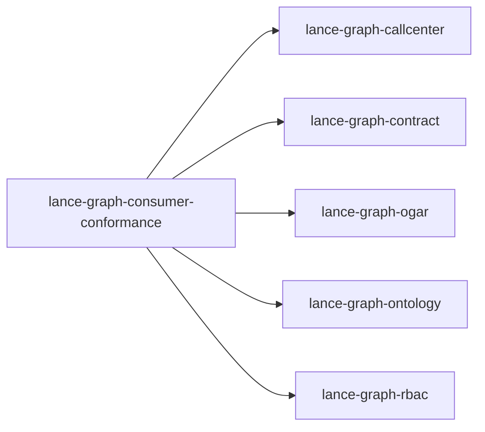

# lance-graph-consumer-conformance

crate: lance-graph-consumer-conformance
path: crates/lance-graph-consumer-conformance
workspace: member
digest: 82e980465d770990
evidence legend: ../index.md#evidence-legend

Generated; the code is the truth. See ../index.md.

## Depends on

- dep lance-graph-callcenter normal — crates/lance-graph-consumer-conformance/Cargo.toml:14 CONFIRMED
- dep lance-graph-contract normal — crates/lance-graph-consumer-conformance/Cargo.toml:21 CONFIRMED
- dep lance-graph-ogar normal — crates/lance-graph-consumer-conformance/Cargo.toml:19 CONFIRMED
- dep lance-graph-ontology normal — crates/lance-graph-consumer-conformance/Cargo.toml:16 CONFIRMED
- dep lance-graph-rbac normal — crates/lance-graph-consumer-conformance/Cargo.toml:23 CONFIRMED

## Depended on by

## Public items

- struct RecordingSink [pub] — crates/lance-graph-consumer-conformance/src/harness.rs:40 CONFIRMED
- fn RecordingSink::snapshot [pub] — crates/lance-graph-consumer-conformance/src/harness.rs:46 CONFIRMED
- fn RecordingSink::len [pub] — crates/lance-graph-consumer-conformance/src/harness.rs:51 CONFIRMED
- fn RecordingSink::is_empty [pub] — crates/lance-graph-consumer-conformance/src/harness.rs:56 CONFIRMED
- struct ConformanceFixture [pub] — crates/lance-graph-consumer-conformance/src/harness.rs:85 CONFIRMED
- fn assert_consumer_conformance [pub] — crates/lance-graph-consumer-conformance/src/harness.rs:119 CONFIRMED
- fn assert_deny_on_alias_keyed_policy [pub] — crates/lance-graph-consumer-conformance/src/harness.rs:327 CONFIRMED
- mod harness [pub] — crates/lance-graph-consumer-conformance/src/lib.rs:23 CONFIRMED

## Imports from in-scope crates

### lance-graph-callcenter
- use lance_graph_callcenter::audit_sink::AuditError — crates/lance-graph-consumer-conformance/src/harness.rs:24 CONFIRMED
- use lance_graph_callcenter::audit_sink::AuditSink — crates/lance-graph-consumer-conformance/src/harness.rs:24 CONFIRMED
- use lance_graph_callcenter::audit_sink::MerkleRoot — crates/lance-graph-consumer-conformance/src/harness.rs:24 CONFIRMED
- use lance_graph_callcenter::super_domain::SuperDomain — crates/lance-graph-consumer-conformance/src/harness.rs:25 CONFIRMED
- use lance_graph_callcenter::unified_audit::AuditMerkleRoot — crates/lance-graph-consumer-conformance/src/harness.rs:26 CONFIRMED
- use lance_graph_callcenter::unified_audit::UnifiedAuditEvent — crates/lance-graph-consumer-conformance/src/harness.rs:26 CONFIRMED
- use lance_graph_callcenter::unified_bridge::TenantId — crates/lance-graph-consumer-conformance/src/harness.rs:27 CONFIRMED
- use lance_graph_callcenter::unified_bridge::UnifiedBridge — crates/lance-graph-consumer-conformance/src/harness.rs:27 CONFIRMED
- use lance_graph_callcenter::super_domain::SuperDomain cfg=test — crates/lance-graph-consumer-conformance/src/lib.rs:29 CONFIRMED
- use lance_graph_callcenter::unified_bridge::TenantId cfg=test — crates/lance-graph-consumer-conformance/src/lib.rs:30 CONFIRMED
- use lance_graph_callcenter::unified_bridge::UnifiedBridge cfg=test — crates/lance-graph-consumer-conformance/src/lib.rs:30 CONFIRMED
### lance-graph-contract
- use lance_graph_contract::hash::fnv1a_str — crates/lance-graph-consumer-conformance/src/harness.rs:28 CONFIRMED
- use lance_graph_contract::property::PrefetchDepth — crates/lance-graph-consumer-conformance/src/harness.rs:29 CONFIRMED
- use lance_graph_contract::property::Marking cfg=test — crates/lance-graph-consumer-conformance/src/lib.rs:31 CONFIRMED
- use lance_graph_contract::property::PrefetchDepth cfg=test — crates/lance-graph-consumer-conformance/src/lib.rs:31 CONFIRMED
- use lance_graph_contract::property::Schema cfg=test — crates/lance-graph-consumer-conformance/src/lib.rs:31 CONFIRMED
### lance-graph-ontology
- use lance_graph_ontology::bridge::NamespaceBridge — crates/lance-graph-consumer-conformance/src/harness.rs:30 CONFIRMED
- use lance_graph_ontology::bridge::NamespaceBridge cfg=test — crates/lance-graph-consumer-conformance/src/lib.rs:32 CONFIRMED
- use lance_graph_ontology::namespace::OgitUri cfg=test — crates/lance-graph-consumer-conformance/src/lib.rs:33 CONFIRMED
- use lance_graph_ontology::proposal::MappingProposal cfg=test — crates/lance-graph-consumer-conformance/src/lib.rs:34 CONFIRMED
- use lance_graph_ontology::proposal::MappingProposalKind cfg=test — crates/lance-graph-consumer-conformance/src/lib.rs:34 CONFIRMED
- use lance_graph_ontology::OntologyRegistry cfg=test — crates/lance-graph-consumer-conformance/src/lib.rs:35 CONFIRMED
### lance-graph-rbac
- use lance_graph_rbac::permission::PermissionSpec cfg=test — crates/lance-graph-consumer-conformance/src/lib.rs:36 CONFIRMED
- use lance_graph_rbac::policy::Policy cfg=test — crates/lance-graph-consumer-conformance/src/lib.rs:37 CONFIRMED
- use lance_graph_rbac::role::Role cfg=test — crates/lance-graph-consumer-conformance/src/lib.rs:38 CONFIRMED

## Calls

CALL_GRAPH=ARTIFACT_MISSING
- calls ARTIFACT_MISSING — no ruff_charon artifact for this crate UNKNOWN

## Architecture

- none

Generated from Cargo manifests — extracted relationships only.

