# lance-graph-contract

crate: lance-graph-contract
path: crates/lance-graph-contract
workspace: member
digest: 6b4e13ff1d0afadb
evidence legend: ../index.md#evidence-legend

Generated; the code is the truth. See ../index.md.

## Depends on

- dep criterion dev — crates/lance-graph-contract/Cargo.toml:32 CONFIRMED
- dep glob build — crates/lance-graph-contract/Cargo.toml:24 CONFIRMED
- dep serde build — crates/lance-graph-contract/Cargo.toml:23 CONFIRMED
- dep serde dev — crates/lance-graph-contract/Cargo.toml:29 CONFIRMED
- dep serde_yaml build — crates/lance-graph-contract/Cargo.toml:22 CONFIRMED
- dep serde_yaml dev — crates/lance-graph-contract/Cargo.toml:28 CONFIRMED

## Depended on by

- rdep bgz-tensor normal optional — crates/bgz-tensor/Cargo.toml:27 CONFIRMED
- rdep cognitive-shader-driver normal — crates/cognitive-shader-driver/Cargo.toml:230 CONFIRMED
- rdep cognitive-stack normal — crates/cognitive-stack/Cargo.toml:48 CONFIRMED
- rdep crepe-plan-probe normal — crates/crepe-plan-probe/Cargo.toml:27 CONFIRMED
- rdep d-diamond-1-probe normal — crates/d-diamond-1-probe/Cargo.toml:16 CONFIRMED
- rdep deepnsm normal — crates/deepnsm/Cargo.toml:39 CONFIRMED
- rdep deepnsm-v2 normal — crates/deepnsm-v2/Cargo.toml:29 CONFIRMED
- rdep dr-isa-stream-lab normal — crates/dr-isa-stream-lab/Cargo.toml:19 CONFIRMED
- rdep drf-focus-probe dev — crates/drf-focus-probe/Cargo.toml:27 CONFIRMED
- rdep drisa-register-probe normal — crates/drisa-register-probe/Cargo.toml:21 CONFIRMED
- rdep dt64-admission-probe normal — crates/dt64-admission-probe/Cargo.toml:19 CONFIRMED
- rdep foundry-parity-lab normal — crates/foundry-parity-lab/Cargo.toml:24 CONFIRMED
- rdep grammar-constraints-probe normal — crates/grammar-constraints-probe/Cargo.toml:18 CONFIRMED
- rdep jc dev — crates/jc/Cargo.toml:34 CONFIRMED
- rdep lance-graph dev — crates/lance-graph/Cargo.toml:163 CONFIRMED
- rdep lance-graph normal — crates/lance-graph/Cargo.toml:50 CONFIRMED
- rdep lance-graph-archetype normal — crates/lance-graph-archetype/Cargo.toml:10 CONFIRMED
- rdep lance-graph-arm-discovery normal optional — crates/lance-graph-arm-discovery/Cargo.toml:52 CONFIRMED
- rdep lance-graph-callcenter normal — crates/lance-graph-callcenter/Cargo.toml:12 CONFIRMED
- rdep lance-graph-codegraph dev — crates/lance-graph-codegraph/Cargo.toml:23 CONFIRMED
- rdep lance-graph-cognitive normal — crates/lance-graph-cognitive/Cargo.toml:19 CONFIRMED
- rdep lance-graph-consumer-conformance normal — crates/lance-graph-consumer-conformance/Cargo.toml:21 CONFIRMED
- rdep lance-graph-dir-sim dev — crates/lance-graph-dir-sim/Cargo.toml:52 CONFIRMED
- rdep lance-graph-dir-sim normal optional — crates/lance-graph-dir-sim/Cargo.toml:40 CONFIRMED
- rdep lance-graph-dt64 normal — crates/lance-graph-dt64/Cargo.toml:10 CONFIRMED
- rdep lance-graph-dt64-lance normal — crates/lance-graph-dt64-lance/Cargo.toml:27 CONFIRMED
- rdep lance-graph-glove-parity normal — crates/lance-graph-glove-parity/Cargo.toml:14 CONFIRMED
- rdep lance-graph-lane-fold normal — crates/lance-graph-lane-fold/Cargo.toml:15 CONFIRMED
- rdep lance-graph-mask-risc dev — crates/lance-graph-mask-risc/Cargo.toml:37 CONFIRMED
- rdep lance-graph-nal normal — crates/lance-graph-nal/Cargo.toml:15 CONFIRMED
- rdep lance-graph-ogar normal — crates/lance-graph-ogar/Cargo.toml:89 CONFIRMED
- rdep lance-graph-ontology normal — crates/lance-graph-ontology/Cargo.toml:12 CONFIRMED
- rdep lance-graph-planner normal — crates/lance-graph-planner/Cargo.toml:40 CONFIRMED
- rdep lance-graph-quack normal — crates/lance-graph-quack/Cargo.toml:18 CONFIRMED
- rdep lance-graph-r2il normal — crates/lance-graph-r2il/Cargo.toml:30 CONFIRMED
- rdep lance-graph-rbac normal — crates/lance-graph-rbac/Cargo.toml:8 CONFIRMED
- rdep lance-graph-relalg normal — crates/lance-graph-relalg/Cargo.toml:23 CONFIRMED
- rdep lance-graph-report normal — crates/lance-graph-report/Cargo.toml:17 CONFIRMED
- rdep lance-graph-report-ogar normal — crates/lance-graph-report-ogar/Cargo.toml:31 CONFIRMED
- rdep lance-graph-sap normal — crates/lance-graph-sap/Cargo.toml:11 CONFIRMED
- rdep lance-graph-supervisor normal — crates/lance-graph-supervisor/Cargo.toml:14 CONFIRMED
- rdep lance-graph-xlog normal — crates/lance-graph-xlog/Cargo.toml:14 CONFIRMED
- rdep learning normal — crates/learning/Cargo.toml:17 CONFIRMED
- rdep ogar-behavior-probe normal — crates/ogar-behavior-probe/Cargo.toml:22 CONFIRMED
- rdep onebrc-probe normal optional — crates/onebrc-probe/Cargo.toml:71 CONFIRMED
- rdep perturbation-sim normal optional — crates/perturbation-sim/Cargo.toml:30 CONFIRMED
- rdep r2il-mask-abi-probe dev — crates/r2il-mask-abi-probe/Cargo.toml:33 CONFIRMED
- rdep sigma-tier-router normal — crates/sigma-tier-router/Cargo.toml:9 CONFIRMED
- rdep soa64-u64-lab normal — crates/soa64-u64-lab/Cargo.toml:17 CONFIRMED
- rdep surreal_container normal — crates/surreal_container/Cargo.toml:51 CONFIRMED
- rdep symbiont normal — crates/symbiont/Cargo.toml:41 CONFIRMED
- rdep thinking-engine normal — crates/thinking-engine/Cargo.toml:17 CONFIRMED
- rdep thought-git-probe normal — crates/thought-git-probe/Cargo.toml:13 CONFIRMED
- rdep tract-harvest-probe normal — crates/tract-harvest-probe/Cargo.toml:25 CONFIRMED
- rdep weather-poc normal optional — crates/weather-poc/Cargo.toml:28 CONFIRMED

## Public items

- type ExpertId [pub] — crates/lance-graph-contract/src/a2a_blackboard.rs:33 CONFIRMED
- enum ExpertCapability [pub] — crates/lance-graph-contract/src/a2a_blackboard.rs:38 CONFIRMED
- struct ExpertEntry [pub] — crates/lance-graph-contract/src/a2a_blackboard.rs:71 CONFIRMED
- struct BlackboardEntry [pub] — crates/lance-graph-contract/src/a2a_blackboard.rs:88 CONFIRMED
- struct Blackboard [pub] — crates/lance-graph-contract/src/a2a_blackboard.rs:107 CONFIRMED
- fn Blackboard::new [pub] — crates/lance-graph-contract/src/a2a_blackboard.rs:115 CONFIRMED
- fn Blackboard::post [pub] — crates/lance-graph-contract/src/a2a_blackboard.rs:120 CONFIRMED
- fn Blackboard::from_expert [pub] — crates/lance-graph-contract/src/a2a_blackboard.rs:125 CONFIRMED
- fn Blackboard::by_capability [pub] — crates/lance-graph-contract/src/a2a_blackboard.rs:130 CONFIRMED
- fn Blackboard::next_round [pub] — crates/lance-graph-contract/src/a2a_blackboard.rs:138 CONFIRMED
- fn Blackboard::len [pub] — crates/lance-graph-contract/src/a2a_blackboard.rs:144 CONFIRMED
- fn Blackboard::is_empty [pub] — crates/lance-graph-contract/src/a2a_blackboard.rs:147 CONFIRMED
- enum RoutingStrategy [pub] — crates/lance-graph-contract/src/a2a_blackboard.rs:158 CONFIRMED
- struct RoutingDecision [pub] — crates/lance-graph-contract/src/a2a_blackboard.rs:171 CONFIRMED
- enum ConsensusStrategy [pub] — crates/lance-graph-contract/src/a2a_blackboard.rs:183 CONFIRMED
- struct ConsensusResult [pub] — crates/lance-graph-contract/src/a2a_blackboard.rs:196 CONFIRMED
- fn compute_consensus [pub] — crates/lance-graph-contract/src/a2a_blackboard.rs:211 CONFIRMED
- enum ActionState [pub] — crates/lance-graph-contract/src/action.rs:44 CONFIRMED
- fn ActionState::is_terminal [pub] — crates/lance-graph-contract/src/action.rs:59 CONFIRMED
- struct StateGuard [pub] — crates/lance-graph-contract/src/action.rs:67 CONFIRMED
- struct ActionDef [pub] — crates/lance-graph-contract/src/action.rs:79 CONFIRMED
- fn ActionDef::is_override [pub] — crates/lance-graph-contract/src/action.rs:100 CONFIRMED
- struct ClassActions [pub] — crates/lance-graph-contract/src/action.rs:109 CONFIRMED
- fn actions_for [pub] — crates/lance-graph-contract/src/action.rs:120 CONFIRMED
- fn effective_actions [pub] — crates/lance-graph-contract/src/action.rs:137 CONFIRMED
- struct ActionInvocation [pub] — crates/lance-graph-contract/src/action.rs:185 CONFIRMED
- fn ActionInvocation::pending [pub] — crates/lance-graph-contract/src/action.rs:218 CONFIRMED
- fn ActionInvocation::commit [pub] — crates/lance-graph-contract/src/action.rs:266 CONFIRMED
- fn ActionInvocation::commit_via [pub] — crates/lance-graph-contract/src/action.rs:328 CONFIRMED
- struct AiwarClassView [pub] — crates/lance-graph-contract/src/aiwar.rs:25 CONFIRMED
- fn AiwarClassView::from_graph [pub] — crates/lance-graph-contract/src/aiwar.rs:32 CONFIRMED
- fn AiwarClassView::family_of [pub] — crates/lance-graph-contract/src/aiwar.rs:48 CONFIRMED
- fn AiwarClassView::len [pub] — crates/lance-graph-contract/src/aiwar.rs:53 CONFIRMED
- fn AiwarClassView::is_empty [pub] — crates/lance-graph-contract/src/aiwar.rs:58 CONFIRMED
- fn AiwarClassView::categories [pub] — crates/lance-graph-contract/src/aiwar.rs:63 CONFIRMED
- fn aiwar_node_rows [pub] — crates/lance-graph-contract/src/aiwar.rs:74 CONFIRMED
- fn aiwar_node_rows_with [pub] — crates/lance-graph-contract/src/aiwar.rs:88 CONFIRMED
- struct AlgebraLaw [pub] — crates/lance-graph-contract/src/algebra_law.rs:37 CONFIRMED
- enum IdentityKind [pub] — crates/lance-graph-contract/src/algebra_law.rs:96 CONFIRMED
- trait AlgebraDescriptor [pub] — crates/lance-graph-contract/src/algebra_law.rs:110 CONFIRMED
- type AlphaAddr [pub] — crates/lance-graph-contract/src/alpha.rs:84 CONFIRMED
- const ALPHA_STAMP_OFFSET [pub] — crates/lance-graph-contract/src/alpha.rs:89 CONFIRMED
- const ALPHA_STAMP_BYTES [pub] — crates/lance-graph-contract/src/alpha.rs:92 CONFIRMED
- struct AlphaStamp [pub] — crates/lance-graph-contract/src/alpha.rs:126 CONFIRMED
- fn AlphaStamp::to_le_slot [pub] — crates/lance-graph-contract/src/alpha.rs:142 CONFIRMED
- fn AlphaStamp::from_le_slot [pub] — crates/lance-graph-contract/src/alpha.rs:154 CONFIRMED
- fn stamp_of [pub] — crates/lance-graph-contract/src/alpha.rs:170 CONFIRMED
- enum AlphaError [pub] — crates/lance-graph-contract/src/alpha.rs:178 CONFIRMED
- struct AlphaClaim [pub] — crates/lance-graph-contract/src/alpha.rs:197 CONFIRMED
- struct AlphaMask [pub] — crates/lance-graph-contract/src/alpha.rs:249 CONFIRMED
- fn AlphaMask::empty [pub] — crates/lance-graph-contract/src/alpha.rs:273 CONFIRMED
- fn AlphaMask::contains [pub] — crates/lance-graph-contract/src/alpha.rs:288 CONFIRMED
- fn AlphaMask::count [pub] — crates/lance-graph-contract/src/alpha.rs:294 CONFIRMED
- fn AlphaMask::is_empty [pub] — crates/lance-graph-contract/src/alpha.rs:300 CONFIRMED
- fn AlphaMask::len [pub] — crates/lance-graph-contract/src/alpha.rs:335 CONFIRMED
- fn AlphaMask::and [pub] — crates/lance-graph-contract/src/alpha.rs:370 CONFIRMED
- fn AlphaMask::or [pub] — crates/lance-graph-contract/src/alpha.rs:376 CONFIRMED
- fn AlphaMask::xor [pub] — crates/lance-graph-contract/src/alpha.rs:382 CONFIRMED
- fn AlphaMask::and_not [pub] — crates/lance-graph-contract/src/alpha.rs:388 CONFIRMED
- fn AlphaMask::not [pub] — crates/lance-graph-contract/src/alpha.rs:395 CONFIRMED
- fn AlphaMask::and_assign [pub] — crates/lance-graph-contract/src/alpha.rs:417 CONFIRMED
- fn AlphaMask::or_assign [pub] — crates/lance-graph-contract/src/alpha.rs:428 CONFIRMED
- fn AlphaMask::xor_assign [pub] — crates/lance-graph-contract/src/alpha.rs:438 CONFIRMED
- fn AlphaMask::and_not_assign [pub] — crates/lance-graph-contract/src/alpha.rs:448 CONFIRMED
- fn AlphaMask::not_assign [pub] — crates/lance-graph-contract/src/alpha.rs:456 CONFIRMED
- fn AlphaMask::clear [pub] — crates/lance-graph-contract/src/alpha.rs:465 CONFIRMED
- fn AlphaMask::words_mut [pub] — crates/lance-graph-contract/src/alpha.rs:477 CONFIRMED
- fn AlphaMask::clear_tail [pub] — crates/lance-graph-contract/src/alpha.rs:483 CONFIRMED
- fn AlphaMask::materialize_ordinals [pub] — crates/lance-graph-contract/src/alpha.rs:493 CONFIRMED
- fn AlphaMask::words [pub] — crates/lance-graph-contract/src/alpha.rs:503 CONFIRMED
- fn AlphaMask::from_words [pub] — crates/lance-graph-contract/src/alpha.rs:517 CONFIRMED
- struct AlphaAllocation [pub] — crates/lance-graph-contract/src/alpha.rs:534 CONFIRMED
- fn AlphaAllocation<'a>::over [pub] — crates/lance-graph-contract/src/alpha.rs:556 CONFIRMED
- fn AlphaAllocation<'a>::ordinal [pub] — crates/lance-graph-contract/src/alpha.rs:573 CONFIRMED
- fn AlphaAllocation<'a>::mask_of [pub] — crates/lance-graph-contract/src/alpha.rs:596 CONFIRMED
- fn AlphaAllocation<'a>::len [pub] — crates/lance-graph-contract/src/alpha.rs:612 CONFIRMED
- fn AlphaAllocation<'a>::is_empty [pub] — crates/lance-graph-contract/src/alpha.rs:618 CONFIRMED
- fn AlphaAllocation<'a>::contains [pub] — crates/lance-graph-contract/src/alpha.rs:624 CONFIRMED
- fn AlphaAllocation<'a>::base [pub] — crates/lance-graph-contract/src/alpha.rs:630 CONFIRMED
- struct AlphaOverlay [pub] — crates/lance-graph-contract/src/alpha.rs:638 CONFIRMED
- fn AlphaOverlay<'a>::over_shared [pub] — crates/lance-graph-contract/src/alpha.rs:677 CONFIRMED
- fn AlphaOverlay<'a>::new [pub] — crates/lance-graph-contract/src/alpha.rs:688 CONFIRMED
- fn AlphaOverlay<'a>::claim [pub] — crates/lance-graph-contract/src/alpha.rs:707 CONFIRMED
- fn AlphaOverlay<'a>::claim_path [pub] — crates/lance-graph-contract/src/alpha.rs:749 CONFIRMED
- fn AlphaOverlay<'a>::get [pub] — crates/lance-graph-contract/src/alpha.rs:767 CONFIRMED
- fn AlphaOverlay<'a>::claimed_len [pub] — crates/lance-graph-contract/src/alpha.rs:773 CONFIRMED
- fn AlphaOverlay<'a>::allocated_len [pub] — crates/lance-graph-contract/src/alpha.rs:779 CONFIRMED
- fn AlphaOverlay<'a>::rows [pub] — crates/lance-graph-contract/src/alpha.rs:785 CONFIRMED
- fn AlphaOverlay<'a>::allocation [pub] — crates/lance-graph-contract/src/alpha.rs:791 CONFIRMED
- fn AlphaOverlay<'a>::attended_mask [pub] — crates/lance-graph-contract/src/alpha.rs:808 CONFIRMED
- fn AlphaOverlay<'a>::scanpath [pub] — crates/lance-graph-contract/src/alpha.rs:830 CONFIRMED
- fn AlphaOverlay<'a>::unattended [pub] — crates/lance-graph-contract/src/alpha.rs:840 CONFIRMED
- fn AlphaOverlay<'a>::regressions [pub] — crates/lance-graph-contract/src/alpha.rs:855 CONFIRMED
- fn AlphaOverlay<'a>::only_in [pub] — crates/lance-graph-contract/src/alpha.rs:875 CONFIRMED
- fn AlphaOverlay<'a>::discard [pub] — crates/lance-graph-contract/src/alpha.rs:884 CONFIRMED
- enum FocusError [pub] — crates/lance-graph-contract/src/alpha_focus.rs:52 CONFIRMED
- struct FocusCell [pub] — crates/lance-graph-contract/src/alpha_focus.rs:79 CONFIRMED
- struct AlphaFocus [pub] — crates/lance-graph-contract/src/alpha_focus.rs:89 CONFIRMED
- fn AlphaFocus<'a,'b>::cross [pub] — crates/lance-graph-contract/src/alpha_focus.rs:103 CONFIRMED
- fn AlphaFocus<'a,'b>::cell [pub] — crates/lance-graph-contract/src/alpha_focus.rs:121 CONFIRMED
- fn AlphaFocus<'a,'b>::matrix [pub] — crates/lance-graph-contract/src/alpha_focus.rs:131 CONFIRMED
- fn AlphaFocus<'a,'b>::any_rung_mask [pub] — crates/lance-graph-contract/src/alpha_focus.rs:153 CONFIRMED
- fn AlphaFocus<'a,'b>::unlooked [pub] — crates/lance-graph-contract/src/alpha_focus.rs:175 CONFIRMED
- fn AlphaFocus<'a,'b>::rung_reach [pub] — crates/lance-graph-contract/src/alpha_focus.rs:182 CONFIRMED
- struct AlphaTunnel [pub] — crates/lance-graph-contract/src/alpha_tunnel.rs:73 CONFIRMED
- fn AlphaTunnel<'a>::over [pub] — crates/lance-graph-contract/src/alpha_tunnel.rs:82 CONFIRMED
- fn AlphaTunnel<'a>::lane [pub] — crates/lance-graph-contract/src/alpha_tunnel.rs:93 CONFIRMED
- fn AlphaTunnel<'a>::lane_mut [pub] — crates/lance-graph-contract/src/alpha_tunnel.rs:103 CONFIRMED
- fn AlphaTunnel<'a>::claimed_len [pub] — crates/lance-graph-contract/src/alpha_tunnel.rs:109 CONFIRMED
- fn AlphaTunnel<'a>::cycle [pub] — crates/lance-graph-contract/src/alpha_tunnel.rs:115 CONFIRMED
- fn AlphaTunnel<'a>::run_wave [pub] — crates/lance-graph-contract/src/alpha_tunnel.rs:124 CONFIRMED
- fn AlphaTunnel<'a>::run_wave_parallel [pub] — crates/lance-graph-contract/src/alpha_tunnel.rs:149 CONFIRMED
- fn AlphaTunnel<'a>::merge [pub] — crates/lance-graph-contract/src/alpha_tunnel.rs:181 CONFIRMED
- fn AlphaTunnel<'a>::merged_rows [pub] — crates/lance-graph-contract/src/alpha_tunnel.rs:223 CONFIRMED
- struct I4x32 [pub] — crates/lance-graph-contract/src/atoms.rs:74 CONFIRMED
- const I4x32::ZERO [pub] — crates/lance-graph-contract/src/atoms.rs:80 CONFIRMED
- fn I4x32::from_bytes [pub] — crates/lance-graph-contract/src/atoms.rs:85 CONFIRMED
- fn I4x32::as_bytes [pub] — crates/lance-graph-contract/src/atoms.rs:91 CONFIRMED
- fn I4x32::pack [pub] — crates/lance-graph-contract/src/atoms.rs:106 CONFIRMED
- fn I4x32::unpack [pub] — crates/lance-graph-contract/src/atoms.rs:119 CONFIRMED
- struct I4x64 [pub] — crates/lance-graph-contract/src/atoms.rs:151 CONFIRMED
- const I4x64::ZERO [pub] — crates/lance-graph-contract/src/atoms.rs:157 CONFIRMED
- fn I4x64::pack [pub] — crates/lance-graph-contract/src/atoms.rs:162 CONFIRMED
- fn I4x64::unpack [pub] — crates/lance-graph-contract/src/atoms.rs:175 CONFIRMED
- enum AtomGroup [pub] — crates/lance-graph-contract/src/atoms.rs:194 CONFIRMED
- struct Atom [pub] — crates/lance-graph-contract/src/atoms.rs:211 CONFIRMED
- const CANONICAL_ATOMS [pub] — crates/lance-graph-contract/src/atoms.rs:231 CONFIRMED
- fn atom [pub] — crates/lance-graph-contract/src/atoms.rs:275 CONFIRMED
- const FOCUS_AXES [pub] — crates/lance-graph-contract/src/attention_facet.rs:117 CONFIRMED
- enum FocusAxis [pub] — crates/lance-graph-contract/src/attention_facet.rs:128 CONFIRMED
- const FocusAxis::ALL [pub] — crates/lance-graph-contract/src/attention_facet.rs:145 CONFIRMED
- fn FocusAxis::group [pub] — crates/lance-graph-contract/src/attention_facet.rs:157 CONFIRMED
- fn FocusAxis::from_group [pub] — crates/lance-graph-contract/src/attention_facet.rs:165 CONFIRMED
- struct AttentionFocusFacet [pub] — crates/lance-graph-contract/src/attention_facet.rs:185 CONFIRMED
- const AttentionFocusFacet::SHAPE [pub] — crates/lance-graph-contract/src/attention_facet.rs:196 CONFIRMED
- fn AttentionFocusFacet::exact [pub] — crates/lance-graph-contract/src/attention_facet.rs:201 CONFIRMED
- fn AttentionFocusFacet::prefix [pub] — crates/lance-graph-contract/src/attention_facet.rs:213 CONFIRMED
- fn AttentionFocusFacet::whole_class [pub] — crates/lance-graph-contract/src/attention_facet.rs:224 CONFIRMED
- fn AttentionFocusFacet::depth [pub] — crates/lance-graph-contract/src/attention_facet.rs:237 CONFIRMED
- fn AttentionFocusFacet::classid [pub] — crates/lance-graph-contract/src/attention_facet.rs:245 CONFIRMED
- fn AttentionFocusFacet::payload_bytes [pub] — crates/lance-graph-contract/src/attention_facet.rs:253 CONFIRMED
- fn AttentionFocusFacet::coarse [pub] — crates/lance-graph-contract/src/attention_facet.rs:263 CONFIRMED
- fn AttentionFocusFacet::fine [pub] — crates/lance-graph-contract/src/attention_facet.rs:272 CONFIRMED
- fn AttentionFocusFacet::axis [pub] — crates/lance-graph-contract/src/attention_facet.rs:281 CONFIRMED
- fn AttentionFocusFacet::covers [pub] — crates/lance-graph-contract/src/attention_facet.rs:297 CONFIRMED
- fn AttentionFocusFacet::common_prefix [pub] — crates/lance-graph-contract/src/attention_facet.rs:314 CONFIRMED
- struct RowFocusMask [pub] — crates/lance-graph-contract/src/attention_facet.rs:370 CONFIRMED
- fn RowFocusMask::empty [pub] — crates/lance-graph-contract/src/attention_facet.rs:378 CONFIRMED
- fn RowFocusMask::is_empty [pub] — crates/lance-graph-contract/src/attention_facet.rs:386 CONFIRMED
- fn RowFocusMask::len [pub] — crates/lance-graph-contract/src/attention_facet.rs:393 CONFIRMED
- fn RowFocusMask::entries [pub] — crates/lance-graph-contract/src/attention_facet.rs:399 CONFIRMED
- fn RowFocusMask::insert [pub] — crates/lance-graph-contract/src/attention_facet.rs:406 CONFIRMED
- fn RowFocusMask::contains [pub] — crates/lance-graph-contract/src/attention_facet.rs:417 CONFIRMED
- fn RowFocusMask::union [pub] — crates/lance-graph-contract/src/attention_facet.rs:423 CONFIRMED
- fn RowFocusMask::intersect [pub] — crates/lance-graph-contract/src/attention_facet.rs:434 CONFIRMED
- fn RowFocusMask::difference [pub] — crates/lance-graph-contract/src/attention_facet.rs:455 CONFIRMED
- struct ActorContext [pub] — crates/lance-graph-contract/src/auth.rs:41 CONFIRMED
- fn ActorContext::new [pub] — crates/lance-graph-contract/src/auth.rs:53 CONFIRMED
- fn ActorContext::is_admin [pub] — crates/lance-graph-contract/src/auth.rs:65 CONFIRMED
- enum AuthError [pub] — crates/lance-graph-contract/src/auth.rs:72 CONFIRMED
- type Palette256Pair [pub] — crates/lance-graph-contract/src/awareness_facet.rs:32 CONFIRMED
- struct SpoFacet [pub] — crates/lance-graph-contract/src/awareness_facet.rs:52 CONFIRMED
- fn SpoFacet::from_rails [pub] — crates/lance-graph-contract/src/awareness_facet.rs:74 CONFIRMED
- fn SpoFacet::to_rails [pub] — crates/lance-graph-contract/src/awareness_facet.rs:89 CONFIRMED
- fn SpoFacet::from_register [pub] — crates/lance-graph-contract/src/awareness_facet.rs:106 CONFIRMED
- fn SpoFacet::to_register [pub] — crates/lance-graph-contract/src/awareness_facet.rs:121 CONFIRMED
- fn SpoFacet::spo [pub] — crates/lance-graph-contract/src/awareness_facet.rs:141 CONFIRMED
- fn SpoFacet::witness [pub] — crates/lance-graph-contract/src/awareness_facet.rs:149 CONFIRMED
- const TRUTH_STATES [pub] — crates/lance-graph-contract/src/band_reading.rs:101 CONFIRMED
- const BAND_STATES [pub] — crates/lance-graph-contract/src/band_reading.rs:103 CONFIRMED
- enum TruthLens [pub] — crates/lance-graph-contract/src/band_reading.rs:126 CONFIRMED
- enum BandPresence [pub] — crates/lance-graph-contract/src/band_reading.rs:142 CONFIRMED
- enum WitnessKind [pub] — crates/lance-graph-contract/src/band_reading.rs:164 CONFIRMED
- enum EdgeProvenance [pub] — crates/lance-graph-contract/src/band_reading.rs:182 CONFIRMED
- fn EdgeProvenance::trusted [pub] — crates/lance-graph-contract/src/band_reading.rs:207 CONFIRMED
- enum BandReadError [pub] — crates/lance-graph-contract/src/band_reading.rs:215 CONFIRMED
- struct BandReading [pub] — crates/lance-graph-contract/src/band_reading.rs:240 CONFIRMED
- const BandReading::ZERO_FALLBACK [pub] — crates/lance-graph-contract/src/band_reading.rs:254 CONFIRMED
- fn BandReading::admits [pub] — crates/lance-graph-contract/src/band_reading.rs:268 CONFIRMED
- fn BandReading::admits_band [pub] — crates/lance-graph-contract/src/band_reading.rs:276 CONFIRMED
- fn BandReading::project_truth [pub] — crates/lance-graph-contract/src/band_reading.rs:291 CONFIRMED
- fn BandReading::project_band [pub] — crates/lance-graph-contract/src/band_reading.rs:318 CONFIRMED
- struct BandDeclarations [pub] — crates/lance-graph-contract/src/band_reading.rs:347 CONFIRMED
- fn BandDeclarations::new [pub] — crates/lance-graph-contract/src/band_reading.rs:354 CONFIRMED
- fn BandDeclarations::declare [pub] — crates/lance-graph-contract/src/band_reading.rs:363 CONFIRMED
- fn BandDeclarations::get [pub] — crates/lance-graph-contract/src/band_reading.rs:380 CONFIRMED
- fn BandDeclarations::reading_or_default [pub] — crates/lance-graph-contract/src/band_reading.rs:391 CONFIRMED
- fn BandDeclarations::project_truth [pub] — crates/lance-graph-contract/src/band_reading.rs:398 CONFIRMED
- fn BandDeclarations::project_band [pub] — crates/lance-graph-contract/src/band_reading.rs:412 CONFIRMED
- fn sampling_admits [pub] — crates/lance-graph-contract/src/band_reading.rs:433 CONFIRMED
- enum CognitiveOpKind [pub] — crates/lance-graph-contract/src/bridge_gate.rs:41 CONFIRMED
- enum CognitiveAuthResult [pub] — crates/lance-graph-contract/src/bridge_gate.rs:73 CONFIRMED
- fn CognitiveAuthResult::is_allowed [pub] — crates/lance-graph-contract/src/bridge_gate.rs:82 CONFIRMED
- fn CognitiveAuthResult::is_denied [pub] — crates/lance-graph-contract/src/bridge_gate.rs:88 CONFIRMED
- enum CognitiveBridgeError [pub] — crates/lance-graph-contract/src/bridge_gate.rs:99 CONFIRMED
- fn auth_to_result [pub] — crates/lance-graph-contract/src/bridge_gate.rs:121 CONFIRMED
- trait CognitiveBridgeGate [pub] — crates/lance-graph-contract/src/bridge_gate.rs:140 CONFIRMED
- struct PassthroughGate [pub] — crates/lance-graph-contract/src/bridge_gate.rs:178 CONFIRMED
- struct DenyAllGate [pub] — crates/lance-graph-contract/src/bridge_gate.rs:212 CONFIRMED
- mod ogit_uris [pub] — crates/lance-graph-contract/src/callcenter/mod.rs:26 CONFIRMED
- truncated (2874 total), see symbols.tsv

## Imports from in-scope crates

- none

## Calls

CALL_GRAPH=ARTIFACT_MISSING
- calls ARTIFACT_MISSING — no ruff_charon artifact for this crate UNKNOWN

## Architecture

- arch ClassView defined-in lance-graph-contract [CONFIRMED] validation=OK — crates/lance-graph-contract/src/class_view.rs:1057 CONFIRMED
- arch DT64 interprets-via ClassView [CONFIRMED] validation=OK — crates/lance-graph-dt64/src/lib.rs:814 CONFIRMED
- arch DT64 selects-fields-with WideFieldMask [CONFIRMED] validation=OK — crates/lance-graph-dt64/src/lib.rs:719 CONFIRMED
- arch WideFieldMask defined-in lance-graph-contract [CONFIRMED] validation=OK — crates/lance-graph-contract/src/class_view.rs:243 CONFIRMED

Generated from Cargo manifests — extracted relationships only.

```mermaid
flowchart LR
  n1["bgz-tensor"]
  n6["cognitive-shader-driver"]
  n7["cognitive-stack"]
  n8["crepe-plan-probe"]
  n9["d-diamond-1-probe"]
  n10["deepnsm"]
  n11["deepnsm-v2"]
  n12["dr-isa-stream-lab"]
  n14["drisa-register-probe"]
  n15["dt64-admission-probe"]
  n18["foundry-parity-lab"]
  n20["grammar-constraints-probe"]
  n28["lance-graph"]
  n30["lance-graph-archetype"]
  n31["lance-graph-arm-discovery"]
  n33["lance-graph-callcenter"]
  n37["lance-graph-cognitive"]
  n38["lance-graph-consumer-conformance"]
  n39["lance-graph-contract"]
  n41["lance-graph-dir-sim"]
  n42["lance-graph-dt64"]
  n43["lance-graph-dt64-lance"]
  n44["lance-graph-glove-parity"]
  n46["lance-graph-lane-fold"]
  n49["lance-graph-nal"]
  n51["lance-graph-ogar"]
  n53["lance-graph-ontology"]
  n55["lance-graph-planner"]
  n57["lance-graph-quack"]
  n58["lance-graph-r2il"]
  n59["lance-graph-rbac"]
  n60["lance-graph-relalg"]
  n61["lance-graph-report"]
  n62["lance-graph-report-ogar"]
  n63["lance-graph-sap"]
  n64["lance-graph-supervisor"]
  n66["lance-graph-xlog"]
  n67["learning"]
  n70["ogar-behavior-probe"]
  n71["onebrc-probe"]
  n73["perturbation-sim"]
  n80["sigma-tier-router"]
  n81["soa64-u64-lab"]
  n82["surreal_container"]
  n83["symbiont"]
  n86["thinking-engine"]
  n87["thought-git-probe"]
  n88["tract-harvest-probe"]
  n89["weather-poc"]
  n1 --> n39
  n6 --> n39
  n7 --> n39
  n8 --> n39
  n9 --> n39
  n10 --> n39
  n11 --> n39
  n12 --> n39
  n14 --> n39
  n15 --> n39
  n18 --> n39
  n20 --> n39
  n28 --> n39
  n30 --> n39
  n31 --> n39
  n33 --> n39
  n37 --> n39
  n38 --> n39
  n41 --> n39
  n42 --> n39
  n43 --> n39
  n44 --> n39
  n46 --> n39
  n49 --> n39
  n51 --> n39
  n53 --> n39
  n55 --> n39
  n57 --> n39
  n58 --> n39
  n59 --> n39
  n60 --> n39
  n61 --> n39
  n62 --> n39
  n63 --> n39
  n64 --> n39
  n66 --> n39
  n67 --> n39
  n70 --> n39
  n71 --> n39
  n73 --> n39
  n80 --> n39
  n81 --> n39
  n82 --> n39
  n83 --> n39
  n86 --> n39
  n87 --> n39
  n88 --> n39
  n89 --> n39
```

