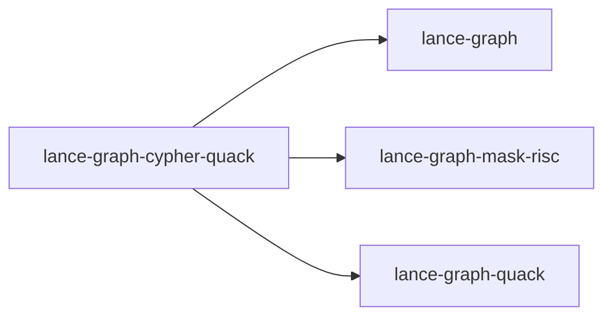

# lance-graph-cypher-quack

crate: lance-graph-cypher-quack
path: crates/lance-graph-cypher-quack
workspace: member
digest: 003e14de37585ab8
evidence legend: ../index.md#evidence-legend

Generated; the code is the truth. See ../index.md.

## Depends on

- dep lance-graph normal — crates/lance-graph-cypher-quack/Cargo.toml:15 CONFIRMED
- dep lance-graph-mask-risc normal — crates/lance-graph-cypher-quack/Cargo.toml:17 CONFIRMED
- dep lance-graph-quack normal — crates/lance-graph-cypher-quack/Cargo.toml:16 CONFIRMED
- dep arrow-array dev — crates/lance-graph-cypher-quack/Cargo.toml:22 CONFIRMED
- dep arrow-schema dev — crates/lance-graph-cypher-quack/Cargo.toml:23 CONFIRMED
- dep serde dev — crates/lance-graph-cypher-quack/Cargo.toml:24 CONFIRMED
- dep serde_json normal — crates/lance-graph-cypher-quack/Cargo.toml:18 CONFIRMED
- dep tokio dev — crates/lance-graph-cypher-quack/Cargo.toml:25 CONFIRMED

## Depended on by

## Public items

- enum Demand [pub] — crates/lance-graph-cypher-quack/src/demand.rs:51 CONFIRMED
- fn classify [pub] — crates/lance-graph-cypher-quack/src/demand.rs:68 CONFIRMED
- mod demand [pub] — crates/lance-graph-cypher-quack/src/lib.rs:48 CONFIRMED
- enum Kind [pub] — crates/lance-graph-cypher-quack/src/lib.rs:71 CONFIRMED
- struct NodeTable [pub] — crates/lance-graph-cypher-quack/src/lib.rs:83 CONFIRMED
- struct EdgeTable [pub] — crates/lance-graph-cypher-quack/src/lib.rs:95 CONFIRMED
- struct Binding [pub] — crates/lance-graph-cypher-quack/src/lib.rs:113 CONFIRMED
- fn Binding::graph_config [pub] — crates/lance-graph-cypher-quack/src/lib.rs:124 CONFIRMED
- enum Refusal [pub] — crates/lance-graph-cypher-quack/src/lib.rs:164 CONFIRMED
- enum ResultShape [pub] — crates/lance-graph-cypher-quack/src/lib.rs:196 CONFIRMED
- enum On [pub] — crates/lance-graph-cypher-quack/src/lib.rs:205 CONFIRMED
- struct Compiled [pub] — crates/lance-graph-cypher-quack/src/lib.rs:215 CONFIRMED
- enum Answer [pub] — crates/lance-graph-cypher-quack/src/lib.rs:228 CONFIRMED
- fn compile [pub] — crates/lance-graph-cypher-quack/src/lib.rs:236 CONFIRMED
- fn lower_plan [pub] — crates/lance-graph-cypher-quack/src/lib.rs:256 CONFIRMED
- struct TableLanes [pub] — crates/lance-graph-cypher-quack/src/lib.rs:695 CONFIRMED
- fn Compiled::execute [pub] — crates/lance-graph-cypher-quack/src/lib.rs:705 CONFIRMED

## Imports from in-scope crates

### lance-graph
- use lance_graph::ast::BooleanExpression — crates/lance-graph-cypher-quack/src/demand.rs:31 CONFIRMED
- use lance_graph::ast::ValueExpression — crates/lance-graph-cypher-quack/src/demand.rs:31 CONFIRMED
- use lance_graph::logical_plan::LogicalOperator — crates/lance-graph-cypher-quack/src/demand.rs:32 CONFIRMED
- use lance_graph::config::GraphConfig cfg=test — crates/lance-graph-cypher-quack/src/demand.rs:304 CONFIRMED
- use lance_graph::logical_plan::LogicalPlanner cfg=test — crates/lance-graph-cypher-quack/src/demand.rs:305 CONFIRMED
- use lance_graph::parser::parse_cypher_query cfg=test — crates/lance-graph-cypher-quack/src/demand.rs:306 CONFIRMED
- use lance_graph::ast::BooleanExpression — crates/lance-graph-cypher-quack/src/lib.rs:53 CONFIRMED
- use lance_graph::ast::ComparisonOperator — crates/lance-graph-cypher-quack/src/lib.rs:53 CONFIRMED
- use lance_graph::ast::PropertyValue — crates/lance-graph-cypher-quack/src/lib.rs:53 CONFIRMED
- use lance_graph::ast::RelationshipDirection — crates/lance-graph-cypher-quack/src/lib.rs:53 CONFIRMED
- use lance_graph::ast::ValueExpression — crates/lance-graph-cypher-quack/src/lib.rs:53 CONFIRMED
- use lance_graph::config::GraphConfig — crates/lance-graph-cypher-quack/src/lib.rs:55 CONFIRMED
- use lance_graph::logical_plan::LogicalOperator — crates/lance-graph-cypher-quack/src/lib.rs:56 CONFIRMED
- use lance_graph::logical_plan::LogicalPlanner — crates/lance-graph-cypher-quack/src/lib.rs:56 CONFIRMED
- use lance_graph::logical_plan::ProjectionItem — crates/lance-graph-cypher-quack/src/lib.rs:56 CONFIRMED
- use lance_graph::parser::parse_cypher_query — crates/lance-graph-cypher-quack/src/lib.rs:57 CONFIRMED
- use lance_graph::semantic::SemanticAnalyzer — crates/lance-graph-cypher-quack/src/lib.rs:58 CONFIRMED
### lance-graph-mask-risc
- use lance_graph_mask_risc::ExecError — crates/lance-graph-cypher-quack/src/lib.rs:60 CONFIRMED
- use lance_graph_mask_risc::Foreign — crates/lance-graph-cypher-quack/src/lib.rs:60 CONFIRMED
- use lance_graph_mask_risc::ForeignPlane — crates/lance-graph-cypher-quack/src/lib.rs:60 CONFIRMED
- use lance_graph_mask_risc::LaneRef — crates/lance-graph-cypher-quack/src/lib.rs:60 CONFIRMED
- use lance_graph_mask_risc::Out — crates/lance-graph-cypher-quack/src/lib.rs:60 CONFIRMED
- use lance_graph_mask_risc::Planes — crates/lance-graph-cypher-quack/src/lib.rs:60 CONFIRMED
- use lance_graph_mask_risc::Program — crates/lance-graph-cypher-quack/src/lib.rs:60 CONFIRMED
- use lance_graph_mask_risc::execute_into — crates/lance-graph-cypher-quack/src/lib.rs:60 CONFIRMED
- use lance_graph_mask_risc::words_for — crates/lance-graph-cypher-quack/src/lib.rs:60 CONFIRMED
- use lance_graph_mask_risc::Scratch — crates/lance-graph-cypher-quack/src/lib.rs:61 CONFIRMED
- use lance_graph_mask_risc::Value — crates/lance-graph-cypher-quack/src/lib.rs:61 CONFIRMED
### lance-graph-quack
- use lance_graph_quack::Agg — crates/lance-graph-cypher-quack/src/lib.rs:63 CONFIRMED
- use lance_graph_quack::Cmp — crates/lance-graph-cypher-quack/src/lib.rs:63 CONFIRMED
- use lance_graph_quack::Col — crates/lance-graph-cypher-quack/src/lib.rs:63 CONFIRMED
- use lance_graph_quack::Filter — crates/lance-graph-cypher-quack/src/lib.rs:63 CONFIRMED
- use lance_graph_quack::ForeignPlane as FP — crates/lance-graph-cypher-quack/src/lib.rs:63 CONFIRMED
- use lance_graph_quack::Mask — crates/lance-graph-cypher-quack/src/lib.rs:63 CONFIRMED
- use lance_graph_quack::Query — crates/lance-graph-cypher-quack/src/lib.rs:63 CONFIRMED
- use lance_graph_quack::lower — crates/lance-graph-cypher-quack/src/lib.rs:63 CONFIRMED

## Calls

CALL_GRAPH=ARTIFACT_MISSING
- calls ARTIFACT_MISSING — no ruff_charon artifact for this crate UNKNOWN

## Architecture

- none

Generated from Cargo manifests — extracted relationships only.

